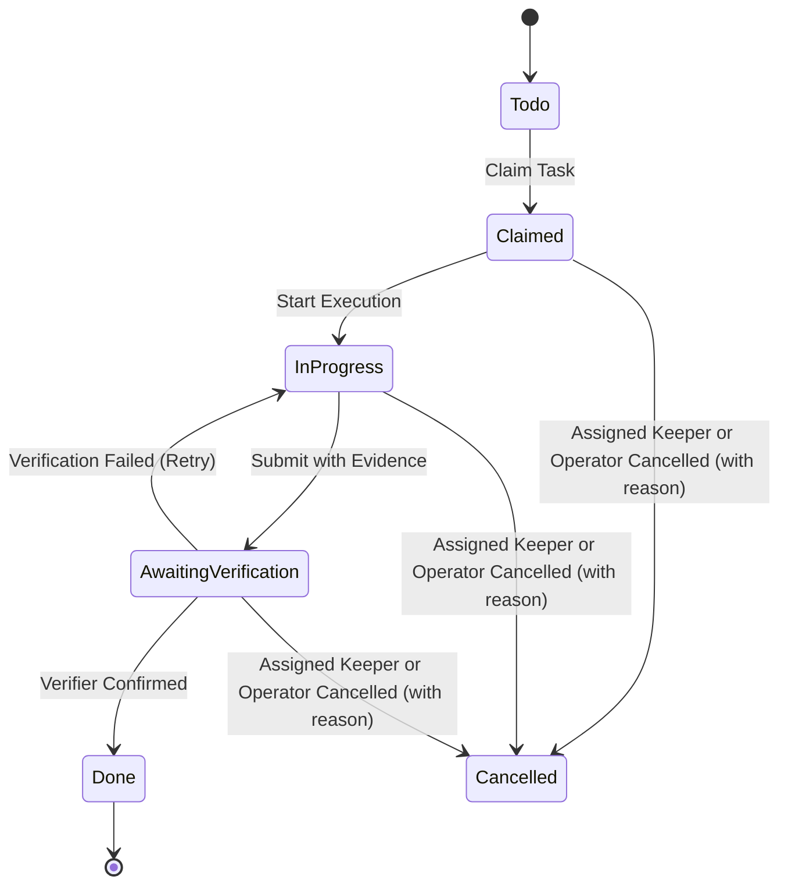

## What is a Keeper?

A **Keeper** is a long-running, supervised agent that retains persistence across multiple turns and collaborates inside the MASC workspace. Rather than executing single-shot prompts, it maintains state across turns and submits work through verifier gates.

Key attributes:
- **Turn Continuity**: Does not forget context or reset identity between turns.
- **Verification Gate**: Cannot unilaterally declare completion without passing verification.
- **Failover Discipline**: Gracefully falls back across configured model providers during rate limits.

---

## Task Lifecycle

Tasks move through a clear 6-state lifecycle (`Todo`, `Claimed`, `InProgress`, `AwaitingVerification`, `Done`, `Cancelled`). An assigned Keeper can also cancel its own Task directly with a reason (including from `AwaitingVerification`), without requiring verifier approval:



---

## Configuration Example

Defined in `<base-path>/.masc/config/keepers/<name>.toml`. `masc keeper-create`
writes this for you; the fields are documented in the
[Configuration Reference](/reference/config/):

```toml
[keeper]
activation_mode = "autonomous"  # "manual" | "reactive" | "scheduled" | "autonomous"
sandbox_profile = "docker"      # "docker" | "microvm" | "remote_ssh" (no "local" or host profile)
sandbox_image = "base"          # "base" | "ocaml" (promoted in sandbox-image-builds.toml)
network_mode = "inherit"        # "none" | "inherit" | "policy"
instructions = """
You are the review Keeper. Inspect the current change and report concrete
evidence with file paths and commands.
"""

[keeper.tools]
native = "read"              # "none" | "read" | "full"
```

Valid `sandbox_profile` values are `"docker"`, `"microvm"`, or `"remote_ssh"` (there is no `"local"` or host profile). Which model a Keeper's turns use comes from `runtime.toml` — `[runtime].default`,
or a lane the Keeper's work maps to. See the
[Configuration Reference](/reference/config/#runtimetoml) for how model bindings
and lanes are declared.
