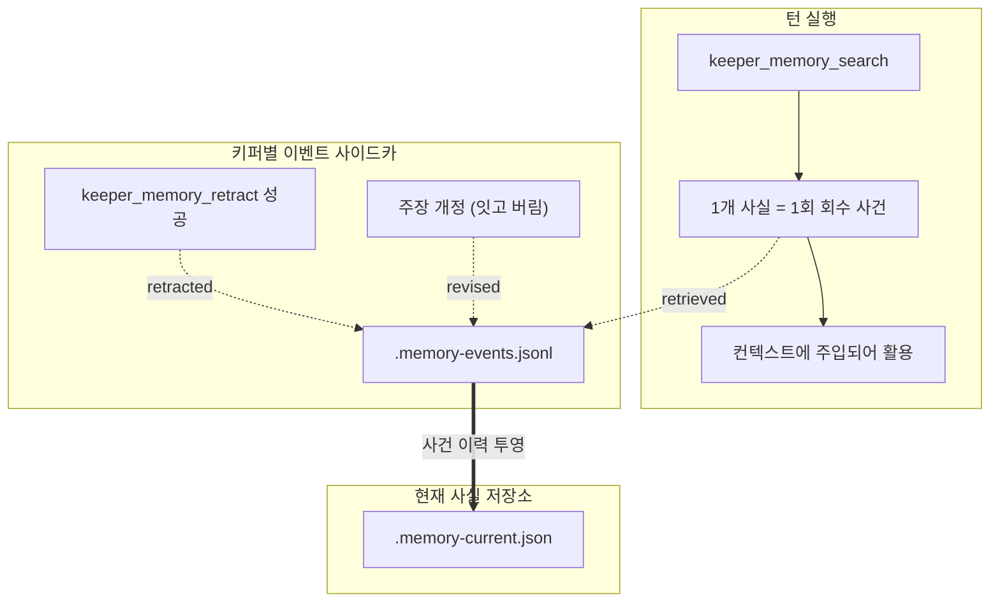

키퍼 장기 기억(Keeper Long-Term Memory)은 키퍼가 학습한 사실을 턴 너머로 유지하는 하위 시스템입니다. 사실은 키퍼별 저장소에 파일로 남고, 서버를 다시 띄워도 사라지지 않으며, 다음 턴의 컨텍스트에 다시 주입됩니다.

---

## 두 개의 키퍼별 저장소

키퍼마다 두 개의 개인 기억 저장소가 있습니다.

| 저장소 | 무엇을 담나 |
|---|---|
| 일반 저장소 (ordinary) | 키퍼의 현재 사실 |
| 원천 결속 저장소 (source-bound) | 원천 자료에 결속된 사실과 그 무효화(invalidation) 기록 |

일반 저장소 스냅샷은 없고 원천 결속 스냅샷만 남은 키퍼는 `source-only`로 표시됩니다. 터미널 UI의 Memory 화면(`:go Memory`)은 이 두 저장소의 건강 상태를 키퍼별로 보여 줍니다.

---

## 사용 기반 강화 (RFC-0418)

같은 주장이 다시 관측될 때 카운터를 올리는 방식은 작동하지 않습니다. LLM은 같은 사실이라도 바이트 단위로 똑같이 재생성하지 않으므로, 정적 재관측 카운터는 0에 머뭅니다.

키퍼 장기 기억은 **"기억은 다시 꺼내 쓸 때 굳는다"**는 원칙을 따릅니다:

### 1. 타입화된 사이드카 이벤트 스트림
각 키퍼는 기억 이력 사건을 단일 JSONL 사이드카(`<keeper>.memory-events.jsonl`)에 순차 기록합니다. 종류는 닫힌 세 가지입니다:
* `retrieved`: 사실이 `keeper_memory_search`가 어떤 질의에 대해 반환한 결과에 들어 있을 때 1건.
* `retracted`: `keeper_memory_retract`가 `memory_id`로 지목한 사실을 실제로 철회했을 때 1건.
* `revised`: librarian이 이 사실을 잇는 새 주장을 쓰고 이것을 버릴 때. `superseded_by`에 새 사실의 id가 남습니다.

버려진 사실의 사건도 지워지지 않습니다 — 사건은 사실보다 오래 남고, 읽는 쪽은 살아 있는 사실에만 붙여 봅니다. 같은 주장이 다시 추가되면 API 행과 터미널 UI는 그 사실의 회수·철회·개정 이력을 이 사이드카에서 보여 줍니다.

### 2. 정적 카운터 제거
사실 저장소에서 의미를 잃은 정적 정수 카운터(`fact.reinforcement`)를 걷어냈습니다. 터미널 UI의 사실 행에는 이 사건들에서 모은 회수 횟수·회수한 날 수·마지막 회수·철회 횟수·개정 원본 수가 그대로 표시됩니다.

---

## 심사와 정리: librarian 레인

기억 정리는 키퍼 실행과 분리된 백그라운드 레인(librarian)이 맡습니다. 후보 사실은 인출(recall) 가능한 현재 저장소에 들어가기 전에 먼저 Librarian admission 대기열을 거쳐 심사됩니다. librarian은 키퍼의 instructions, 현재 기억 전체, 한정된 분량의 새 대화를 읽고 구조화 JSON으로 판정합니다:

* 기존 기억 ID는 전부 `retained_memory_ids`(유지) 또는 `dropped`(사유 한 문장과 함께 제거) 중 정확히 한 곳에 나와야 합니다. 어느 쪽에도 없는 ID는 판정 전체를 거부시킵니다.
* 무엇이 중요한지는 그 키퍼의 책무와 진행 중인 일에 상대적으로 판단합니다. 범용 어시스턴트에게 무가치한 사실이 이 키퍼에게는 핵심일 수 있습니다.
* 목표 항목 수도, 판정 뒤의 결정론적 순위 매김도 없습니다. 수치 점수나 감쇠 곡선은 쓰지 않습니다.

터미널 UI의 Memory 화면(`:go Memory`)은 레인 상태(`librarian lane-busy · failures`)를 키퍼별로 보여 줍니다.

---

## 공유 워크스페이스 기억과 워크스페이스 위키

키퍼별 저장소 외에도 키퍼들은 워크스페이스 단위의 두 지식 표면을 함께 씁니다:

* **공유 워크스페이스 기억 및 Curator 브리핑**: 키퍼들이 교차 관측 사실을 append-only 워크스페이스 기억 원장에 기록하면, Curator 레인이 이를 종합해 공유 브리핑으로 발행합니다. 키퍼는 `keeper_workspace_memory_read`와 `keeper_memory_select`(`[typesafeai] workspace_memory_selection_enabled = true`일 때)로 브리핑을 읽거나 현재 판단에 필요한 사실을 선별합니다.
* **워크스페이스 위키 (`<base-path>/.masc/wiki`)**: 키퍼와 MCP 클라이언트가 `keeper_wiki_*` 및 `masc_wiki_*` 도구(`list`, `read`, `search`, `create`, `update`, `lint`)로 관리하는 구조화 마크다운 위키입니다. `runtime.toml`에 `[wiki_contents] enabled = true`(기본값)가 켜져 있으면, 매 키퍼 턴 시작 시 위키 목차(제목·파일·요약 한 줄씩)가 컨텍스트에 포함됩니다.

---

## 터미널 UI에서 보기

커맨드 팔레트에서 `:go Memory`로 Memory 화면을 엽니다(상단 7개 `Tab` 링이 아닌 별도 진입 화면입니다). `Enter`를 누르면 팩트 브라우저가 열립니다. `c`/`C`는 카테고리 필터, `s`는 정렬(최신, 마지막 인출, 인출 횟수, 카테고리, 내용), `/`는 텍스트 필터입니다. 자세한 키는 [터미널 UI 가이드](/ko/guides/tui/)를 보세요.
