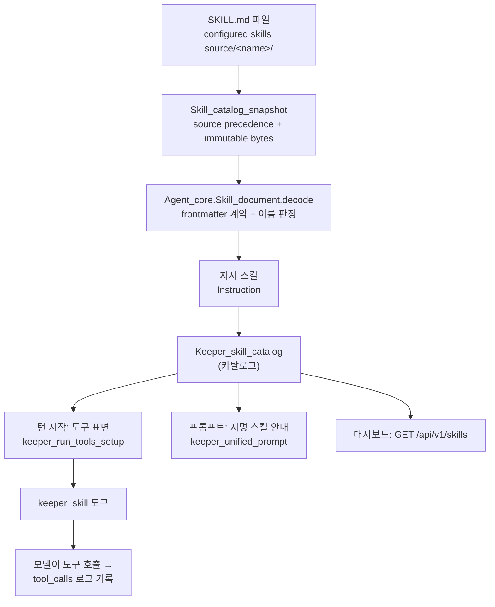
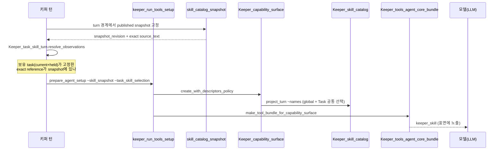

# Skills — 어떻게 도는가 (흐름 + 코드 경로)

`docs/SKILLS.md`는 SKILL.md를 **어떻게 쓰는가**를 다룬다. 이 문서는 그 선언이
런타임에서 **어떻게 도는가**를 순서도와 코드 위치로 정리한다.

## 0. 한 눈에

스킬은 `runtime.toml`의 `[[skills.sources]]` 아래 `<name>/SKILL.md` 파일 하나로 선언한다.
Keeper는 `keeper_skill` 도구로 본문을 읽는다. 같은 카탈로그를 세 곳이 읽는다:
턴 시작(도구 표면 조립), 프롬프트(지명된 스킬 안내), 대시보드(`/api/v1/skills`).

## 1. 선언과 파싱 — 한 곳의 권위

**파일 → 문서**: `Agent_core.Skill_document.decode`
(`packages/agent_core/lib/skill_document.ml`)가 SKILL.md의 frontmatter 계약을
강제한다. frontmatter `name`과 디렉터리 이름은 둘 다 공식 이름 문법을 만족하고 정확히
같아야 한다. `name` 누락·불일치·문법 오류와 다른 frontmatter 진단은 그 문서를 snapshot
rejection으로 격리한다. 디렉터리 이름으로 복구하거나 다른 Skill까지 멈추지 않는다.

**문서 → 스킬**: `Keeper_skill_catalog.parse_skill`
(`lib/keeper/keeper_skill_catalog.ml`)이 decode를 통과한 문서를 지시 스킬
(`surface = Instruction`)로 만든다.

알 수 없는 top-level field는 Agent Skills 문서 admission에서 거부한다.
Agent Skills의 실험적 선택 필드 `allowed-tools`는 string 문법만 검증하고 즉시 버린다.
MASC 승인이나 도구 제한으로 해석하지 않으며 AST, registry, prompt, Gate, Keeper
effective surface, immutable snapshot entry에 값을 남기지 않는다. 원본 `SKILL.md`를
편집할 때 보이는 source text는 이식성을 위한 round-trip 원문이지 정책 상태가 아니다.

**snapshot → 표면**: `Skill_catalog_snapshot`이 source scan 결과와 진단을 먼저
불변 snapshot으로 발행하고, `Keeper_skill_catalog.prepare_snapshot`이 그 snapshot을 runtime
surface로 한 번 투영한다. task가 지명한 exact reference가 snapshot에서 해소되지 않을
때만 admission이 typed error를 반환한다.
SKILL.md가 없는 디렉터리는 스킬이 아니므로 source scanner가 조용히 건너뛴다.

## 2. 카탈로그를 읽는 세 소비자

카탈로그의 권위는 `Skill_catalog_snapshot_service`가 발행한 snapshot 하나다. turn
orchestrator가 turn 경계에서 snapshot을 고정하고 `prepare_agent_setup ~skill_snapshot`에
전달한다. setup, prompt, effective surface, `/api/v1/skills`는 이 snapshot 또는 그 exact
reference를 소비한다. 각 소비자가 파일을 다시 scan/refresh하지 않는다:

### 2a. 턴 시작 — 도구 표면

턴(`keeper_turn.ml`, `keeper_unified_turn.ml`)이 먼저
`Keeper_task_skill_turn.resolve_live_observations`가 Tool descriptor를 먼저 고정하고,
**보유한 모든 task**(current + 나머지 Claimed/InProgress, task-364 수리)의 exact reference를
묶어 서로 다른 참조마다 한 번 해석한다. 공유 참조에는 모든 Task ID가 남는다.
`prepare_agent_setup`(`keeper_run_tools_setup.ml`)은 그 결과를 받는다. snapshot 객체와
descriptor 객체들이 같으면 같은 불변 선택을 재사용하고, 입력이 바뀌면 원래 참조를 재해석한다.
실행 setup과 기존 선택이 주어진 effective surface는 `Keeper_task_skill_turn.bind_surface`에서
선택과 그 입력에 맞는 catalog/diagnostic/inventory 준비 결과를 함께 받는다. 새 참조를 받은
effective surface는 `resolve_surface`에서 해석과 준비 쌍을 바로 받는다. 바인딩 직후
같은 입력으로 준비를 다시 검증하지 않는다. 선택 authority 검증과 exact snapshot/descriptor
객체 일치는 유지하며, 새로 해석한 경우에는 그 해석이 만든 선택·준비 쌍을 그대로 반환한다.
표시용 `prepare_surface`는 이미 선택한 Task 참조를 다시 해석하지 않는 별도 관측 계약이다.
설정이 정상인 snapshot에서 해소되지 않는 reference(pin한 Skill을 고치거나 지운 경우)와
catalog가 투영하지 못하는 entry는 그 Task의 unavailable row이며 턴을 막지 않는다.
이유(`error_code`, `detail`)는 prompt와 로그에 보인다. Skill 설정이 거절됐거나 읽히지 않은
snapshot은 entry가 없어서 모든 pin이 "삭제됨"으로 보이므로, pin이 하나라도 있으면
`Skill_config_rejected` / `Skill_config_unreadable`로 턴을 실패시킨다.
pin한 source를 성공적으로 읽지 못했거나(스캔 실패·미확인·경로 문제 등) pin한 package의
문서를 읽지 못한 경우도 Skill이 아직 있을 수 있으므로 `Skill_source_unreadable` /
`Skill_entry_unreadable`로 턴을 실패시킨다. 해소되지 않는 pin을 stale(삭제·수정됨)로
내리는 것은 성공적으로 읽힌 source에 대해서만 한다. Profile 이름 선택에서 제외된 알려진
Task Skill도 실행 projection과 prompt에서 unavailable이며 admission 전체를 막지 않는다.
지시 본문은 `keeper_skill`이 직접 서빙하므로 `Read`와 무관하다. 통과하면:

- `Keeper_capability_surface`가 Keeper profile의 `[keeper.skills].names`를 global과
  Task-selected Skill에 한 번 적용한다. 없음은 all, 빈 배열은 none이다. exact canonical
  name equality만 사용한다.
- 설정에만 있는 이름은 `Configured_skill_name_unavailable`로 남기며 다른 Skill은 막지 않는다.
- `keeper_skill` 도구 하나가 표면에 오른다(`make_instruction_skill_tool`,
  `keeper_instruction_skill.ml`). 본문은 이 도구가 서빙한다(#30635 이후
  파일시스템 프로비저닝 불필요).

#### 턴 준비 재사용과 준비 단계 관측

직접·자율 턴의 Skill 해석, 문맥·프롬프트 조립, 준비 단계 관측은 다음 불변 경계를 따른다.

- **Task 참조 묶기와 준비 결과 공유 (`Keeper_skill_catalog.prepared`)**:
  - 여러 Task가 같은 exact Skill 참조를 가리키면 해석 전에 묶어 한 번만 해석하고 각 Task 출처 목록을 보존한다.
  - 스냅샷은 `Skill_reference.Identity_map`(`source_id`, `package_id`, `name`) 기반 exact 인덱스와 이름별 첫 source 유효 항목 인덱스를 불변 값으로 보유한다 (`O(log E)` 조회).
  - 스냅샷은 `Ephemeron.K1`, Tool descriptor 목록은 각 descriptor를 약한 키로 갖는 `Ephemeron.Kn`에 결속하여 살아 있는 입력에 대해서만 완성된 카탈로그·diagnostic·inventory 준비 결과를 공유한다.
  - Lane add-on worker는 backend 시작마다 고유 owner token을 발급하고 `Ephemeron.K2`/`K1`으로 동일 owner·Tool 객체의 export와 canonical descriptor를 재사용하되, 실제 호출 경계에서는 현재 가시성·phase·schema·owner 일치를 매번 다시 검증한다.
  - `bind_surface`의 성공 결과는 `(selection, preparation)`이며, 재사용 경로는 기존 선택과 준비 객체를 그대로 공유한다. 새 exact 참조는 `resolve_surface`에서 같은 입력으로 만든 쌍을 바로 받고, selection만 필요한 해석은 그 형태를 바로 투영한다. 바인딩 뒤 별도의 `prepare_surface` 검사는 없다.
  - 기존 선택의 성공 바인딩에서 `prepared_matches` 호출은 2회에서 1회로 줄었으며 별도의 선택 authority 비교는 유지한다. `Retained_turn_surface`는 준비가 성공한 뒤 기존 의미로 한 번 남고, config/source/pin 오류·Task 출처·실제 Tool 권한·자원 소유권 검증은 바꾸지 않는다. 이는 소스상 검사 호출 수이며 준비 시간·모델 왕복 감소 실측이 아니다.
- **도구 이름 투영 (`Keeper_run_tools_setup`)**:
  - official-client·Agent Core 표면의 검증은 공통 descriptor·Skill 이름 목록을 setup당 한 번 계산하고, 실제 지연 도구·대화에 유지된 스키마·연결 도구 목록은 각 표면에 맞춰 검증한다.
- **공통 world 입력 병렬 조회와 worker 수명 (`Keeper_turn_shared_inputs.observe`, `Executor_pool`)**:
  - 직접·자율 진입 경로가 공통으로 읽는 Lane 구독 참조, workspace memory 관측, wiki 목차 조회는 Eio에서 중첩 `Eio.Fiber.pair`로 병렬 실행하고 합류 뒤 한 번 로그·gauge를 기록한다.
  - `Executor_pool` 제출은 `Awaiting_worker` / `Entered_worker` / `Cancelled_before_entry` 상태를 원자적으로 추적하며, 호출자 대기가 취소되면 진입 전 작업을 retire하거나 이미 진입한 worker의 취소 컨텍스트에 전달하고 정리 완료를 기다린 뒤 원래 취소를 전파한다(실패한 함수를 호출자에서 inline 재실행하지 않는다).
- **프롬프트 공통 결과 재사용 (`prepare_prompt`, `Keeper_direct_turn_context.prepare`)**:
  - 자율 실행은 21개 layer 중 17개 공통 layer의 텍스트와 SHA-256 digest를 cycle당 한 번 준비하고, `Workspace_memory`·`Wiki`·`Own_recent_actions`·`Recent_work` 4개 동적 layer만 실제 요청의 Tool 접근 권한과 행동 관측에 맞춰 투영한다.
  - 직접 요청도 Task·held Skills·Lane 안내·승인 관측·대화 suffix를 한 번 준비하고, 요청별 Tool 접근 권한에 따라 memory·wiki 안내만 다시 투영한다.
- **실행 결속 준비 단계 관측과 종료 보고서 (`Keeper_turn_preview`, `Keeper_preparation_runtime_observation`)**:
  - 직접·자율 실행은 Task 입력을 읽기 직전에 실행 전용 preview writer(Owner interrupt token 및 원래 turn/execution reference 결속)를 생성하고, `Task`·`Skill`·`World`(`Lane`·`Memory`·`Wiki`)·`Context`·`Tool`·`Prompt` 준비 scope의 시작·종료·상태(`active`, `prepared`, `rejected`, `raised`, `cancelled`)와 단조 시계 소요 시간을 start-ordered 불변 Map에 기록한다.
  - 실행 중에는 `/api/v1/keepers/turns`(`preparation_details_for=<name>`)가 그 Keeper의 준비 단계 이력을 함께 돌려준다.
  - 실행이 반환·예외·취소로 끝나면 `with_turn`이 해당 writer의 준비 단계 기록을 runtime manifest(`Preparation_observed`)에 한 번 append하고, 직접 실행이 응답 생성 전에 실패한 경우에도 생성된 `Turn_ref`를 canonical failure의 `outcome_ref`에 남긴다.
  - 종료된 실행의 준비 이력은 `GET /api/v1/keepers/<name>/runtime-trace`의 저장 보고서에서 읽는다. Owner가 다음 작업으로 이동한 뒤에도 남는다.

### 2b. 프롬프트 — 지명된 스킬 안내

`task.skills`(`masc_add_task`가 지정, `lib/task/tool_task_handlers.ml`의
`parse_task_skills`)는 백로그에 저장된다. 프롬프트는 이걸 두 블록으로 싣는다
(`lib/keeper/keeper_unified_prompt.ml`):

- **current task 블록**: `format_task_skills`
  (`config/prompts/keeper.md` 의 `current_task.skills` 슬롯).
- **Skills Named by Tasks You Hold 블록**(task-364): current 말고 다른 보유 task가
  지명한 스킬을 task별 한 줄씩. `format_held_task_skills`
  + `config/prompts/keeper.md` 의 `held_task.skills` / `held_task.skills_heading` 슬롯. 이유: `current_task_id`는
  소유에서 reconcile되고 이미 current가 있으면 유지되므로, 두 번째 task를 claim해도
  그 스킬이 current 블록에 안 실린다. 그래서 별도 블록으로 뽑는다.

두 블록 모두 canonical exact reference와 그 turn의 typed surface를 싣는다(본문 X).
Keeper는 그 객체를 그대로 `keeper_skill`에 전달한다. 실행 불가능한 reference는
unavailable로 표시한다. 이름-only fallback은 없다. 본문은 매 턴 prompt에 넣지 않고
필요할 때 읽는다.

### 2c. 대시보드 — GET /api/v1/skills

`lib/server/server_routes_http_routes_activity.ml`. 발행된 워크스페이스 스냅샷
(`masc.skill-snapshot/v1`, `lib/skill_snapshot`)과 snapshot의 모든 entry를 대상으로 한
exact surface를 함께 투영한다. shadow entry도 빠지지 않는다. join key는
source/package/name/content revision 전체이며,
instruction/unavailable과 typed projection diagnostics를 표시한다.

같은 projection은 각 Skill의 `activation_tool`과 본문/discovery 바이트를 `profile`로
내보낸다. 본문은 언제나 deferred로 남아 매 턴 prompt에 실리지 않는다.
Keeper별 effective tool surface에는 전체 schema 바이트와 그중 Skill 때문에 추가된
바이트를 따로 내보내므로, 점진 공개의 이득과 도구 표면 비용을 함께 확인할 수 있다.

### 2d. 편집 — Skill Studio

대시보드 Monitor › Skills의 Skill Studio는 exact reference로
`/api/v1/skills/editor/read` → `/preview` → `/save`를 호출하고 서버가 다음을 순서대로
강제한다.

1. CanAdmin 인증과 source의 `read-write` 선언
2. published content revision과 현재 디스크 bytes의 CAS 일치
3. Agent Skills 문서 검증
4. ownership-root 아래 durable atomic write
5. 전체 workspace snapshot 재발행 및 candidate revision readback

외부 편집이 먼저 들어갔으면 `revision_conflict`로 저장하지 않는다. write 뒤 재발행만
실패한 드문 경우는 `saved_but_unpublished`로 분리해 파일이 바뀐 사실을 숨기지 않는다.

새 Skill은 **+ New Skill**로 만들고 원문을 `/api/v1/skills/editor/create`에 보낸다.
같은 이름의 package가 이미 있으면 덮어쓰지 않고 `package_already_exists`로 거절한다.
삭제는 서버의 `DELETE /api/v1/skills/editor`(exact reference + `confirmed`)로 한다.
삭제본은 소스 루트의 `.masc-skill-delete-recovery/` 에 quarantine 로 남는다. 웹
대시보드에는 삭제 조작이 없다.

## 3. 실행과 관측

모델이 `keeper_skill`에 exact reference를 넘기면 `Keeper_instruction_skill`
(`lib/keeper/keeper_instruction_skill.ml`)이 frozen snapshot의 지시 본문을 돌려준다.
선택 인자 `file`을 함께 넘기면 그 Skill의 리소스 파일 원문을 돌려준다. 읽을 때마다
`masc_keeper_skill_reads_total` 계수와 Keeper 로그 한 줄이 남는다. 호출은 다른 도구와
같이 `tool_calls` 스토어(`lib/keeper_tool_call_log.ml`)에 남는다.

## 4. 라이브 배치

파일 위치와 우선순위는 `<base>/.masc/config/runtime.toml`의
`[[skills.sources]]`만이 정한다. source 수나 Skill 이름을 코드·문서에 고정하지 않는다.
서버는 발행 snapshot revision을 API/effective surface에 투영하며, 새 배치 후에는
`/health`의 `binary_commit`과 snapshot revision을 함께 확인한다.
