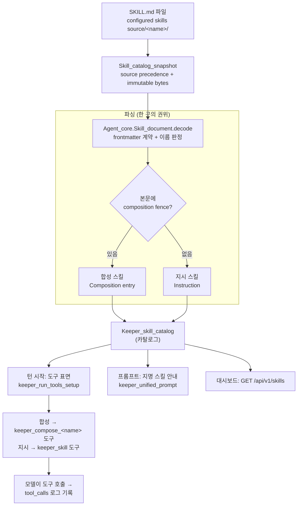
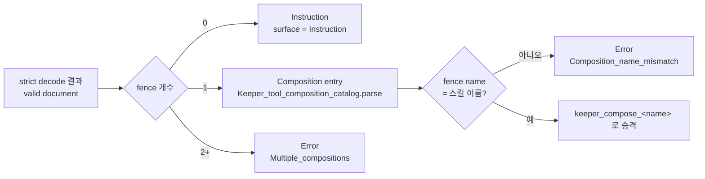
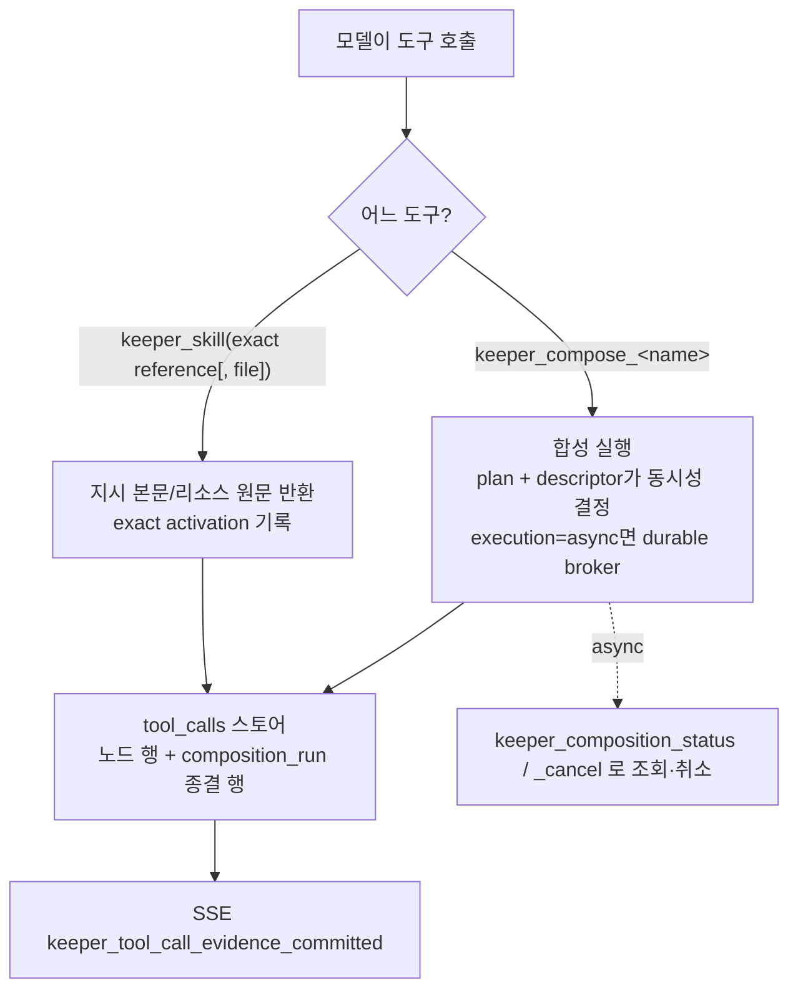

# Skills — 어떻게 도는가 (흐름 + 코드 경로)

`docs/SKILLS.md`는 SKILL.md를 **어떻게 쓰는가**를 다룬다. 이 문서는 그 선언이
런타임에서 **어떻게 도는가**를 순서도와 코드 위치로 정리한다. 설계 근거는
`docs/rfc/RFC-skills-as-tools.md`.

## 0. 한 눈에

스킬은 `runtime.toml`의 `[[skills.sources]]` 아래 `<name>/SKILL.md` 파일 하나로 선언한다. 본문에
```` ```toml composition ```` fence가 있으면 **합성 스킬**(도구가 된다), 없으면
**지시 스킬**(`keeper_skill` 도구로 본문을 읽는다). 같은 카탈로그를 세 곳이 읽는다:
턴 시작(도구 표면 조립), 프롬프트(지명된 스킬 안내), 대시보드(`/api/v1/skills`).



## 1. 선언과 파싱 — 한 곳의 권위

**파일 → 문서**: `Agent_core.Skill_document.decode`
(`packages/agent_core/lib/skill_document.ml`)가 SKILL.md의 frontmatter 계약을
강제한다. frontmatter `name`과 디렉터리 이름은 둘 다 공식 이름 문법을 만족하고 정확히
같아야 한다. `name` 누락·불일치·문법 오류와 다른 frontmatter 진단은 그 문서를 snapshot
rejection으로 격리한다. 디렉터리 이름으로 복구하거나 다른 Skill까지 멈추지 않는다.

**문서 → 스킬**: `Keeper_skill_catalog.parse_skill`
(`lib/keeper/keeper_skill_catalog.ml`)가 본문의 composition fence를 본다.



fence 개수가 유일한 갈림길이다. 알 수 없는 top-level field는 Agent Skills 문서
admission에서 거부한다.
Agent Skills의 실험적 선택 필드 `allowed-tools`는 string 문법만 검증하고 즉시 버린다.
MASC 승인이나 도구 제한으로 해석하지 않으며 AST, registry, prompt, Gate, Keeper
effective surface, immutable snapshot entry에 값을 남기지 않는다. 원본 `SKILL.md`를
편집할 때 보이는 source text는 이식성을 위한 round-trip 원문이지 정책 상태가 아니다.
composition의 종류는 본문으로 정한다. 유효한 composition이라도 노드 도구가 현재
Keeper 표면에 없으면 합성 도구를 숨기고 `node_tools_outside_surface`를 표시한다
(`Keeper_capability_surface`). 문서용 예시는 더 긴 CommonMark 외부 fence로 감싼다.

**실패와 편차는 다르다**: `Skill_catalog_snapshot`이 source scan 결과와 진단을 먼저
불변 snapshot으로 발행하고, `Keeper_skill_catalog.of_snapshot`이 그 snapshot을 runtime
surface로 한 번 투영한다. 잘못된 composition은 임의로 버리거나 turn 전체를 실패시키지
않고 frozen Instruction과 typed projection diagnostic으로 남는다. 그 exact reference를
task가 지명했는데 snapshot에서 해소되지 않을 때만 admission이 typed error를 반환한다.
SKILL.md가 없는 디렉터리는 스킬이 아니므로 source scanner가 조용히 건너뛴다.

## 2. 카탈로그를 읽는 세 소비자

카탈로그의 권위는 `Skill_catalog_snapshot_service`가 발행한 snapshot 하나다. turn
orchestrator가 turn 경계에서 snapshot을 고정하고 `prepare_agent_setup ~skill_snapshot`에
전달한다. setup, prompt, effective surface, `/api/v1/skills`는 이 snapshot 또는 그 exact
reference를 소비한다. 각 소비자가 파일을 다시 scan/refresh하지 않는다:

```mermaid
sequenceDiagram
  participant Turn as 키퍼 턴
  participant Setup as keeper_run_tools_setup
  participant Snap as skill_catalog_snapshot
  participant Cat as Keeper_skill_catalog
  participant Surface as keeper_tool_composition_surface
  participant Model as 모델(LLM)

  Turn->>Snap: turn 경계에서 published snapshot 고정
  Snap-->>Turn: snapshot_revision + exact source_text
  Turn->>Turn: Keeper_task_skill_turn.resolve_observations
  Note over Turn: 보유 task(current+held)가 고정한<br/>exact reference가 snapshot에 있나
  Turn->>Setup: prepare_agent_setup ~skill_snapshot ~task_skill_selection
  Setup->>Cat: of_snapshot
  Setup->>Cat: project_turn ~names (global + Task 공통 선택)
  Setup->>Surface: make_tools ~instruction_skills ~skill_compositions
  Surface-->>Model: 합성 → keeper_compose_&lt;name&gt;<br/>지시 → keeper_skill (표면에 노출)
```

### 2a. 턴 시작 — 도구 표면

턴(`keeper_turn.ml`, `keeper_unified_turn.ml`)이 먼저
`Keeper_task_skill_turn.resolve_live_observations`가 Tool descriptor를 먼저 고정하고,
**보유한 모든 task**(current + 나머지 Claimed/InProgress, task-364 수리)의 exact reference를
묶어 서로 다른 참조마다 한 번 해석한다. 공유 참조에는 모든 Task ID가 남는다.
`prepare_agent_setup`(`keeper_run_tools_setup.ml`)은 그 결과를 받는다. snapshot 객체와
descriptor 객체들이 같으면 같은 불변 선택을 재사용하고, 입력이 바뀌면 원래 참조를 재해석한다.
설정이 정상인 snapshot에서 해소되지 않는 reference(pin한 Skill을 고치거나 지운 경우)와
catalog가 투영하지 못하는 entry는 그 Task의 unavailable row이며 턴을 막지 않는다.
이유(`error_code`, `detail`)는 prompt와 로그에 보인다. Skill 설정이 거절됐거나 읽히지 않은
snapshot은 entry가 없어서 모든 pin이 "삭제됨"으로 보이므로, pin이 하나라도 있으면
`Skill_config_rejected` / `Skill_config_unreadable`로 턴을 실패시킨다.
pin한 source를 성공적으로 읽지 못했거나(스캔 실패·미확인·경로 문제 등) pin한 package의
문서를 읽지 못한 경우도 Skill이 아직 있을 수 있으므로 `Skill_source_unreadable` /
`Skill_entry_unreadable`로 턴을 실패시킨다. 해소되지 않는 pin을 stale(삭제·수정됨)로
내리는 것은 성공적으로 읽힌 source에 대해서만 한다. Profile 이름 선택에서 제외된 알려진
Task Skill도 실행 projection과 prompt에서 unavailable이며 admission 전체를 막지 않는다.
지시 본문은 `keeper_skill`이 직접 서빙하므로 `Read`와 무관하다. 통과하면
`Keeper_tool_composition_surface.make_tools`가:

- Keeper profile의 `[keeper.skills].names`를 global과 Task-selected Skill에 한 번 적용한다.
  없음은 all, 빈 배열은 none이다. exact canonical name equality만 사용한다.
- 설정에만 있는 이름은 `Configured_skill_name_unavailable`로 남기며 다른 Skill은 막지 않는다.

- 합성 스킬 → exact `composition_skill { reference; entry }` closure가 만드는
  `keeper_compose_<name>` 도구. activation recorder는 도구 이름에서 reference를 역추론하지
  않는다.
- 지시 스킬 → `keeper_skill` 도구 하나(`make_instruction_skill_tool`,
  `keeper_tool_composition_surface.ml`). 본문은 이 도구가 서빙한다(#30635 이후
  파일시스템 프로비저닝 불필요).

#### Task 참조 준비의 As-Is / To-Be

비교 기준은 #43452의 `e76940898cb5347810918def2fddefc60174f32b`다. 일반 direct/autonomous
턴의 live selection → Tool binding → 실행 setup 경로에서, 전체 Task 참조 출현 수를 `R`,
서로 다른 exact reference 수를 `U`라 하면 Task 참조 해석 요청은 소스상 `R + 2U`에서 `U`로
줄어든다. 같은 Skill을 두 Task가 쓰는 경우에는 `R=2, U=1`이므로 `4 → 1`이다.
이는 실제 실행 횟수나 지연 실측이 아닌 소스 경로 비교다. 카탈로그의 기존 projection cache는
별도로 존재하므로 이 수치를 전체 카탈로그 컴파일 횟수 감소로 해석하지 않는다.

| 조건 | As-Is | To-Be 소스 경로 |
| --- | --- | --- |
| 여러 Task가 같은 exact Skill 참조 | Task별 해석 후 중복 병합 | 해석 전에 참조를 묶고 Task 출처를 모두 보존 |
| live Tool authority 반영 | 기본 descriptor로 해석한 뒤 다시 해석 | 고정된 실제 descriptor로 첫 해석 |
| setup이 같은 입력을 다시 받음 | 원래 참조를 다시 해석 | 같은 불변 선택 재사용 |
| snapshot 또는 descriptor가 바뀜 | 새 입력으로 재해석 | 새 입력으로 재해석 |
| 서로 다른 snapshot 또는 Tool binding의 선택 병합 | 하나의 재사용 근거 없음 | 재사용 입력을 미확인으로 두고 요청한 입력으로 재해석 |

재사용 키는 snapshot과 실제 descriptor 객체 identity다. revision 문자열, Task 이름, 시간으로
동일성을 추측하지 않는다. profile별 실행 가능성은 기존 capability surface가 판정한다.
새 snapshot의 unreadable/stale pin도 기존 실패·unavailable 정책을 따른다. 복합 시나리오는
공유 Task 출처, 같은 입력 재사용, 빠진 Tool, 바뀐 Skill revision, 섞인 source와 읽을 수 없는
설정을 함께 다룬다. 이 단위에서는 작성만 했고 실행하지 않았다. 구문 검사만으로 타입·동작·
첫 모델 요청까지의 시간이나 모델 왕복 개선을 증명하지 않는다.

#### 턴이 보유하는 카탈로그·inventory 준비 결과

Task 선택은 exact reference 해석에 쓴 `Keeper_skill_catalog.prepared`와 그로부터 만든
유효 카탈로그·diagnostic·전체 inventory를 함께 보관한다. 프롬프트의 exact Task 표면,
실행 setup, 유효 Tool 표면, 대기 중 Composition 재개는 `prepare_surface`로 같은 결과를
받는다. 재개가 새 snapshot을 관측하면 그 새 입력으로 준비하며, 이전 실행 권한을
준비 결과에서 가져오지 않는다. 원래 Task 출처·실행 admission은 기존 경로가 판정한다.

비교 기준은 `6633d8223ca8ffe5eff597f3592f518c0cac322a`다. 기존에도 마지막 snapshot과
descriptor 객체에 결속된 전역 projection cache가 있었다. 다른 Keeper나 workspace의
준비가 끼어들면 그 한 칸이 교체될 수 있었다. 이제 턴이 보유한 불변 handle은 그 교체와
무관하게 유지된다. 전역 cache를 무제한으로 늘리거나 시간으로 유효성을 추측하지 않는다.

| 조건 | As-Is | To-Be 소스 경로 |
| --- | --- | --- |
| 같은 선택을 여러 소비 지점이 사용 | 유효 카탈로그와 inventory를 각각 다시 조립 | 선택이 보유한 한 준비 결과를 공유 |
| 다른 입력의 준비가 중간에 실행 | 마지막 한 칸 cache가 교체돼 원래 입력을 다시 투영할 수 있음 | 원래 선택의 handle과 그 파생 결과 유지 |
| inventory의 exact entry 처리 | 항목마다 cache 조회·전체 projection 목록 검색, 유효 항목 목록 재검색 | 준비된 entry·projection·effective 상태를 한 번 순회 |
| shadowed·잘못된 sibling 문서 | exact 출처와 독립된 오류 행 보존 | 같은 순서·출처·typed 상태 보존 |
| source·Tool 객체 변경 또는 서로 다른 준비 결과 병합 | 요청한 입력으로 재해석 | 요청한 입력으로 재해석하고 일관된 준비 결과 생성 |

같은 binding의 준비 결과를 사용하는 소비 지점 수를 `K`, snapshot exact entry 수를 `E`라
하면, 카탈로그·inventory 조립은 소스상 `K회 → 1회`다. 각 inventory 조립이 추가로 하던
항목별 전체 projection·effective 목록 검색은 직접 순회로 바뀐다. 이는 inventory 파생
단계의 반복을 제거한 것이며, 최초 카탈로그 투영 내부의 effective 검색이나 Task exact
lookup까지 선형으로 바꾼 것은 아니다. 이 단위의 복합 시나리오는 작성만 했고 실행하지
않았다. 실제 준비 시간·첫 요청 크기·모델 왕복·TUI 전체 갱신 지연은 이 소스 비교로
판정하지 않는다.

#### 최초 준비와 exact 조회의 인덱스

이 비교의 기준은 `c7c2194c116f165114f872e68cdef8cd01a53f6b`다. 스냅샷이 exact identity
인덱스와 이름별 첫 source의 유효 항목 인덱스를 불변 값으로 보유한다. exact identity의
기준은 `source_id`, `package_id`, `name`이며 `Skill_reference.Identity_map`이 동일한
canonical 필드로 키를 비교한다. Task exact lookup은 이 인덱스를 사용하고, 카탈로그도
스냅샷의 `is_effective_identity`로 유효 여부를 판정한다. 카탈로그의 준비된 projection은
동일한 identity 타입의 인덱스를 사용하되, 원래 entry 객체일 때만 기존 결과를 재사용한다.
다른 스냅샷에서 온 같은 identity의 entry는 독립적으로 투영하며 원래 값을 바꾸지 않는다.

`E`는 exact entry 수, `F`는 유효 항목 수다. 아래는 조회 부분의 소스 복잡도 비교이며,
문서 읽기·파싱·해시·Composition 컴파일·모델 요청을 포함한 시간 실측이 아니다.

| 단계 | As-Is | To-Be 소스 경로 |
| --- | --- | --- |
| snapshot exact 참조 한 건 조회 | 최대 `E` 항목 순회 | exact identity Map 조회, `O(log E)` |
| 최초 projection의 유효 여부 판정 | 항목마다 유효 목록 순회, 최대 `O(E·F)` | 항목마다 유효 이름 인덱스와 exact identity 비교, `O(E log F)` |
| 준비된 projection 한 건 조회 | 최대 `E` 항목 순회 | exact Map 조회 후 원래 entry 객체 확인, `O(log E)` |
| 인덱스 구성·보유 | 별도 인덱스 없음 | 준비 시 `O(E log E)` 구성 작업과 선형 크기의 인덱스 메모리 |

목록의 source·entry·shadow·rejection 순서, 첫 source 우선순위, content revision 검사,
public projection과 revision 해시 입력은 기존 목록을 사용한다. 인덱스는 그 목록의 원래
entry 객체를 가리키며 wire에 추가되지 않는다. 같은 이름이더라도 다른 source/package의
exact 참조를 대신하지 않고, 거절된 중복 문서는 원래 winner를 교체하지 않는다.

복합 시나리오는 decoded identity의 shadow 조회, 다른 package와 같은 이름의 구분,
새 스냅샷의 revision 변경과 원래 스냅샷 유지, 거절된 중복의 digest, 다른 스냅샷 entry의
projection 분리를 다룬다. 이 단위에서는 작성만 했고 실행하지 않았다. 인덱스 구성 비용,
실제 메모리·첫 요청 준비 시간·모델 왕복·TUI 지연 개선은 미측정이다. lookup 부분의
복잡도 감소를 전체 준비 경로의 선형화나 실측 속도 향상으로 부르지 않는다.

#### Keeper 교차 실행에서 준비 결과 공유

비교 기준은 `6a997d6f11ddd44f337116da0d9fb5a800ff8f78`다. 한 턴의 handle을
보관하는 것에 더해, 같은 입력을 다시 쓰는 새 턴도 원래 준비 결과를 받는다.

| 조건 | As-Is | To-Be 소스 경로 |
| --- | --- | --- |
| 입력 A → B → A로 새 턴 준비 | 마지막 projection 한 칸이 교체되어 A를 다시 투영할 수 있음 | 소유 중인 A·B 준비 결과를 각각 재사용 |
| 같은 snapshot·Tool 객체를 새 목록에 담아 전달 | 마지막 binding일 때만 재사용 | 목록 컨테이너와 무관하게 실제 객체와 순서로 조회 |
| 새 턴의 카탈로그·diagnostic·inventory | projection이 같아도 파생 결과를 다시 조립 | 같은 projection의 완성된 준비 결과를 공유 |
| 같은 입력의 동시 최초 준비 | 호출마다 조립한 뒤 마지막 결과가 cache를 교체할 수 있음 | 해당 binding의 lock으로 한 번 조립하고 완성된 결과만 게시 |
| 새 snapshot·교체한 Tool 객체·순서 변경 | 별도 준비 | 별도 준비; 같은 이름·id·revision만으로 합치지 않음 |
| 소유자가 사라진 입력 | 마지막 cache가 한 입력을 계속 보유 | snapshot·각 Tool 객체를 약한 키로 사용해 회수 가능 |

snapshot은 `Ephemeron.K1`, Tool binding은 각 descriptor를 키로 갖는
`Ephemeron.Kn`에 결속된다. 새 목록이나 배열 자체를 약한 키로 삼지 않으므로
컨테이너의 GC가 살아 있는 실제 Tool binding을 버리지 않는다. snapshot과 모든 Tool
객체의 소유가 유지될 때만 projection을 보관하며, 완성된 카탈로그·inventory도 그
projection의 소유에 결속된다. 결과가 자기 입력을 가리키는 순환 참조만으로 입력을
살려 두지 않는다. 발행 교체·workspace retire 후에도 실제 턴이 보유한 handle은
유효하며, 소유가 사라진 입력과 결과는 GC가 회수한다. 즉시 해제나 worker 종료를
수행하는 API는 아니다. 죽은 hash binding은 다음 miss에서도 정리한다.

약한 table의 조회·삽입만 짧은 Stdlib mutex로 보호한다. 조립 중에는 binding별
`Cross_context_mutex`를 잡고 전역 lock은 잡지 않는다. 같은 입력의 Eio 대기는
cooperative하며, 다른 binding의 조립은 공유 lock으로 직렬화하지 않는다. 조립이
예외로 끝나면 부분 결과를 게시하지 않고, lock을 해제해 다음 호출이 다시 시도한다.

Task의 reference·출처·현재/보유 Task 선택·capability 판정은 각 호출에서 해석한다.
공유하는 것은 불변 문서와 Tool 입력의 준비 결과이며 실행 결과나 권한이 아니다.
동적 Tool은 아래의 worker 소유에 결속된 export·descriptor를 사용한다.
별도 객체로 전달되는 다른 descriptor는 여전히 새 입력으로 준비한다.

입력 A와 B가 소유된 상태에서 A → B → A → B를 준비하면, 소스 경로상 projection
조립은 `4회 → 2회`, Task 표면의 카탈로그·inventory 조립도 `4회 → 2회`가 된다.
이는 정의한 입력 순서의 조립 횟수 비교다. 실제 cache hit/build/wait 계측값이나
실행된 benchmark가 아니다. 약한 table·키 배열·lock과 여러 활성 준비 결과의 메모리
비용도 추가되며 아직 측정하지 않았다. 직접 inventory API가 수행하는 별도 투영까지
모두 한 번이 된다는 뜻도 아니다.

작성한 시나리오는 교차 입력 뒤의 새 Task 준비, Tool 객체 교체·순서 변경,
두 Domain의 최초 준비 공유, 소유하지 않는 snapshot·descriptor와 순환 참조의 회수를
다룬다. 이 단위에서는 실행하지 않았다. 전체 준비 시간, 첫 유효 작업까지의 시간,
모델 왕복, TUI 지연 개선은 별도의 같은 조건 비교가 필요하다.

#### 동적 Tool의 export·descriptor 재사용

비교 기준은 `a0166ab0de8037d034121d687b32dc1b3d98a946`다. 실제 worker는
프로토콜 초기화에서 읽은 Tool 객체들을 보유하지만, 종전 관측 경로는 매번 새
export와 descriptor를 만들어 위 준비 cache에 서로 다른 입력을 전달했다.

| 조건 | As-Is | To-Be 소스 경로 |
| --- | --- | --- |
| 같은 worker 시작·같은 Tool 객체를 반복 관측 | export·descriptor를 다시 생성 | 같은 export·canonical descriptor 재사용 |
| created 콜백과 준비 완료의 connection wrapper | instance 문자열로 export 식별 | 한 backend 시작이 만든 같은 owner token 사용 |
| 같은 instance 문자열로 다른 worker 시작 | 문자열과 live schema로 호출 대상 확인 | 다른 owner이므로 별도 준비·이전 대상 호출 거절 |
| 같은 owner의 Tool 객체 교체 | 새 descriptor | 새 export·descriptor; 호출 시 live schema도 다시 확인 |
| detach·접근 권한 변경·이름 충돌 | live 상태에 따라 거절 | 매번 같은 live 검사를 수행 |
| 실제 소유가 사라진 export·descriptor | 준비 cache에서 별도 입력으로 취급 | 약한 키의 순환 참조도 GC 회수 가능 |

`Lane_addon_runtime.run`의 backend 시작 1회마다 새 owner token을 만들고,
created와 ready connection wrapper가 이를 공유한다. token은 worker 자원이나
호출 closure를 보유하지 않는다. `Ephemeron.K2`는 실제 owner와 Tool 객체를
키로 export를, `Ephemeron.K1`은 그 export를 키로 canonical descriptor를
재사용한다. 조회·생성·게시만 짧은 Stdlib mutex로 보호한다. 단순 이름·schema
동등성·일시적인 pair wrapper를 재사용 권한으로 삼지 않는다.

동결한 plan은 원래 export를 그대로 호출 경계로 전달한다. runtime은 현재
가시성·phase·stopping·충돌·schema를 다시 읽고, 동결한 owner와 현재 connection의
owner가 같은지도 확인한다. 같은 owner 안의 기존 live schema 검사는 구조적
동등성 의미를 유지한다. factory의 재사용 조건은 더 보수적인 Tool 객체 identity다.
권한이나 실행 결과를 cache하지 않으며, 동적 descriptor는 계속 `Ordinary Serial`이다.
worker의 종료·정리 소유와 절차도 기존 runtime이 담당한다.

같은 입력을 `R`번 관측하고 Tool이 `T`개라면, 소스 경로의 export·descriptor
생성은 각각 `R × T → T`다. live inventory·권한·충돌 검사는 여전히 `R`번이다.
같은 snapshot과 descriptor 순서도 유지될 때만 상위 준비 cache의 projection과
Task 표면 조립을 재사용한다. 새 hash 조회·lock·약한 table 비용을 포함한 시간과
메모리 절감량은 측정하지 않았다.

작성한 시나리오는 실제 attach/list/call/detach 경로의 export 재사용,
다른 owner·변경 schema의 dispatch 전 거절, Task 출처를 보존한 준비 재사용과
관측, 두 Domain의 동시 factory 호출, 소유가 사라진 입력의 회수를 다룬다.
이 단위에서는 실행하지 않았다. parser 검사는 타입·기능·실제 Docker·모델·TUI
동작을 증명하지 않으며, 설치나 서버 재시작도 수행하지 않는다.

#### 실행 중인 준비 단계의 관측

비교 기준은 `c77324736453a06c6cb5ce4bb90c82bfb5e5c226`다. 완료 후 기록되는
Skill 준비 manifest에 더해, `Keeper_turn_preview`는 실제 작업을 부르기 전에
실행 중인 준비 scope를 게시한다.

| 조건 | As-Is | To-Be 소스 경로 |
| --- | --- | --- |
| context·Tool·Skill 준비가 실행 중 | 하나의 일반 준비 상태 | 실제로 진입한 단계와 `active` 상태 |
| 중첩된 Skill 준비가 끝남 | 세부 단계 없음 | 아직 실행 중인 바깥 Tool 준비로 복귀 |
| 준비가 반환·거절·예외·취소로 끝남 | 마지막 일반 준비 상태가 남을 수 있음 | `prepared`·`rejected`·`raised`·`cancelled`를 구분 |
| 준비 뒤 모델 활동이 관측됨 | 기존 provider 상태 | 준비 scope를 폐기하고 실제 provider 상태 유지 |
| 이전 실행의 늦은 완료 | 원래 writer에만 기록 | 같은 소유 원칙을 유지하며 새 활동도 덮어쓰지 않음 |

연결한 경계는 `prepare_run_context`, `prepare_agent_setup`, 그 안의 executable
Skill 준비다. 각 scope는 실제 writer에 결속되고, 시작 시각과 완료 시 그 scope만의
monotonic span을 기록한다. JSON에는 phase·state·turn reference·시각·측정 span만
추가하며 입력·예외 본문·Tool 결과를 담지 않는다. 생산자가 아직 확정하지 않은
turn reference는 `null`로 남긴다. 직접·자율 Task 진입에서 만든 writer는 생산자가
확정한 원래 reference를 context 단계에도 전달한다. 준비 성공은 provider dispatch나 턴 완료를 뜻하지
않으며, 다음 활동이 관측되기 전에는 그 사실도 명시한다.

이 값은 실행 중인 턴의 기존 `/api/v1/keepers/turns` preview로 전달된다. 별도의
주기 조회나 저장 작업을 추가하지 않는다. snapshot은 가장 최근의 활성 scope와
그 부모를 추적하는 미리보기이며 전체 병렬 분기·자원 대기 원장이 아니다.
새 provider·본문·Tool 활동은 기존 scope를 무효화하므로 늦게 끝난 scope가 이를
다시 준비 상태로 바꾸지 못한다. writer가 없으면 추가 시계·상태 갱신 없이 실행한다.

이 서버 데이터는 아래의 원래 실행에 결속된 TUI status projection으로 전달된다.
Keeper 이름만 같다는 이유로 다른 실행의 상태를 빌려 쓰지 않는다. Task 입력과
agent 진입 전 Skill 해석, 프롬프트 조립의 경계는 아래의 실행 진입 연속성에서
연결한다. 아직 관측하지 않는 queue·lock 등 대기 구간은 남아 있다.

작성한 시나리오는 실행 중 JSON, 중첩 복귀, 원래 turn reference, provider 전환 뒤
늦은 완료, 새 writer 보호, 오류·예외·실제 fiber 취소를 다룬다. 이 단위에서는
실행하지 않았다. 문법 검사는 타입·기능·실제 화면·실행 지연 개선의 증거가 아니다.

#### 원래 실행에 결속된 TUI 준비 진행줄

비교 기준은 `ba44e17b5b589a7f0fb6aa841167168db5f34b01`다. 준비 미리보기의
서버 데이터에서 기본·상세 채팅의 같은 status projection까지 연결한다.

| 조건 | As-Is | To-Be 소스 경로 |
| --- | --- | --- |
| agent 진입 후 첫 provider 관측 전 준비 | 채팅은 일반 응답 대기 | 실제 준비 phase·state를 `최근 확인` 진행줄에 표시 |
| 배치의 다른 요청이 같은 실행을 구독 | 준비 snapshot과 연결하지 않음 | batch binding의 원래 execution ID로 연결 |
| 같은 Keeper의 다른 operation | 준비 snapshot과 연결하지 않음 | ID가 다르면 연결하지 않음 |
| 자율 실행 | 준비 snapshot과 연결하지 않음 | 원래 journal turn과 snapshot turn이 모두 같은 경우 연결 |
| provider·Tool 활동 뒤 늦은 준비 조회 | 준비 표시 없음 | 실제 stream 관측을 유지하고 준비 표시를 사용하지 않음 |
| 새 턴이 writer를 설치하기 전 이전 callback이 갱신 | 최근 시각이면 이전 preview가 현재 턴에 붙을 수 있음 | Owner slot token이 다르면 preview를 전달하지 않음 |

Keeper Owner가 chat child와 `Run_if_idle` child를 시작할 때, 슬롯에 실제 게시한
interrupt token을 fiber scope에 결속한다. writer는 그 토큰을 생성 시 보유하고,
turns route는 요청한 슬롯과 같은 토큰의 writer만 읽는다. 시계가 최신이라는
이유로 소유가 다른 preview를 인정하지 않는다. writer가 아직 없거나 이 관측
scope 밖에서 생성됐으면 preview가 없다. 스케줄링·중단 권한은 기존 Owner에 남는다.

직접 실행의 preview는 원래 `Keeper_repetition_scope.Execution`의 불변 scope를
전달한다. TUI는 원래 operation 또는 batch execution과 이를 비교한다. 자율 실행은
lane 종류와 두 turn reference를 함께 확인한다. Keeper 이름만 같거나 후보가 여러
개이면 상태를 빌려 쓰지 않는다. preview의 준비·실행 identity는 nullable 필수
필드로 읽고, 준비 객체의 모르는 phase·state, 중복·추가 필드, 잘못된 시각과
불완전한 완료 span은 decode 오류로 남긴다.

provider 이름이 없는 attempt를 포함해 모델·Tool·승인·종단·불명확한 stream
관측이 도착하면 그 transcript의 준비 관측 창을 닫는다. 이 판단에는 경과 시간이나
본문 문자열을 쓰지 않는다. 접수와 batch binding은 준비 이후의 활동으로 간주하지
않는다. 준비 거절·예외·취소는 attention으로 남기며, 성공은 다음 활동의 관측을
기다리는 상태다. 기본 표시와 row budget은 같은 projection을 사용한다.

새 polling이나 저장 경로를 추가하지 않고 기존 turns 조회를 사용한다. 전송된
snapshot이 마지막 관측이라는 점을 표시하며, 순간적인 실제 실행 상태나 전체
진척률을 보장하지 않는다. 초기 준비 뒤의 continuation, 아직 관측하지 않는 상위
입력·queue·lock 대기와 모든 병렬 분기의 상세 원장은 여전히 별도 연결이 필요하다.
다른 TUI·Composition 스택을 조합한 실행, 실제 화면과 지연 개선도 아직 확인하지 않았다.

작성한 복합 시나리오는 fiber 자식의 Owner 결속부터 실제 preview JSON과 turns
decoder, typed TUI 선택, batch·자율 identity, 모르는/중복 metadata 거절, 이름 없는
provider 관측 뒤 재조회, 새 slot 이전의 늦은 callback까지 다룬다. 이 단위에서는
실행하지 않았다. source Before/After이며 실제 화면·타입·성능 검증이 아니다.

#### Task 진입에서 프롬프트까지 같은 writer 사용

비교 기준은 `4827e20c6b9a48e5777d8056547aabb72fc87fd0`다. 직접·자율 실행은
Task 입력을 읽기 직전에 writer를 만들고 `Keeper_agent_run.run_turn`에 그 실제
capability를 전달한다. agent 진입에서 새 writer를 만들며 앞선 준비 관측을
교체하지 않는다. 독립적인 agent 진입은 writer를 전달받지 않은 경우 그 자리에서
시작한다. Keeper 이름·현재 표시·마지막 활동에서 writer를 찾지 않는다.

| 조건 | As-Is | To-Be 소스 경로 |
| --- | --- | --- |
| current Task·held Skill·snapshot 읽기 | agent writer 생성 전 구간 | 실제 Task 준비 scope 게시 |
| Task의 exact Skill 해석·표면 조립 | 완료 후 manifest만 있거나 scope 없음 | 같은 writer의 live Skill scope와 기존 manifest 유지 |
| agent 진입 | 여기서 writer 생성 | 호출자가 전달한 writer 사용 |
| context 준비의 원래 turn reference | context 전에는 미관측 | 생산자가 앞서 확정한 reference 유지; 실제 미확정만 null |
| 프롬프트·history·user-message 조립 | 별도 phase 없음 | `build_turn_context`의 Prompt scope |
| 자율 journal 생성 전 | 기본 화면에 일반 작업 상태 | 실제 Owner 슬롯의 `현재 작업` 준비 관측 |
| 그 journal에서 provider 활동 후 늦은 조회 | 이 별도 표시 경로 없음 | 이전 snapshot이 별도 Owner 줄로도 다시 표시되지 않음 |

phase 종류는 context·Tool·Skill의 3개에서 Task·Prompt를 포함한 5개가 된다.
이는 소스의 구분 가능한 경계 수이며 시간·속도·모델 왕복의 측정값이 아니다.
새 범위는 직접 실행의 current Task·held Skill·snapshot 읽기, 자율 실행의
current Task·snapshot 읽기, 양쪽 exact Skill 해석·표면 조립과 agent의 실제
프롬프트 조립이다. 자율 실행이 인자로 받은 held Skill 관측이나 더 앞선 routing·
recovery·memory/world-state 조립까지 모두 포함한다는 뜻은 아니다.

writer는 생산자가 생성 시 전달한 원래 turn reference를 별도로 보유한다.
context 준비는 이 값을 읽으며 이전 preview의 마지막 activity나 history에서 ID를
유추하지 않는다. 같은 실행이 사용하는 redaction snapshot도 writer에 유지된다.
성공 경로의 writer/redaction 생성은 진입 시점이 앞당겨지는 것이며, 새 실패 경로의
생성 비용과 scope·clock·projection 비용은 아직 측정하지 않았다.

값을 반환하는 준비와 Result를 반환하는 준비는 같은 scope lifecycle을 사용한다.
값·Result·예외·취소의 원래 의미를 바꾸지 않는다. Task 읽기의 `prepared`는 입력
관측이 끝났다는 뜻이며 Task 존재나 권한을 승인하지 않는다. 기존 Skill manifest의
capture span은 수집 구간만, live scope span은 report 게시까지 포함한 바깥 구간을
잰다. 이 둘을 더하거나 같은 시계 구간으로 취급하지 않는다.

기본 채팅의 독립 Owner 관측은 실제 슬롯과 준비 metadata를 보유한 row에서 나온다.
journal이나 요청 ID를 합성하지 않으며, 대기 요청의 admission도 바꾸지 않는다.
같은 원래 execution/turn의 journal이 더 나중 활동을 관측했으면 독립 줄도 그
snapshot을 사용하지 않는다. 계속 필요한 전체 phase 이력·queue·lock·모든 병렬
분기와 continuation segment의 연결은 별도 작업이다.

작성한 시나리오는 Task의 실제 preview JSON → turns decoder → 독립 Owner 선택,
journal 전 대기 요청의 identity 보존, 이름 없는 provider 관측 뒤 재표시 거절,
같은 writer의 Prompt scope와 예외 보존, 실제 Skill 해석·준비의 manifest와 live
scope 병행을 다룬다. 이 단위에서는 실행하지 않았다. 별칭으로 호출되던 기존
preview fixture도 현재 필수 identity 인자에 맞췄다. 문법 검사는 타입·동작·실제
TUI 화면이나 지연 개선을 증명하지 않는다.

#### 직접·자율 실행의 공통 world 입력 병렬 조회

비교 기준은 `65bfac964a57e7e3d20e7ba0dc8575665ee25444`다.
`Keeper_turn_shared_inputs.observe`는 실제 두 진입 경로가 읽는 Lane 구독 참조,
workspace memory 관측, wiki 목차를 함께 준비한다. 각 출처는 기존 권한·오류·
부재 의미를 유지하며, 반환값이 다른 출처의 입력이 아닌 세 조회만 병렬로 묶는다.

| 조건 | As-Is | To-Be 소스 경로 |
| --- | --- | --- |
| Eio 직접·자율 실행 | pool 조회 결과를 하나씩 기다린 뒤 다음 조회 시작 | 세 조회를 nested `Eio.Fiber.pair`로 시작하고 합류 |
| IO worker 정책 | 각 조회의 `submit_io_or_inline` | 같은 정책 유지; worker 안의 자식도 재제출하지 않음 |
| Eio 밖 호출 | 순차 조회 | 그대로 순차 조회; Eio effect를 새로 요구하지 않음 |
| 출처가 typed unavailable 반환 | 출처별 오류·부재 값 | 다른 출처 결과와 함께 보존; 성공으로 변환하지 않음 |
| 준비 표시 | 앞선 Skill 완료 뒤 이 구간을 구분하지 못함 | 원래 writer·turn reference의 `world` phase |
| 로그·workspace gauge | 두 진입부의 중복 코드 | 세 조회 합류 뒤 호출 fiber에서 한 번 기록 |

관측은 하나의 실제 바깥 scope다. 각 병렬 분기의 이력이나 atomic cross-store
snapshot을 합성하지 않는다. 조립 결과와 실제 제공 Tools에 따른 권한 projection은
기존 경로가 계속 결정한다. 조회는 구독 output을 소비·acknowledge하지 않는다.

독립 조회 시간 `L`, `M`, `W`의 소스 critical path 목표는 `L+M+W`에서
`max(L,M,W)+scheduling/join 비용`으로 옮기는 것이다. 이것은 의존성 구조의
비교이며 시간 절감 실측값이 아니다. pool 용량·공유 lock·동기 IO가 겹침을
제한할 수 있고, pool이 없으면 모든 읽기가 실제로 겹친다고 보장하지 않는다.

실제 private Lane 참조·소비되지 않은 원래 receipt·정상 wiki 목차와 손상된 memory
ledger를 함께 읽는 복합 시나리오를 작성했다. Eio 밖, Eio 안의 pool 부재, 단일
pool worker와 그 worker 내부의 재진입, 원래 Owner와 turn reference, strict preview
decoder를 다룬다. 이 단위에서는 실행하지 않았다. 타입·실제 겹침·TUI frame·
최신 native/model Before/After는 확인하지 않았다.

예외·취소는 재시도하지 않고 호출자에게 전파한다. 이 비교 기준의 executor는
caller의 result wait 취소만으로 이미 수락한 worker의 정지를 보장하지 않았다.
해당 병렬 조회 단위는 worker 취소 전달을 포함하지 않았으며, 아래 수명 수리와
구분한다. repository freshness·recent work·초기
world snapshot·routing/recovery는 이번 세 조회 범위에 포함하지 않는다.

#### Executor 제출의 실제 worker 수명과 실패 보존

비교 기준은 `04b929bf6e0b3dea4ad40008cfa6c960d11a1b06`다. 설치된 Eio의
`Executor_pool.submit_exn`은 작업을 pool 소유 fiber에 넘긴 뒤 caller에서 결과를
기다린다. 이 대기를 취소하는 것과 이미 수락된 작업을 취소·정리하는 것은 다르다.
비공개 `Executor_pool_submission`이 Domain pool과 shared executor의 실제
제출을 함께 소유하며, IO/CPU weight와 worker 표식은 각 기존 진입부가 유지한다.

| 조건 | As-Is | To-Be 소스 경로 |
| --- | --- | --- |
| Domain pool의 동기 IO·CPU | caller 대기만 취소될 수 있음 | 정확한 worker에 취소 전달, 진입한 invocation의 정리 합류 |
| Domain pool의 비동기 IO·CPU | 지정 Switch가 결과 waiter만 소유 | 같은 소유 Switch의 제출 fiber가 공통 취소·정리 경로 사용 |
| shared executor 일반 제출 | 취소는 전달하지만 정리 완료 전 caller 종료 가능 | 같은 completion acknowledgement를 기다림 |
| 일반 제출의 worker 예외 | catch-all이 caller에서 함수를 다시 실행 | 원래 실패 전파, 실패한 effect 재실행 없음 |
| strict 제출 | 원래 Work_failed 보존, worker 취소 연결 없음 | typed Work_failed·Submission_failed 구분 유지, worker 취소·정리 연결 |
| 취소와 worker 진입 경합 | 별도 진입 소유 상태 없음 | 진입 전 취소가 CAS를 이기면 사용자 함수 실행 금지 |

상태는 `Awaiting_worker`, `Entered_worker`, `Cancelled_before_entry`다. 제출마다
별도 atomic entry와 취소·정리 promise를 만든다. 취소는 진입을 retire하거나,
이미 진입한 worker의 자기 cancellation context에 전달한다. caller는 후자의
정리가 끝날 때까지 취소로부터 보호된 대기를 한 뒤 원래 취소를 다시 던진다.
이 경로에 재시도, elapsed-time 제한, inline 재실행은 없다. pool 부재·Eio 밖·
이미 shared worker인 호출자의 기존 inline 정책과 strict 거절 정책은 유지한다.

`취소 요청`과 `정리 완료`는 구분한다. CPU 루프·동기 syscall·보호된 정리가
양보하지 않으면 합류가 늦어질 수 있다. 즉시 중단이나 응답 시간 단축의 보장이
아니다. world 준비 scope도 실제 진입한 worker 정리를 건너뛰어 끝내지 않는다.
비동기 promise를 별도 fiber에서 기다리다가 그 관측 fiber만 취소한 경우는
소유 Switch의 제출을 취소한 것이 아니다. raw executor escape hatch는 이 계약의
대상이 아니며, 사용자 함수가 별도로 분리한 전역 작업까지 추적하지 않는다.

실제 공개 API 6개에 대해 보호된 worker 정리 전 owner 종료 거절·독립 sibling
유지·동일 pool의 후속 작업, capacity 대기 중 취소 뒤 사용자 함수 미진입,
effect 이후 원래 예외·단일 실행 보존의 18개 시나리오를 작성했다. source상
조합 수이며 실행 결과가 아니다. 비동기 IO·CPU의 관측 fiber 취소 뒤 원래 결과
수신 2개와 유효하지 않은 weight 거절 뒤 사용자 effect 미실행 1개도 작성했다.
새로운 timeout·TUI 문구·배치 검사는 추가하지
않았다. 타입·동작 실행·취소 비용·실제 Tool/TUI 연속성·최신 native/model
Before/After와 독립 리뷰는 아직 확인하지 않았다.

#### 자율 프롬프트 공통 결과의 실행 소유 재사용

비교 기준은 `4a6e34856c9c944119c511bbda3aca5f7cf335ed`다. 자율 실행은 Tools를
정하기 전의 프롬프트와 실제 요청의 `dynamic_context_for_tools`에서 world 전체를
다시 조립했다. 이제 해당 cycle에서 `prepare_prompt`를 한 번 호출하고, 같은
실제 결과를 초기 조립과 요청별 `project_prompt`에 직접 전달한다. Keeper 이름·
현재 화면·모델 이름으로 이전 결과를 찾거나 process-global cache에 보관하지 않는다.

| 조건 | As-Is | To-Be 소스 경로 |
| --- | --- | --- |
| Goals·Task·Gate 관측·Board 등 공통 layer | 초기와 실제 요청마다 다시 렌더 | 원래 turn 입력에서 한 번 렌더한 불변 content 사용 |
| 공통 layer·frame의 SHA-256 | 매 조립에서 같은 문자열을 다시 해시 | 실제 문자열에서 생성한 opaque content의 digest 사용 |
| memory·wiki 접근 안내 | 실제 Tools에 맞춰 전체 world를 다시 렌더 | 실제 request access로 해당 두 layer만 다시 투영 |
| 최근 행동·작업 근거 | 갱신된 행동을 넣은 observation 전체를 재조립 | 실제 행동 projection·artifact transmission을 네 동적 layer에만 반영 |
| 요청의 renderer receipt | 전체 조립에서 offset·digest 생성 | canonical 순서로 새 offset 생성, 불변 content에 결속된 digest 사용 |
| answered Ask 입력 | 매 전체 조립에서 다시 포맷 | 처음 준비한 원래 user input 유지; fresh wake는 새 준비 |
| 초기 공통 조립 관측 | 별도 live scope 없음 | 원래 writer·turn reference의 Prompt 준비 scope |

현재 20종 layer 중 16종은 공통, 4종은 Workspace_memory·Wiki·Own_recent_actions·
Recent_work다. 실제 요청 callback 호출 수가 `R`이면, 공통 layer의 content 분기와
존재하는 content의 해시는 초기 조립을 포함한 `1+R`회에서 한 번으로 옮긴다.
`R=1`일 때의 소스 중복은 2→1이다. 모델 왕복·Tool 호출·요청 수·전송 bytes의
측정값이나 감소 보장이 아니다. 네 동적 layer와 실제 artifact 권한·publication은
요청마다 기존 생산자가 결정한다. 전체 world 문자열 조립과 receipt의 전체 text
hash도 실제 bytes에서 계속 생성한다.

공통 text·digest와 프레임·user input은 해당 준비가 읽은 입력과 prompt fragment에
고정된다. 새 turn·world snapshot·공통 prompt 변경에는 새 준비가 필요하다.
Task/Gate 문구의 관측을 effect 권한으로 재사용하지 않는다. 실제 Tool effect의
권한 경계와 제공 Tools에 따른 reader·discovery 경로도 기존대로 유지한다.
one-shot renderer와 dashboard preview는 같은 준비·투영 구현을 사용하되 재사용
이득이 없는 Map/content 생성 비용을 지불한다. 추가 보관·할당·조립 비용과 실제
native/model 지연은 아직 측정하지 않았다.

작성한 시나리오는 다른 Task 준비가 끼어들어도 원래 Task·answered Ask를 유지하고,
동일 준비에서 unavailable·direct·discoverable request access를 투영한다. 최근 행동
조회 실패 뒤 원래 source 복원, 원래 Ask가 소비된 fresh wake, 실제 history/artifact
reader의 제거·복구, 각 실제 UTF8 span과 digest도 다룬다. 실행하지 않았다.
타입·실제 concurrent worker·화면·현재 통합 경로와 성능 개선은 미확인이다.
준비 전반의 전체 timeline·continuation segment 연결, Composition·held job 및
원래 작업 재개의 최신 조합 증거도 계속 남아 있다.

#### 직접 요청의 공통 문맥 재사용

비교 기준은 `3c5ee890f1e465823530206d4b41f7825852cfdd`다. 직접 요청의
`build_turn_prompt`는 이제 `Keeper_direct_turn_context.prepare`로 원래 문맥을
한 번 준비한다. 같은 불변 결과를 초기 preview와 실제 Tools별 `project`에
전달한다. Task·held Skills·Lane 안내를 다시 렌더하거나 공통 문자열의 빈 값
검사를 반복하지 않는다. 대화·approval 관측·worktree·telemetry·instructions도
해당 준비의 원래 bytes를 보존한다.

| 조건 | As-Is | To-Be 소스 경로 |
| --- | --- | --- |
| Task·held Skills·Lane 안내 | 초기와 요청 callback마다 다시 렌더 | 직접 prompt 준비마다 한 번 렌더 |
| approval 관측의 포맷 | 요청 callback에서 다시 포맷 | 공통 준비에서 한 번 포맷 |
| 공통 문맥 필터·조립 | 매 요청에 전체 fragment 검사·조립 | Task prefix와 Lane·대화 suffix를 한 번 조립 |
| memory·wiki 안내 | 실제 access로 포맷 | 동일한 실제 access로 요청마다 새 포맷 |
| 다른 직접 요청·읽기 실패 | 해당 호출의 입력 사용 | 별도의 준비 결과 사용; 이전 Task·대화·출처를 빌리지 않음 |

직접 prompt 준비 한 번에 실제 Tools callback이 `R`회라면, 위 공통 렌더·필터
작업은 초기 조립을 포함한 `1+R`회에서 한 번으로 옮겨진다. `R=1`은 2→1이라는
소스 작업량 비교다. 전체 문자열 연결과 직접 요청 receipt는 실제 bytes에서
계속 생성하며 모델 왕복·요청 크기·지연 감소를 측정한 값은 아니다. 불변 record와
prefix·suffix의 보관·추가 할당 비용도 미측정이다.

메모리·위키는 준비 시 읽은 관측을 보관한다. 실제 request access가 바뀌면 그
관측의 direct·discoverable·unavailable 경로를 다시 투영한다. 새 관측·공통 prompt
변경·새 직접 요청은 새 준비가 필요하다. 이 prompt 관측은 Tool effect 권한이나
durable conversation이 아니다. 초기 조립은 기존 writer의 Prompt scope 안에
있고, 후속 투영이 준비 상태를 다시 열지 않는다.

공개 준비·투영 API를 사용하는 복합 시나리오는 원래 Task·held Skill·대화 bytes,
Lane 참조, 세 reader 경로와 preview, 다른 준비의 개입, 새 출처 조회 실패를
다룬다. 기존 실제 memory reader 전달 시나리오도 이 API로 옮겼다. 작성했지만
실행하지 않았으며 타입·모델·TUI 화면·실제 성능 및 원래 Ask 작업 재개의 종단
동작을 증명하지 않는다.

### 2b. 프롬프트 — 지명된 스킬 안내

`task.skills`(`masc_add_task`가 지정, `lib/task/tool_task_handlers.ml`의
`parse_task_skills`)는 백로그에 저장된다. 프롬프트는 이걸 두 블록으로 싣는다
(`lib/keeper/keeper_unified_prompt.ml`):

- **current task 블록**: `format_task_skills` → `Skills named by this task: …`
  (`config/prompts/keeper.md` 의 `current_task.skills` 슬롯).
- **Skills Named by Tasks You Hold 블록**(task-364): current 말고 다른 보유 task가
  지명한 스킬을 task별 한 줄씩. `format_held_task_skills`
  + `config/prompts/keeper.md` 의 `held_task.skills` / `held_task.skills_heading` 슬롯. 이유: `current_task_id`는
  소유에서 reconcile되고 이미 current가 있으면 유지되므로, 두 번째 task를 claim해도
  그 스킬이 current 블록에 안 실린다. 그래서 별도 블록으로 뽑는다.

두 블록 모두 canonical exact reference와 그 turn의 typed surface를 싣는다(본문 X).
instruction은 그 객체를 그대로 `keeper_skill`에 전달하고, composition은 투영된 exact
composition tool을 호출한다. 같은 tool name 충돌 등으로 실행 불가능한 reference는
unavailable로 표시한다. 이름-only fallback은 없다. 본문은 매 턴 prompt에 넣지 않고
필요할 때 읽는다.

### 2c. 대시보드 — GET /api/v1/skills

`lib/server/server_routes_http_routes_activity.ml`. 발행된 워크스페이스 스냅샷
(`masc.skill-snapshot/v1`, `lib/skill_snapshot`)과 snapshot의 모든 entry를 대상으로 한
exact surface를 함께 투영한다. shadow entry도 빠지지 않는다. join key는
source/package/name/content revision 전체이며,
instruction/composition/unavailable과 typed projection diagnostics를 표시한다. 사용 증거는
별도 session activation ledger의 exact activation/delivery/action 기록에서 읽는다. 이름,
tool prefix, 최근 로그 행 수로 사용 횟수를 재구성하지 않는다.

같은 projection은 각 Skill의 실행 유도 방식, 실제 plan schedule의 node/batch/최대 병렬
폭, async 여부, 정적 read-only 판정, 본문/discovery/tool-schema 바이트를 `profile`로
내보낸다. 본문은 언제나 deferred로 남아 매 턴 prompt에 실리지 않는다.
Keeper별 effective tool surface에는 전체 schema 바이트와 그중 Skill 때문에 추가된
바이트를 따로 내보내므로, 점진 공개의 이득과 도구 표면 비용을 함께 확인할 수 있다.

### 2d. TUI 편집 — Tools › Skills

Tools 화면에서 `J/K`로 published Skill을 고르고 `e`를 누르면 `$EDITOR`에 원문을
넘긴다. 파일 경로는 클라이언트에 노출하지 않는다. TUI는 exact reference로
`/api/v1/skills/editor/read` → `/preview` → `/save`를 호출하고 서버가 다음을 순서대로
강제한다.

1. CanAdmin 인증과 source의 `read-write` 선언
2. published content revision과 현재 디스크 bytes의 CAS 일치
3. Agent Skills 문서 및 composition plan 검증
4. ownership-root 아래 durable atomic write
5. 전체 workspace snapshot 재발행 및 candidate revision readback

외부 편집이 먼저 들어갔으면 `revision_conflict`로 저장하지 않는다. write 뒤 재발행만
실패한 드문 경우는 `saved_but_unpublished`로 분리해 파일이 바뀐 사실을 숨기지 않는다.

새 Skill은 같은 화면에서 `c`(지시 스킬)나 `C`(합성 스킬 starter)로 만든다. `$EDITOR`에서
쓴 원문을 첫 번째 쓰기 가능한 source로 `/api/v1/skills/editor/create`에 보낸다. 같은 이름의
package가 이미 있으면 덮어쓰지 않고 `package_already_exists`로 거절한다. 대시보드는
Skills › Skill Studio의 **+ New Skill**이 같은 경로를 쓴다. `Enter`는 선택한 revision의
activation 기록과 마지막으로 끝난 합성 실행을 `/api/v1/skills/evidence`로 불러온다.
삭제는 `DELETE /api/v1/skills/editor`만 있고 TUI·대시보드 조작은 없다.

## 3. 실행과 관측



- 합성 스킬은 plan이다. 같은 dependency layer에서도 `Ordinary Concurrent` descriptor
  노드가 일반 스케줄에서 동시 실행되고 `Ordinary Serial`/`Terminal`은 각자 직렬 batch다.
  named inline Skill의 완전히 해석된 Read/Edit 계획은
  `Keeper_prepared_inline_files`가 실제 자원을 준비하면 별도 자원 순서를 쓴다.
  Read끼리의 공유는 허용하고 겹치는 Write는 앞선 소유자 뒤에서 실행한다. 명시적인
  의존성·실패 정책은 그대로 적용된다. 지원 범위는
  [Read/Edit 자원](guides/PREPARED-EDIT-RESOURCES.md)을 따른다. `execution =
  "async"`면 기존 durable broker로 흐르고 `keeper_composition_status`/`_cancel`로
  조회·취소한다. 접수 결과와 각 노드의 실제 실행 결과는 별도로 확인한다.
- 모든 실행은 `tool_calls` 스토어(`lib/keeper_tool_call_log.ml`)에 노드 단위로 남고
  (`composition_tool`, `composition_run_id`, `composition_node_id`) SSE
  `keeper_tool_call_evidence_committed`로도 흐른다. 이 SSE에는 노드의 `success`,
  `disposition`, `duration_ms`가 로그와 동일하게 실린다. inline/async 실행 모두 별도
  `record_kind=composition_run` 종결 행을 남기며, async는 durable broker settlement가
  확정된 뒤에만 기록한다. 따라서 async 접수 성공을 실행 성공으로 세지 않는다.

## 4. 라이브 배치

파일 위치와 우선순위는 `<base>/.masc/config/runtime.toml`의
`[[skills.sources]]`만이 정한다. source 수나 Skill 이름을 코드·문서에 고정하지 않는다.
서버는 발행 snapshot revision을 API/effective surface에 투영하며, 새 배치 후에는
`/health`의 `binary_commit`과 snapshot revision을 함께 확인한다.
