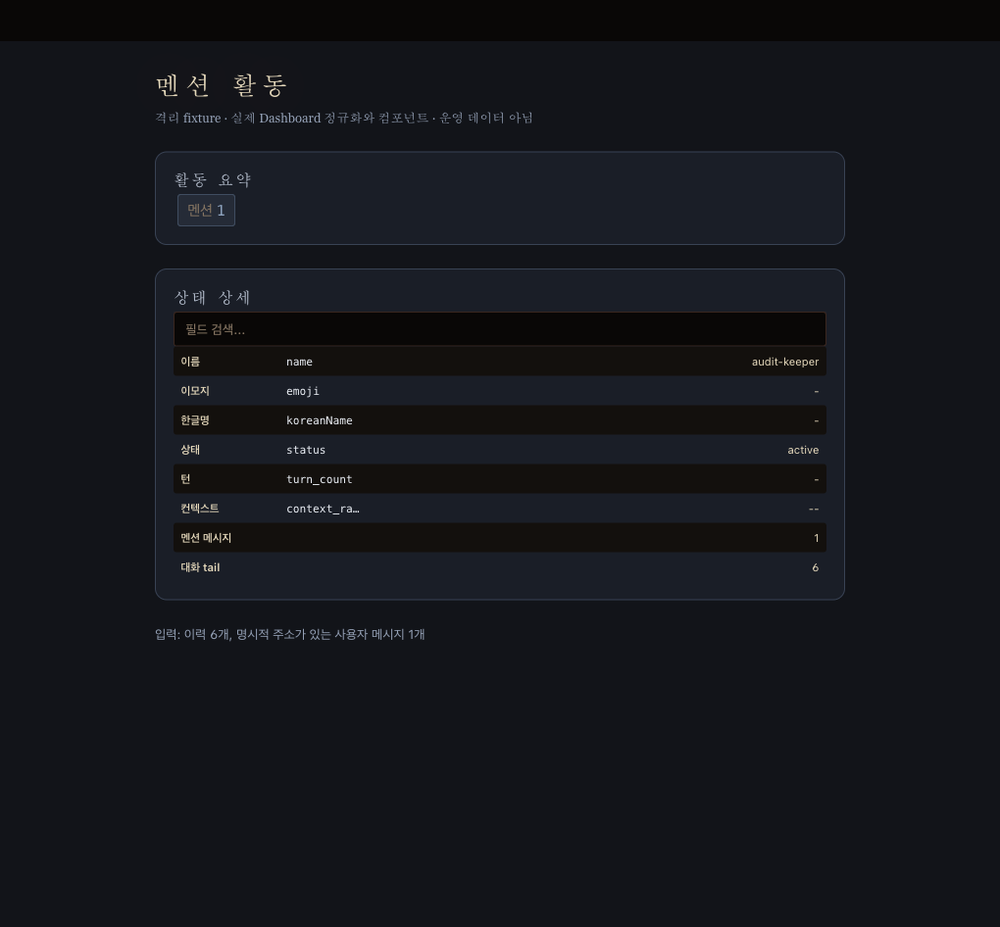

# 기능·SSOT·구조 감사 — 2026-10-23

감사 기준은 `7ceccb5c947a30f2949147e59f1e457ee5813ecf`이며, 수리 코드의 비교 head는 `ed476e2a76f21bd48330da9db38f7b651effef83`다. 공용 체크아웃을 변경하지 않고 별도 Git 메타데이터를 가진 체크아웃에서 작업했다. 이 문서는 **소스 감사와 명시한 재현 범위**의 결과다. 실행 중인 서버·Keeper·브라우저의 종합 QA나 production-ready 판정은 포함하지 않는다.

- 정적 인벤토리: `lib`, `bin`, `dashboard/src`, `tools`의 소스 **6,033개 / 1,391,498줄**.
- 확인한 결함: **P1 1건, P2 4건**. P0를 입증한 증거는 없다. 미검사 경로까지 P0가 없다는 뜻은 아니다.
- 수리: Native Stack **#45554**, 코드 PR **#45552 → #45553 → #45566 → #45592**. 이 문서를 쓴 시점의 상태는 PR이며 병합·설치·배포가 아니다.
- 구조 인벤토리: 2,000줄 이상 구현 파일 **63개**와 별도 대형 인터페이스 1개. 길이는 조사 대상을 찾는 기준이며 결함 판정·CI 제한값이 아니다.

## 우선순위와 재현 근거

P0는 광범위한 서비스 불능·즉시 대응이 필요한 전면 손상, P1은 높은 피해의 기능 결함, P2는 제한된 기능·정확성·관측 손실로 분류했다. 노출 범위도 함께 기록했다.

| ID | 등급 | 실제 조건과 영향 | 근거 / 수리 |
|---|---|---|---|
| F1 | P1 | 내부 유지보수용 `Workspace.reset`을 호출했을 때 `.masc` 안 디렉터리 심볼릭 링크를 따라 외부 파일을 삭제하고, 이후 `ENOTDIR`로 실패한다. 원격 API 취약점으로 확인한 것은 아니다. | [원래 reset](https://github.com/jeong-sik/masc/blob/7ceccb5c947a30f2949147e59f1e457ee5813ecf/lib/workspace/workspace_init.ml#L98), [이슈 #45538](https://github.com/jeong-sik/masc/issues/45538), [PR #45552](https://github.com/jeong-sik/masc/pull/45552) |
| F2 | P2 | 기본 이력 필터가 `OK`, `42`, `완료`, 정상 URL을 미완성으로 판정한다. 저장된 정상 답변이 Keeper status와 Dashboard 양쪽에서 사라진다. | [휴리스틱](https://github.com/jeong-sik/masc/blob/7ceccb5c947a30f2949147e59f1e457ee5813ecf/lib/keeper/keeper_text_processing.ml#L57), [소비자](https://github.com/jeong-sik/masc/blob/7ceccb5c947a30f2949147e59f1e457ee5813ecf/lib/keeper/keeper_status_detail.ml#L447), [PR #45553](https://github.com/jeong-sik/masc/pull/45553) |
| F3 | P2 / SSOT | 같은 `MASC_KEEPER_HISTORY_FRAGMENT_FILTER=off`를 Dashboard는 false, Keeper status는 true로 해석한다. 설정 파서가 서로 다른 권위다. | [Keeper 파서](https://github.com/jeong-sik/masc/blob/7ceccb5c947a30f2949147e59f1e457ee5813ecf/lib/keeper/keeper_config_text.ml#L15), [Dashboard 파서](https://github.com/jeong-sik/masc/blob/7ceccb5c947a30f2949147e59f1e457ee5813ecf/lib/dashboard/dashboard_http_helpers.ml#L8), [이슈 #45545](https://github.com/jeong-sik/masc/issues/45545). F2와 함께 설정·미사용 파서를 제거했다. |
| F4 | P2 / SSOT | Slack·Discord의 canonical 정책을 반영한 뒤 감사 로그 기록이 실패하면, dispatch는 새 정책을 쓰는데 상태 JSON은 이전 mirror를 보여준다. 정상적인 순차 HTTP set/clear는 원래도 동기화됐으며 결함 조건이 아니다. | [override 반영과 audit 순서](https://github.com/jeong-sik/masc/blob/7ceccb5c947a30f2949147e59f1e457ee5813ecf/lib/runtime_params.ml#L248), [Discord mirror](https://github.com/jeong-sik/masc/blob/7ceccb5c947a30f2949147e59f1e457ee5813ecf/lib/gate/channel_gate_discord_state.ml#L119), [이슈 #45559](https://github.com/jeong-sik/masc/issues/45559), [PR #45566](https://github.com/jeong-sik/masc/pull/45566) |
| F5 | P2 | Keeper 이름을 부분문자열로 찾아 일반 단어·이메일·다른 이름·코드도 멘션으로 센다. 이어서 사람의 멘션까지 `K2K`로 표시해 실제 Keeper 간 통신처럼 보이게 한다. | [집계](https://github.com/jeong-sik/masc/blob/7ceccb5c947a30f2949147e59f1e457ee5813ecf/lib/dashboard/dashboard_http_keeper_metrics.ml#L69), [표시](https://github.com/jeong-sik/masc/blob/7ceccb5c947a30f2949147e59f1e457ee5813ecf/dashboard/src/components/keeper-detail-activity-summary.ts#L34), [이슈 #45584](https://github.com/jeong-sik/masc/issues/45584), [PR #45592](https://github.com/jeong-sik/masc/pull/45592) |

재현 결과:

- **F1:** 임시 외부 파일이 수정 전에는 실제로 삭제됐다. 수정 후에는 링크 대상이 남고 dangling link도 제거된다. 중첩 mkdir memo가 해제돼 reset 뒤 같은 디렉터리에 다시 쓸 수 있다. 경합 중 심볼릭 링크 교체에 대한 방어를 증명한 것은 아니다.
- **F2:** 동일한 정상 assistant 답변 4개가 수정 전에는 양쪽 투영에서 0개, 수정 후에는 4개 보인다. 명시적 `internal_assistant` 출처는 계속 제외된다.
- **F3:** `off`가 포함된 canonical false 집합과 누락된 중복 파서의 직접 소스 비교로 확인했다. 이 언어별 필터의 바이트/문자 비율을 오류 확률로 해석하지 않았다. 기존 [#27444](https://github.com/jeong-sik/masc/issues/27444)의 방향성 주장을 재사용하지 않았다.
- **F4:** audit 파일 위치를 디렉터리로 만든 격리 fixture에서 두 connector 모두 `runtime=mention_only / display=mention_or_thread`가 재현됐다. 수리 후 두 값이 모두 `mention_only`다. 감사 쓰기 실패 자체는 계속 반환되며, 이 PR은 설정 변경을 새 트랜잭션으로 만들지는 않는다.
- **F5:** 6개 user 메시지의 기존 집계 6건 중 5건이 오탐이었다. 수정 후 정확한 주소를 가진 1건만 센다. 반복된 대소문자 표기는 같은 ID로 한 번 센다. `addressed_message_count`와 `recent_addressed_messages`는 user 행을, `keeper_mention_counts`는 assistant를 포함한 모든 공개 이력 행의 멘션을 집계한다. 어느 것도 전달 영수증이 아니다.

## 제거한 휴리스틱과 SSOT 위반

| 이전 구현 | 최종 소유자 / 경계 | 처리 |
|---|---|---|
| 24바이트, 한국어 어미 목록, 끝 문장부호, 접속사 suffix로 답변의 완결성 판단 | 저장된 이력의 명시적 source provenance | 문장 판정·환경변수·fragment 필드와 카운터를 제거했다. 숫자를 바꾸거나 새 문구 목록을 넣지 않았다. |
| 두 `bool_default_true_of_env` 구현과 여러 재노출 `.mli` | 해당 기능에 설정 자체가 불필요 | 마지막 소비자 제거 후 미사용 구현과 선언도 삭제했다. |
| `Workspace_init`의 별도 재귀 삭제 구현 | `Fs_compat.remove_tree` | 실제 링크 처리를 소유한 공용 primitive를 사용하고, 제거한 각 디렉터리의 memo 해제를 공용 구현에 배치했다. |
| 정책 원본과 Discord/Slack `trigger_policy_ref`, startup 복사, HTTP 후처리 mirror | `Runtime_params.get Runtime_settings.*_trigger_policy` | 상태 조회가 typed 값을 한 번 캡처한다. 직렬화는 그 불변 snapshot만 사용한다. |
| Keeper 이름의 일반 부분문자열 검색 | `Keeper_lane_mentions` → `Board_addressing`, `Keeper_identity.Keeper_id` | 기존 주소 문법을 사용한다. 별도 정규식·이름 alias·문장 추측을 추가하지 않았다. |
| 이력 집계 중 로컬 Hashtbl 갱신 | fold가 반환하는 `Map.Make(String)` 값 | 해석 실패한 행이 기존 누계에 부분 효과를 남기지 않는 불변 누계로 바꿨다. |

## Facade와 참조 투명성

실제로 정리한 체인은 `Keeper_execution → Keeper_prompt → Keeper_text_processing`이다. `Keeper_execution.ml/.mli`를 삭제하고 checkpoint/log 소비자는 실제 소유자인 `Keeper_context_core`를 직접 호출한다. `Keeper_context_runtime`의 중복 text-processing include, 미사용 open/module alias도 삭제했다. 실제 UTF-8 preview 절단 소비자는 유지했다.

다음 구조는 **후속 정리 대상**이다. 아래의 존재만으로 재현하지 않은 기능 장애를 주장하지 않는다.

| 위치 | 확인한 구조 / 영향 | 다음 경계 |
|---|---|---|
| `lib/board.ml → Masc_board_handlers.Board → Board_votes → Board_core → Board_core_persist → Board_core_classify` | 여러 `include`가 일반 Board API에 저장소·payload helper까지 전달한다. root의 `board_core*` 재노출도 별도로 존재한다. | 호출자를 소유 leaf로 옮기고 실제 외부 Board 계약만 남긴다. type identity와 persistence 호출자를 함께 검토해야 한다. |
| `lib/workspace.ml → Workspace_core → Workspace_utils → backend_setup / paths_backend / ops` | 경로·저장소·도메인 API가 연쇄 재노출되고 `Workspace_core`는 hook 설치 효과도 가진다. | 경로/저장소와 Task lifecycle 소비자 경계를 구분한다. 단순 파일 쪼개기 뒤 동일 include 체인을 재생성하지 않는다. |
| `lib/server/server_dashboard_http_composite.ml → ..._enrich`, 상위 `server_dashboard_http`의 include | 구현 없는 재노출 한 층이 존재한다. | 실제 소비자를 enrich 소유자로 이동하고 dead export 여부를 확인한다. |
| `bin/masc_tui_render_prim.ml:1174–1189` | 렌더러가 `acting_pane_row_targets`/scroll 정보를 전역 ref에 써서 paint와 입력 해석을 결합한다. 같은 인자만으로 효과를 설명할 수 없다. | 렌더 결과가 화면과 hit-target 값을 함께 반환하고 event loop가 한 frame 단위로 반영하도록 만든다. 오클릭 발생을 이번에 실측한 것은 아니다. |
| `bin/masc_tui_render_chat.ml:2650–2673` | module-global memo가 physical identity와 호출 이력에 의존한다. 출력이 틀렸다는 증거와는 구분한다. | view/receiver 수명이 cache owner가 되게 하고 projection은 입력 snapshot과 clock을 명시적으로 받는다. |
| `dashboard/src/components/chat/primitives.ts:3724–3736` | 펼침 상태 Map이 component 밖에 있고 test-only reset을 요구한다. 사용자 선택 유지라는 실제 이유가 있으므로 무조건 삭제할 상태는 아니다. | workspace/chat store가 수명과 키를 소유하도록 경계를 명시한다. |

`mutable`, `ref`, `Atomic`, Hashtbl의 존재를 모두 결함으로 세지 않았다. I/O 자원 소유, 취소 예약, 짧은 로컬 buffer, 안전한 publication은 필요한 효과다. 이번 확정 결함은 **동일 정책의 중복 mutable 권위**이며, mutex를 하나 더 씌우지 않고 mirror를 없앴다.

## Godfile 목록

[전체 63개 CSV](2026-10-23-feature-audit/godfiles.csv). `.mli`는 구현 후보에서 제외했으며, 별도로 `lib/tui_decode.mli` 2,744줄을 확인했다. 아래는 직접 책임을 확인한 큰 파일이다. 수리 전 고정 스냅샷의 줄 수다.

| 파일 | 줄 수 | 함께 들어 있는 책임 / 권장 분리 |
|---|---:|---|
| `bin/masc_tui.ml` | 34,049 | server identity, 비동기 read launch, theme/image/media, 화면 전환, 입력/event loop. 도메인별 command → effect interpreter 경계가 필요하다. |
| `bin/masc_tui_types.ml` | 20,846 | 타입 선언뿐 아니라 editor/finder, Ask, 요청 철회, action/표시 계산과 mutable state까지 포함한다. 상태 모델과 전이/표시를 나눠야 한다. |
| `lib/tui_decode.ml` | 8,214 | 여러 도메인의 타입·wire parser·label·evidence 검증. wire 계약별 leaf codec으로 나누고 소유자를 중복시키지 않는다. |
| `bin/masc_tui_render_prim.ml` | 5,505 | voice/connection/Ask/Fusion/acting pane과 전역 hit-target 효과. 순수 rendering과 event-loop 반영을 나눈다. |
| `dashboard/src/components/chat/primitives.ts` | 5,485 | HTML sanitization, avatar, attachment, audio, trace card 상태, composer. 보안 변환과 UI state/controller를 분리한다. |
| `bin/masc_tui_render_chat.ml` | 5,262 | transcript/child join, Markdown projection, 도구 결과, 스크롤, memo/cache. receiver snapshot별 순수 projection과 cache owner를 분리한다. |
| `lib/fs_compat/fs_compat.ml` | 4,971 | Eio/Unix I/O 경계, 안전한 경로·소유권, 원자 write, JSONL 복구. 공용 I/O 경계는 필요하다. 내부 책임별 분해와 공용 invariant 유지가 목표다. |
| `bin/main_eio.ml` | 4,745 | bootstrap, 종료 처리, runtime wizard, Keeper CLI, sandbox CLI. 명령 해석과 실행 구성을 분리한다. |
| `lib/server/server_routes_http_keeper_stream.ml` | 4,414 | 승인·Ask·stream terminal·오류 정착·응답 변환. operation lifecycle과 HTTP 직렬화의 소유자를 나눈다. |
| `lib/lane_addon/lane_addon_runtime.ml` | 4,318 | lifecycle/recovery, ownership, worker/action execution, resource slicing. 실행 소유권은 shell에 두고 transition 결정은 불변 core로 옮긴다. |
| `lib/runtime/runtime.ml` | 3,646 | loaded-state publication, catalogue notification, config mutation, lane/capacity resolution. canonical snapshot과 효과를 분리한다. |
| `lib/runtime/runtime_toml.ml` | 3,570 | provider/model/account/egress/runtime schema 파싱. 크기만으로 장애라고 하지는 않되 schema 소유 단위로 분해한다. |

CSV의 `mutable_markers`, `ref_markers` 등은 주석·문자열까지 포함하는 **검색용 토큰 수**다. unsafe state 개수나 mutable field 개수로 해석하면 안 된다. 예를 들어 `masc_tui_types.ml`의 `mutable` 826건은 이 방식의 marker 수다. 모든 후보의 정적 길이 목록은 다음과 같다.

| 파일 | 줄 수 |
|---|---:|
| [`bin/masc_tui.ml`](https://github.com/jeong-sik/masc/blob/7ceccb5c947a30f2949147e59f1e457ee5813ecf/bin/masc_tui.ml) | 34,049 |
| [`bin/masc_tui_types.ml`](https://github.com/jeong-sik/masc/blob/7ceccb5c947a30f2949147e59f1e457ee5813ecf/bin/masc_tui_types.ml) | 20,846 |
| [`lib/tui_decode.ml`](https://github.com/jeong-sik/masc/blob/7ceccb5c947a30f2949147e59f1e457ee5813ecf/lib/tui_decode.ml) | 8,214 |
| [`bin/masc_tui_render_prim.ml`](https://github.com/jeong-sik/masc/blob/7ceccb5c947a30f2949147e59f1e457ee5813ecf/bin/masc_tui_render_prim.ml) | 5,505 |
| [`dashboard/src/components/chat/primitives.ts`](https://github.com/jeong-sik/masc/blob/7ceccb5c947a30f2949147e59f1e457ee5813ecf/dashboard/src/components/chat/primitives.ts) | 5,485 |
| [`bin/masc_tui_render_chat.ml`](https://github.com/jeong-sik/masc/blob/7ceccb5c947a30f2949147e59f1e457ee5813ecf/bin/masc_tui_render_chat.ml) | 5,262 |
| [`lib/fs_compat/fs_compat.ml`](https://github.com/jeong-sik/masc/blob/7ceccb5c947a30f2949147e59f1e457ee5813ecf/lib/fs_compat/fs_compat.ml) | 4,971 |
| [`bin/main_eio.ml`](https://github.com/jeong-sik/masc/blob/7ceccb5c947a30f2949147e59f1e457ee5813ecf/bin/main_eio.ml) | 4,745 |
| [`lib/server/server_routes_http_keeper_stream.ml`](https://github.com/jeong-sik/masc/blob/7ceccb5c947a30f2949147e59f1e457ee5813ecf/lib/server/server_routes_http_keeper_stream.ml) | 4,414 |
| [`lib/lane_addon/lane_addon_runtime.ml`](https://github.com/jeong-sik/masc/blob/7ceccb5c947a30f2949147e59f1e457ee5813ecf/lib/lane_addon/lane_addon_runtime.ml) | 4,318 |
| [`lib/server/server_routes_http_routes_dashboard.ml`](https://github.com/jeong-sik/masc/blob/7ceccb5c947a30f2949147e59f1e457ee5813ecf/lib/server/server_routes_http_routes_dashboard.ml) | 4,062 |
| [`bin/masc_tui_http.ml`](https://github.com/jeong-sik/masc/blob/7ceccb5c947a30f2949147e59f1e457ee5813ecf/bin/masc_tui_http.ml) | 4,061 |
| [`lib/keeper/keeper_memory_os_current.ml`](https://github.com/jeong-sik/masc/blob/7ceccb5c947a30f2949147e59f1e457ee5813ecf/lib/keeper/keeper_memory_os_current.ml) | 3,758 |
| [`lib/keeper/keeper_tool_descriptor.ml`](https://github.com/jeong-sik/masc/blob/7ceccb5c947a30f2949147e59f1e457ee5813ecf/lib/keeper/keeper_tool_descriptor.ml) | 3,663 |
| [`lib/runtime/runtime.ml`](https://github.com/jeong-sik/masc/blob/7ceccb5c947a30f2949147e59f1e457ee5813ecf/lib/runtime/runtime.ml) | 3,646 |
| [`lib/runtime/runtime_toml.ml`](https://github.com/jeong-sik/masc/blob/7ceccb5c947a30f2949147e59f1e457ee5813ecf/lib/runtime/runtime_toml.ml) | 3,570 |
| [`lib/keeper/keeper_turn_driver_try_provider.ml`](https://github.com/jeong-sik/masc/blob/7ceccb5c947a30f2949147e59f1e457ee5813ecf/lib/keeper/keeper_turn_driver_try_provider.ml) | 3,515 |
| [`lib/keeper/keeper_turn_driver.ml`](https://github.com/jeong-sik/masc/blob/7ceccb5c947a30f2949147e59f1e457ee5813ecf/lib/keeper/keeper_turn_driver.ml) | 3,413 |
| [`lib/runtime/runtime_claude_code.ml`](https://github.com/jeong-sik/masc/blob/7ceccb5c947a30f2949147e59f1e457ee5813ecf/lib/runtime/runtime_claude_code.ml) | 3,318 |
| [`lib/fs_compat/capability_recovery_obligation.ml`](https://github.com/jeong-sik/masc/blob/7ceccb5c947a30f2949147e59f1e457ee5813ecf/lib/fs_compat/capability_recovery_obligation.ml) | 3,220 |
| [`lib/keeper/keeper_tool_filesystem_runtime.ml`](https://github.com/jeong-sik/masc/blob/7ceccb5c947a30f2949147e59f1e457ee5813ecf/lib/keeper/keeper_tool_filesystem_runtime.ml) | 3,204 |
| [`lib/keeper_chat_operations/keeper_chat_operation_store.ml`](https://github.com/jeong-sik/masc/blob/7ceccb5c947a30f2949147e59f1e457ee5813ecf/lib/keeper_chat_operations/keeper_chat_operation_store.ml) | 3,196 |
| [`lib/keeper/keeper_chat_store.ml`](https://github.com/jeong-sik/masc/blob/7ceccb5c947a30f2949147e59f1e457ee5813ecf/lib/keeper/keeper_chat_store.ml) | 3,118 |
| [`lib/keeper/keeper_tool_composition_surface.ml`](https://github.com/jeong-sik/masc/blob/7ceccb5c947a30f2949147e59f1e457ee5813ecf/lib/keeper/keeper_tool_composition_surface.ml) | 3,115 |
| [`lib/keeper/keeper_approval_queue.ml`](https://github.com/jeong-sik/masc/blob/7ceccb5c947a30f2949147e59f1e457ee5813ecf/lib/keeper/keeper_approval_queue.ml) | 3,113 |
| [`lib/keeper/keeper_turn_sandbox_runtime.ml`](https://github.com/jeong-sik/masc/blob/7ceccb5c947a30f2949147e59f1e457ee5813ecf/lib/keeper/keeper_turn_sandbox_runtime.ml) | 3,100 |
| [`lib/runtime/runtime_codex_app_server.ml`](https://github.com/jeong-sik/masc/blob/7ceccb5c947a30f2949147e59f1e457ee5813ecf/lib/runtime/runtime_codex_app_server.ml) | 3,099 |
| [`lib/keeper/keeper_owner.ml`](https://github.com/jeong-sik/masc/blob/7ceccb5c947a30f2949147e59f1e457ee5813ecf/lib/keeper/keeper_owner.ml) | 3,020 |
| [`lib/keeper/keeper_sandbox_microvm.ml`](https://github.com/jeong-sik/masc/blob/7ceccb5c947a30f2949147e59f1e457ee5813ecf/lib/keeper/keeper_sandbox_microvm.ml) | 2,853 |
| [`dashboard/src/components/keeper-config-panel.ts`](https://github.com/jeong-sik/masc/blob/7ceccb5c947a30f2949147e59f1e457ee5813ecf/dashboard/src/components/keeper-config-panel.ts) | 2,835 |
| [`bin/masc_tui_keeper_chat_transcript.ml`](https://github.com/jeong-sik/masc/blob/7ceccb5c947a30f2949147e59f1e457ee5813ecf/bin/masc_tui_keeper_chat_transcript.ml) | 2,753 |
| [`lib/keeper/keeper_skill_activation_ledger.ml`](https://github.com/jeong-sik/masc/blob/7ceccb5c947a30f2949147e59f1e457ee5813ecf/lib/keeper/keeper_skill_activation_ledger.ml) | 2,726 |
| [`dashboard/src/api/dashboard-runtime.ts`](https://github.com/jeong-sik/masc/blob/7ceccb5c947a30f2949147e59f1e457ee5813ecf/dashboard/src/api/dashboard-runtime.ts) | 2,638 |
| [`lib/keeper/keeper_msg_async.ml`](https://github.com/jeong-sik/masc/blob/7ceccb5c947a30f2949147e59f1e457ee5813ecf/lib/keeper/keeper_msg_async.ml) | 2,555 |
| [`lib/keeper/keeper_agent_run.ml`](https://github.com/jeong-sik/masc/blob/7ceccb5c947a30f2949147e59f1e457ee5813ecf/lib/keeper/keeper_agent_run.ml) | 2,539 |
| [`lib/keeper/keeper_tool_in_process_runtime.ml`](https://github.com/jeong-sik/masc/blob/7ceccb5c947a30f2949147e59f1e457ee5813ecf/lib/keeper/keeper_tool_in_process_runtime.ml) | 2,490 |
| [`lib/server/server_bootstrap_loops.ml`](https://github.com/jeong-sik/masc/blob/7ceccb5c947a30f2949147e59f1e457ee5813ecf/lib/server/server_bootstrap_loops.ml) | 2,415 |
| [`lib/server/server_dashboard_http_runtime_info.ml`](https://github.com/jeong-sik/masc/blob/7ceccb5c947a30f2949147e59f1e457ee5813ecf/lib/server/server_dashboard_http_runtime_info.ml) | 2,405 |
| [`lib/fs_compat/atomic_write.ml`](https://github.com/jeong-sik/masc/blob/7ceccb5c947a30f2949147e59f1e457ee5813ecf/lib/fs_compat/atomic_write.ml) | 2,388 |
| [`bin/masc_tui_keys.ml`](https://github.com/jeong-sik/masc/blob/7ceccb5c947a30f2949147e59f1e457ee5813ecf/bin/masc_tui_keys.ml) | 2,382 |
| [`dashboard/src/components/tools/scheduled-automation-panel.ts`](https://github.com/jeong-sik/masc/blob/7ceccb5c947a30f2949147e59f1e457ee5813ecf/dashboard/src/components/tools/scheduled-automation-panel.ts) | 2,377 |
| [`bin/masc_tui_render_keepers.ml`](https://github.com/jeong-sik/masc/blob/7ceccb5c947a30f2949147e59f1e457ee5813ecf/bin/masc_tui_render_keepers.ml) | 2,363 |
| [`bin/masc_tui_message_layout.ml`](https://github.com/jeong-sik/masc/blob/7ceccb5c947a30f2949147e59f1e457ee5813ecf/bin/masc_tui_message_layout.ml) | 2,360 |
| [`lib/keeper/keeper_librarian_runtime.ml`](https://github.com/jeong-sik/masc/blob/7ceccb5c947a30f2949147e59f1e457ee5813ecf/lib/keeper/keeper_librarian_runtime.ml) | 2,360 |
| [`dashboard/src/components/connector-status.ts`](https://github.com/jeong-sik/masc/blob/7ceccb5c947a30f2949147e59f1e457ee5813ecf/dashboard/src/components/connector-status.ts) | 2,323 |
| [`lib/keeper/keeper_tool_execution_journal.ml`](https://github.com/jeong-sik/masc/blob/7ceccb5c947a30f2949147e59f1e457ee5813ecf/lib/keeper/keeper_tool_execution_journal.ml) | 2,312 |
| [`lib/keeper/keeper_checkpoint_store.ml`](https://github.com/jeong-sik/masc/blob/7ceccb5c947a30f2949147e59f1e457ee5813ecf/lib/keeper/keeper_checkpoint_store.ml) | 2,309 |
| [`lib/server/server_dashboard_http_keeper_api.ml`](https://github.com/jeong-sik/masc/blob/7ceccb5c947a30f2949147e59f1e457ee5813ecf/lib/server/server_dashboard_http_keeper_api.ml) | 2,291 |
| [`bin/masc_tui_lane_addons.ml`](https://github.com/jeong-sik/masc/blob/7ceccb5c947a30f2949147e59f1e457ee5813ecf/bin/masc_tui_lane_addons.ml) | 2,273 |
| [`lib/voice/voice_bridge.ml`](https://github.com/jeong-sik/masc/blob/7ceccb5c947a30f2949147e59f1e457ee5813ecf/lib/voice/voice_bridge.ml) | 2,254 |
| [`lib/keeper/keeper_board_attention_worker.ml`](https://github.com/jeong-sik/masc/blob/7ceccb5c947a30f2949147e59f1e457ee5813ecf/lib/keeper/keeper_board_attention_worker.ml) | 2,239 |
| [`lib/keeper/keeper_official_client_host.ml`](https://github.com/jeong-sik/masc/blob/7ceccb5c947a30f2949147e59f1e457ee5813ecf/lib/keeper/keeper_official_client_host.ml) | 2,199 |
| [`dashboard/src/components/settings-surface.ts`](https://github.com/jeong-sik/masc/blob/7ceccb5c947a30f2949147e59f1e457ee5813ecf/dashboard/src/components/settings-surface.ts) | 2,188 |
| [`lib/server/server_runtime_bootstrap.ml`](https://github.com/jeong-sik/masc/blob/7ceccb5c947a30f2949147e59f1e457ee5813ecf/lib/server/server_runtime_bootstrap.ml) | 2,145 |
| [`lib/keeper/keeper_gate.ml`](https://github.com/jeong-sik/masc/blob/7ceccb5c947a30f2949147e59f1e457ee5813ecf/lib/keeper/keeper_gate.ml) | 2,141 |
| [`lib/keeper/keeper_unified_prompt.ml`](https://github.com/jeong-sik/masc/blob/7ceccb5c947a30f2949147e59f1e457ee5813ecf/lib/keeper/keeper_unified_prompt.ml) | 2,114 |
| [`bin/masc_tui_render_work.ml`](https://github.com/jeong-sik/masc/blob/7ceccb5c947a30f2949147e59f1e457ee5813ecf/bin/masc_tui_render_work.ml) | 2,113 |
| [`lib/keeper/keeper_tool_memory_runtime.ml`](https://github.com/jeong-sik/masc/blob/7ceccb5c947a30f2949147e59f1e457ee5813ecf/lib/keeper/keeper_tool_memory_runtime.ml) | 2,095 |
| [`dashboard/src/api/dashboard-tools-prompts.ts`](https://github.com/jeong-sik/masc/blob/7ceccb5c947a30f2949147e59f1e457ee5813ecf/dashboard/src/api/dashboard-tools-prompts.ts) | 2,068 |
| [`lib/server/server_dashboard_http_keeper_api_post.ml`](https://github.com/jeong-sik/masc/blob/7ceccb5c947a30f2949147e59f1e457ee5813ecf/lib/server/server_dashboard_http_keeper_api_post.ml) | 2,053 |
| [`bin/masc_tui_render_schedule.ml`](https://github.com/jeong-sik/masc/blob/7ceccb5c947a30f2949147e59f1e457ee5813ecf/bin/masc_tui_render_schedule.ml) | 2,013 |
| [`dashboard/src/keeper-state.ts`](https://github.com/jeong-sik/masc/blob/7ceccb5c947a30f2949147e59f1e457ee5813ecf/dashboard/src/keeper-state.ts) | 2,013 |
| [`bin/masc_tui_render_lanes.ml`](https://github.com/jeong-sik/masc/blob/7ceccb5c947a30f2949147e59f1e457ee5813ecf/bin/masc_tui_render_lanes.ml) | 2,006 |

## 테스트 정리와 검증 범위

제거된 휴리스틱의 규칙만 재확인하던 `test_pbt_text_processing.ml`의 5개 property(정규화 멱등성, 마침표, 한국어 어미, 콜론, 연속 공백)와 Dashboard substring helper의 테스트 1개를 삭제했다. 해당 test-only export와 Dune 목록도 정리했다. 유지하는 기능에 대한 unrelated test는 고치지 않았다.

실제 기능 경로를 다루는 기존 테스트에는 다음 시나리오만 추가·수정했다.

- `test_workspace`: reset의 외부 링크 대상 보존과 재초기화 뒤 중첩 writer 재개.
- `test_dashboard_keeper_metrics_10286`: 저장된 짧은 답변 보존, 정확한 주소 문법의 멘션 집계.
- `test_keeper_effective_meta_overlay`: 실제 status handler의 이력 선택.
- `test_server_discord_trigger_policy`, `test_server_slack_trigger_policy`: set/clear, 이전 snapshot 유지, 반영 후 audit 실패의 상태 조회.
- `test_channel_gate_discord_state`: 제거된 mirror API 대신 canonical 설정으로 descriptor fixture 구성.
- `dashboard/src/keeper-store-normalize.test.ts`: 새 count wire 필드가 activity 표면에 도달하는지 확인.

| 증거 | 실행 결과 | 증명하는 범위 |
|---|---|---|
| `source-probes.py` | before/after 재현 성공 | 실제 reset body·삭제 primitive·이력 투영·공용 주소 parser를 제한된 adapter 아래 실행한다. full Workspace/API/Eio 검증이 아니다. |
| `connector-probe.py` | Slack/Discord before/after 재현 성공 | 실제 Runtime_params와 mutation helper를 local filesystem/lock/registration adapter 아래 실행한다. live gateway 검증이 아니다. |
| 변경 OCaml `.ml/.mli` parsing, `git diff --check` | 성공 | 문법·공백. 전체 타입 검사·링크를 뜻하지 않는다. |
| Dashboard focused Vitest | **47/47 성공** | 정상화 모듈과 추가된 wire-to-state 소비자 시나리오. 화면 문구·배치 snapshot 검사는 추가하지 않았다. |
| Dashboard `tsc --noEmit` | **성공** | 변경된 wire 소비자를 포함한 Dashboard 타입 검사. 브라우저 실측이 아니다. |
| Dashboard 격리 browser fixture | **실제 렌더링·스크린샷 확인** | 현재 코드의 normalizer와 두 실제 컴포넌트에 합성 입력을 넣었다. `멘션 1`, `멘션 메시지 1`을 확인했다. 운영 서버·통합 화면 QA는 아니다. |
| 독립 적대적 소스 리뷰 | 네 코드 작업 단위 모두 PASS | 검토한 source/diff 범위. GitHub 승인·병합·배포를 대신하지 않는다. |
| 전체 linked OCaml 테스트 / 전체 CI / 설치 / live runtime / 운영 browser QA | **미실행** | 성공으로 표시하지 않는다. |


공개 시점에 관련 OCaml 6개 스위트를 `minimal=true`로 [원격 실행 요청](https://github.com/jeong-sik/masc/actions/runs/39942599904)했다. API를 한 번 읽어 대상 head가 `ed476e2a76f21bd48330da9db38f7b651effef83`, 상태가 `in_progress`임을 확인했다. 대상은 `test_workspace`, `test_dashboard_keeper_metrics_10286`, `test_keeper_effective_meta_overlay`, `test_server_discord_trigger_policy`, `test_server_slack_trigger_policy`, `test_channel_gate_discord_state`다. 이 접수·진행 상태를 성공이나 전체 회귀 결과로 세지 않는다. CI 대기·반복 조회는 하지 않았다.

[실측 출력](2026-10-23-feature-audit/observations.txt), [격리 화면 재현](2026-10-23-feature-audit/dashboard-fixture/README.md).



감사 스크립트는 매 PR의 CI gate나 새 테스트 스위트에 연결하지 않았다. 이 스냅샷을 다시 확인하는 수동 재현 도구다.

```sh
python3 docs/audits/2026-10-23-feature-audit/inventory.py 7ceccb5c947a30f2949147e59f1e457ee5813ecf
python3 docs/audits/2026-10-23-feature-audit/source-probes.py --before 7ceccb5c947a30f2949147e59f1e457ee5813ecf --after ed476e2a76f21bd48330da9db38f7b651effef83
python3 docs/audits/2026-10-23-feature-audit/connector-probe.py --before 7ceccb5c947a30f2949147e59f1e457ee5813ecf --after ed476e2a76f21bd48330da9db38f7b651effef83
```

## 범위와 남은 작업

이번 세션은 Task/Workspace 삭제, Keeper 이력·Dashboard projection, connector 설정 경계에서 재현 가능한 결함을 수리했다. Goal/Candle/Board lifecycle, provider failover, 장시간 Keeper 연속성, sandbox/async tool 실행을 실제 환경에서 완주한 감사는 아니다. 크기/토큰 census를 그 기능 검증으로 대신하지 않는다.

남은 구조 작업은 위 Godfile·Facade·render-state 목록이다. 다음 수리는 하나의 실제 feature 동작과 소비자·상태 소유권을 먼저 고정한 뒤 순수 전이와 효과 경계를 나누는 방식으로 진행해야 한다. arbitrary turn/time/token cap, 새 환경변수, 전역 registry, Facade의 재노출로 파일 크기만 줄이는 방식은 개선으로 간주하지 않는다.
