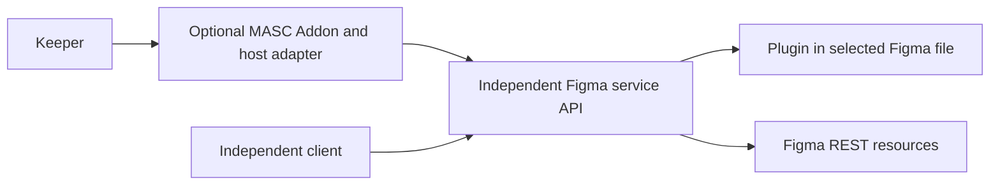

# Figma Plugin and REST research for a deferred Studio design

Status: archived design research, 2026-10-13. The
[Figma Studio idea](figma-studio-lane-addon.md) is deferred. This dated inventory
describes platform capabilities, not a shipped Addon or a current implementation
plan. Recheck the official sources and actual account when design work resumes.

[근거] Official documentation and OpenAPI checked on 2026-10-13 (Asia/Seoul).
Confidence is high for the documented API boundaries; account entitlements,
installed Plugin behavior and live MASC integration still require runtime checks.
The REST inventory below uses Figma's OpenAPI 0.44.0 at
[`1c15f007cc81b4409efb2f24fec89608e8a7548d`](https://github.com/figma/rest-api-spec/blob/1c15f007cc81b4409efb2f24fec89608e8a7548d/openapi/openapi.yaml).
The specification is marked beta; endpoint documentation and actual responses
must also be checked when implementing a capability.

## Proposed independent service boundary

Use the Plugin for live document reads and native edits, REST for authorized
server-side resources, and an independent Figma service for document operation
state and retained snapshots. A future optional MASC Addon consumes its API and
owns the MASC workflow. The Figma service has no knowledge of MASC. This is a
proposal and does not require access to the Official Figma MCP endpoint.

Figma documents REST authentication separately from its MCP client catalog.
A personal access token (PAT) authenticates REST calls using `X-Figma-Token`;
it does not authenticate MASC or grant Plugin editing rights. Scopes still obey
the token owner's resource permissions. See [PAT authentication][pat] and
[scopes][scopes].

MASC worker isolation remains a consumer-side concern. The Figma service does
not call MASC. REST and Plugin observations retain separate origins even when
they refer to the same file and node.

## Capability map

| User outcome | Plugin API | REST with PAT | Studio responsibility |
| --- | --- | --- | --- |
| Generate or revise an editable screen | Create native frames, text, vectors and other supported nodes; edit layout and properties in an open editable file. | No general canvas node creation/update endpoint in the inspected REST inventory. | Plan typed edits, bind the document, validate before effects, read back actual nodes. |
| Create a separate Figma file | Can create pages inside its current document. | No general Design-file creation endpoint in the inspected inventory. | Initial flow asks the user to open/create a target file; never claim that a new page is a new file. |
| Inspect the selected design | Current selection and live node APIs, including unsaved editor observations. | File/node JSON by file key and node IDs, optionally at a specified version. | Record source, root, coverage and observation identity. Do not merge live and server state silently. |
| Capture structural design data | `node.exportAsync({format: "JSON_REST_V1"})` returns REST-shaped JSON. | `GET /v1/files/{key}` and `/nodes` return server-side JSON. | Reuse a shared parser; preserve raw payload and explicit source metadata. Add Plugin-only information separately. |
| Capture previews and assets | PNG/JPG/PDF/SVG exports; image handles/bytes and supported native media APIs. | Render node images and fetch image-fill URLs. | Download and hash bytes while available; distinguish source assets from a flattened preview. |
| Reuse a design system | Create/read local components, instances, styles and variables; import accessible published assets by key. | Read published component/style metadata; variable endpoints have additional access restrictions. | Preserve component keys and variable bindings; maintain reviewed code mappings instead of recreating every instance. |
| Synchronize design tokens | Read/create/update accessible local variables and modes; bind them to nodes. | Read and bulk-write variables in eligible Enterprise organizations. | Capability-check the actual account; choose an available route and identify its source. |
| Build an interactive prototype | Read and set supported node reactions, including async setters with dynamic page access. | Can read exported interaction data; no general prototype-edit endpoint in the inspected inventory. | Generate supported interactions explicitly and test the intended behavior; a screenshot cannot prove it works. |
| Implement a design in a codebase | Provides structure, visuals, assets and optional Dev Mode codegen UI. | Supplies server snapshots, assets and library metadata. | Keeper inspects the repository, edits code, runs the app and records the implementation against a pinned snapshot. |
| Connect nodes to code, previews and reports | Native metadata APIs can supplement the open document. | Dev Resources CRUD attaches URLs to nodes. | Retain a node-to-component mapping and, when authorized, publish actual PR/preview/report links. |
| Review and discuss a design | General Plugin API does not expose the file comment service. | Read/post/delete comments and read/add/delete reactions. | Read comments as context; post only when requested and record the returned comment ID. |
| Track versions | Can create a named version using `saveVersionHistoryAsync`. | List version history; retrieve file/nodes/renders with an explicit version where supported. | Distinguish a local capture ID, an operation ID and a Figma version ID. |
| React to live edits | Selection/page/document events while the Plugin is running. | Webhooks for file, named-version, library, comment and Dev Mode status changes. | Invalidate affected observations; queue work with an origin. Events alone do not prove the resulting state. |
| Continue while Figma is closed | No Plugin execution after it is stopped or the file is closed. | Authorized REST reads and eligible REST writes can run from a server. | Retain requests; expose that native editing is waiting for a Plugin session. |
| Inspect in Dev Mode | Read document data and provide inspect/codegen UI; document contents are read-only. | Account-authorized REST resources remain a separate surface. | Advertise inspection separately from canvas editing; reject edits in Dev Mode. |
| Discover files and library usage | Limited to the current document and permitted library APIs. | Accessible folders/files and published libraries; library analytics has Enterprise restrictions. | Add discovery and analytics only for a requested workflow and granted scopes. |

Canvas, file and live-selection boundaries are supported by the
[Plugin introduction][plugins], [global API][global], [export API][export],
[Dev Mode guide][devmode], and [REST file endpoints][files]. Component/style
lookup methods and the absence of general canvas/file creation operations are
checked against the pinned [REST OpenAPI][openapi], rather than inferred from an
individual wrapper's current tool list. Prototype interaction editing is covered
by the [node reactions API][reactions]. Organization administration, billing and
audit APIs are separate surfaces and are not prerequisites for this design and
implementation workflow.

## Runtime and consistency constraints

### Plugin lifetime and editor access

Plugins are user-launched and do not provide an unattended background service.
The user can stop a running Plugin at any time. Native document access runs in
the Plugin sandbox; browser UI/network operations use the iframe and message
passing. Pages load on demand, so read the selected subtree first and load other
pages only for an explicit operation. See [Plugin access][plugins] and
[execution model][run].

The Plugin manifest must allow the actual relay origin. Development loopback
origins and production origins need appropriate allowlists; an enabled proposed
API flag does not establish a publishable production dependency. Keep the
initial contract on documented stable APIs and request only needed Plugin
permissions. See [the manifest reference][manifest].

Design-mode editing and Dev Mode inspection are different capabilities. A
manifest supporting `dev`/`inspect` does not establish that a session can edit
the canvas. Font-changing and text-creation operations must load required fonts
before mutating nodes; an unavailable font is a reported limitation, not an
implicit substitution. Use [Dev Mode][devmode] and [font loading][fonts].

The ordinary public Plugin API does not provide `figma.fileKey`; that property
is restricted to private Plugins and Figma-owned resources. A file URL supplied
by the user can identify a REST target, but does not prove that it is the file
currently open in the Plugin. Node IDs and names can coincide in different
files. Keep the Plugin session explicitly bound; require a verified association
before combining its observations or writes with REST resources. See
[`fileKey`][global].

### Snapshot capture

Prefer `JSON_REST_V1` plus a native PNG export over expanding the current custom
node serializer. Supplement that payload with the required variable values,
fonts, component mapping and coverage information; REST-shaped JSON is not a
guarantee that every Plugin property was exported. This is a design choice based
on the [documented exporter][export], to be qualified with real fixtures.

Read the structural payload before and after asynchronous exports. If the
observed structures differ, record a changing/incomplete capture. Matching
reads are useful evidence, but do not prove the PNG and JSON were captured
atomically: a collaborator can change and restore a property between reads.
Keep actual image bytes, raw JSON, source and timestamps in one retained bundle;
never label a live Plugin observation as a Figma server revision.

For server captures, pass the same explicit version to file/node JSON and
render endpoints that support it. The image-fill endpoint has no version
parameter in the inspected OpenAPI. Such assets must carry that limitation
instead of being represented as version-pinned. Null entries in node/render
maps and expired asset URLs are failures or coverage gaps, not empty successful
captures. See [file endpoints][files] and the pinned [OpenAPI][openapi].

### Writes and recovery

Plugin edits are sequential effects on a collaborative document. `commitUndo`
creates an undo checkpoint; it is not an atomic transaction. Preflight the whole
supported request, then record created/changed IDs and partial failure. Losing a
reply never permits replaying a mutation automatically. See
[`commitUndo`][undo] and the [redesign requirements](figma-studio-lane-addon.md#product-scope-to-design-before-implementing).

The Variables REST endpoint has a narrower, explicitly documented guarantee:
its bulk request is atomic on validation failure. That guarantee does not cover
Plugin edits, later library publication, or a workflow combining several REST
requests. It cannot update remote variables in a consuming file; changes belong
in the originating file. See [variable endpoints][variable-endpoints].

### Events and rate limits

Plugin document events are asynchronous and can coalesce or omit certain
propagated changes. Treat them as refresh hints, not a complete edit journal.
Do not trigger an unbounded model/edit loop from the Plugin's own changes. See
[Plugin events][events].

`FILE_UPDATE` is documented to fire within 30 minutes of editing inactivity.
It cannot drive per-edit visual feedback. Named-version events are a better
candidate for an explicit handoff; comment and Dev Mode status events can start
separate review workflows. Webhooks require a reachable endpoint and passcode
verification; failed deliveries are retried. Persist/deduplicate event intake,
then fetch the affected resource. See [webhook events][webhook-events] and
[delivery requirements][webhooks].

REST limits depend on endpoint tier, resource plan and account/seat. PAT calls
share a user's allowance; issuing more PATs does not create independent
capacity. Honor `429` and `Retry-After`, use version-aware caches scoped to the
credential identity, and avoid polling whole documents. A scope or access error
must not become an empty success or an automatic switch to another user's
credential. See [rate limits][limits].

## Credentials and optional REST surfaces

Keeper selection and Identity configuration belong to a future MASC adapter;
the independent service has no Keeper identity. Figma credentials belong to that
service, outside the Plugin and model context. Service-client authentication,
Plugin pairing and Figma REST authentication remain separate. A future adapter
must not pass MASC credentials to the service. A PAT can support a personal
installation; OAuth is available for delegated user
authorization. Organization/Enterprise plan access tokens are a separate option
with their own resource restrictions; do not treat token types as interchangeable.
See [authentication][auth].

Request granular scopes only as a feature is enabled:

| Feature | REST scope | Qualification |
| --- | --- | --- |
| Verify token owner | `current_user:read` | `/v1/me`; does not prove file access. |
| File metadata | `file_metadata:read` | File metadata endpoint. |
| Structure and renders | `file_content:read` | Only files accessible to this identity. |
| Version history | `file_versions:read` | History access does not grant writes. |
| File/team/individual library metadata | `library_content:read`, `team_library_content:read`, `library_assets:read` | Choose the scope for the requested endpoint. |
| Folder discovery | `folders:read`, `folder_metadata:read` | Current docs prefer folders over deprecated project scopes; check token-type support per endpoint. |
| Comments | `file_comments:read`, optionally `file_comments:write` | Delete is restricted to the comment author. |
| Dev Resources | `file_dev_resources:read`, optionally `file_dev_resources:write` | Check individual result/error entries, even on HTTP 200. |
| Variables | `file_variables:read`, optionally `file_variables:write` | Enterprise eligibility, membership and file permissions also apply. |
| Webhooks | `webhooks:read`, optionally `webhooks:write` | Creation also depends on permissions for the selected file/folder/team context. |
| Library analytics | `library_analytics:read` | Enterprise restriction; not a prerequisite for design generation. |

Scope names and deprecations come from [Scopes][scopes]. Do not request legacy
`files:read` as a blanket replacement for this capability negotiation.

Variables have a documentation ambiguity: the overview says Full-seat Enterprise
users, while its GET table says any organization member; POST requires a Full
seat/admin and edit access. Treat Enterprise membership/scopes as necessary,
and probe the requested endpoint to establish actual GET availability. Do not
advertise unconditional access based only on a plan label. The Plugin's local
variable API is separately subject to editor access and feature availability.
See [Variables REST eligibility][variables] and [Plugin variables][plugin-variables].

Dev Resources can connect a node to a component source, PR, running preview or
test report without republishing a component. The endpoint accepts main-file
keys, not branch keys, and create/update responses may mix successes and errors.
Publishing a link is an external write and records only the links actually
created. See [Dev Resources][dev-resources] and [endpoints][dev-resource-endpoints].

Comment reads can inform a revision. Posting/reactions require explicit workflow
authorization; a comment returned by Figma is evidence of that post, not design
approval. Version history is read separately from the Plugin method that creates
a named checkpoint. See [comments][comments], [versions][versions], and
[`saveVersionHistoryAsync`][save-version].

The version-save method may return `null`, and Figma explicitly does not
guarantee that immediately preceding Plugin edits are included in the saved
version. Do not use a fixed delay or a returned version ID as proof of capture
equality. Read that server version and compare the intended content before
linking a Plugin result to it. Until then retain the two observations separately.

## Deferred redesign inputs from this research

1. **Use two explicit sources.** `plugin_live` and `rest_version` observations
   carry distinct identities, availability and coverage. REST is a first-class
   complement for server resources, not merely a fallback transport for Plugin
   operations. No canvas-edit request silently falls back to REST.
2. **Replace the thin capture model.** Prefer native REST-shaped export and
   preserve bytes. Add native variable/font/component supplements with explicit
   coverage. Qualify supported exports in a real Figma file.
3. **Negotiate capabilities per session and credential.** Distinguish editing,
   Dev Mode inspection, PAT scopes, Enterprise variables, and unavailable fonts.
   Do not infer capabilities from a Plugin connection alone.
4. **Define state ownership.** The independent service owns document pairing,
   operation IDs, conflict checks, uncertain effects and retained snapshots.
   A consumer owns its workflow. The Plugin is not the durable queue.
5. **Implement the useful closed loop.** Generate/revise native nodes; retain a
   snapshot; implement and run the selected repository; associate changed code,
   preview and review findings with the same snapshot. Visual comparison is
   optional; actual design readback and running-app evidence are required.
6. **Add collaboration only after the core loop.** Authorized comments, Dev
   Resources, named-version handoffs and token synchronization extend the loop.
   Webhooks do not replace the open-Plugin feedback path.

These are platform-backed opportunities for the replacement, not claims of
exclusive features that no other Figma integration can offer.

At source checkpoint `figma-mcp` `5ab32824353812371dc8a001a75c8b6db1d769d3`,
the public v2 registry still exposes eight read/verification tools. Internal
Plugin and REST handlers expose more capability than that public registry. The
Plugin's `serializeNode` is a limited custom projection; its manifest includes
Dev Mode inspection and proposed APIs. The repaired `apply_ops` dispatcher has
fixture coverage, but Studio pairing, native capture, Addon installation and
the two complete user journeys are not established by that test.

No next implementation slice is scheduled. Before resuming, review the deferred
design requirements, capability gaps and session-close/cancellation behavior.
Real account/file checks remain necessary for scopes, fonts, plan-specific
capabilities and both complete user journeys.

[plugins]: https://developers.figma.com/docs/plugins/
[run]: https://developers.figma.com/docs/plugins/how-plugins-run/
[global]: https://developers.figma.com/docs/plugins/api/figma/
[export]: https://developers.figma.com/docs/plugins/api/properties/nodes-exportasync/
[devmode]: https://developers.figma.com/docs/plugins/working-in-dev-mode/
[fonts]: https://developers.figma.com/docs/plugins/working-with-text/
[undo]: https://developers.figma.com/docs/plugins/api/properties/figma-commitundo/
[events]: https://developers.figma.com/docs/plugins/api/properties/figma-on/
[plugin-variables]: https://developers.figma.com/docs/plugins/working-with-variables/
[reactions]: https://developers.figma.com/docs/plugins/api/properties/nodes-reactions/
[manifest]: https://developers.figma.com/docs/plugins/manifest/
[auth]: https://developers.figma.com/docs/rest-api/authentication/
[pat]: https://developers.figma.com/docs/rest-api/personal-access-tokens/
[scopes]: https://developers.figma.com/docs/rest-api/scopes/
[files]: https://developers.figma.com/docs/rest-api/file-endpoints/
[variables]: https://developers.figma.com/docs/rest-api/variables/
[variable-endpoints]: https://developers.figma.com/docs/rest-api/variables-endpoints/
[dev-resources]: https://developers.figma.com/docs/rest-api/dev-resources/
[dev-resource-endpoints]: https://developers.figma.com/docs/rest-api/dev-resources-endpoints/
[comments]: https://developers.figma.com/docs/rest-api/comments-endpoints/
[versions]: https://developers.figma.com/docs/rest-api/version-history-endpoints/
[save-version]: https://developers.figma.com/docs/plugins/api/properties/figma-saveversionhistoryasync/
[webhooks]: https://developers.figma.com/docs/rest-api/webhooks/
[webhook-events]: https://developers.figma.com/docs/rest-api/webhooks-events/
[limits]: https://developers.figma.com/docs/rest-api/rate-limits/
[openapi]: https://github.com/figma/rest-api-spec/blob/1c15f007cc81b4409efb2f24fec89608e8a7548d/openapi/openapi.yaml
