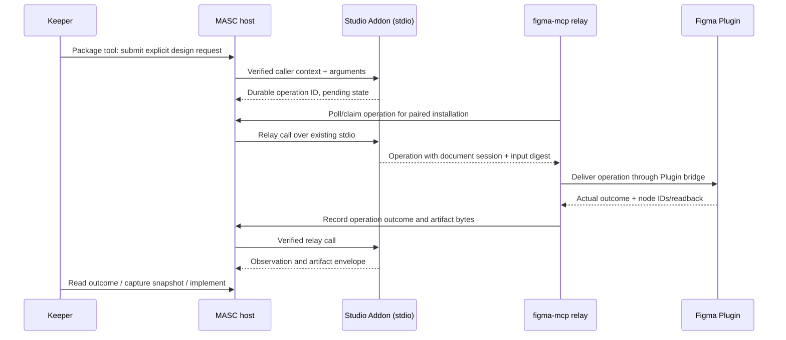

# Figma Studio Lane Addon

Status: implementation design, 2026-10-13. This document does not claim an
installed Plugin, a connected `leader`, or a completed design-to-code run.

## Product contract

One optional Lane Addon supports two connected workflows:

1. **Create a design:** a user asks a Keeper for a screen or a revision. The
   Keeper prepares an explicit edit plan, the Figma Plugin applies it in the
   selected document, and the resulting nodes and preview are read back.
2. **Implement a design:** the Keeper consumes a retained snapshot of selected
   Figma frames, including layout, text, components, variables and assets, and
   implements them in the selected repository. The running result is checked
   against that snapshot. The repository determines the language and framework.

The initial operator-selected Keeper is `leader`; the package must not hardcode
that name. Either workflow can start independently. Implementing an existing
frame does not require generating a new one. Creating a design does not require
an implementation repository. Revisions link to their predecessor snapshot;
refreshing the source never silently changes an in-progress implementation.

Visual comparison is optional. Showing an actual Figma preview and checking the
running implementation remain part of the workflow. No SSIM threshold or
separate visual-verifier agent is required for admission or completion.

## Ownership

| Owner | Responsibility |
| --- | --- |
| Keeper | Interpret the request, propose design changes, use project tools to implement code, and explain results. |
| Figma Plugin | Read and edit the open document through the Plugin API; report actual node IDs and observed results. |
| `figma-mcp` | Figma context, assets, explicit Plugin sessions, command transport and operation evidence. It remains useful without MASC. |
| Figma Studio Addon | Workflow requests, selected document/session and snapshot references, result rows, bundled Skills and package-owned tools. |
| MASC host | Existing authentication, installation visibility, stdio worker lifecycle, tool discovery, action receipts and artifact retention. |

No Figma branch is added to Keeper dispatch, the Lane source-kind enum or the
Dashboard menu. The package uses existing rows, presentation, tool exports and
Skills. No model runs inside the Plugin or a second orchestration loop inside
`figma-mcp`. Detaching the Addon does not close Figma, undo edits or delete code.

The existing Keeper Figma OAuth Identity and a local Plugin session are distinct
capabilities. Plugin-backed work does not pretend that `leader` has a REST token.
REST fallback is available only after that Identity is actually connected. The
Plugin can serve an open document without depending on a remote-MCP client
registration or on a REST file key.

## Transport with the current Lane runtime

The current worker is started with Docker `--network none`. A worker cannot
connect to `127.0.0.1:8940` on the operator's host, and the Plugin cannot connect
to a worker listener. Do not publish a manifest that assumes either path works.

The proposed adapter uses an **outbound relay owned by `figma-mcp`**:

The relay runs on the operator's host, outside the isolated worker. It uses an
existing authenticated MASC MCP connection; the connection must be able to see
the selected installation. Authentication is not inferred from a supplied Keeper
name. An operator-admitted relay credential remains in the host credential store,
never the Plugin iframe, model prompt, binding TOML or returned tool arguments.
The first deployment must prove visibility and authentication with that actual
credential before claiming a connected Addon. This is an explicit trusted local
relay, not a new multi-tenant isolation guarantee.

The package exports its workflow and relay ports through the existing
tool-export mechanism and requires `host_context`. Domain mutations and relay calls are authorized from
that private caller envelope plus an installation-scoped pairing capability;
model-supplied `caller`, `keeper` or `channel_id` fields confer no authority. Relay
ports remain discoverable under the current export contract, so secrecy of tool
names must not be used as access control. The unexported `lane_call` envelope
continues to be callable only over host-owned stdio.

Pairing binds installation, worker incarnation, relay identity and Plugin session.
A new worker or Plugin session requires an explicit new pairing. Secrets are not
included in observation rows. The package may show relay and Plugin connection
states independently. Transport disconnect does not cancel or replay an accepted
operation. The relay never substitutes the last connected Plugin as the target.

The package uses exported tools for submission; it does not declare the generic
`act` contribution for document mutations. The current generic `lane_act` worker
call lacks the trusted caller envelope. Export calls receive that envelope but
do not create generic MASC action receipts or immediately retain packet artifacts.
The package therefore returns its own durable submission receipt, and publishes
artifact bytes through the subsequent `lane_observe` output. A raw tool response
is not evidence that host artifact retention has completed. Keeper tool discovery
is the initial action surface; new Dashboard action buttons are not assumed.

## Operations and failure semantics

A design request contains a stable operation ID, normalized input digest, exact
Plugin session, selected root/page, and supported edit operations. An initial
operation set covers frames, text, geometry, fills and auto layout; later sets
add components/instances and variable bindings without accepting arbitrary code.
Unknown operations or unsupported properties are rejected before editing.

Validation includes target membership and node kinds, fonts, property values,
references between new nodes and the supported capabilities of that session.
After asynchronous preparation, recheck the target before the first mutation.
Serialize edits per Plugin session. An edit targets explicit IDs, never whatever
happens to be selected when delivery completes.

| Operation state | Evidence |
| --- | --- |
| `prepared` | Valid request retained; no document effect claimed. |
| `dispatched` | Delivery attempted for this operation and session. |
| `applied` | Plugin reported actual changed nodes and readback for the same operation. |
| `rejected` | Validation failed before document mutation. |
| `partial` | Some document effects are known; changed nodes and failure are retained. |
| `outcome_unknown` | Delivery/execution may have happened, but its outcome cannot be established. |

A persistent package ledger is required: `[world.state] mode = "persistent"`.
Its authoritative operation records reside in the package's owned `/state`
volume, scoped to the logical installation. Durable transactions record normalized
input, target Plugin session, originating worker incarnation, dispatch and
outcome before acknowledging those transitions. Read failure refuses mutation;
an empty recovery view is not permission to replay. The relay holds transport
delivery state, not a second independent authority for operation completion.

A duplicate ID and identical input returns the recorded outcome; different input
under that ID is refused. Queue removal is not execution acknowledgement. Retain
dispatched operations until their outcome is recorded. Reconnect queries the
original operation; an unknown outcome is not automatically sent as a new edit.
Plugin/session restart cannot infer success from an empty in-memory result cache.
After worker replacement, the new incarnation can read old operation records but
cannot rebind them to its new pairing. Submitted/dispatched operations with an
unestablished outcome require reconciliation against their original session;
closing that session may leave the outcome unknown indefinitely.

An exported submission receipt confirms **request retention**, not Figma success.
The later operation outcome is a separate record. MASC's existing generic
`confirmed` action receipt is not produced by this exported-tool path and must
not be claimed. Neither receipt type nor an operation outcome is independent
verification of the design.

Figma undo grouping improves recovery but is not an atomic transaction. Do not
promise automatic rollback, and do not call undo against unrelated user edits.
Known partial effects remain visible even if preview export or result delivery
fails after an edit. A user-requested undo/recovery targets the recorded operation.

## Shared design snapshot

Both workflows use one versioned, retained artifact contract:

- Origin: Plugin session, page and root node IDs; file key only when actually
  available, never guessed from a document name or the root's ID.
- Capture: operation/readback references, observation time, supported capabilities
  and an explicit consistency/coverage result.
- Native design: ordered hierarchy, geometry, auto layout, text content and styled
  runs, component/instance relationships, styles, variable IDs/modes/bindings.
- Assets: exact preview and export bytes with MIME type and content hash. An
  expired export URL alone is not retained evidence.
- Coverage: unsupported or unavailable fields/assets, inaccessible nodes, truncated
  content and changes observed during capture. Missing data is not a default value.

The package retains snapshot bytes with the existing artifact envelope. Tool
results include the snapshot identity; implementations pin that identity. Large
selections are scoped/paged explicitly and report their coverage. A partial or
changing capture cannot be labeled a complete immutable snapshot. A complete
Plugin capture need not have a REST file version; a Plugin observation is not a
Figma server revision or proof of an atomic server-side snapshot.

## User flow and Addon presentation

The existing Addon surface presents these parallel facts:

- Connection: paired document and Plugin session, relay state, and read/write
  capabilities. A closed Plugin is shown as unavailable.
- Design: request, affected frames, latest retained preview and outcome.
- Implementation: pinned snapshot, selected repository, branch/changes and preview
  or run evidence. The Addon does not execute arbitrary shell text from Figma.
- Recovery: partial effects or an unknown outcome, with readback/reconcile as the
  next available action.

Package tools accept intents such as prepare/apply design, capture selected roots,
read operation outcome and prepare an implementation handoff. The Keeper's normal
repository tools perform coding. The Addon records their evidence; it must not
claim that preparing a handoff compiled or ran the application. No chosen React,
Next.js, iOS, CSS system or screenshot threshold is hardcoded into the package.

A structural check asks whether required nodes, text, layout and bindings were
actually produced. A visual check asks whether the visible result fits the user's
intent; it may use direct image inspection. Automated image comparison is an
optional diagnostic for a requested fidelity target, with its viewport, fonts and
rendering environment recorded. It is never substituted for functional behavior.

## Regression boundary

The implementation is an optional package and optional `figma-mcp` extension. The
current eight-tool read/verification surface continues to work without it. Enabling
editing must be explicit; merely connecting a Plugin does not enable writes.

Keep REST context extraction, standalone Plugin reads, other Addons, host
provider/runtime selection and Keeper credentials independent. Test cold start,
detach, reconnect and two open Figma documents. A missing relay or Plugin must not
block unrelated Keeper turns or other Addon workers. A tool cannot retarget a
replacement installation using only its old display name.

## Delivery units and acceptance

1. **Contract and actual Plugin dispatcher.** Record this product boundary and
   repair the discovered `apply_ops`/`execute_dsl` mismatch. A behavioral fixture
   executes the actual Plugin dispatcher instead of an always-successful bridge
   responder. Rejected inputs leave no nodes; partial failures remain explicit.
2. **Explicit Plugin session and operation ledger.** Implement pairing, target
   checks, stable operation IDs, acknowledgement/reconciliation and capabilities.
   Qualify duplicate delivery, conflicting IDs, two documents and reply loss,
   including Plugin apply → lost reply → worker replacement → read the original
   operation without executing it again.
3. **Capture and optional editing surface.** Publish the versioned snapshot and
   native edit schema through an explicitly enabled MCP extension. Verify actual
   frame/text/auto-layout edits and complete/incomplete captures in Figma.
4. **Addon and outbound relay.** Package Skills, tool exports, state, presentation
   and retained snapshots; exercise the existing network-isolated Docker runtime.
   Show `leader` using a paired session; detach must withdraw its tools.
5. **Both user journeys.** Generate/revise a frame and implement a selected frame
   in a supplied repository. Retain Figma preview, exact source snapshot, code
   diff and actual running application evidence. Exercise a second Provider or
   Runtime through the same package contract; do not claim that source neutrality
   is runtime regression evidence.

Each unit is reviewed separately in its repository's stack. Fixture, Docker,
installed-runtime and visible-Figma/application evidence are reported separately.
The first unit is deliberately not a claim that all five units are complete.

## Source basis

Local source at planning time: MASC `d95d23b42b8d169946562957d9b7a363c12673ff`,
`figma-mcp` `4420701c00398662837a1480456df5e67276bab0`.

- [Lane tool ownership](lane-addon-tool-exports.md),
  [worker isolation](../../lib/lane_addon/lane_addon_worker.ml),
  [action receipts/artifacts](../guides/lane-world-actions.md), and
  [caller context](../../lib/lane_addon_call_context/lane_addon_call_context.mli).
- [Figma Plugin API](https://developers.figma.com/docs/plugins/api/figma/):
  `fileKey` is unavailable to ordinary public Plugins; editing uses the open
  document. [Undo grouping](https://developers.figma.com/docs/plugins/api/properties/figma-commitundo/)
  provides undo checkpoints, not an atomic edit transaction.

[근거] The linked official Plugin API pages were read on 2026-10-13 (Asia/Seoul),
confidence High. Local source observations apply to the recorded commits only.
