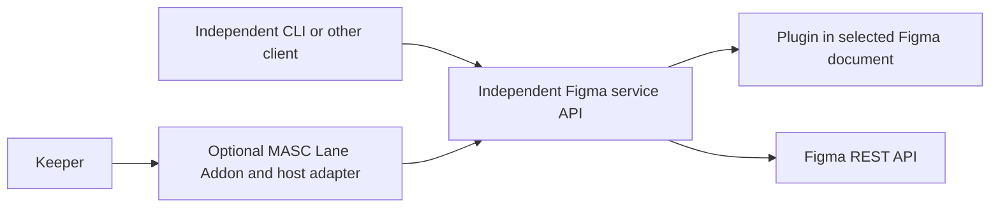

# Figma Studio: deferred design idea

Status: deferred by operator decision on 2026-10-13. This is a design proposal,
not an installable Addon or a release promise. Tracking: [#42735](https://github.com/jeong-sik/masc/issues/42735).

The experimental `addons/figma-studio` package has been withdrawn from the
shipping tree. Its peer relay required MASC tool names, credentials and worker
protocols inside the Figma repository. Removing that experiment does not remove
MASC's generic Lane Addon framework, Apple microVM backend or Figma OAuth Identity.
Existing installations and private state are not automatically deleted. Operators
who installed the experiment should identify its Addon installation/binding,
owned state volume (`studio.sqlite3`), relay configuration and imported Studio
development Plugin. Retire only credentials dedicated to that experiment after
checking whether the MASC relay token or Figma PAT is shared. Uninstalling the
experiment and deleting its private state require a separate operator decision.

The replacement experiments remain for reference in
[MASC #42784](https://github.com/jeong-sik/masc/pull/42784) and
[Figma #194](https://github.com/jeong-sik/figma-mcp/pull/194). They are deferred,
not ready to install. Source and fixture results do not establish actual Figma
canvas behavior, installed MASC integration or visual fidelity. Review also found
that stale Plugin sessions could accept work and later execute delayed edits.
That lifecycle problem must be resolved before any replacement is admitted.
See the original [MASC lifecycle review](https://github.com/jeong-sik/masc/pull/42784#pullrequestreview-5501882081)
and [Figma lifecycle review](https://github.com/jeong-sik/figma-mcp/pull/194#pullrequestreview-5501881690).

## Proposed dependency boundary

The Figma service owns Plugin pairing, document operations, Figma credentials,
operation outcomes and retained design snapshots. It has no MASC imports, tool
names, callbacks, Keeper names, credentials or installation protocol. It must
work from an independent client without a MASC checkout or process.

A future MASC Addon consumes only that published API. MASC-specific permissions,
worker transport, artifact import and workflow state belong on the MASC side.
The consumer respects generic worker network isolation. Choosing a host adapter
or a network-capable worker is a separate reviewed implementation decision.
A Plugin or Figma service must never receive a MASC credential.

The ordinary Figma MCP tools remain available independently. This proposal does
not require Official Figma MCP access and does not claim MCP feature parity.

## Product scope to design before implementing

Both user journeys remain the goal:

- Create or revise native Figma designs, then read back actual changed nodes and
  the rendered preview from the selected document.
- Implement a selected design in an existing repository from a pinned snapshot,
  run the application and compare the observed result with that snapshot.

The [dated Plugin and REST research](figma-platform-capabilities.md) is input to
redesign, not a list of implemented features. The next design review must cover:

1. A capability matrix mapping the existing MCP tools, Plugin operations and REST
   endpoints to supported, unsupported and entitlement-dependent behavior.
2. One snapshot contract for hierarchy, styled text, layout, components, variables,
   assets and preview bytes, with source identity and explicit missing coverage.
3. Explicit document/session selection and operation identity; cancellation and
   close/disconnect semantics; recovery of partial or uncertain effects without
   replay or silent retargeting. Reconnection alone cannot authorize old edits.
4. A versioned independent API, authentication and an installation/uninstallation
   path, exercised by a non-MASC client before the optional adapter is added.
5. Real Figma creation/revision and running-application evidence tied to the same
   snapshot. Kitty preview is a presentation option; emitting image bytes alone
   does not prove that the user saw them. A visual-verifier agent or fixed score
   threshold is not mandatory, but actual visual comparison needs evidence.

## Release proposal

The cleanup is proposed for the **v0.54.0** development scope following the
already-cut v0.53.0 candidate. Candidate `22395227d5addda383a80e8d549e7d366b7a03ee`
and published v0.52.0 contain none of the withdrawn Studio package or design
files (only the pre-existing versioned roadmap). Do not reopen that candidate
for this cleanup, or advertise withdrawal as removal of a released feature.
Release owners retain version assignment and normal release checks.

Full Studio functionality has **no assigned release**. A later **0.xx.0** minor
may include it after design review, explicit capability gaps and both real user
journeys pass. No version bump, tag, runtime installation or private-state cleanup
is authorized by this proposal.
