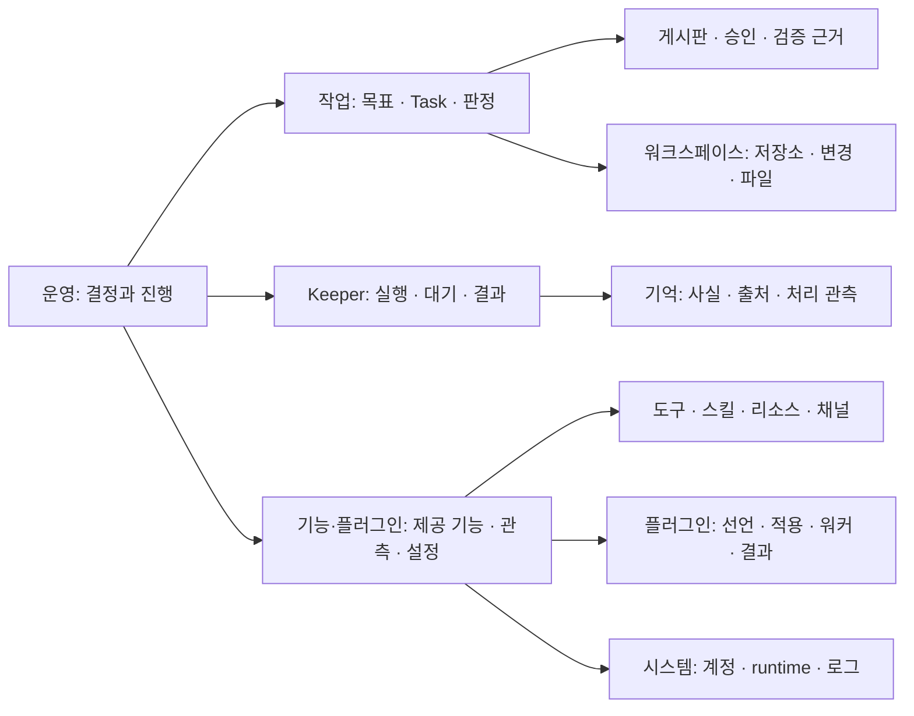

# 운영자가 판단하고 조치하는 TUI

TUI는 먼저 사람이 결정할 일과 진행 중인 일을 보여 준다. 구현 모듈이나 수집한 지표의
목록을 첫 화면의 구조로 삼지 않는다. 이 문서는 TUI 전체의 정보 배치 기준이다.
실행 화면 검증이나 설치 완료 기록은 별도로 남긴다.

## 여섯 진입점

| 진입점 | 운영자가 답할 질문 | 먼저 읽을 정보 | 더 읽을 곳 |
|---|---|---|---|
| 운영 | 지금 내가 결정하거나 확인할 일은 무엇인가? | 승인·질문, 이어갈 대화, 업무와 실행 여력의 관측 | 사용량의 계정·호출·추세 |
| 작업 | 무엇을 맡겼고, 무엇이 끝났으며, 무엇을 판정해야 하나? | Goal과 Task, 담당·진행·제출 근거, 다음에 가능한 조치 | 승인·질문, Task Review·Verdicts, 게시판 |
| Keeper | 누가 일하고 있고, 누구에게 어떤 도움이 필요한가? | 현재 실행·대기 이유, 보류된 요청, 최근 결과 | 대화·원래 요청·로그·기억·일정·변경 |
| 기능·플러그인 | 여기서 무엇을 사용할 수 있고, 무엇을 설정하거나 확인해야 하나? | 제공하는 기능, 관측된 상태와 근거, 설정 적용과 실제 워커 | 도구·스킬·리소스·채널·클라이언트·플러그인 상세 |
| 워크스페이스 | 어느 저장소의 어떤 결과를 다루고 있는가? | 저장소·브랜치·작업 디렉터리, 변경·산출물 | 파일·diff·이력·메모·코드 탐색 |
| 시스템 | 실행 환경을 어떻게 구성하고 진단하는가? | 모델·계정·runtime 설정과 적용 결과 | 이벤트·서버 로그·원문 설정 |

Tab은 이 여섯 진입점을 순환한다. `surface_ring`과 순수한
`surface_ring_family`가 이동과 선택 표시의 공통 기준이다. 사용량·게시판 등은
기존 surface와 동작을 유지하며 명시적인 팔레트 후보로 남는다.

## 한 화면의 읽는 순서

1. 대상과 범위: workspace, Keeper, 계정 또는 기능을 먼저 식별한다.
2. 관측 상태: 현재 수신·재조회·마지막 관측·부분 수신·미관측을 밝힌다.
3. 필요한 결정: 실제 승인·질문·실패·복구 사유와 그 대상에 도달하는 조작을 둔다.
4. 진행 중인 일과 최근 결과: 접수·실행·완료를 구분한다.
5. 상세 근거: 원래 요청, 영수증, 출처, 실행 이력, 원문 설정을 선택해서 연다.

기본 화면에는 이 순서를 설명하는 문장을 반복하지 않는다. 정상 조회를 매번 설명하기보다
대상과 내용을 보여 주고, 조회 실패·부분 수신·이전 자료는 그 문제가 있을 때 알린다.
Task의 검증 제출은 기본적으로 시스템 심사 대상이다. 그 상태만으로 사람의 응답 요청으로
분류하거나 우선하지 않는다. 실제 질문·보류한 호출·Goal 최종 확인의 원래 판정을 따른다.
목록의 정렬을 화살표로 연결해 업무 흐름처럼 보이게 하지 않는다.

기능 화면은 기능의 이름·하는 일·현재 상태와 실제 오류를 먼저 보여 준다. 조작 경로는
후보 수·보존 실행 집계보다 앞에 두고, 긴 식별자와 집계는 기존 상세에서 읽는다.
기능 화면에 시스템의 런타임 메뉴를 다시 나열하지 않는다. 현재 워커와 보존한 워커의
실패는 구분하며, 기록이 있다는 이유로 현재 실행 중이라고 쓰지 않는다.

모든 탭에 별도의 대규모 진단 패널을 추가하지 않는다. 각 화면의 기존 헤더·목록·선택
상세를 사용하고, 추가된 행은 같은 frame의 본문 예산에서 차감한다. 좁은 창에서도
현재 선택과 실패·조회 상태가 보이게 한다. 긴 기술 ID와 설정 원문은 상세에서 읽는다.

## 연결, 실행, 관측, 조치는 서로 다른 사실이다

| 표시 | 뜻 | 이 표시만으로 알 수 없는 것 |
|---|---|---|
| HTTP 연결 | 해당 HTTP 연결·요청의 관측 | fleet scan 성공, 개별 Keeper 실행 가능 여부 |
| fleet 수치 | 그 fleet snapshot이 관측한 실행 여력과 차단 사유 | 다음 순간의 실행 상태 |
| scan 실패·stream 단절 | 현재 fleet 관측을 갱신하지 못함 | 보존한 수치가 현재도 참인지 여부 |
| waiting 목록 갱신 | 대기 목록 reader의 조회 진행 | Keeper 업무가 차단되었는지 여부 |
| 사람 조치 필요 | producer가 보고한 조치 사유 | 모든 warning이 사람 조치를 요구한다는 뜻 |

보존한 fleet의 grade·count·blocker는 한 관측이다. 갱신 실패 중에는 그 요약의
시작부터 마지막 관측임을 밝힌다. 뒤에 `stale`만 덧붙여 오래된 `blocked · 0/28`을
현재 장애처럼 먼저 읽게 하지 않는다. 실패를 숫자 0이나 정상 empty로 바꾸지 않는다.
HTTP 성공과 느리거나 실패한 구성 조회도 하나의 정상/장애 상태로 합치지 않는다.

공통 operator-action rollup의 미보고와 정상 빈 목록은 별도 의미다. 현재 wire와
표시에서 이 구분이 보존되는지는 각 변경에서 확인한다. 이 문서의 원칙이 이미 모든
consumer에 구현되었다고 간주하지 않는다.

## 기능과 플러그인

기존 lane inventory와 `Masc_tui_lane_standing`의 닫힌 상태를 재사용한다.
준비·대기·변경 중·실패·꺼짐·미설정·미관측을 유지한다. 목록에 있다는 사실이나
설정이 있다는 사실을 실제 실행 성공으로 바꾸지 않는다. 미설정된 선택 기능을
자동으로 사람 조치 필요에 더하지 않는다.

선택한 항목은 다음 순서로 읽는다.

- 제공하는 기능과 사용 대상.
- 서버가 관측한 현재 상태와 최근 실행·실패.
- 선언과 적용 상태, 현재 워커와 보존한 워커의 구분.
- 실제로 가능한 설정·이력·복구 진입점. 권한은 원래의 typed 결정이 판정한다.

lane inventory는 모든 도구·스킬·플러그인의 완전한 목록이 아니다. 각각의 정본으로
내려가는 경로를 제공한다. `/features`는 TUI 사용법 안내이며 동적 가용성의 근거가 아니다.
기능 목록의 시각은 서버가 보낸 관측 시각을 쓰며, 화면을 그린 시각을 갱신 시각으로 쓰지 않는다.

## 기억을 읽는 다섯 축

참고한 기억 설계의 핵심은 나이와 출처 무효화를 나누고 전체 관측에서 Keeper 상세로
내려가는 것이다. 수치·예시 그림·갱신 전후 시뮬레이션을 실제 실행 결과로 옮기지 않는다.

| 축 | 현재 데이터의 의미 | 오인하지 않을 것 |
|---|---|---|
| 사실 나이 | 일반 사실의 `first_seen` 분포 | 오래됨을 약함·실패·stale로 판단하지 않음 |
| 저장 갱신 | memory snapshot의 `updated_at` | 출처를 다시 읽고 검증했다는 증거가 아님 |
| 출처 무효화 | 출처 변경·접근 불가 등의 기록 | 사실 나이와 별개이며 실제 무효화 근거를 보존 |
| Librarian 처리 | 처리 관측, 읽지 않은 턴과 연속성 근거 | 접수·보존된 pass를 현재 모델 실행으로 말하지 않음 |
| world | ledger·briefing·입력 revision의 독립 관측 | Keeper 사실 합계와 ledger claim 수를 같은 분모로 비교하지 않음 |

Keeper의 `By age` 그룹은 사실 나이 구간이 아니라 **저장 스냅샷 갱신 시각**의 구간이다.
축의 사실 나이 사다리와 함께 보여도 이 의미는 바뀌지 않는다. `saved`와 설명줄에서
이를 밝힌다. 출처를 다시 확인한 시각·결과가 없는 곳에는 새 “신선함” 점수를 만들지 않는다.
일반 사실의 First/Last와 retrieval 이력, source-bound 사실의 Bound Path/File SHA는
원래 상세에서 읽는다.

## 구현과 검증 범위

상위 메뉴 재분류만으로 이 설계를 구현했다고 보지 않는다. 각 본문의 기본 화면도
목록과 선택한 대상의 근거·조치로 구성한다. 넓은 창에서는 나란히, 좁은 창에서는
같은 정보를 위아래로 읽으며 선택·스크롤은 실제 목록에 배정된 높이를 쓴다.

| 본문 | 기본 화면 | 상세로 내려갈 정보 |
|---|---|---|
| 운영 | 결정·이어가기와 실제 fleet 실행·턴 여력 | 계정 사용량, 개별 요청과 조치 사유 |
| 작업 | Goal·Task 목록과 선택한 원래 목표·담당·단계·제출 근거 | 원래 요청, 제출·판정 원문과 연결 Task |
| Keeper | 현재 일·대기·필요한 도움과 최근 결과 | Story, 대화, 일정·hold, 로그 |
| 기억 | Keeper 선택과 다섯 독립 관측 축 | 일반 사실·출처·처리 입력·원자·revision |
| 기능 | 목적·가용성 목록과 선언·적용·현재/보존 워커 | 성공률·지연 통계, provider 경로와 세부 설정 |
| 워크스페이스 | 등록 저장소 목록과 선택한 실제 경로·배정·Git 관측 | 현재 Git 변경 `d`, 기록된 쓰기 `H`, 파일 `Enter`, 전체 경로 `v` |
| 시스템 | 설정 검증·적용 사실 표와 workspace 관측 | 원문 설정, 모델·계정, 활동·서버 로그·엔진 진단 |

Keeper의 새 기본 보기는 목록과 선택한 대상의 운영 정보다. 저장된 보기 설정은
그대로 복원하며, 상태·원인·시간·나이 등의 축별 보기는 별도 경로로 유지한다.

작업 목록은 Goal·Task 제목을 먼저 읽고, 단계·담당·연결 작업 관측을 보조 행에서
읽는다. 긴 ID·우선순위·갱신 시각·기한은 선택 상세에 둔다. 높이가 부족하면 상태와
제목을 한 행으로 줄이고, 페이지 이동은 실제로 보이는 항목 수를 사용한다.
부분 Task 관측에서는 집계와 각 연결 행에 그 범위를 표시하며, 비어 있어도 전체에
작업이 없다고 단정하지 않는다. 운영의 질문 목록은 실제 첫 질문을 먼저 보여 주고
배경과 나머지 질문은 원래 질문 reader에서 읽는다.

워크스페이스의 등록된 기본 브랜치는 현재 checkout 브랜치가 아니다. 현재 Git 조회가
없으면 그 사실과 조회 조작을 표시한다. 이전 Git 응답은 같은 저장소 ID와 조회 범위에
결속될 때만 사용하고 마지막 조회임을 밝힌다. 목록을 그린 시각을 서버 관측 시각으로
쓰지 않는다. 설정 상태는 같은 revision의 적용 관측을 사용하며 명시적 source jump와
원문 선택은 계속 원문을 연다. Task 순서가 달라져도 기존 Task ID 선택·재결속을 유지한다.

backend 상태 판정·설정·권한·자동 복구 정책은 바꾸지 않는다. 시안의 데모 수치와
Memory 갱신 시뮬레이션을 실제 제품에 넣지 않는다. 구현 진척과 실제 후보의 관측은
각각 기록하고, 모든 본문을 실행해 보기 전에는 설계와의 일치를 완료로 보고하지 않는다.

독립 소스 리뷰, 구문 검사, 실제 후보의 타입·실행·설치 관측은 서로 다른 근거다.
소스 변경이나 설계도가 있다는 사실을 설치된 TUI에서 개선이 확인되었다고 보고하지 않는다.
변경한 문구·배치·행 순서만 확인하는 새 검사는 만들지 않는다. 기존 탐색 검사는
typed 목적지·입력 소유·요청·선택 결정을 계속 확인한다.

## 참고

2026-11-09에 아래 공식 문서를 읽었다. MASC의 상태와 결정은 해당 제품의 용어를
그대로 가져오지 않고 현재 코드와 API에 맞춰 정했다.

- [Grafana dashboard best practices](https://grafana.com/docs/grafana/latest/visualizations/dashboards/build-dashboards/best-practices/): 운영자가 겪는 증상과 상세 자원 관측을 나누는 참고.
- [Kubernetes Pod Lifecycle](https://kubernetes.io/docs/concepts/workloads/pods/pod-lifecycle/): 상태와 조건, 미확인의 구분을 위한 참고.
- [VS Code Extension Marketplace](https://code.visualstudio.com/docs/configure/extensions/extension-marketplace): 확장 목록과 설정·활성화·상세 진입을 묶는 참고.
