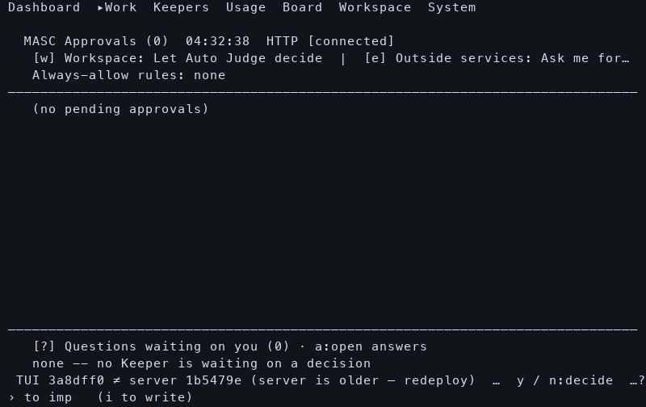

# Ask receipt visibility before retained feedback

This is one isolated native 80×24 diagnostic capture at TUI source
`3a8dff0fe1e7ec1c744168fc923ba6dd05856d62`, with backend source
`1b5479e708100b482295681b40cd31435ae89ce6`. It precedes the retained-receipt
implementation. The implementation's immediate parent also changes independent
operator-confirmation reads; this capture is therefore ancestor diagnostic
evidence, not an exact-parent performance baseline or paired After comparison.

The actual native selection/Enter sequence sent one answer POST. Its HTTP 200
receipt reports `recorded=true` and `delivered=true`; the original canonical
answer and pending wake bytes are retained under `durable-after/`. No Keeper
consumption or work was observed. The post-answer question list is empty.

At the later [native frame](warm-9.5.png), **5216.963 ms after the confirmation
key** on the collector's same arm clock, the transient notice is gone and no
retained answer outcome is visible. This was manually inspected; no wording,
layout or row-order assertion test was added. The full native ANSI stream and
exact frame offsets remain available. The PNG is a native terminal cell replay,
not a physical terminal paint clock.

## As-Is and To-Be

| Aspect | Before observation/source | To-Be implementation |
|---|---|---|
| Late answer outcome | Transient notice expired; no retained receipt in the frame | Session-local original receipt remains on Approvals |
| First feedback dependency | POST result waits behind the question reread | Original result offered before the reread starts |
| Extra HTTP calls | Original POST and reload | Same POST and reload |
| Actual Keeper work | Not observed | Still requires separate Keeper activity/action evidence |

**After is not built or measured for this implementation.** Source parser
checks and authored protocol scenarios do not fill that gap. The source change
and observation semantics are described in
[the refresh guide](../../guides/tui-refresh-observation.md#keep-the-last-ask-answer-receipt-visible).

## Provenance and limits

The TUI was built by [native run 38953855971](https://github.com/jeong-sik/masc/actions/runs/38953855971).
The selected producer-checksummed executable has SHA-256
`d43c2a8004a7c5385ecc3ab6f69099f8a8d5419e50341f624117d3f1461c572a`. Selected ZIP members and producer
checksums were verified; the full archive API digest was not verified. This
isolated macOS cohort used four existing local dependency libraries and does
not prove an installed or relocatable release.

`manifest.json` retains exact source/binary hashes, intervention settings,
input hashes, capture scope and observer/renderer identities. Their frozen
sources are included. `http-observations.json` retains every recorded request
outcome, including failures or stream closes; capture completion is not an
all-HTTP-success verdict. One attempt and one arm completed fixture validation.
No source-version latency distribution, real-model speedup, live installation
or restart is claimed. Earlier answer captures and their retained collector
failure are a separate cohort in
[the original answer evidence](../2026-10-17-native-ask-answer/README.md).

`artifact-index.json` indexes this frozen evidence's payload sizes and hashes;
it is an integrity receipt, not a product-behavior verdict.
