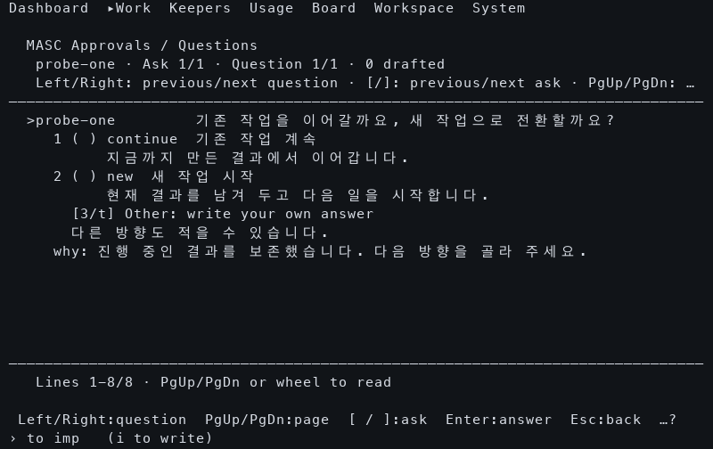
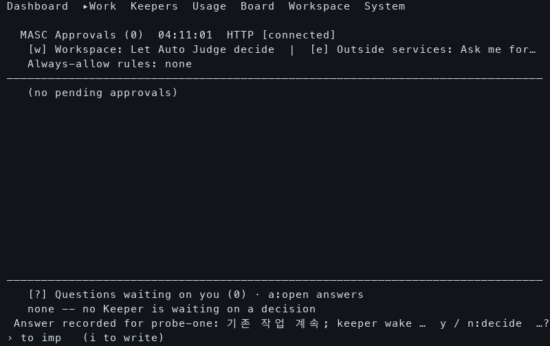

# Native Ask answer and narrow-screen follow-up

An actual native TUI submitted the original question's selected choice at
120×36 and 80×24. Each isolated arm produced one answer POST, one canonical
answer event and one pending wake carrying that Ask's original continuation and
canonical answer time. The subsequent open-question read was empty. No Keeper
was started, so these observations establish answer recording and durable queue
admission, not Keeper consumption, resumed work or task completion.

Both server and TUI came from `1b5479e708100b482295681b40cd31435ae89ce6`.
The native build is [38945386945](https://github.com/jeong-sik/masc/actions/runs/38945386945).
Selected members matched the producer SHA256SUMS and ZIP CRC; the complete
archive digest was not verified. The same four supplemental local libraries used
by the [question-read comparison](../2026-10-17-native-asks/README.md) were used.
These are private candidates, not an installed runtime.

## Observed protocol and screen

| Viewport | Actual answer POSTs | Canonical answer events | Original pending wake | Collector outcome |
|---|---:|---:|---|---|
| 120×36 | 1 | 1 | Present | Nonzero exit from the old open-list validator |
| 80×24 | 1 | 1 | Present | Captured, protocol fixture verified |

The actions were: open the original question, select position 1, press Enter to
arm, and press Enter again to confirm. HTTP receipts name the original Ask and
authenticated actor `masc-tui`. The canonical answer contains the actual submitted
`continue` choice. The queue's `ask_answered` source retains the same Ask ID,
answer time and original unrouted continuation. Raw request outcomes, saved
canonical records, actual action/capture offsets and binary hashes are in
[observed.json](observed.json) and the viewport directories.

| 80×24 original answer draft | 80×24 after native submission |
|---|---|
|  |  |

Manual inspection found that the question, choice labels, descriptions and
free-text alternative fit in the narrow draft. The final receipt starts with
the recorded answer and choice, but its trailing wake status is ellipsized at
80 columns. Internal choice IDs also consume space before the human labels.
The 120-column [final frame](120x36/warm-9.5.png) retains the full wake notice.
No screen wording, layout or row-order assertions were used.

## As-Is and To-Be

| Aspect | Observed As-Is | Source change | Execution still needed |
|---|---|---|---|
| Successful answer notice | Long chosen labels precede the wake status, hiding it in a narrow footer | Put recording and wake status before Keeper/choice detail | Fresh native frame of the revised notice |
| Failed wake notice | Chosen labels precede delivery-pending status | Put recording and pending status first; preserve automatic-recovery detail | Native pending-delivery observation |
| Choice row | Position, selection mark, internal ID and human label | Show position, mark and human label; retain exact IDs in the draft and request | Fresh native narrow draft |
| Answer semantics | One native POST, canonical answer and original pending wake | Existing answer validation, first-winner handling and wake meaning retained | Keeper consumption and original next action |

The screenshots above precede these readability edits. They expose the problem;
they do not establish the revised rendering. The separate enclosing-refresh
change has its own source/binary and timing evidence.

## Retained collector failure

There were two collector attempts and two started native arms. The first
collector's read-only fixture validator expected the original question to remain
in every warm list even after the successful answer removed it from the open
list. It exited nonzero and its original `fixture_unverified` observation remains
saved. Its actual POST response, canonical answer, original pending wake and
native frame were independently read; those narrower facts are reported above.

The corrected collector accepts an empty warm open list only after observing the
matching recorded-answer receipt. The 80×24 run completed with a verified fixture.
The included collector source is that corrected version; both original observer
digests remain in `observed.json`. No timing distribution or real-model speedup
is inferred from these functional observations.

## Reproduce in isolation

Use the verified native binaries, private support dependencies and renderer as
described in the earlier question-read comparison. Choose a fresh output path:

```sh
python3 observe-native-refresh.py \
  --server "$VERIFIED_SERVER" --baseline-tui "$VERIFIED_TUI" \
  --candidate-tui "$VERIFIED_TUI" --support "$SUPPORT" \
  --frame-renderer ./native-frame-support.py --output "$NEW_PRIVATE_OUTPUT" \
  --columns 80 --rows 24 --health-delay 0 --sibling-delay 0 \
  --only-arm candidate --submit-answer
```

Answer observations require one fresh arm so the first arm's durable pending
wake cannot contaminate another arm. Question creation is an explicit synthetic
fixture. The collector records HTTP, durable state and real PTY cells; `captured`
is a collection outcome and does not assert visible text or Keeper action.
