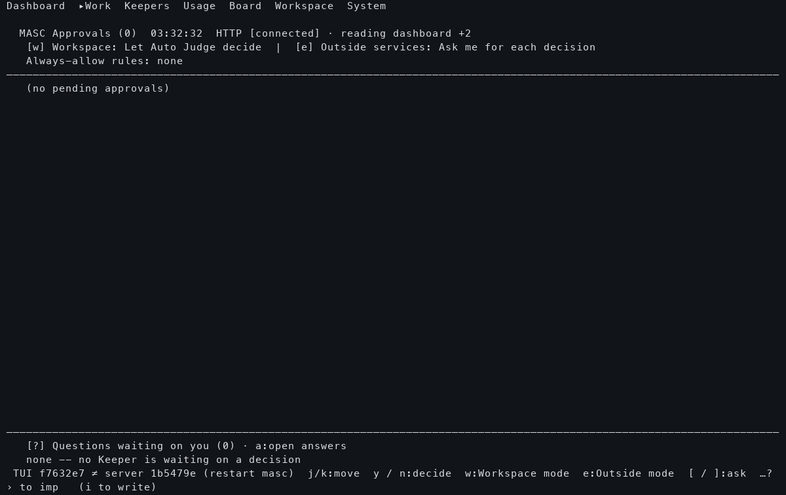
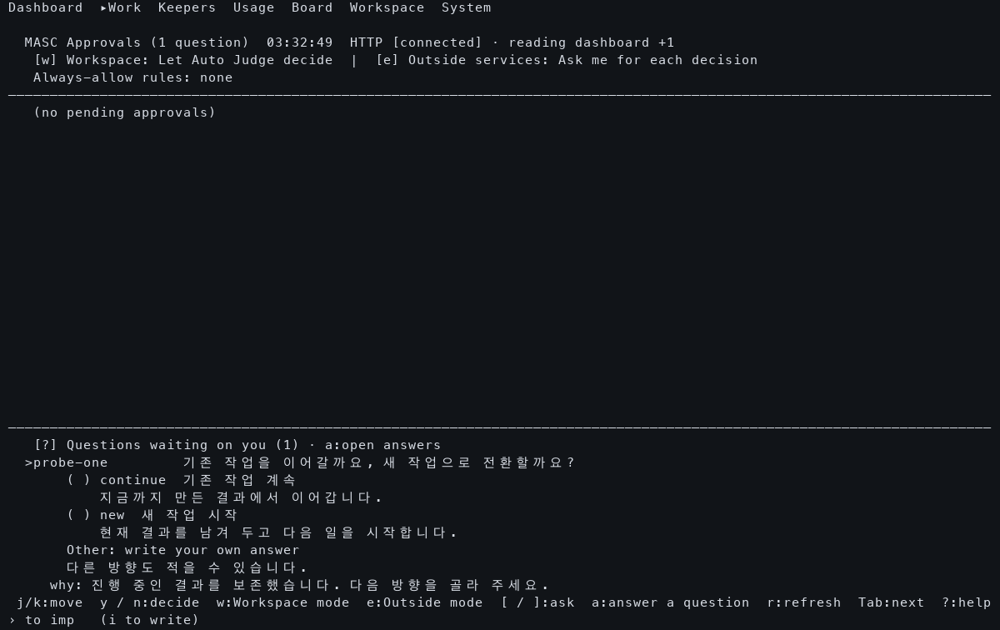

# Native Ask Before/After

The new TUI can display the original question while independent readers are
still pending. Both binaries used one repaired native backend and the same
canonical private workspace per pair, with the question bytes reset between
arms. This comparison injects a four-second independent-reader delay and a
two-second post-question health delay. It measures that dependency path, not
normal fleet latency or real-model preparation.

Open [the frame comparison](index.html) to choose 120×36 or 80×24 and inspect the
same capture stage side by side. The packaged PNGs render actual native PTY
cells. The `.txt`, `.ansi`, HTTP and Transport records retain their narrower
provenance; no UI wording, layout or row-order assertions are used.

| Viewport | Old question reader | New question reader | New question state admitted | Old full refresh | New full refresh |
|---|---:|---:|---:|---:|---:|
| 120×36 | 2007.584 ms | 5.568 ms | 18.129 ms | 6033.812 ms | 6026.096 ms |
| 80×24 | 2013.317 ms | 7.131 ms | 17.886 ms | 6025.552 ms | 6043.904 ms |

`question reader` is the logical source duration, including the old extra
health request. `state admitted` ends at accepted UI state, not physical paint.
The old binary has no matching early-Ask admission record, so its state clock
is unknown. Each admission joins its own full refresh by exact
`refresh_started_ns`; process clocks are not compared as absolute timestamps.

Manual frame inspection found the original question, choices and context in
the new `warm-0.1` frame at both widths. The old `warm-1` frames still have no
question, and `warm-2.5` frames show it. Capture offsets are recorded in
[observed.json](observed.json); labels are scheduled stages, not exact paint
times. Both new answer drafts open with the original choices and free-text
option. No native answer was submitted and no Keeper action is established.
The full refresh still takes about six seconds in this intervention.

| Before, 120×36 at the one-second capture | After, 120×36 at the 0.1-second capture |
|---|---|
|  |  |

The 80×24 [question list](80x24/candidate/warm-0.1.png) and
[answer draft](80x24/candidate/draft-3.5.png) retain the question, numbered
choices, descriptions, free-text option and context. Long navigation hints
remain ellipsized at that width; this is not a claim that every shortcut is
visible simultaneously.

## Source and execution evidence

- Baseline TUI: `f7632e71601da3ce6c7b5a5e8a6b528bcf42fa4c`.
- Candidate TUI and shared server: `1b5479e708100b482295681b40cd31435ae89ce6`.
- Exact native build: [run 38945386945](https://github.com/jeong-sik/masc/actions/runs/38945386945).
- HTTP/Ask projection/source-read/answer-wake checks: [run 38945382876](https://github.com/jeong-sik/masc/actions/runs/38945382876), 108 passing cases.
- Selected archive members were checked against ZIP CRC and producer SHA256SUMS. The complete archive digest was not verified. Four supplemental local libraries, identical across arms, are recorded separately in `observed.json`.
- The old binary's expected version notice is retained because both clients intentionally share the repaired server. The comparison does not claim old/new whole-runtime parity or an installed runtime.

Binary hashes, source identities, fixture hashes, observer/renderer digests,
actual capture offsets, source clocks and HTTP outcomes are in `observed.json`.
`artifact-index.json` binds the packaged collector files at assembly. Raw HTTP
query values are omitted from the public HTTP records; those records retain
endpoint, status, request outcome, clocks and response hash. Failed background
requests at client shutdown remain counted. They are not silently promoted to
successful requests or pooled into the completed warm-read measurement.

## Attempts retained

Seven collector attempts remain in the history: two setup failures and five
runs that started ten native arms. Two arms exposed the original registry-only
inventory defect. Eight arms returned the original question. Four of those
used an earlier PNG renderer that painted the second-cell background over wide
Korean glyphs; their raw terminal text was intact. They remain recorded and are
excluded from the corrected four-arm visual cohort above.

The corrected renderer paints all backgrounds before any glyph. New captures
also retain exact ANSI byte offsets so a future renderer correction can replay
the original bytes without rerunning a native comparison. The earlier
[offline inventory counterexample](../2026-10-17-asks-offline-inventory/README.md)
remains a failed observation, not a latency improvement. With two matched pairs
in the corrected cohort, no median, tail percentile or fleet-wide percentage
is reported.

## Reproduce in isolation

Use verified binaries and the same supplemental native libraries. Install
`pyte` and Pillow into a private `SUPPORT/pty-python-dependencies` directory.
On macOS, the renderer uses the platform Menlo and Apple SD Gothic Neo fonts.
Choose an unused output path; the collector refuses to overwrite an attempt.

```sh
python3 observe-native-asks.py \
  --server "$VERIFIED_SERVER" --baseline-tui "$VERIFIED_OLD_TUI" \
  --candidate-tui "$VERIFIED_NEW_TUI" --support "$SUPPORT" \
  --frame-renderer ./native-frame-support.py --output "$NEW_PRIVATE_OUTPUT" \
  --columns 120 --rows 36 --health-delay 2 --sibling-delay 4
```

Repeat with a new private output path and `--columns 80 --rows 24`. Question
creation is an explicit synthetic durable fixture; Keeper/model question
creation, native answer submission, live installation/restart and real-model
preparation remain separate evidence.
