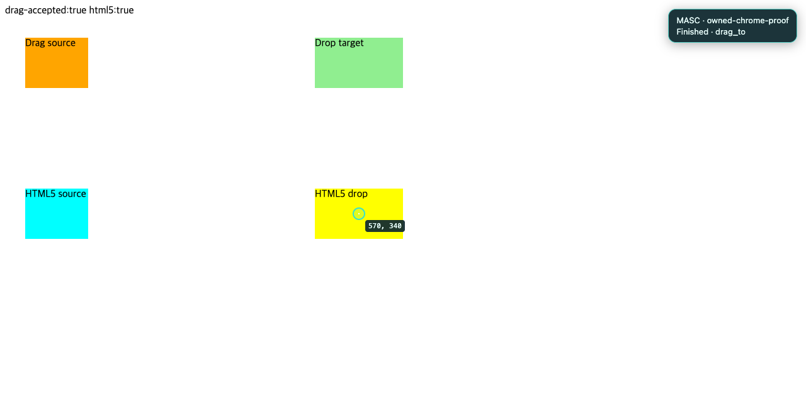

# Browser pointer follow-up evidence — 2026-10-19

Captured from an isolated Chrome profile and local fixtures, using the actual candidate browser-domain source and the installed pinned Stagehand 4.1.0 runtime. No production browser was driven. `source-manifest.json` identifies the source: all eleven files were byte-compared with the files compiled into the native proof bridge after the final rebase. The runtime's own handshake version is retained verbatim in the result.

`chrome-result.json` is the captured result and RPC method log. It shows:

- Native hover, followed by a fresh control read and trusted pointerdown/mousedown/click menu selection.
- Default and custom-path pointer drags accepted by the fixture.
- A separate actual HTML5 drag accepted only after trusted DataTransfer/drop delivery.
- Six observed working frames with the explicit owner and original semantic action, followed by a finished `drag_to` badge. The pointer at 570,340 comes from the trusted drop event.
- An inert, aria-hidden feedback host. Feedback does not authorize or replay input.

The screenshot was captured from that run and visually inspected. Its fixture deliberately reports pointer drag and HTML5 acceptance separately.

The source checks additionally compiled actual Lane (with its real PPX), Interaction, Wire, Feedback, Executor and Backend interfaces and ran 23 focused executor, queue and actor-routing checks. The unchanged Session transport types were supplied at the boundary. These checks cover all terminal outcomes, cancellation, overlay failure, anonymous calls and separately queued owners.

Other stack layers were measured separately: Firefox supports the tested native hover/menu and pointer-capture drags; its tested HTML5 DataTransfer/drop case still fails. The scene repair changes an old-source 200-node truncated read with no late toolbar into a 241-node complete read and retains over 3,100 dense nodes within the existing 1 MiB response limit.

This is candidate source/native-fixture evidence. It does not establish a complete server build, execution of the full compiled `stagehand_browser_probe` program, installation, production Slack reaction marking, or recovery of the separately reported skill-reader runtime failure. The persisted probe and fixtures were strengthened in this stack for subsequent integration checks.
