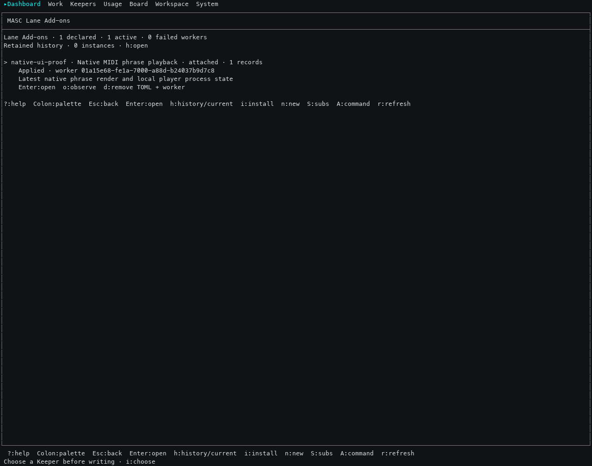
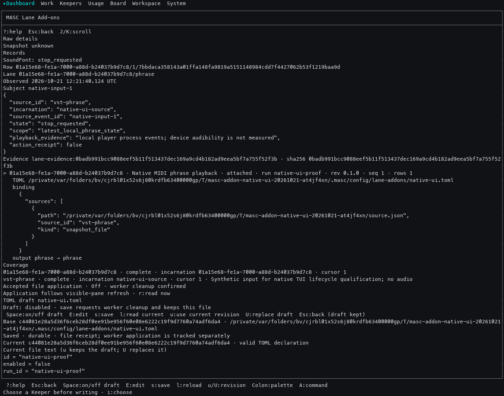
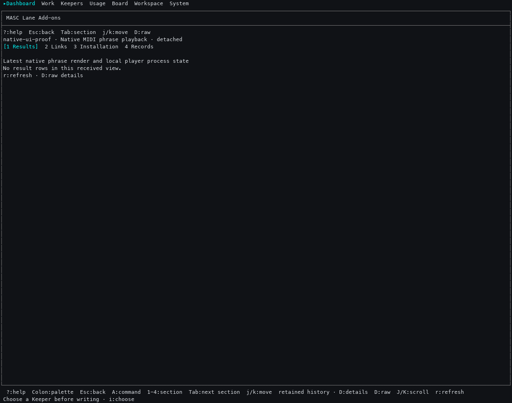
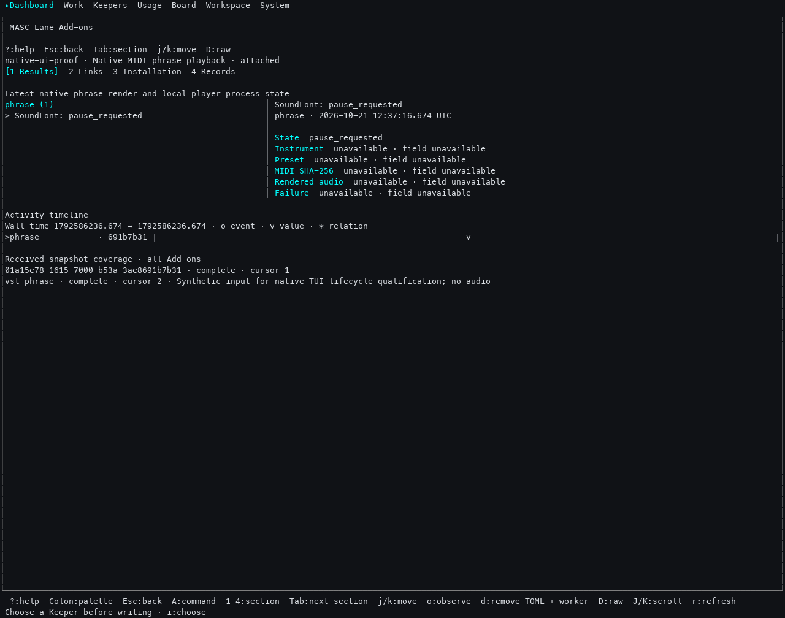
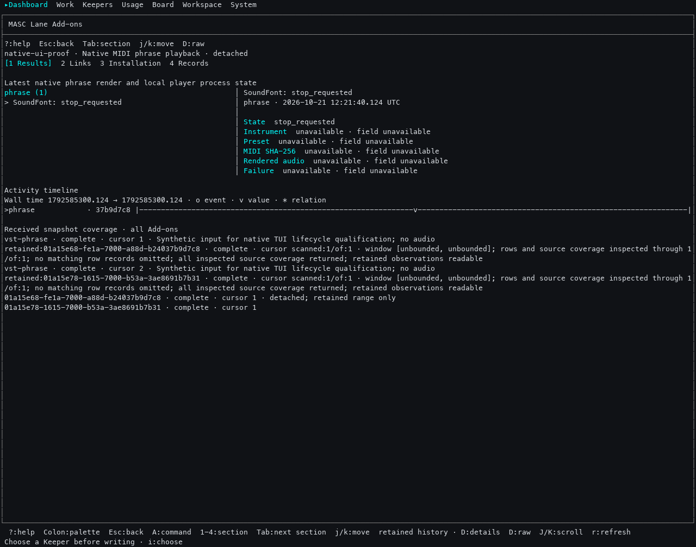

# Actual native Add-on lifecycle observation and retained-refresh failure

The actual matching native server and TUI from product
`7b16a9175711aefe744c5c704e038a42fd5b6b7b` executed against one isolated workspace,
port `64247`, and a real Docker/MCP `vst-phrase` observer. On → Off → On returned a
new incarnation and a new input result, with the original result preserved in
host storage. **A02 remains incomplete:** the TUI's ordinary detail refresh
replaced retained results with the live-only inventory. This folder preserves
that failure alongside the successful lifecycle observations. It is not an
execution receipt for the repair in #44838.

## Evidence identities

[receipt.json](receipt.json) records exact source, artifact, workflow, executable
hashes, installation ID/path/revision, engine, image, both incarnations and
containers, original row/evidence identities, and limits.
Native artifact run: [39595834943](https://github.com/jeong-sik/masc/actions/runs/39595834943),
artifact `12343798542`; workflow `97468f95df78f35a35bb3fe14a9670240cced930`.
Both binaries were queried directly for their embedded build commit and rehashed.

The input is a **synthetic phrase snapshot**, not real VST/audio/player or model
execution. The observer has no action schema; `action_receipt: false` is explicit.
No action receipt or audible output is claimed. Save captures show the actual
TUI's file receipt status/revision, while the original HTTP POST response body
was not separately recorded. GET documents are separate authoritative owner reads.

## Observed lifecycle

| Stage | Actual terminal capture | API / engine evidence |
| --- | --- | --- |
| On: applied, attached, original result | [overview](05-on-overview.txt), [detail](06-on-detail.txt) | [original inventory](on-before-off.json), [container running](container-on.json) |
| Off: explicit draft, durable save, Cleaning then confirmed cleanup | [draft](08-off-draft.txt), [save](09-off-save.txt), [application](10-off-application.txt) | [document](off-document.json), [inactive/released](off-after-save.json), [old container absent](container-off.json) |
| Defect: refresh loses visible retained rows | [first refresh](11-off-retained-detail.txt), [second refresh](12-off-retained-refreshed.txt) | [same original row still readable](off-slice.json) |
| History Enter temporarily restores the row | [retained detail](15-off-history-detail.txt) | [retained slice](off-slice.json) |
| On again: same installation/revision, new worker, new input result | [save](24-on-save.txt), [applied](25-reconnected-application.txt), [new result](31-on-new-result.txt) | [new incarnation](on-reconnected.json), [new container running](container-reconnected.json) |
| Old result remains its own result after reconnect | [old detail](33-old-result-after-reconnect.txt) | [both original rows/evidence](on-reconnected-slice.json) |
| Retained execution is unavailable | [retained controls](14-off-history-overview.txt), [manual Observe refused](34-retained-observe-refused.txt) | No action schema; old observation sequence remains `1` |
| Teardown through the same TUI | [final durable Off](37-final-off-save.txt), [cleanup observed](39-final-cleanup-observed.txt) | [both released](final-off.json), [both exact containers absent](container-final-off.json), [isolated process stop](shutdown-request.json) |

Off keeps the TOML. This is not Remove TOML + worker followed by reinstall.
The source revision changes with the enabled flag; the desired package/binding
revision remains the same. A fresh application read can coexist with an older
received worker inventory in raw details; those are separate observations.
After its selected instance disappears, `j` explicitly selects the remaining
installation before `E`; no replacement is silently selected for an effect.
No editor was configured, so the initial `E` retained the draft and reported that
fact. `Space` and `s` then saved through the normal TUI path.

## Actual terminal and derived images

The `.txt` files and six `*-cells.json.gz` files are captures of the actual
native process under a 160×56 PTY, interpreted with pyte 0.8.2.
[terminal-commands.jsonl](terminal-commands.jsonl) preserves manual input/capture
times. [tui-terminal.bin.gz](tui-terminal.bin.gz) is the lossless original terminal
stream. Gzip files use deterministic timestamp `0`; decompression yields the
original bytes. No screen wording, layout, row-order or PTY assertion test was
added. PNGs render the captured cells with Menlo 13 at 8×18 pixels per cell;
**they are derived terminal renders, not physical desktop screenshots**.

## Repair, review and remaining work

[Independent source investigation and repair review](source-investigation-and-repair-review.md)
confirms the same failure path in remote main `8feb8ea28f748c9e8c8ea905dc13b64671f04401`.
The bounded source repair in #44838 captures `Read_detail(instance, incarnation)`
for Inspect/Slice at dispatch, so manual, cadence, reconnect and terminal-action
follow-up reads use the existing fresh-inventory → retained-slice path. Effect,
evidence and action-status receipts retain their existing independent handling;
explicit installation-result jumps remain explicit.

Independent source verdict: PASS at repair `b217eacd614a4845aef270f62f6f27f182de6d54`
and complete diff `d082102f2b65dc8ac263e3b91c9f8583e7b3ea686c3ad291585588b7343951f1`.
[Four-file parser checks](repair-parser.json) passed. These are source/parser
evidence, not type checking, execution, formal GitHub approval or UI success.
The new state/request case checks exact incarnation binding, late-read rejection
and effect/status receipt admission; it asserts no screen strings.

A separate G06 follow-up remains: when fresh Inspect succeeds but the retained
Slice fails, the existing composite can replace previous rows before showing its
detail failure. That source-supported risk was not reproduced in this run and
is not fixed by #44838. A successful empty slice must remain distinguishable
from a failed read. Re-execute the repaired exact native candidate, including
manual and cadence refresh, before completing A02. Dashboard combination,
action-capable worker/model/real-app behavior, G03/G04 integration, operator
installation and the other worklist requirements remain separate.

Only the isolated server/TUI were stopped after both containers were released;
`ps` then confirmed both original PIDs absent. The terminal driver's WNOHANG
status is not a native exit-code receipt. Private login/token files were excluded
by an allowlist, and every selected artifact was checked against the original
bearer token before publication. [files.json](files.json) records file hashes.
