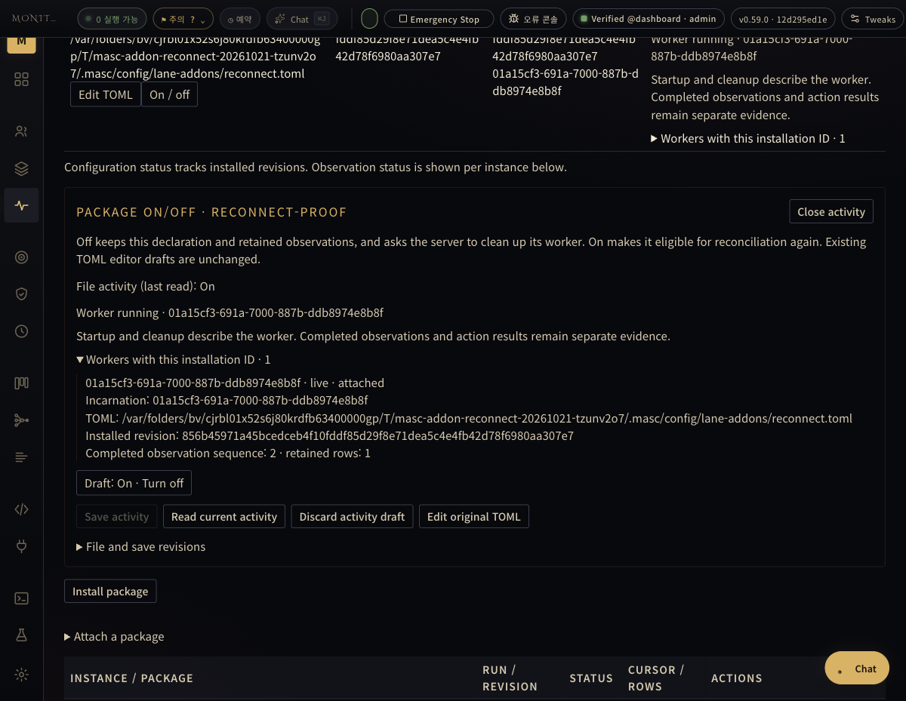
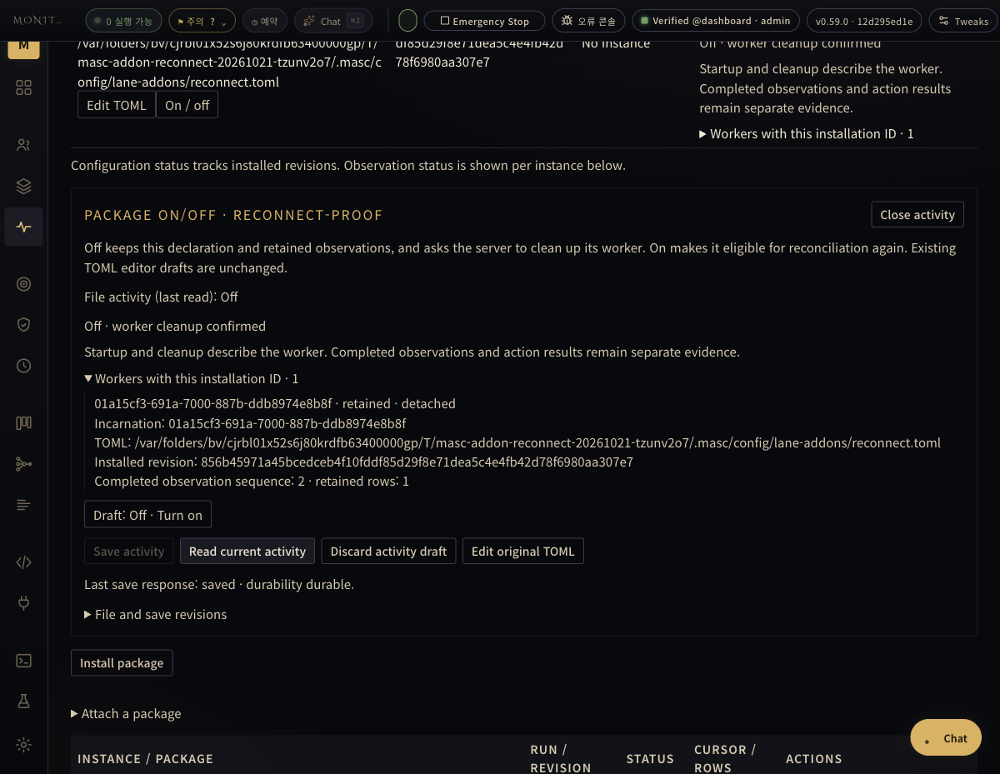
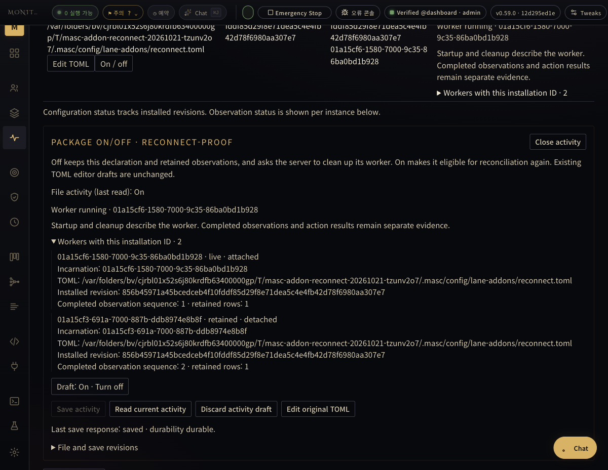

# Addon connection observation · 2026-10-21

The Dashboard drove a real installation through On → Off → On in a disposable
workspace. The Docker/MCP worker stopped, retained its first observation and
returned a new observation under a new incarnation after reconnection.

Frontend source: `566b98b5d1645d6312d518bf2810f3e5e0626586`.
Existing installed host: `12d295ed1e1bbf78ddbcabe41c5799f879d453af`.
The host was not rebuilt or deployed. This change consumes the host's existing
application and worker ownership facts; it does not introduce a new worker
implementation. The exact image digest and artifact hashes are in
[receipt.json](receipt.json).

| Observation | Recorded fact |
| --- | --- |
| [Before Off](on-before.json) | `applied`, live incarnation `01a15cf3-691a-7000-887b-ddb8974e8b8f`, sequence 2, one row |
| [After Off](off.json) | `inactive`; the same incarnation is retained/detached, with its Docker engine and released container ID; sequence 2 and one retained row |
| [After On](reconnected.json) | `applied`, new live incarnation `01a15cf6-1580-7000-9c35-86ba0bd1b928`, sequence 1, one new row; previous incarnation remains retained |
| [History read](history.json) | Two distinct rows, original `input-1` and new `input-2`, each bound to its own worker |

The old container was absent when inspected on the recorded Docker engine;
engine identity was read before and after the absence check; the
[independent follow-up output](container-absence.json) is retained. File saves used
the ordinary Dashboard activity draft and declaration CAS path. No responses
were mocked. The source input was a **synthetic phrase snapshot**; this proves
the actual package/host lifecycle and observation path, not real audio playback,
VST device behavior, model judgment or Candle settlement. Transient `cleaning`
and `starting` states were not captured and are not claimed as observed.

The frontend initially kept the prior server reading after saving Off and
displayed a different file revision as unconfirmed. An explicit activity read
then displayed cleanup confirmation. Reconnecting used the same declaration
and semantic revision; a new incarnation returned `input-2` rather than borrowing
the old worker's observation.

The first unauthenticated disposable setup returned 401. A restart of that
separate workspace was refused by its lease ownership check. The final cycle
used a new disposable workspace with an isolated admin credential. No lease was
deleted or bypassed. This does not qualify abrupt server-restart recovery.

## Actual Dashboard screens

## Validation boundaries

- Eight focused Dashboard suites: **145 passed**; [execution log](dashboard-tests.txt).
- TypeScript: `tsc --noEmit` passed.
- Changed OCaml implementation and test: parser checks passed, **no local Dune build**.
- Independent source review of frontend/TUI commit: PASS, no unresolved P0–P2.
- New TUI source has **not been executed** or visually qualified. The minimal
  request to `masc-pro-builder`, operation `kmsg-2ada1cdc54884c58aa6736a80b598868`,
  was queued when recorded. Queue acceptance is not a test or artifact result.
- No full regression, release, merge, installed runtime replacement, provider
  execution or extraction of Candle Appraiser is claimed.

The common connection boundary stays in the existing declaration, application,
worker and evidence contracts. Further Lane extraction should inject its domain
runner at that boundary, retain host settlement authority and use these same
surfaces. For Candle, the existing `Candle_appraisal.runner` is a candidate seam;
per-request grade/keeper schemas and typed retry outcomes must be preserved
before replacing that runner with an Addon. That extraction is separate work.
