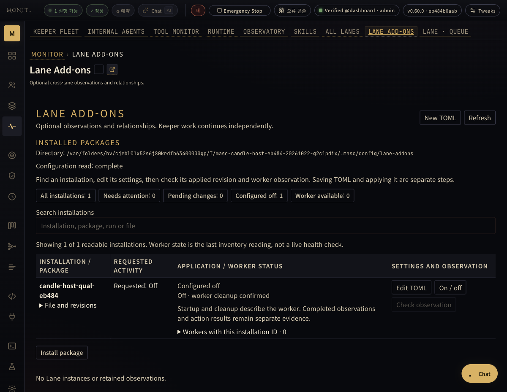
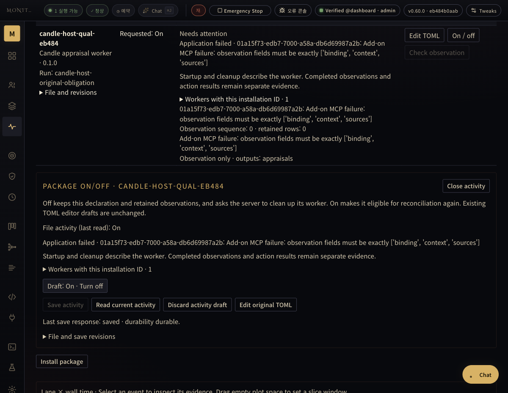
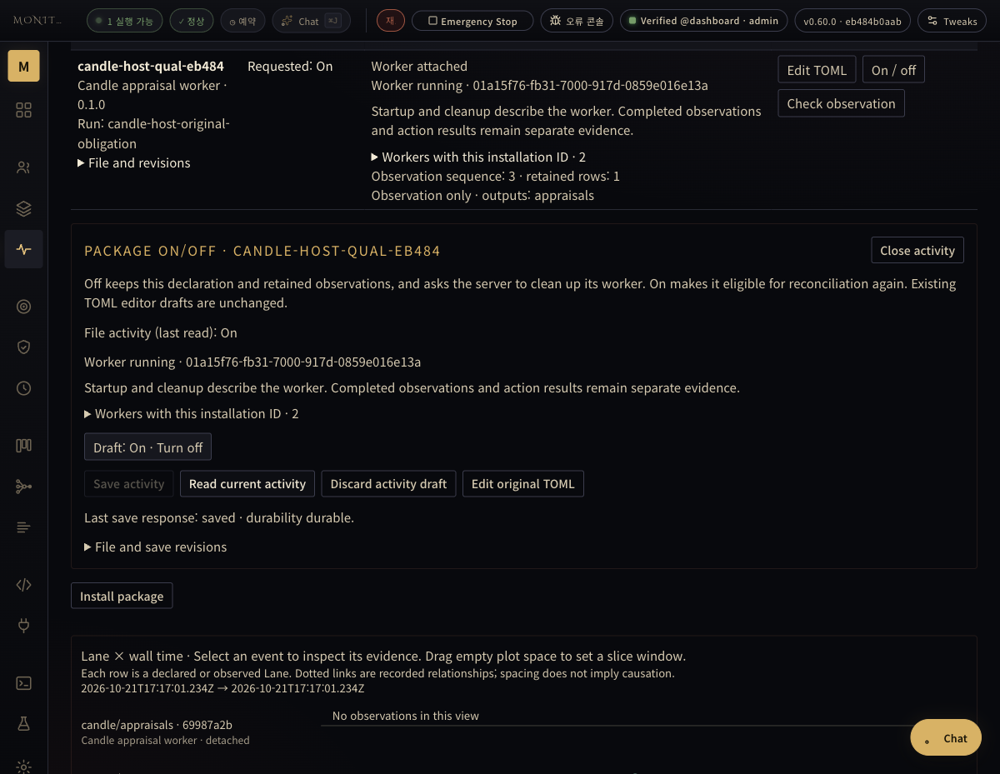
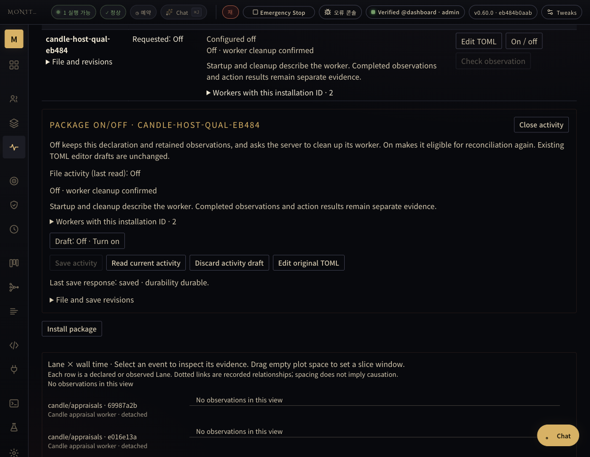
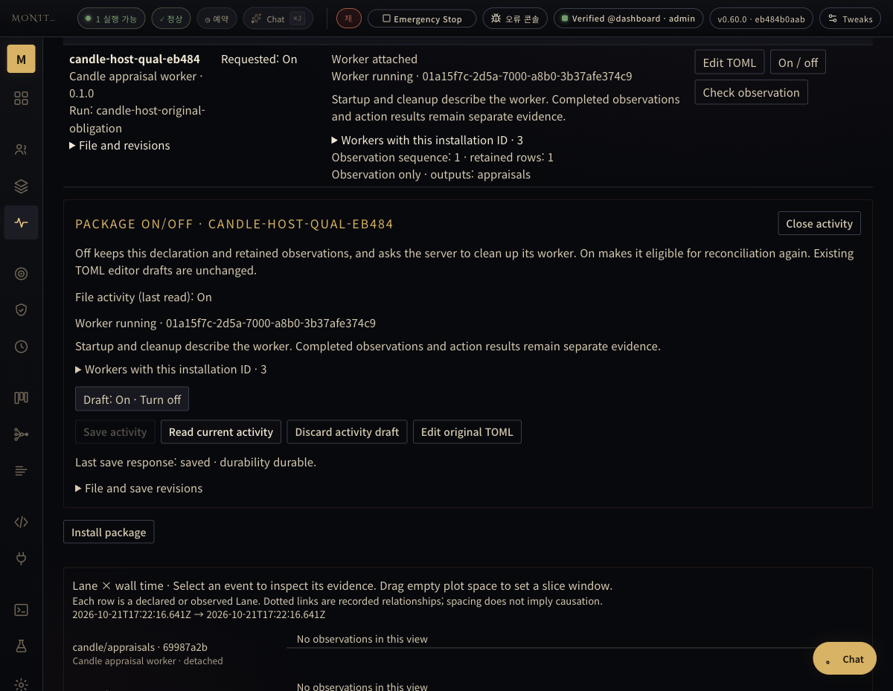
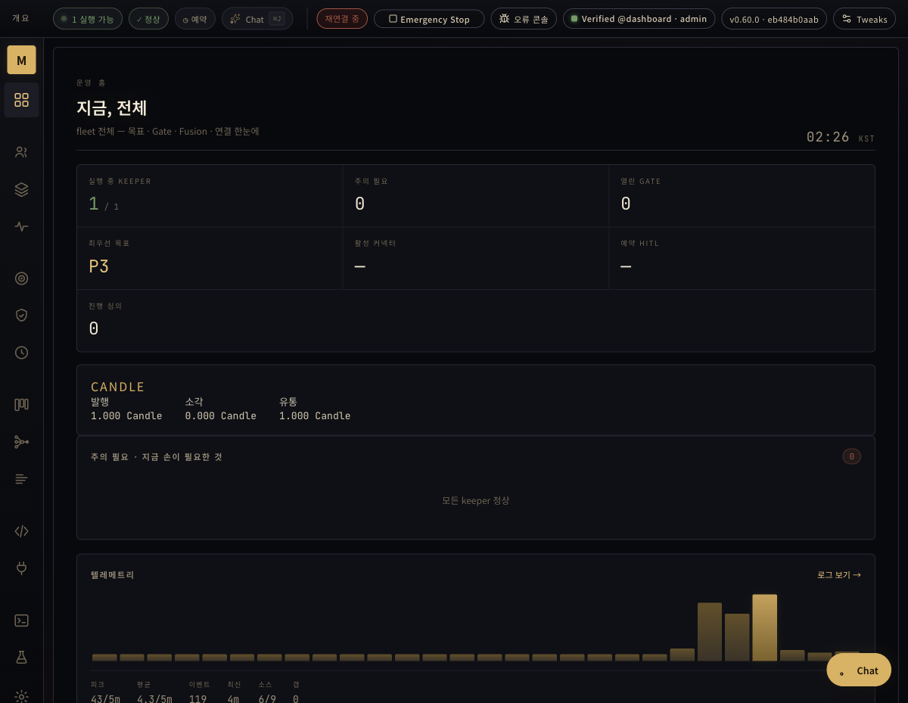

# Candle: real host reconnect and original payout

Measured 2026-10-21 16:51–17:28 UTC in one isolated owned workspace. This is E01 progress in the [54-item worklist](../../../reports/addon-lane-full-worklist-20261021.md), not completion of that whole goal or operator deployment.

## Source and execution identity

Native server/TUI and Dashboard: `eb484b0aabe699b46740bcb787a935fb67bbfa8e`. Native run [39636870206](https://github.com/jeong-sik/masc/actions/runs/39636870206) produced the actually executed matching binaries; its existing TUI/application suites passed 24+5 checks. Matching Dashboard build produced 671 files. See [identity](native-identity.json). The host native source predates the separately merged ledger-replay repair #44391; this run does not prove that repair.

The failed first worker is exact eb484. The repaired mounted Python worker is `b427c23667250e06ff4f85e235fe5716611c79f8`; `d4a12896d7f0e8199e5fb12095acb36f4d215a5e` subsequently adds only #44911's changelog. Native and Dashboard source are unchanged by those commits. This is an explicitly mixed component qualification, not a newly built native candidate.

The declaration uses the existing private image alias `masc-candle-proof:d35d2559-0c67b092c532`, immutable image `sha256:dfa4491a3c5c6ffac467e2e2ac2aa58cd46109d38fafea0f2ec0b492ce6ee00a`. Only the manifest's image binding differs from the source manifest. The exact package is mounted read-only; persistent state belongs to this installation. The Linux arm64 guest shim is a separately installed released dependency, verified against its original sidecar and copied into this isolated base path only. No operator runtime/configuration or credentials were changed.

## Original failure and normal recovery

1. A real manual Keeper, linked Task `task-001`, and Goal `goal-candle-host-eb484-source-qualification` were created through normal APIs. The bounded Task/Goal compare source bytes and retain a measurement; they do not pretend to establish this feature's behavior.
2. The first Task submission correctly retained [artifact_unreadable](29-original-unreadable-evidence.json): the guest was not running. Actual Keeper history also contained a failed Write, caused by missing guest shim. The earlier assumption that no Write was attempted is corrected. After the dependency was installed, a new manual operation attempted Write twice and Read once; do not infer two committed writes or quote its claim of a first-attempt success. The original host measurement is 401 bytes; the captured guest artifact is 400 bytes with the final newline omitted, and their JSON values agree.
3. Normal same-assignee resubmission produced `vrf-5ee2e4f6674a8ccda7adaa075d60da5b` with [no capture diagnostics](35-task-normal-resubmission-after-real-guest-write.json). The [actual immutable guest artifact](36-actual-guest-artifact-evidence.json) is untruncated and its values match the [exact Git/checkout comparison](38-original-artifact-source-comparison.json).
4. The real `verifier_exact` model [approved the Task](42-actual-task-autojudge-completion.json), using `ollama_cloud.ollama-cloud-kimi-k3`. A later test operator verdict attempt was [rejected](39-normal-private-operator-task-verdict.json), because the normal judge had already completed it. That attempted API call did not approve or bypass the Task.
5. A normal Goal proof request was [proven by the actual model](45-goal-proof-boundary-observation.json). The test driver then exercised the [authenticated private operator confirmation API](47-private-operator-goal-confirmation.json) against the exact request/criterion/run. `human_confirmed` is the API state name: this test was performed by Codex using the isolated administrator credential, not by a human, and says nothing about confirmation of the active 54-item user goal.
6. With Addon Off, the host naturally wrote [snapshot + payout_owed](48-off-original-obligation-retained.json); [inventory](49-off-after-actual-obligation-inventory.json) remained disabled with zero workers, and [there were no Candle appraisal runs](50-off-after-obligation-exact-runs.json). No ledger or verdict was seeded by the driver.
7. Dashboard On reproduced [the actual observation schema failure](52-dashboard-save-on-actual-inventory.json). The host sends `binding`/`sources` to derive-only packages; the Candle worker incorrectly required action `context`. [Before-fix subprocess check](python-before-fix.log) reproduces that same error; [after-fix check](python-after-fix.log) passes all 13 existing tests with the actual host envelope.
8. Dashboard Off confirmed [owned cleanup/release](56-failed-worker-off-cleanup.json). Only the private mounted worker source changed while detached ([receipt](57-private-worker-only-source-repair.json)). On created a fresh worker. [Application and observation](61-repaired-worker-application-boundary.json) succeeded, and the real common Exact route completed all three appraisal stages ([terminal runs](72-original-payout-terminal-exact-boundary.json)). Full original inputs, schemas, outputs and answering slots are in the three `83-original-*.json` receipts.
9. The normal host wrote [one paid event](73-original-ledger-post-three-stages.jsonl), for the original request `eb1b31232bf66ae2d1e677472024cfa6` and proof run `01a15f73-38a3-7000-8e6d-41546e05b642`: grade bounded, related task-001, weight 10, allocation 1000 milli to the actual Keeper. Those are isolated test policy values, not policy recommendations.
10. Dashboard Off released the settled worker, then On created a third incarnation of the same installation. Its [first observation](81-settled-original-installation-reconnected.json) retained all three finished results, zero pending. The [post-reconnect audit](84-original-payout-after-reconnect.json) retained exactly three succeeded Candle run IDs and byte-identical ledger with one paid event. A [later observation](88-paid-once-later-observation.json) at 17:26:15 UTC, about four minutes after reconnect, confirms the same ledger bytes, one paid event and three original Candle runs. This is a bounded observed reconnect, not an indefinite stress guarantee.

The [actual container receipt](66-candle-container-secret-and-state-boundary.json) records only environment variable names and mounts. Provider credential variables are absent, and mounts contain only the package and owned state. No credential values or private server startup log are published.

## Visible UI observations

These are manual actual-application observations. No TUI wording/layout/row-order tests or mocked HTTP were used. The VT cells/text are the real native child's terminal output, not a screenshot of a desktop terminal. Dashboard was observed in an owned ego task space; the transparent HTTP proxy does not provide a live WebSocket, so these are explicit refresh observations, not WebSocket-health evidence.

[Actual native TUI detail after reconnect](80-tui-selected-original-worker-detail.txt) and its [original VT cells](80-tui-selected-original-worker-detail-cells.json) show the new worker's original appraisals row with pending 0 and retained results 3.

## Reviews, limits and follow-up

- [Independent artifact/recovery review](independent-artifact-recovery-review.md) and [independent source review](independent-source-review.md) are bounded read-only sibling-agent reviews, not formal GitHub approvals or cross-model attestations.
- #44911 follows Browser #44168/#44702. The first publication attempt left it a draft targeting the existing top branch after `gh stack link` failed to append. MASC pr-updater subsequently attached it: the current REST census confirms position 68 of 68 in native stack #44168. The earlier failed retarget of #44702 was refused by GitHub; the prior 67-layer identity remained intact at that checked boundary. This PR must be considered with its native stack, not independently merged to main.
- Native/worker component identities and the private image binding above remain material limits. This is not installed operator behavior, full Native Stack readiness, every failure/cancel/unknown case, Safari/Chrome/Firefox parity, or full54 completion.
- A new G03 observation issue remains: rereading a finished Grade while later stages progress rewrites its reported elapsed_s (60.03 seconds in receipt 68, then 180.05 seconds in receipt 72; receipt 63 still reports Grade running) without a new model request. Preserve-first terminal timing needs a bounded follow-up; do not interpret that changing elapsed value as provider latency or duplicate provider execution.

[File hashes](sha256-receipts.json) cover the original files in this bundle; the hash file excludes itself.

## Owned cleanup

After capturing the results, Dashboard saved the same declaration Off. All three owned Addon incarnations reported detached/released, and normal Keeper shutdown finalized with no visible microVM guest. The owned native server/TUI exited, the proxy received a stop request, and owned browser task space 30 finished. Original evidence, ledger and persistent volumes remain available. See [cleanup receipt](99-owned-qualification-cleanup.json), [Addon releases](94-final-addon-owned-cleanup.json), [Keeper shutdown](97-private-keeper-shutdown-observation.json), and [final actual TUI](95-tui-final-off-retained-history.txt). These actions did not stop or replace the operator's running MASC.
