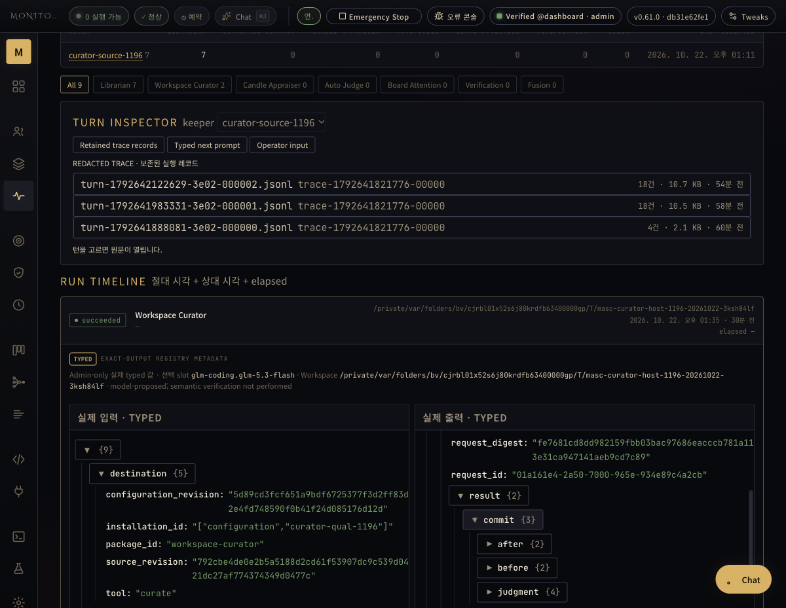
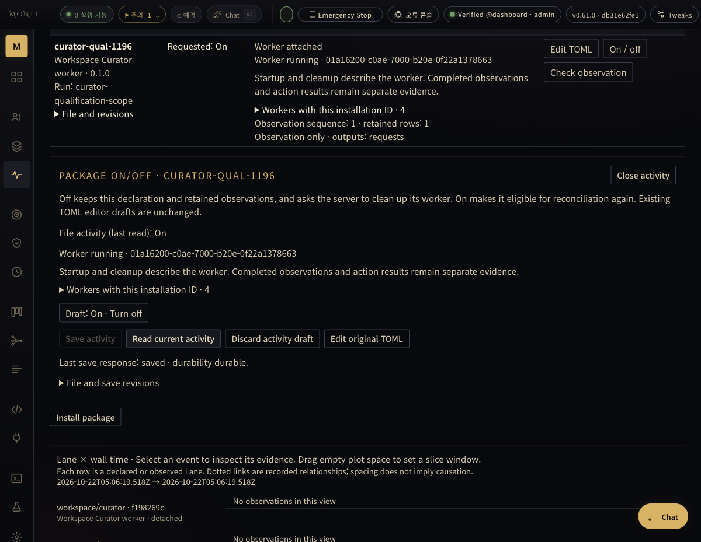

# Curator: original Briefing recovery while Off

This is actual isolated-host evidence for source
`db31e62fe17f92aea4919de7765f1ace65914772`, following the earlier
[cb2 partial result](../2026-10-22-curator-contract-owner-context/README.md).
It does not certify the operator installation, all failure paths, E03 extraction,
or completion of the original 54 tasks.

## Executed source and checks

- [Selected run 39724191606](https://github.com/jeong-sik/masc/actions/runs/39724191606):
  production owner 16 and original commit/recovery 63, **79 actual tests PASS**.
  [Original runner log](selected-tests.log) preserves the actual commands/results.
- [Native run 39724191562](https://github.com/jeong-sik/masc/actions/runs/39724191562):
  TUI 24 + application 5 PASS, with matching server/TUI/key reference. The
  [native receipt](native-receipt.json) records source and binary hashes.
- [Actual health identity](actual-health-identity.json) comes from the new
  process's full-health response. The same workspace, port, auth and domain data
  were retained. Only the owned qualification server/TUI were normally stopped
  and replaced. Dashboard assets were built from a clean detached checkout of
  the same db31 source; no synthetic build identity was written.
- The worker image was retained, not rebuilt. Its protocol, Exact worker,
  Curator server and manifest implementation bytes are unchanged between the
  qualified host sources. The installation-only image reference remains the
  task-owned image used by the earlier real provider execution.

## Recovery with no worker

The installation was already Off with zero owned running containers before the
new server started. The [original retained captures](before-recovery.json) were
not replaced or seeded. Classification had committed and ACKed; Briefing had a
real GLM answer and a retained commit intention, but no published briefing.

The repaired host recovered original Briefing request
`01a161e4-2a50-7000-965e-934e89c4a2cb` while it remained Off. Its append-only
events explicitly retain `commit_unknown` with reason `Recovered original
commit intent`, then `commit_retry_observed`, `commit_observed` and observer
completion intention/ACK. This is not a new model dispatch.

[After recovery](originals-after-Off-recovery.json), both original requests have
observer completion receipts. The original classification journal, ledger and
Keeper Memory bytes stayed unchanged at this boundary. All 17 existing Exact
payload files stayed byte-identical. One new payload is the expected completion
receipt under the **same original Briefing run directory**, not another model
answer or run. [The boundary record](Off-recovery-boundary.json) separates these
facts. [Published Briefing](briefing-after-Off-recovery.json) has the original
claim source/contract, retained answer, and no remaining building state.

[Off inventory](Off-inventory.json) and the actual empty
[owned Docker listing](owned-docker-Off.txt) show that recovery did not require
reattaching the worker. The native history shows both originals succeeded;
[original detail](native-original-Briefing-completion.txt) preserves the request,
real GLM usage, retained judgment and host commit. The matching Dashboard shows
the same original typed input/completion, rather than inferring completion from
a worker's status.

## Re-enable and process new actual input

The same installation was enabled through Dashboard's normal activity save.
It reconciled to new incarnation `01a16200-c0ae-7000-b20e-0f22a1378663`.
[API inventory](On-new-incarnation-inventory.json), actual
[TUI](native-new-incarnation-On.txt), and Dashboard distinguish it from the
three retained older workers.

The same real Keeper was normally resumed and received one explicit message.
It used `keeper_memory_write` once, producing actual candidate
`memory-admission-eacd6102425f3dc4d519fe817002d278`, sequence 2. The
[original operation completion](actual-Keeper-fact-completion.json) is distinct
from candidate admission. The existing host Librarian admitted the candidate:
[Memory](memory-after-new-work.json) advanced to revision 2, preserving the first
fact and adding the second; the [candidate queue](candidate-queue-after-new-work.json)
has `last_sequence: 2` and no pending rows. A Memory fact's codec origin label is
not a claim that the test author manually seeded it: these files were read after
the actual Keeper tool call and host Librarian commit.

The reattached worker and actual GLM provider then completed separate new
classification `01a16201-c77f-7000-a06a-f57651d3b7a4` and Briefing
`01a16202-0a90-7000-a621-2431c6a556dd`. Both have host commit and observer ACK in
the [four original journals](originals-after-new-work.json). The two older
terminal journals equal the frozen post-recovery originals, rather than being
rewritten as new worker results. The [ledger](ledger-after-new-work.json) now
contains the second fact, and the [published Briefing](briefing-after-new-work.json)
covers both claim sources with no remaining building state.

The normal Librarian's ordinary turn-history pass subsequently admitted one
additional constraint from that same completed Keeper turn. This is separate
from the single explicit candidate write. Curator processed it with another
classification/Briefing pair. The [final boundary](final-boundary.json) records
Memory revision 3, three facts/claims/sources, six committed and ACKed originals,
and no remaining Briefing building state. The intermediate revision-2 files
above remain frozen; they are not relabeled as the final state.

The source Keeper was normally stopped with its state retained. Dashboard's
normal final Off save cleaned the owned worker. [Final inventory](final-Off-inventory.json)
and the actual empty [Docker listing](final-owned-docker-Off.txt) confirm cleanup;
a save response alone is not that evidence. The [final originals](final-originals.json)
still equal the earlier two post-recovery terminal journals and retain all four
new request receipts. [Final Memory](final-memory.json),
[ledger](final-ledger.json) and [Briefing](final-briefing.json) preserve the actual
three-source result. Native/Dashboard observations are manual actual UI captures,
not layout assertions or mocked API data. No full regression, release validation,
main merge or operator installation is asserted by this evidence.
