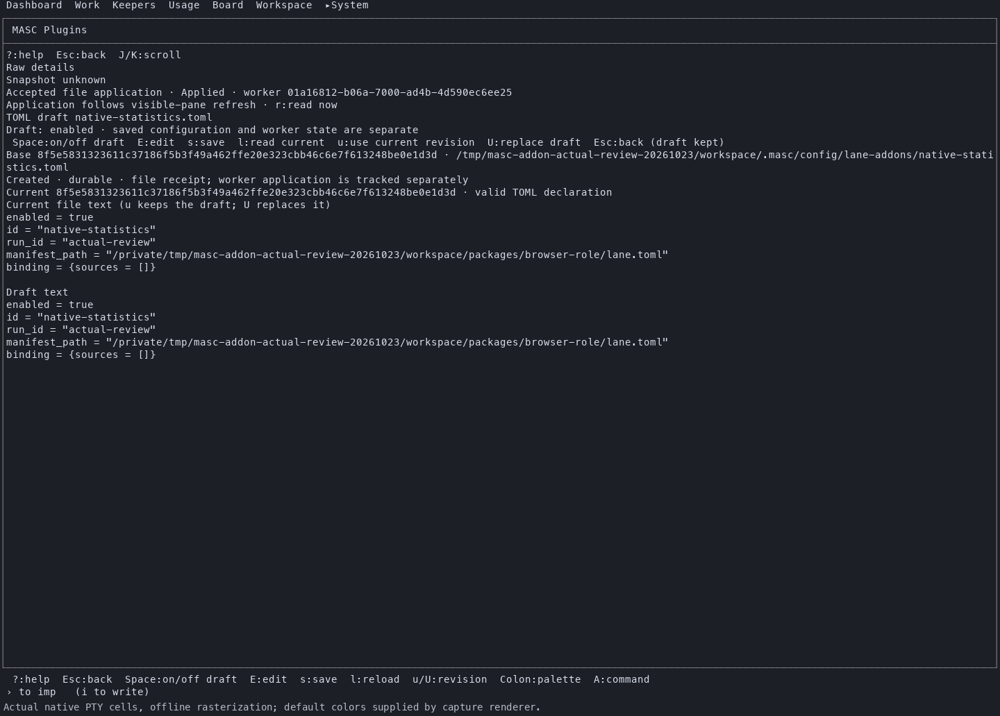
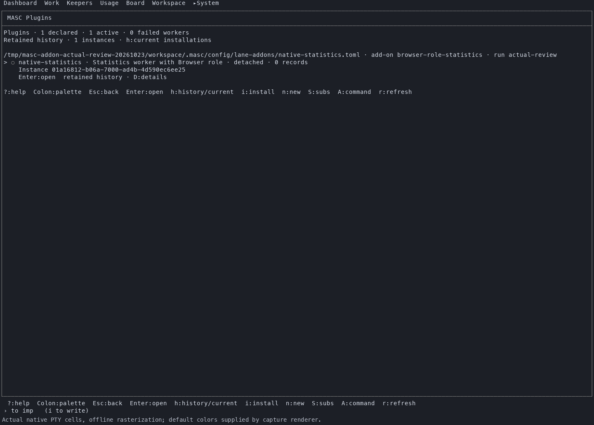
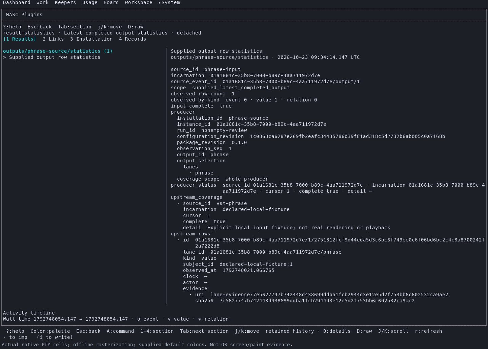
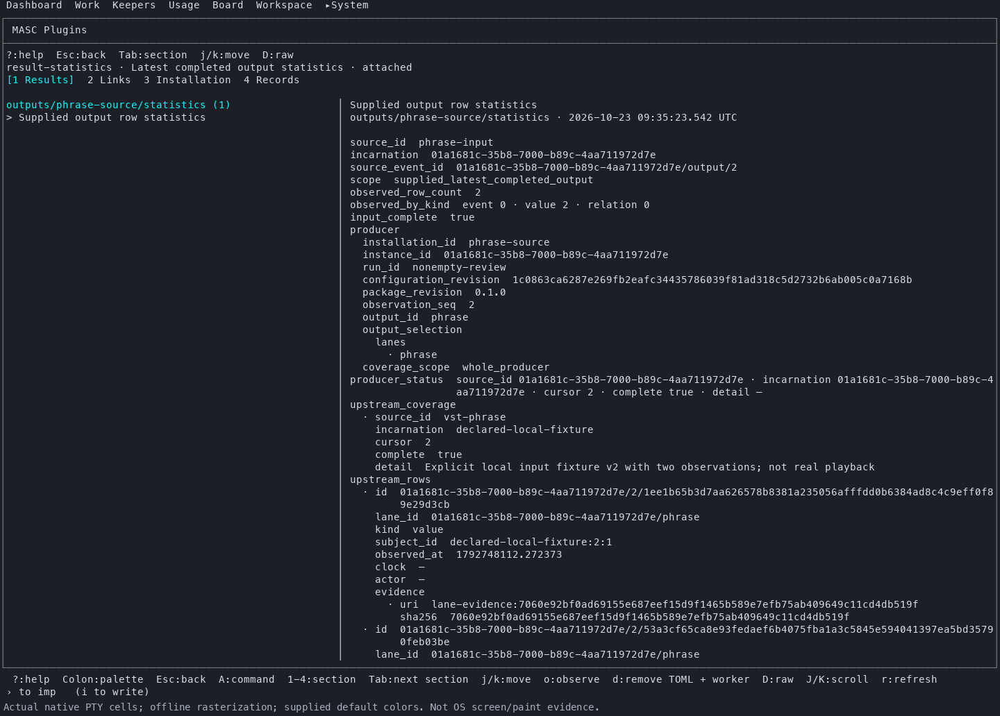

# Native Plugin On/Off, reconnect and original-result observation

Observed on the downloaded matching server/TUI at exact `a6fba325404c963061b7b95c4c564e35f5ea5e2e`, built by [native39928840589](https://github.com/jeong-sik/masc/actions/runs/39928840589). These are actual isolated native MCP worker, HTTP and PTY observations. They satisfy original A02 within this installation scope; they do not certify every package, engine, installed operator runtime or the full54.

## Guided TUI installation and lifecycle

The actual Features surface opens Plugins. The catalog groups explicit Browser and Analysis roles, while the preview separately identifies the MCP service and host-process runtime. The Browser-role fixture uses the statistics worker; it is not a browser engine test.

The [guided report](guided/report.md) records the manual keyboard sequence. Before saving the local draft, the [API still reported no declarations](guided/08-api-before-save.json). Explicit TUI save created a durable declaration and worker `01a16812-b06a-7000-ad4b-4d590ec6ee25`; an unsaved Off draft [left it enabled](guided/11-unsaved-off-inspect.json). Saving Off [retained and released the original](guided/13-after-off-inspect.json), and On created replacement `01a16814-72b5-7000-a94e-29142454bdec` under the [same installation, manifest, run and configuration revision](guided/18-reconnected-inspect.json). Explicit Observe returned pending, then [completed sequence2](guided/20-after-observe-inspect.json). Both incarnations remained separately inspectable after final Off.

## Nonempty result and receipt preservation

In a second fresh isolated workspace, unmodified first-party `vst-phrase` read an explicitly declared supported local snapshot, then actual `output-statistics` consumed its named `lane_output`. No worker result or completed host record was injected. The supplied input deliberately records known failures; it is not actual VST/audio rendering or playback.

The [nonempty report](nonempty/report.md) and [preservation analysis](nonempty/final-preservation-analysis.json) record:

| Observation | Original | Replacement |
| --- | --- | --- |
| Statistics installation | `result-statistics` | `result-statistics` |
| Worker incarnation | `01a1681c-664d-7000-9b12-e905430e98a5` | `01a1681d-74da-7000-af11-ca81ee22e3a2` |
| Result count | 1 | 2 |
| Original upstream sequence | 1 | 2 |

Saving Off, changing the declared source input and reconnecting produced the new count2 result. Refresh kept the original selected detail at count1/sequence1. Explicitly selecting the new result, reopening retained history and returning to current results preserved both selections separately.

The [original row](nonempty/original-statistics-row.json), [Slice after reconnect](nonempty/12-original-slice-reread.json) and [Slice after final Off](nonempty/20-original-row-after-cleanup.json) retain the identical row, including original provenance and evidence references. Canonical row SHA256 remains `5618464d5328c1b28c7909659fbc42baedc8e9ae52bbb623502c74a65f1509aa`. Scoped Inspect supplies metadata and the original native release receipt; Slice supplies row bodies. The live Slice coverage envelope is not claimed immutable with the row. Real CAS file-write and native-release receipts are preserved; the source declares `action_receipt=false`, so this is not package action-receipt proof.

## Provenance, cleanup and limits

Server SHA256 is `c0c96aefea1a1bbfe23f693fbbdb823228710565d04b7050c54359d5765a3e22`; TUI SHA256 is `1b85a7130be2331e9cfdef09129d44dbdbd172f7a9724102e51e637f05c35f98`. Both embedded commits match a6fba. Workers are the actual first-party Python sources from that candidate over native MCP stdio; fixture manifests explicitly select host-process execution. A privately copied installed native launcher was required; its hash is recorded and its source build is unverified. This observation does not certify the launcher's candidate provenance.

Final declarations are inactive, native claims consumed, and instance release history retained in the captured durable records. Own server/TUI/worker processes ended and both ports were reusable. The parent independently rechecked the nonempty81-file private manifest, full original-row equality, final two inactive declarations/three retained native releases, process absence and port availability. [Published-file hashes](published-files.json) identify this bounded public subset. Source report paths identify the full private captures, not additional committed files.

Images are offline rasterizations of actual PTY cells with supplied default colors, not OS screenshots or physical paint/latency measurements. Raw HTTP captures omit the isolated bearer. Keyboard logs are observations, not screen assertions. No new tests or local Dune/build/typecheck were run. Dashboard, actual browser/Agent/model/provider/audio, exported tools, server restart, container isolation and operator installation remain unverified here. This is bounded A02 evidence, not whole G/H, E12 or full54 completion.
