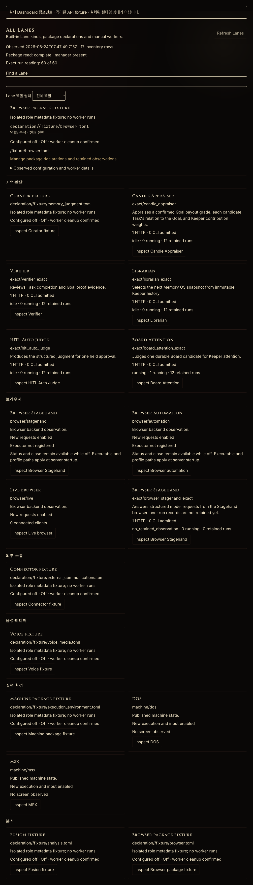

# Addon product roles in Dashboard

This candidate follows category Core #45385 and shipped manifests #45386. It groups the real Dashboard inventory, installation manager, worker list, and package browser by explicit product role. Built-in routes use their closed semantic selection: Browser/Stagehand are Browser, judgment/memory routes are Memory and judgment, and MSX/DOS are Execution environment. Category metadata never changes lifecycle or permissions.

Dashboard TypeScript checking passed. The selected nine suites passed all 82 tests on the source hashes in execution.json. The author's earlier 81-case run and corrected test-router fixture failure are preserved separately, not converted into installed-runtime evidence.

The screenshot is from the actual LaneInventoryPanel rendered through Vite with an isolated synthetic API fixture. The banner states its scope. Six example role declarations supplement the existing inventory fixture. It does not show installed Addons or current production health. In the browser, the original declaration remained selected after filtering it out, reversing API row order, and changing its category from Browser to Analysis. Its workspace, installation, source path and management-link target remained identical. The fixture received two GET requests and zero mutations; browser-selection.json retains the actual before/after values and request log.

No server was replaced, no runtime configuration was applied, and no real worker/provider/device was launched. TUI compilation/visible terminal evidence and full Addon conversion remain separate work.

A later source review also identified same-path installation replacement as a selection boundary. The Dashboard now retains the complete typed original management target; a replacement requires explicit reselection. Four targeted suites passed all 54 tests and TypeScript checking passed after that change on the current source hashes. The earlier 82-case and browser results remain bound to their earlier sources. No later visible-browser replacement check is claimed.

The TUI followup groups All Lanes using the same roles and separate nonselectable header rows. Selection retains the original typed row/installation/incarnation identity; missing originals, same-path replacements, and stale mouse marks cannot silently select another target. The exact eleven source files match the independently reviewed frozen patch; eight ML/MLI parsers and whitespace checks passed. Two meaningful settings-target state regressions were authored but have not been executed. No TUI typecheck, binary build, or visible-terminal verification is claimed.
