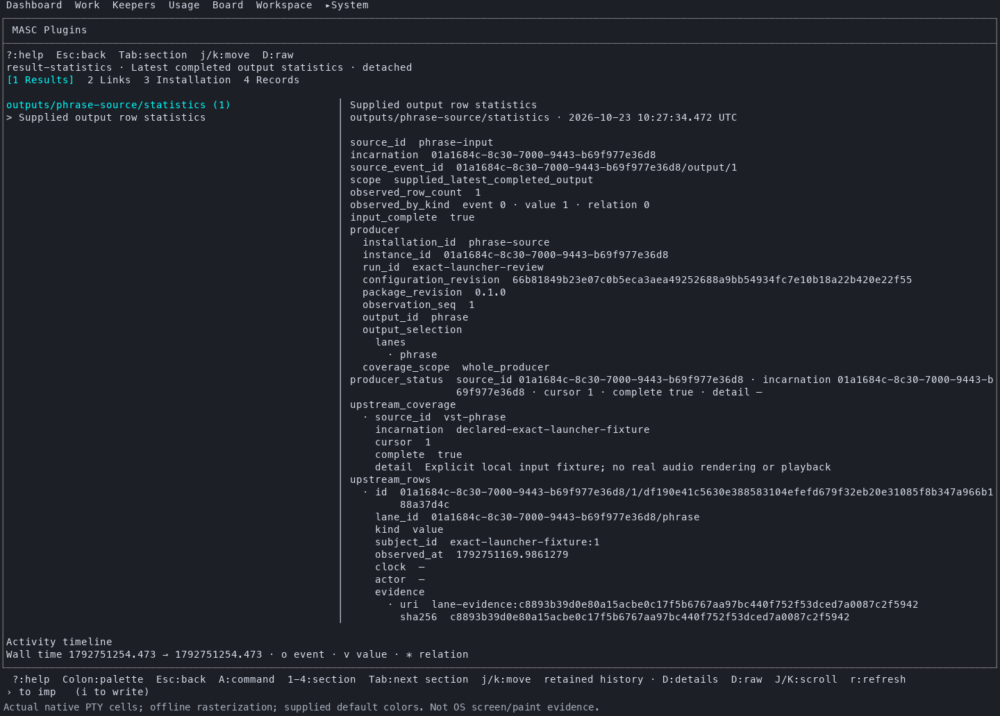
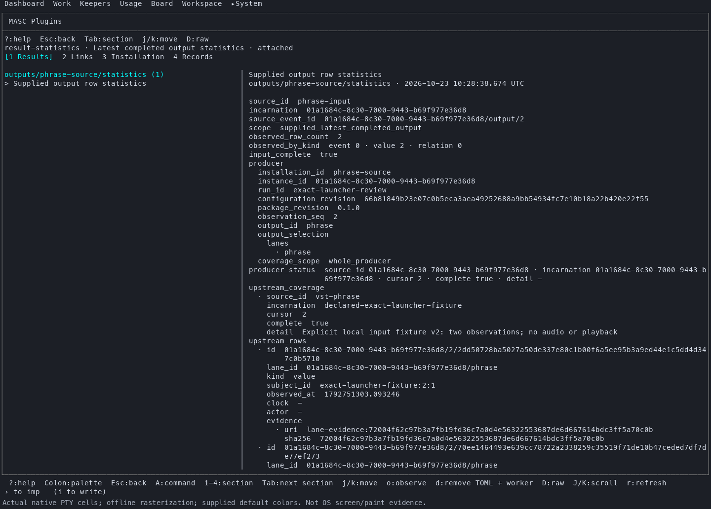

# Exact-source native launcher and Plugin lifecycle observation

The downloaded server, TUI and native Addon launcher from [run39937556339](https://github.com/jeong-sik/masc/actions/runs/39937556339) were verified and used together in a fresh isolated workspace. This closes the installed-launcher source-unknown limitation for this new observation. Earlier [A02 captures](../2026-10-23-addon-executed-regressions/native-ui/README.md) retain their historical limitation.

Source is `a6fba325404c963061b7b95c4c564e35f5ea5e2e`; workflow is `d78ce9eb8bec2c351ad84fc2a3b6e92701e56755`. The selected native run completed successfully: TUI26/26 and application5/5. Its [unaltered receipt](capture/artifact-receipt.json), [download verification](capture/artifact-download-verified.json) and [independent identity check](capture/artifact-verification.json) record matching hashes. Actual server `build-commit` and TUI `--build-commit` both returned a6fba. This is not execution of the newer Task lifecycle source in #45573.

## The actual launcher, rather than an installed copy

Launcher SHA256 is `fe2803bcddbed5865a5d6213b8340da3c188d67e1a0063391255711ac046e93d`. The receipt binds it to `bin/masc_native_addon_launcher.exe` in the exact-source build. The launcher has no embedded commit command, so none is claimed.

[Kernel observations](capture/actual-launcher-selection.json) recorded original statistics PID76284 and replacement PID84600 executing the adjacent artifact launcher, then Python under the same respective PIDs. [Raw executable-path events](capture/actual-owned-exec-paths.jsonl) preserve those transitions. The [production locator and candidates](capture/launcher-locator-candidates.json) explain why the adjacent verified executable is selected. Installed launcher directories were excluded from PATH; no installed launcher was copied or substituted. The first source-worker launch was not caught by the observer, so there is no per-launch kernel trace claim for it.

## Nonempty results and retained history

Unmodified first-party `vst-phrase` reads an explicitly declared supported local snapshot. Actual `output-statistics` consumes its named output through `lane_output`. Manifests explicitly choose host-process execution; there is no mock worker, fake HTTP result or completed-record injection. The supplied phrase observations are known-failure input data, not real audio rendering or playback.

| Observation | Original statistics worker | Replacement statistics worker |
| --- | --- | --- |
| Same installation | `result-statistics` | `result-statistics` |
| Incarnation | `01a1684d-3b95-7000-bd0e-95b4c4c6d51b` | `01a1684e-3662-7000-a3bc-86863a09eb2f` |
| Result count | 1 | 2 |
| Upstream sequence | 1 | 2 |

After saving Off, changing the declared source input and reconnecting, the original selected result remained count1/sequence1. Selecting the new current result showed count2/sequence2; retained history and current selection remained separate. The [original row](capture/original-statistics-row.json), [reread after reconnect](capture/12-original-row-reread.json) and [reread after final Off](capture/19-original-row-after-final-off.json) preserve identical fields, provenance and evidence. Its canonical SHA256 remains `9f4182463273e1d2ed5a1b9e2d728b2ccb9921589e947306823a07abe0d7699c`. The original native release receipt is unchanged; file-write receipts are retained separately. Package action receipts were not exercised (`action_receipt=false`).

These images rasterize actual PTY cells offline with supplied default colors; they are not OS window or physical paint/latency captures. Raw [attached-current text](capture/14-new-current-result.txt) and [final-Off text](capture/19-selected-new-result-after-off.txt) retain the observation stages. PNG files were rendered later, so their filesystem timestamps are not the capture times. No screen text/layout/order assertions were added.

## Cleanup and scope

The [final API observation](capture/19-final-off-inspect.json), durable records and [cleanup receipt](capture/cleanup.json) show two inactive declarations, all three native claims consumed and instance releases retained. All owned server/TUI/workers ended and the port was reusable. The parent directly verified the full99-file private manifest, exact row equality, both kernel transition records, final states and cleanup; [parent evidence check](parent-evidence-check.json) records that bounded reread. [Published hashes](published-files.json) identify this public subset. The [full report](report.md) names the private originals.

No operator runtime or other workspace was changed. This verifies an actual native first-party worker path with candidate launcher provenance; it does not establish actual synth/audio/device, browser, Agent/model/provider, Dashboard, exported-tool or package-action behavior, server-restart recovery, other platforms, whole E12/G/H or the original54 goal. No local Dune/build/typecheck/executable tests were run by the observing sessions. Source review, selected test execution, actual runtime observation, merge and installation remain distinct.
