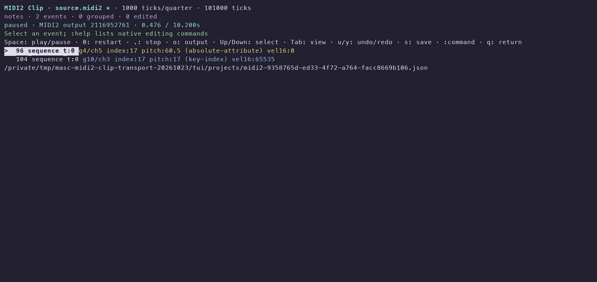
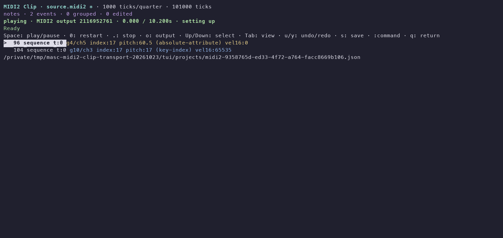

# Native MIDI2 Clip audition evidence

This candidate connects original-resolution Clip editing to native MIDI2 output.
It does not create a captured-session clock or WAV. The immutable execution
identity is private installed runtime
`127bed9ad6d00307df3cf5aa2710304dfb801efc29a5ab5eff9b9b72ad7953fb`.
All 126 runtime inputs and 8 native helpers were read back; their hashes and the
matching source commit are in the [receipt](receipt.json). Source commit
matching is a byte comparison, separate from the actual installation/execution.

## Actual terminal and receiving endpoint

An isolated PTY opened a generated PPQ1000 Clip with a private native MIDI2
destination. The receiver was a separate CoreMIDI process. Both its endpoint
and every native playback process were owned by this QA; existing outputs were
not opened. The Clip had 0.1s configuration and a 10.1s sequence, two groups,
Pitch7.9 at 60.5 with Note Index17 and velocity 0, a second attack at velocity 65535,
a UInt32 per-note controller and a hold pedal.

The actual installed launcher ran with `--midi-file`, `--project-root` and
`--midi-output=PRIVATE_UID`. Controls were:

1. Space; observe both group attacks at the receiver.
2. Space; observe owned note/pedal releases and the same native child.
3. `:seek-event 96` while paused; Space to resume; observe both attacks again.
4. `0`; observe the old child retire, a new child and the identical admitted plan.
5. `.`; observe releases and no remaining native child.
6. Export and `q`; observe exit0, an unedited saved source document and a
   byte-identical source/export file.

The receiving endpoint collected 72 UMP words over the three starts and their
cleanup. Pause/seek/resume used one child; restart replaced it after retirement.
This controlled scenario exercises cleanup releases. Original source release
dynamics were separately checked by the natural-completion native wire harness.
Both the TUI and receiver exited 0. No user project or live Ghostty session was
used. The default launcher remained byte identical.

Images render real captured PTY bytes through a terminal emulator; they are not
screenshots of the operator's Ghostty. Layout/wording is inspected manually,
not tested by snapshots. Images come from the source-candidate run; the same
request/receive/file scenario also passed with the private installed runtime.

## Other checked boundaries

- The 60 focused JavaScript checks in the receipt passed, covering source clocks,
  editing/readback, exact native admission, owned player lifecycle and existing
  transport/save/library boundaries. They are not the full suite.
- `test-midi-clip-clock.mjs` uses the production owner, a controlled monotonic
  clock and a private endpoint. Adjacent deadlines beyond 2^53 nanoseconds stay
  separate; no early sends, pre-start cancellation, empty clips, overflow cleanup
  and malformed plans are checked.
- `test-midi-clip-wire.mjs` compiles and runs the real helper against private
  CoreMIDI endpoints. Full raw words/order, two groups, velocity 0/full16,
  Attribute3, PN32, original releases, pause/seek/resume, cleanup and native1
  refusal passed. A Ready-only cancellation sends no source messages.
- Existing UMP transport/state decision checks passed with the capture/region
  metadata policy still opaque.
- Independent reviews reproduced two P2s: future metadata credited at a
  backward cut, and a first Ready accepted from a different initial-tempo plan.
  Both were fixed and independently rechecked. Due/prefix baselines remain valid;
  wrong initial setup/duration is refused before Start. Source review is not
  guarded GitHub approval.

The official auxiliary installer built the changed native Clip/arrangement/live
helpers in a private prefix. Five other helpers were reused only after source
input identity checks. A subsequent help-text-only runtime reused all 8 with the
same input checks. No repository Dune build or CI watch was run.

## Remaining scope

Physical MIDI2 reception/acoustics, MIDI-CI/profile negotiation, JR clock
coordination, Clip looping, local Clip synthesis and arrangement consumers are
not claimed. [#45643](https://github.com/jeong-sik/masc/issues/45643) remains open.
The private-prefix run above preserved the then-default phrase cursor-audition
runtime. That separate stack subsequently merged as #45604 and #45609. The
integration and default installation below retain both sets of functionality.

## Current-main integration and default installation

The whole four-layer Clip stack was rebased onto main
`453ece3f0a7ef169132cb8c94802256c3ac58620`. Its music delta from the earlier
candidate is exactly the merged cursor-audition changes. All native, Clip,
common playback and installer inputs are unchanged. The previous default's
phrase editor modules remain byte identical; the shared TUI adds only an early
Clip dispatch before phrase editor/worker construction. Independent source
reviews checked these boundaries against the new base.

The official auxiliary installer then installed runtime
`3b3d71b3a1235deae963e95275504d29d777a4edb6db11d30ff44e66081245f2`
as the default launcher. All 126 inputs and 8 native helpers were read back;
helper reuse required complete native-input and binary-hash identity with the
previous verified private installation. The VST host and locked environment
identity were also checked. This is an auxiliary music-runtime installation,
separate from an OCaml server/TUI build or a GitHub merge.

The actual default launcher repeated the same isolated terminal/owned CoreMIDI
scenario: 72 received words, one child for pause/seek/resume, replacement only
after old-child retirement, cleanup on stop, exit0 and unchanged source/export.
The combined Clip and merged cursor-audition/lifecycle checks passed 116/116.
The [default-install receipt](default-install-receipt.json) records this newer
runtime, source identity and fresh verification time. The screenshots above
remain the earlier source-candidate captures. Existing user sessions and music
were not replaced; physical-device, acoustic and Ghostty-display claims remain
outside this evidence.
