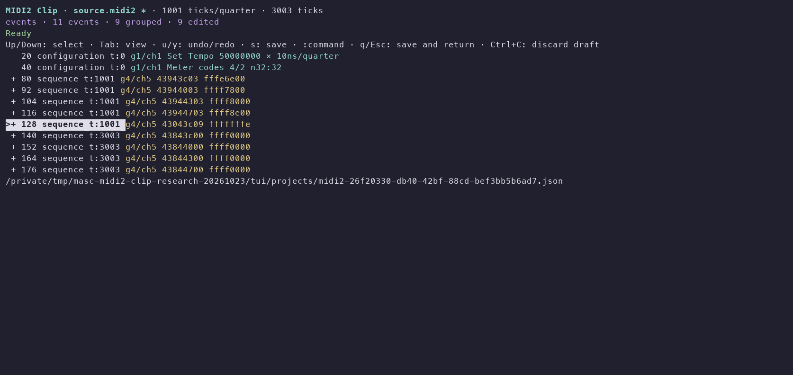
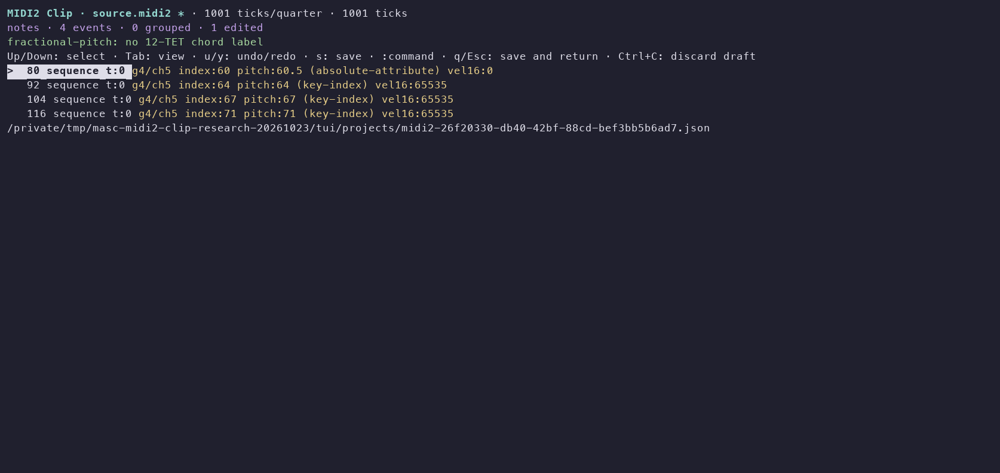

# Native MIDI2 Clip editing evidence

The candidate imports the `SMF2CLIP` envelope, edits native values and musical
ticks, saves/reopens its original-source JSON, and exports MIDI2. This is a
bounded part of [#45643](https://github.com/jeong-sik/masc/issues/45643), which
remains open for native audition, arrangement consumers and endpoint proof.

[Receipt](receipt.json) records the candidate identity and measured values.
Checks and the actual PTY scenario used upper source
`38258f867ea0c34bb7915ecc8c0a045100a1b33b`, lower
`fe30ef2297f86879812dcf9d6660310fed28d951`. Later documentation/changelog and
source-identical history changes do not establish a new installed runtime.

## Observed workflow

A generated PPQ1001 Clip contained four simultaneous group4/channel5 native
attacks (indices60/64/67/71), an unsigned32 per-note controller, explicit
releases, and configuration tempo/meter. The actual CLI ran with `--midi-file`
in an isolated PTY and private project directory. Commands were:

```text
:pitch-absolute 60.5
:harmony
:revoice Cmaj7 drop2 4 0
u
y
:velocity 65534
:select 128
:value32 4294967294
:select-events 80 92 104 116 128 140 152 164 176
:shift-events-ticks 1001
:stretch-events 2
:save-as QA_ROOT/song.json
:export QA_ROOT/edited.midi2
q
```

`QA_ROOT` denotes the private output directory, not a literal command argument.
A second CLI process opened `--project QA_ROOT/song.json`, exported another
MIDI2 file and exited with `q`. Both processes exited0. Original bytes remained
unchanged. The reopened JSON and the two exported files were byte identical.
The saved document retained indices60/64/67/71, absolute pitches55/60/64/71,
first velocity65534, controller4294967294 and original PPQ1001. The clock and
exported/reimported clock both yielded1501500000000/1001 nanoseconds.

The 28 focused checks in the receipt cover original bytes, precision, ordering,
configuration metadata, grouped edits/history, save/readback, exclusive export,
cancellation and existing save/library boundaries. This is not a full suite,
Dune build or CI claim. Independent source reviews also exercised mid-export
cancellation and actual PTY save conflict with an external writer; the writer's
bytes and retained local candidate survived, and the editor remained open.

## Terminal captures

These images render the actual captured PTY byte stream through a terminal
emulator. They are not screenshots of the operator's Ghostty session. Screen
wording and layout are inspected manually, not asserted by a snapshot test.





Native playback of imported Clip files, physical MIDI2 reception and MIDI-CI
profile negotiation were not exercised. No user project, live UI or default
installed runtime was changed by this candidate QA.
