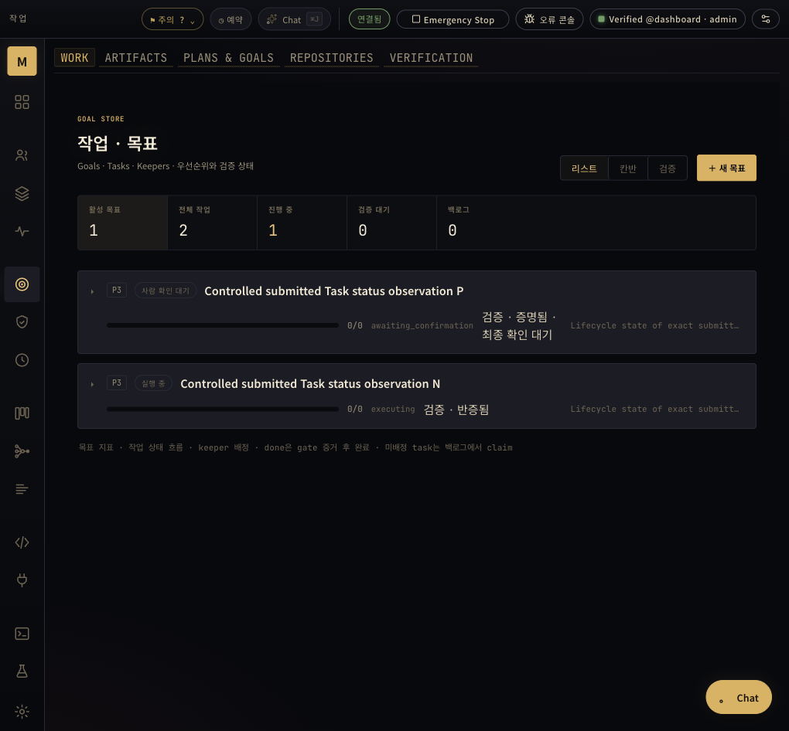

# 실제 Goal 판정자의 고정 Task 원문 조회

PR #45949의 기능을 실제 모델로 확인했다. 원문 조회 도구를 호출한 뒤 모델에 전달된 전체 JSON이 제출 당시 Task source와 byte·SHA 단위로 같았다. Done인 Task는 승인했고, InProgress인데 달성값을 1로 보고한 Task는 거절했다. 이 관측은 Task 상태 조회 기능의 두 예제다. 원래 Goal의 성공 조건이나 외부 acceptance를 이 단순 상태 지표로 바꾸지 않았다.

## 고정된 실행 범위

서버 source는 `3e0d83d9d00fd2c133a8bb8cb33147f9479e07e6`, 실행 파일 SHA256은 `00f3fdc897bea8874dc21bd9f471aef80ef9e2aebd4321b4483ce83508ef84e8`이다. [선행 증거](../2026-10-25-goal-task-source/README.md)의 같은 완전한 실행 번들을 새 base·port에서 사용했다. source checkout은 제품 입력이 같은 `5ef6623937fab2a04f10862605b7d7db56ab8bdb`였다. Task #2670이 이 실측을 추적한다.

실행 전에 선언한 지표는 “제출된 정확한 canonical Task 행의 status가 done이면 1, 나머지는 0”이다. 두 Goal 모두 보고값 1, 목표값 1이다. 아래 Task ID는 이 격리 cohort 내부의 ID이며 운영 workspace의 같은 번호를 가리키지 않는다.

| 대조 | 제출한 실제 Task 상태 | 실제 조회 | 모델 판단 | 저장된 Goal 상태 |
|---|---|---|---|---|
| P | Done, 지표 1 | `keeper_tasks_list(task-001)` | APPROVE | `proof_proven` / `awaiting_confirmation` |
| N | InProgress, 지표 0 | `keeper_tasks_list(task-002)` | REJECT | `proof_refuted` / `executing` |

두 Task 원문 모두 primary revision 10이다. [P 원문](source-P.json)은 2,561 bytes, [N 원문](source-N.json)은 527 bytes다. 원본과 [판정 P](goal-P-result.json)·[판정 N](goal-N-result.json)의 request ID, criterion revision, run ID가 일치한다. 조회 결과가 다음 실제 provider 요청에 포함된 상태에서 모델이 verdict를 생성했다. P의 registry excerpt는 1,024 bytes에서 잘렸으므로 그 excerpt만으로 전체 조회를 입증하지 않았다. 실제 다음 요청의 full Tool message를 풀어 2,561-byte 원문과 일치시켰다.

양성 선행 Task는 운영자가 만든 45-byte JSON fixture를 제출했다. [실제 자동 판정](automatic-task-result.json)은 파일 Read → 구조화 APPROVE → `system_llm_agent` / `verifier_exact` 원장 → primary Done으로 이어졌다. 운영자가 verdict를 주입하지 않았다. producer는 운영자 fixture이며 producer 모델 identity를 만들어 넣지 않았다.

## 실행 수와 관측 한계

실제 자동 Task 판정 1건과 Goal 판정 2건에서 provider POST는 9회였다. 각 역할에 3회씩이며 모델이 보고한 정체성은 모두 `glm-5.3`이었다([wire projection](wire-projection.json)). registry의 reviewed·committed 두 행은 같은 Goal run의 단계다. 두 Goal을 네 표본으로 세거나, 서로 다른 역할을 독립 모델로 세지 않는다.

이 대조의 제목·설명은 양성·음성 방향을 드러낸다. 운영자 fixture이고 비블라인드이므로 조회만의 인과 효과나 일반 성공률·신뢰도를 추정하지 않는다. 실제 조회와 그 원문에 맞는 판단이 이 예제에서 있었다는 범위다. 제품은 조회 없는 판정도 허용하므로 모든 승인이 원문을 읽는다는 보장은 아니다.

Done 행에는 영구 typed verifier/verification-ID 승인 인증서나 전체 승인 이력이 없다. Task 완료 시각과 이번 상태 판정을 실제 Edit의 승인 전후 순서, 외부 acceptance, autonomous Keeper 구현, 원래 main Goal 완료의 증거로 확대하지 않는다. 사람의 최종 확인은 하지 않았다. 원래 Goal의 criterion·acceptance·measurement도 바꾸지 않았다.

`goal-requests-proof-private`라는 이름의 보존본을 읽었을 때 두 판정은 이미 끝나 있었다. 별도의 pending 시점 snapshot으로 부르지 않는다. 요청·보관 Original·실제 wire·완료 원장의 결속과 최종 source bytes를 대조했다. owner의 commit_unknown·retry 관측도 추가 모델 실행이나 실제 crash로 세지 않는다.

## 실제 화면과 실행 건강 상태

브라우저 공간 12에서 양성의 “증명됨 · 최종 확인 대기”와 음성의 “반증됨”을 직접 확인했다. controlled source Tasks는 Goal 링크가 없는 Task이므로 화면의 Task rollup `0/0`은 그대로다. evidence reference가 Task를 Goal에 자동 연결했다는 주장은 없다.

번들의 정적 dashboard 요청은 HTTP 503이었다. 같은 제품 입력의 개발 대시보드를 별도 Vite 서버로 실행해 해당 격리 backend에 연결했다. 기존 로컬 dependency cache를 썼다. 이 화면은 운영용 dashboard 패키징·설치 성공이 아니다([화면 범위](browser-observation.json)).

[실행 관측](runtime-observation.json)에서 embedded source·실행 파일 SHA·effective root·단일 exact lane 결속은 맞았다. liveness와 runtime startup 상태는 ok지만 overall health는 `keeper_memory_execution:addon_unattached`로 degraded였다. 전체 fleet readiness를 통과했다고 쓰지 않는다.

## 실패·정리·공개 범위

[계측 수리](instrumentation-recovery.json)를 숨기지 않는다. 처음에는 macOS 임시 경로 정규화가 빠져 준비 단계에서 거절됐다. 이 최초 사건은 Root가 작성한 영수증과 코드 경로 근거이며 raw stderr 파일·수리 전 script 사본은 없다. 정상 prepare 후 보존한 초기 wrapper를 그 이전 script로 부르지 않는다. 다음에는 정상 적용된 claim의 plain text 응답을 클라이언트가 JSON으로 해석하다 실패했다. 원장을 읽고 같은 Claimed Task에서 이어갔으며 생성·claim을 재시도하지 않았다. 지표·목표·예상 결과는 유지했다.

[정리 기록](owned-cleanup.json)은 판정과 terminal snapshot 이후다. 미완료 음성 Task를 Cancelled로 끝냈지만 제출 원문은 InProgress와 같은 SHA로 남았다. 새 모델 판정을 요청하지 않았다. 소유한 개발 UI·서버·proxy의 세 PID가 종료됐음을 확인하고 브라우저 공간도 닫았다. descendant 전체나 fleet 전역 종료를 확인한 기록은 아니다. terminal 당시 원본을 정리 후 원장으로 덮어쓰지 않았다.

[원본 manifest](private-originals-manifest.json)는 Task·Goal 원장과 wire 등 37개 비공개 원문의 bytes·SHA를 결속한다. raw reasoning·헤더·인증값·호스트 경로는 공개하지 않는다. 공개 JSON 중 projection은 해당 사실과 원본 해시를 표시했고 Task source 두 파일은 제출된 bytes 그대로다. [설계 검토](design-review.json), [실제 cohort의 독립 검토](cohort-review.json), [설계 요구 대응](design-response.json)은 각각 동결된 범위에만 적용된다. 실제 cohort 검토는 조회·판정·저장 상태와 후속 Task 취소를 다루며 화면·프로세스 정리·후속 공개 projection의 감사는 포함하지 않는다. 같은 cohort의 재검토를 추가 실행으로 세지 않는다.

추가 native·전체 회귀·로컬 Dune은 실행하지 않았다. 앞선 native는 선행 증거의 실제 source와 suite 범위다. GitHub 정식 승인, 전체 Native Stack 병합, 운영 설치와 원래 Goal 완료는 별개다.
