# TUI UX stack #48234: before and after screens

Scope: layers 1 to 6, 8 to 11, 13 to 17, 19, 20, 22 to 25, 27, 29, 31, 33 to 36,
38 and 40 of the stack (#48231, #48232, #48233, #48250, #48254, #48266, #48289,
#48292, #48299, #48306, #48327, #48329, #48341, #48344, #48350, #48365, #48370,
#48386, #48389, #48392, #48401, #48411, #48424, #48436, #48456, #48481, #48493,
#48516, #48534, #48552). Layer 7 is the first version of this document. Layer 12
added layers 6 and 8 to 11. Layer 18 added layers 13 to 17. Layer 21 added
layers 19 and 20. Layer 26 is an RFC and has no screens. Layer 28 added layers
22 to 25 and 27. Layer 30 added layer 29. Layer 32 added layer 31. Layer 37
added layers 33 to 36. Layer 39 added layer 38. The layer that carries this text
added layer 40.

## Source

Both sides are the `masc-tui` and `masc` binaries that the native TUI proof
workflow built on a macOS arm64 runner. Each artifact carries a `receipt.json`
whose `sha256` and `server_sha256` match the files that were run, and
`masc-tui --build-commit` prints the source commit below.

| Side | Source commit | Proof run | `masc-tui` sha256 | `masc` sha256 |
| --- | --- | --- | --- | --- |
| Before | `8478b73c5ed93bb3dc2af59a4d4f479f3711ffd5` (main) | 41875751621 | `57b3f6c019aac22f78a0eb9e9cb5590180f74f10921b9cf453305842446b2999` | `bbf78bbbbc852e1443b8fe10ccffbcdfc51cb3517580d9624cda72b7963a0e41` |
| After (layers 1 to 5) | `a8ac7782e3c4e76c80851efbdb2a7682be843076` | 41882548710 | `1d9b46b26ccbbaafb5b8e29303691a0b8d35996525067df74947fc066b97fa62` | `1a055097b60d66d1fcf1b768946af1a7d794c4ae1fd9c62c7283362cb49fd403` |
| After (layers 1 to 9) | `31d56f094eb2407c43a798fe28a655acb5bb5d41` | 41891144314 | `bc4ab5e3b3eceb61d592e41c7b36086d4933fc4f0dc37ef0fbb15c84f60108e2` | `121c5a7df6451a861c66d6ecdf29bc4aa2b76338c3b9bf7764afdea88c965644` |
| After (layers 1 to 10) | `cf512249ace0a8004473911ffd498e018e8ffd2b` | 41893673935 | `72b75b64133b8958647af57c81adc81c4d00dea267c81c11fc8a0b13da58b8dd` | `6ff4917f53ff0b47e3fb48a6f35b5e7a08f74206b6380f92f8345294cc5fd478` |
| After (layers 1 to 11) | `8969a8b26271b91b109849c96588c1f64d02f8ee` | 41895649701 | `15455664f4f711583f9e80554ed92c8234f2b09266aff89ca8a74b40124c7a5a` | `743b72a707f3eb76777b6ae6bf630b3dee1293727c9f1c3c132f1283c66329af` |
| After (layers 1 to 13) | `a91bcfe34a7163537d732604111babe587a2e166` | 41902049950 | `217ce2ec9cc4c4924d8bd4bc602e64f3848ed4a9c5e06a9099ba9f43f3c2ae24` | `45624e505eed03820a9e0c27d1e4b66155e9598f1240e0694e19c2a0e961b3cb` |
| After (layers 1 to 14) | `b4024cd1b69969af074544e33dbcbe7ed2e91bb9` | 41902957736 | `e274ba9288ff5ee1a40d6988c8291ad62a97b88899e4cf85c49638869952baa2` | `108103f1eb58106a2088d3298a304dc1b5e2e3bbd351e8b8ec5f06ce0e3b2280` |
| After (layers 1 to 16) | `3a2c8c907ada34d56ab902c35d5c445ef81a3351` | 41907039543 | `0a7e5caff4a8edc16a19df2c4cc68cc1572585a9a352ecf6934e1ff5aa498ff8` | `a3d493e9b978ca472df16d9e6caf6f16e893124d4bb64fe0e81af9673b8a3a24` |
| After (layers 1 to 17) | `9257388f916e738faf8c7acd2115a8101368c7d0` | 41909034875 | `ad08fcc424bbcc32076b440fd142b2c6d7c71d7aa75d849d059ef0f1aa0ea1c0` | `bc0396352e13b30b2ac262552ee0e7cabe04d8266b612a3b59dc1eaf5b916d1c` |
| After (layers 1 to 19) | `66a120b1993303d4c41b6c76a4ac5af50783d650` | 41913436954 | `8ef3094b19cef732d6c2057218cb189c2c1412b45375a4fadd1e77bbd838039a` | `fd8d22b0cff9f377e02a2696cefdf8fd2156b1ad9311b05fd970f9f5f4971716` |
| After (layers 1 to 20) | `8394991844dee9b123c3b577334bf368a3a7906d` | 41915100410 | `809e534c1b99241c45c51639e78fa46c7701beb8657ac8f470e2be6c3f87fa09` | `cac9d03ef037ce87bc341b97438438332b3c848c5037970b57c051b5e0a1752b` |
| After (layers 1 to 22) | `a6e907b07070ea13dc207c745be240f006bfbe8a` | 41919019723 | `eb92caef0a73d7935b05a0285c4873bb96ad59c437023a8bc45d8b75f990e76d` | `50a2c1484a131bba574f8d11955ebdc78e2f2dfc06f30dbfd5b61103555308ef` |
| After (layers 1 to 25) | `c514194fc2b378b3569485d5e8a58189b24ca69a` | 41925502321 | `c290ad1f9eb83919fbe77958bd7f614186d64e62123a0a0f948f3de241aa8700` | `bce80de3f7c0a05d0069469e1e13b8241cdaadf1fbee0912409d078ec6925990` |
| After (layers 1 to 27) | `d738d2334693f14ffa475ca8e5552dbe0425daf4` | 41929495694 | `8f0ca03fe34d837dafb2b17453ecef13dbb39ef3fe8aaa9c33ff7105e0cbe26f` | `76dd1f564067a2533487100dc6e772cc8debd74187b7cabf8b37c11b38e264ba` |
| After (layers 1 to 29) | `b9161eaa6acd24bae552597a20fadf638eaa0730` | 41934340932 | `b39991f1dad8a7b8913daf0d2ae8c7785a20d0be2c29eae992cd5088a3f89acb` | `c5cf37f66a5896cefba4beb3f712b12d9993d96e778e83b75a8cc247c712331f` |
| After (layers 1 to 31) | `8b86dd384c842d8f7f20027ae5ddc39132e26f08` | 41937783831 | `3dee2c63f3fe896f814dd14fa55e0c0e046581f003205141d3344556575a272b` | `6a00ffc156c1e6cb0c26e887636db87a8f6a53c4c43fea32a3ddddb4c38ba358` |
| After (layers 1 to 33) | `54f7c7d58eb6791e001746a943278981ef77437a` | 41949633565 | `b351a6b3301713cd5fd6f8ceba80b1459829a32f5fc37b7f08f7bdc7c2c8cbe2` | `961027638e120afc3852ddca9e1e944d278f9bf28f94ffd9ecd149739946911b` |
| After (layers 1 to 34) | `16699347711857a0088028d5bfcdcaa280375834` | 41950346736 | `e833ad2d5c16c116abc3f5e650510929847f5d0ef9f17c19d88728f6b754bcbe` | `cd48bf57b82f994f12e0b8beecc90b290babfce81b633368e6314b76ebd9b0cb` |
| After (layers 1 to 35) | `c177173775d9245db26beb4db4c94d208d4da1d5` | 41953166859 | `0b57468d24bfcb32b90d289a45bbdc5570904faa6a12f30d18c4d0cf7c0775bd` | `714dc40b8e2185fd882f5e4569a6b07bfa7fab65bc67989cdace7f089a12aebe` |
| After (layers 1 to 36) | `ee537e002edec7d33e812dc73fab59a9637f87ef` | 41960815641 | `118f0ae57bb201f6060a86a9ee23b5962b9c66c54376b74b4116d353b8b7911f` | `6bfc13656a2a33b7f5021f80f8422e3d904145077ee14c714d0066b1b39785a6` |
| After (layers 1 to 38) | `92b883871eb84114b1512b94131a46a859b2060b` | 41968335391 | `b9c634c2ac26ba44986a74f1179a1851a3ae2adbbe47afbb4e67c9048f4f69cb` | `4ccfb7b664574d37bfac961638f3fbe0e1d5fb91df2e836b8927f16c578414f8` |
| After (layers 1 to 40) | `4422e1e6c381551917958d31f45c4ff90b8af586` | 41973601229 | `26bba8cdd50174de96ea2f9add34755ef2812aff6d0080d0d57f37cbb737007e` | `b40ee783292ecd9a579943422823eb26c534fe4f3612b7460962f7071c895b80` |

Commit `68231ced9d9` was added to layer 5 after the After build. It changes
`test/dune` only, so the After binary is the one the layer 5 head would build.

Commit `b440fa3ddb9` was added to layer 36 after its After build. It changes a
doc comment in `masc_tui_message_layout.mli` and `test/test_tui_wrap_words.ml`
only, so the After binary is the one the layer 36 head would build.

Every proof run ended `cancelled` or `failure`. In each, the
`test_workspace_file_confidentiality` suite failed one case (`Board startup
workspace authority`), the same case on main and on the stack (#48260). The
artifacts were uploaded after that failure.

## Environment

- macOS arm64 machine, one terminal per capture, driven through tmux at a fixed
  size. Sizes: 200x55, 120x35, 80x24, 320x50 and 400x50 for the footer
  comparisons, and 56x24, 68x24, 88x24 and 100x30 for the title rows of layer
  10. Screens opened with the command palette (`:`, then `go <name>`
  and Enter) are the ones with no key path from the Dashboard that the capture
  needed. Layers 13 to 17 used 200x55 and 120x35 (Dashboard), 100x30 and 80x24
  (Features), 120x35 (the footers of layers 15 and 16) and 120x35 and 80x24 (System
  menu). Layer 19 used 120x35 and 200x55 (Dashboard). Layer 20 used 80x24 and 120x35
  (Usage). Layer 22 used 60x24, 80x24, 86x24, 87x24, 100x30 and 120x35 (Task
  Review). Layer 23 used 60x24, 80x24, 120x35 and 200x55 (Features). Layer 24 used
  80x24, 100x30, 120x35 and 140x40 (Runtime). Layer 25 used 60x24, 80x24, 120x35
  and 200x55 with 42 open tasks (Work, Tasks). Layer 27 used 120x35 and 80x24 with
  the 12-task fixture (Task detail). Layer 29 used 60x24, 80x24, 120x35 and 200x55
  (Artifacts / Resources). Layer 31 used 60x24, 80x24, 90x28, 100x30 and 120x35
  (Approvals). Layer 33 used 60x24, 80x24, 100x30 and 120x35 (the `?` sheet) and
  80x24 and 120x35 (Hangul). Layer 34 used 80x24 and 120x35 (Task detail).
  Layer 35 used 80x24, 100x30 and 120x35 (Dashboard), 60x24, 80x24 and 120x35
  (the first screen of 15 palette destinations) and 80x24 and 120x35 (Task
  detail). Layer 36 repeated those captures at the same sizes.
- Every process ran under `env -i` with `PATH`, `HOME` (an empty directory),
  `TERM=xterm-256color` and `LANG=en_US.UTF-8`. No credential, Keeper or
  workspace of the operator was read.
- A fresh workspace per side: `masc init`, `masc start --port <port>` from the
  same artifact as the TUI, an expiring bearer from `masc mcp-config --expiring`.
- The fixture is neutral text written through MCP: one Goal (`example-goal`),
  three Tasks, one Board post with one comment. `task-002` was claimed,
  started, and submitted for verification with a note and one evidence note.
  Three Keeper definitions (`imp`, `relay`, `scout`) are present but none can
  run on this machine, so every footer starts with `ACTION NEEDED 3`. Each
  side seeds its own fresh workspace, so timestamps differ between the sides.
  Layers 25 and 27 seeded extra Tasks with the same neutral text (42 open Tasks
  for layer 25, 12 for layer 27).
- The key sequences are in the sections below. Each capture starts a new TUI
  process, waits for `HTTP [connected]`, settles for a few seconds, and then
  sends the keys. The capture driver is not part of the repository.
- The PNGs of layers 1 to 35 come from `tmux capture-pane -e -p` without `-N`,
  which drops the blanks at the end of a row. A selection band (reverse video)
  is therefore drawn only as far as its row's text in those PNGs. A capture of
  the layer 35 build with `-N` shows the band over all 120 cells of the row on
  the Features, Memory and Logs screens at 120x35.

## Observed results

### Layer 1: Keepers header (#48231)

Keepers list at 120x35.

| Side | Header text | Header `AGE` right edge | Row `—` column |
| --- | --- | --- | --- |
| Before | `Mode…` | 61 | 59 |
| After | `Mode S` | 62 | 62 |


### Layer 2: `Left` closes a Task detail (#48232)

Work, `t` for Tasks, `Enter` for a detail, then `Left`.

- Before: the detail stays open. The screen still reads `MASC Task [task-002]`
  and the footer still offers `Left / Esc:back`.
- After: the Tasks list is on screen (`MASC Work / Tasks`) and the footer reads
  `j/k:select  t / Esc:Goals  Enter:detail  r:refresh  Tab:next  q:quit`.

### Layer 3: footers follow the open detail (#48233)

Work, `Enter` on the Goal. Footer at 200x55.

```
before  z:Candle  j/k:move  t:Goals / Tasks  Left / Esc:back  q:quit  …?
after   z:Candle  j/k:move  v:next Work tab  f:filter  Left / Esc:back  q:quit  …?
```

`t` toggles Goals and Tasks on the list only. With the footer no longer
spending a slot on it, two more keys fit.

At 400x50 no footer is cut. Goal detail, with the middle of the row left out:

```
before  z:Candle  j/k:move  t:Goals / Tasks  p:Approvals  v:next Work tab  …  Y:copy link  /:find  q:quit  …?
after   z:Candle  j/k:move  v:next Work tab  …  Y:copy link  Tab:next  q:quit  ?:help
```

`t`, `p` and `/` are gone from the open detail. `p` is Pause there, so
`p:Approvals` named the wrong action.

Board list at 400x50:

```
before  … v / V:up / down  c:reply  Y:copy link  …
after   … v / V:up / down  Y:copy link  …
```

The Board post footer keeps `c:reply` on both sides. At 200x55 the Board list
footer is the same before and after, because `c:reply` did not fit in either.
The Work Goals list, Tasks list and Task detail footers are the same before
and after at 400x50.

### Layer 4: search keys leave the detail footers (#48250)

System, `L` for the log list, `Enter` for a detail, at 320x50 so the footer is
not cut.

```
before  … Left / Esc:back  /:find  n / N:next / previous match  q:quit  1-16/16  …?
after   … Left / Esc:back  r:refresh  Tab:next  q:quit  ?:help  1-16/16
```

Work, `v` for Task Review, `Enter` for a detail. The footer fitter drops items
from the back, and at 320x50 it had already cut the Task Review detail footer
before `/:find` on both sides, so nothing differs there. At 400x50 it does:

```
before  … a / x:approve / reject  /:find  q:quit  …?
after   … a / x:approve / reject  r:refresh  q:quit  …?
```

The Task Review list footer is the same before and after at 320x50 and 400x50.

### Layer 5: Task history keeps its indentation (#48254)

Work, `t`, `j`, `Enter` on a Task. Before, the history heading, its status
rows, the event rows and the JSON all start at the left edge. After, the
heading sits in the column of the other headings, rows are indented under it,
and the JSON keeps its nesting. A wrapped line continues at its own indent.


### Layer 6: Goal detail headings and one row per Task (#48266)

Work, `Enter` on the Goal, at 200x55. Before is the layers 1 to 5 build, after
is the layers 1 to 9 build; no layer between them touches this screen.

- Before: the section headings and every field line are dim, and each linked
  Task takes three rows (`Task:`, `Title:`, `Link:`).
- After: the headings use the info colour and bold, the style the Log, Lane,
  Fusion and Config detail headings already use. Title, Goal, Stage, Next,
  Metric, Target, Due and Priority are drawn in the normal foreground. Created,
  Updated and Link stay dim. Each linked Task is one row:
  `task-001  todo · Example task A: draft the sample outline`.


### Layer 8: Keepers summary row (#48289)

Keepers list. The count items now lead and the layout and sort name trails; an
item that does not fit is left out whole.

```
80x24   before  compact · priority   ! 0 attention   ▶ 0 active   ◌ 0 waiting   ○ 0 inactiv…
80x24   after   ! 0 attention   ▶ 0 active   ◌ 0 waiting   ○ 0 inactive   ? 3 unknown
120x35  before  compact · priority   ! 0 attention   ▶ 0 active   ◌ 0 waiting   ○ 0 inactive   ? 3 unknown
120x35  after   ! 0 attention   ▶ 0 active   ◌ 0 waiting   ○ 0 inactive   ? 3 unknown   compact · priority
```

200x55 has the same order as 120x35. Before is the layers 1 to 5 build, after is
the layers 1 to 9 build.


### Layer 9: terminal title leads with the attention count (#48292)

Dashboard at 120x35. The window title is what tmux holds after the program sets
it with OSC 0 (`#{pane_title}`). The footer of the same screen starts with
`ACTION NEEDED 3`, because the three fixture Keepers cannot run.

```
before (main 8478b73c5ed)       connected · base
after  (layers 1 to 9)          (3) connected · base
```

The unit tests added in #48292 were not run: local Dune is blocked and the pull
request checks only run the type check.

### Layer 10: title rows at 80 columns (#48299)

Activity, Logs and the Features lane history, opened with `go Activity`,
`go Logs` and `go Librarian history` from the command palette. Before is the
layers 1 to 5 build at 80x24 and the layers 1 to 9 build at 120x35; after is
the layers 1 to 10 build. Clocks differ because each side seeds its own
workspace.

```
80x24   lane history  before  MASC Features · Librarian            (0 loaded / 0 retained · end)  HTTP [co…
80x24   lane history  after   MASC Features · Librarian (0 loaded / 0 retained · end)  HTTP [connected]
80x24   Logs          before  MASC Activity  (213 of 213)  seq 212  level≥DEBUG  03:58:04  Server  HTTP [c…
80x24   Logs          after   MASC Activity  (213 of 213)  seq 212  le…  04:16:19  Server  HTTP [connected]
80x24   Events        before  MASC Activity  ▸Even…  ·  (1 row · 4 events held)  03:58:06  HTTP [connected]
80x24   Events        after   MASC Activity  (1 row · 4 events held)  04:16:22  HTTP [connected]
120x35  lane history  before  MASC Features · Librarian            (0 loaded / 0 retained · end)  HTTP [connected]
120x35  lane history  after   MASC Features · Librarian (0 loaded / 0 retained · end)  HTTP [connected]
```

The same screens at the other widths, both sides built as above:

```
56x24   Events        before  MASC Activity  (1 row · 3 events held)  04:22:28  HT…
56x24   Events        after   MASC Activity  (1 row · …  04:23:09  HTTP [connected]
56x24   Logs          before  MASC Activity  (199 of 199)  seq 198  level≥DEBUG  0…
56x24   Logs          after   MASC Activity  (…  04:23:11  Server  HTTP [connected]
56x24   lane history  before  MASC Features · Librarian            (0 loaded / 0 r…
56x24   lane history  after   MASC Features · Librarian (0 loade…  HTTP [connected]
100x30  Logs          before  MASC Activity  ‹1  ▸L…  ·  (213 of 213)  seq 212  level≥DEBUG  04:23:00  Server  HTTP [connected]
100x30  Logs          after   MASC Activity  (213 of 213)  seq 212  level≥DEBUG  04:23:42  Server  HTTP [connected]
```

At 68x24 the rows read like the 56x24 ones with a longer reading. At 88x24 and
at 100x30 the Events row is the same before and after, with the strip drawn.
At 88x24 the Logs row is the same before and after, with no strip on either side.
At 120x35 the Logs and Events rows are the same before and after. At 80x24 the
`HITL Auto Judge` history reads `MASC Features · HITL…to Judge (0 loaded / 0
retained · end)  HTTP [connected]`: the name folds in the middle so the badge
stays whole.


### Layer 11: Approvals question heading (#48306)

Approvals at 120x35, opened with `go Approvals`. No question is waiting. Before
is the layers 1 to 10 build, after is the layers 1 to 11 build. The text of the
heading `[?] Questions waiting on you (0) · a:open answers` is the same on both
sides; the style is not.

- Before: bold and yellow (`ESC[1m ESC[93m`).
- After: no weight or colour code on the heading. `Theme.recede` draws the
  terminal's own foreground when the terminal has not reported its palette,
  which is the case under tmux here; on a terminal that reports it, the colour
  is blended toward the background. The `none -- nobody is waiting on a
  decision` row under it stays dim (`Ansi.dim`).


### Layer 13: Dashboard lists every reason (#48327)

Dashboard at 120x35 and 200x55. The server of the fixture reports three
reasons it needs the operator, so the footer starts with `ACTION NEEDED 3` on
both sides and names the first reason only. Before is the layers 1 to 11 build,
after is the layers 1 to 13 build.

```
120x35  before  no card; the right column ends with the Status card
120x35  after   a card `Action needed (3)` under the Status card, one row per reason:
                keeper_fleet_safety:no_executable_keeper_fibers
                keeper_identity_drift:configured_keeper_without_runtim / e_meta
                keeper_memory_execution:addon_unattached
200x55  after   the same three rows, each on one line
```

The second reason is 60 cells wide and the text area of the card is 54, so it
wraps at the card edge. The Continue card on the left grows to end on the same row as the
right column. The footer is the same on both sides.


### Layer 14: summary rows leave out whole items (#48329)

Features, opened with `go Features`. Before is the layers 1 to 11 build, after
is the layers 1 to 14 build.

```
80x24   before  All features · observed 05:21:12 · 4 ready · 2 waiting · 1 failing · 4 not …
80x24   after   All features · observed 05:21:22 · 4 ready · 2 waiting · 1 failing
100x30  before  All features · observed 05:21:15 · 4 ready · 2 waiting · 1 failing · 4 not set up
100x30  after   All features · observed 05:21:25 · 4 ready · 2 waiting · 1 failing · 4 not set up
```

At 80 cells the item `4 not set up` does not fit and the row used to end in
the middle of it. It now ends at the last item that fits. At 100 cells every
item fits and the row is the same on both sides. The Keepers summary row
(`! 0 attention ▶ 0 active ...`) is the same before and after at 60, 66, 80,
100 and 120 cells on this fixture, because layer 8 already left out whole items
there; layer 14 moves that rule into the function the Features row shares.


### Layers 15 and 16: the back key follows the open detail (#48341, #48344)

`Left` closes an open detail or diff. With none open it does nothing. `Esc`
closes it too and, on a list, leaves the screen. The layers 1 to 11 build was
driven at 120x35: on each list below, the title row is the same after `Left`,
and after `Esc` it names the screen the key went to.

| List, nothing open | After `Left` | After `Esc` |
| --- | --- | --- |
| Work Goals | same screen | Dashboard |
| Board | same screen | Dashboard |
| Schedules | same screen | Work (Goals) |
| Task Review | same screen | Work (Goals) |
| Task Verdicts | same screen | Work (Goals) |
| System Logs | same screen | Activity (Events) |
| Changes | same screen | Keepers list |
| Runtime | same screen | Config |

Footers at 120x35 with the list on screen. Before is the layers 1 to 11 build,
after is the layers 1 to 16 build. The leading `ACTION NEEDED 3 · ...` row, where
there is one, is left out of the lines below.

```
Work Goals     before  Right / Enter:detail  Left / Esc:back  q:quit  …?
               after   Right / Enter:detail  Esc:back  q:quit  …?
Board          before  j/k:move  s:sort  Ctrl-W:pane  PgUp/PgDn:page  Right / Enter:read  Left / Esc:back  v / V:up / down  q:quit  …?
               after   j/k:move  s:sort  Ctrl-W:pane  PgUp/PgDn:page  Right / Enter:read  Esc:back  v / V:up / down  q:quit  …?
Schedules      before  Right / Enter:details  Left / Esc:back  q:quit  …?
               after   Right / Enter:details  Esc:back  q:quit  …?
Task Review    before  j/k:move  v:next Work tab  Right / Enter:details  Left / Esc:back  a / x:approve / reject  q:quit  …?
               after   j/k:move  v:next Work tab  h:queue / history  Right / Enter:details  Esc:back  a / x:approve / reject  q:quit  …?
Task Verdicts  before  j/k:move  v:next Work tab  PgUp/PgDn:page  Right / Enter:verdict  Left / Esc:back  y / x:agree / overrule  q:quit  …?
               after   j/k:move  v:next Work tab  PgUp/PgDn:page  Right / Enter:verdict  Esc:back  y / x:agree / overrule  q:quit  …?
System Logs    before  Right / Enter:detail  Left / Esc:back  q:quit  …?
               after   Right / Enter:detail  Esc:back  q:quit  …?
Changes        before  j/k:move  [ / ]:keeper  PgUp/PgDn:page  Home/End:top/bottom  Right / Enter:written diff  Left / Esc:back  q:quit  …?
               after   Right / Enter:written diff  Esc:back  q:quit  …?
Runtime        before  Right / Enter:detail  Left / Esc:back  q:quit  …?
               after   Right / Enter:detail  Esc:back  q:quit  …?
```

`Left / Esc:back` becomes `Esc:back` in the lines above, which frees seven cells.
On the Task Review list one more item fits in them: `h:queue / history`.

On the Changes list the footer did not start with the `ACTION NEEDED` row
before layer 16 and does now, like the Goals, Schedules, Logs and Runtime lists.
The footer never drops `Right / Enter:written diff`, `Esc:back`, `q:quit` and the
`…?` help mark, and it gives up the other keys before it gives up the notice.
Those items take 55 cells with `Left / Esc:back` and 48 with `Esc:back`. With the
65-cell notice and a gap of two cells that is 122 cells against 115, in a row of
120. So the notice did not fit before and fits now, and `j/k:move`,
`[ / ]:keeper`, `PgUp/PgDn:page` and `Home/End:top/bottom` no longer fit beside
it and are left out of the line above. They stay in the `?` cheat sheet. The
widths come from the footer strings shown above, not from a measurement of the
fitting code. The Goals, Schedules, Logs and Runtime lists already left their
movement items out on both sides. The Board, Task Review and Task Verdicts
footers carry no such row on either side.

With a detail open the footer still names `Left / Esc`, on both sides:

```
Work Goal detail   before  z:Candle  j/k:move  Left / Esc:back  q:quit  …?
                   after   z:Candle  j/k:move  Left / Esc:back  q:quit  …?
Board post         before  j/k:body  v / V:up / down  Left / Esc:back  …?
                   after   j/k:body  v / V:up / down  Left / Esc:back  …?
Task Review detail before  Left / Esc:back  a / x:approve / reject  q:quit  …?
                   after   Left / Esc:back  a / x:approve / reject  q:quit  …?
Runtime detail     before  j/k:스크롤  Left / Esc:목록  행 1-28/38  …?
                   after   j/k:스크롤  Left / Esc:목록  행 1-28/38  …?
```

The Runtime detail footer is in Korean and the Runtime list footer in English
on both sides. Layers 15 and 16 do not change that.


### Layer 17: the System menu row leaves out the language chip whole (#48350)

System tab, Config view (`Tab` six times from the Dashboard). The row under the
title lists the views and, to the right, the language chip. Before is the
layers 1 to 11 build, after is the layers 1 to 17 build.

```
80x24   before  시스템 메뉴: 9:런타임 · s:리소스 · t:도구·스킬 · A:활동 · L:로그   [언어:KO…
80x24   after   시스템 메뉴: 9:런타임 · s:리소스 · t:도구·스킬 · A:활동 · L:로그
120x35  before  시스템 메뉴: 9:런타임 · s:리소스 · t:도구·스킬 · A:활동 · L:로그   [언어:KO 전환]
120x35  after   시스템 메뉴: 9:런타임 · s:리소스 · t:도구·스킬 · A:활동 · L:로그   [언어:KO 전환]
```

At 80 cells the chip does not fit and the row used to end in the middle of it.
It now ends at the last view. At 120 cells the row is the same on both sides.


### Layer 19: the Status card keeps its Work pointer whole (#48365)

Dashboard, Status card. The `Work` row is a reading followed by where its
details live. Before is the layers 1 to 17 build, after is the layers 1 to 19
build.

```
120x35  before  Work: 0 currently done in the last 24h · details in
                Work
120x35  after   Work: 0 currently done in the last 24h
200x55  before  Work: 0 currently done in the last 24h · details in Work
200x55  after   Work: 0 currently done in the last 24h · details in Work
```

The text area of the card is 54 cells at 120 columns. The pointer
`details in Work` does not fit after the reading, and the card used to wrap it
and leave `Work` alone on the second line. It now leaves the pointer out when it
does not fit whole. At 200 columns it fits, and the row is the same on both
sides.


### Layer 20: Usage lists accounts with no report under one line (#48370)

Usage tab (`Tab` three times from the Dashboard), Plan view. The server has not
heard from any of the fixture's ten accounts since it started, so all ten are in
the `No windows to show` section. Before is the layers 1 to 19 build, after is
the layers 1 to 20 build. The account ids differ between the sides, which start
separate workspaces.

```
80x24   before  [rows 1-14/29 · j/k to scroll]   3 accounts on the first screen
80x24   after   [rows 1-14/17 · j/k to scroll]   7 accounts on the first screen
120x35  before  20 rows from the heading: five rows of two cards, three rows each
120x35  after   12 rows from the heading: one sentence, then ten names
```

Before, each account was a card (120 cells) or a block of two or three rows
(80 cells) that repeated `No usage report since server start`. The section now
says it once and lists the accounts by name and id, one per row. An account with
an email, an account that reported with no window, and an account with a
catalogue exhausted tag are not in this fixture and were not drawn.


### Layer 22: Task Review leaves out whole columns before it cuts the title (#48386)

Task Review (`:`, `go Task Review`, Enter). The fixture has one Task in
review. Before is the layers 1 to 20 build, after is the layers 1 to 22 build.

```
60x24   before  TASK, SUBMITTED BY, 제출 / 요구, start of 자동 검증   TITLE is not on the screen
60x24   after   TASK, 자동 검증, TITLE                               title 24 cells
80x24   before  all five columns                                     title 9 cells
80x24   after   TASK, 제출 / 요구, 자동 검증, TITLE                  title 26 cells
86x24   before  all five columns                                     title 15 cells
86x24   after   TASK, 제출 / 요구, 자동 검증, TITLE                  title 32 cells
87x24   before and after: all five columns, title 16 cells, the same screen
```

Before, the five columns were drawn at every width and TITLE received what
was left: 9 of 76 cells at 80x24, none at 60x24. After, `Masc_tui_table.fit`
keeps 16 cells for TITLE and drops SUBMITTED BY, then 제출 / 요구, then 자동
검증 until the row fits. At 87x24 and wider all five columns fit and the screen
did not change (87x24, 100x30 and 120x35 were captured on both sides). The
screen that Enter opens was not captured for this layer.


### Layer 23: Features sizes its two columns to their longest values (#48389)

Features (`:`, `go Features`, Enter). Before is the layers 1 to 20 build, after
is the layers 1 to 25 build, which holds layer 23 and nothing else that changes
this list.

```
width   before: STATE starts this far from FEATURE   after
60x24   27 cells, sentence ends `· 2…`               the same screen
80x24   37 cells, sentence ends `2 admitted …`       27 cells, whole sentence `… 2 admitted slots`
120x35  72 cells                                     27 cells
200x55  96 cells                                     27 cells
```

Before, the FEATURE column took every cell the row had left and STATE sat at
the right edge. After, each column takes the width of its longest value:
FEATURE is 25 cells (`Browser Lane (automation)`) plus the 2-cell gap. At 80x24
STATE had 39 cells and now has 43, which holds the longest sentence. At 60x24
the two columns do not fit together, so the list keeps the earlier split.


### Layer 24: Runtime leaves a fallback label out whole when the lane column is short (#48392)

Runtime (`:`, `go Runtime`, Enter), the `coding` lane, which has two
candidates. Before is the layers 1 to 20 build, after is the layers 1 to 25
build. The lane cell of a fallback row is a 2-cell indent, a branch mark, the
word `fallback` and a number (`└─ fallback #1`), 16 cells in all.

```
width   lane column   before            after
80x24   10 cells      `└─ fall…`        `└─`
100x30  10 cells      `└─ fall…`        `└─`
120x35  14 cells      `└─ fallback…`    `└─ fallback`
140x40  18 cells      `└─ fallback #1`  `└─ fallback #1`
```

Before, the cell was cut at the column edge and the cut word read like a name.
After, only the parts that fit whole are kept (`Message_layout.join_fitting`).
The candidate column still carries `2/2`, so the order is visible at every
width. Lane names longer than the column still fold in the middle.


### Layer 25: the Work Tasks list names its columns (#48401)

Work, Tasks (`Tab`, then `t`), 42 open tasks. Before is the layers 1 to 22
build (the list is untouched by layers 23 and 24), after is the layers 1 to 25
build. Status columns are in cells from the left edge of the capture.

```
width   before: status word at     GOAL shown on      after: status word at   GOAL shown on
60x24   cell 26 to 52              0 of 13 rows       cell 38 on every row    0 of 12 rows
80x24   cell 37 to 72              5 of 13 rows       cell 43 on every row    12 of 12 rows
120x35  cell 69 to 99              23 of 24 rows      cell 69 on every row    23 of 23 rows
200x55  cell 93 to 123             41 of 42 rows      cell 93 on every row    42 of 42 rows
```

Before, each task was one joined line and the title took what its neighbours
left, so the status started at a different cell on every row and the goal
showed only where the line had room. After, the list is a table: `TASK`,
`TITLE`, `STATUS`, `OWNER`, `GOAL` and a `!` for top priority. The header costs
one row, so one task fewer fits on the first screen. At 60x24 `GOAL` is dropped
first and the status word takes its short spelling (`active`, `verify`). The
header stays in place when the list scrolls.


### Layer 27: the Task detail colours its headings, status and time rows (#48411)

Work, Tasks, Enter on a Task. The fixture has 12 tasks. Before is the layers 1
to 25 build (layers 1 to 26 do not touch the Task detail), after is the layers
1 to 27 build. The `.txt` captures hold no colour, so the table lists the SGR
codes that the `.ansi` captures carry on each row. "Bright cyan" is SGR 96 and
"bright yellow" is SGR 93: the capture terminal does not answer the palette
query, so the info and warn roles come out as these two.

```
Task in review, 120x35 (the detail pane)
row                                                       before   after
[ 1. 작업 식별 · 상태 및 목표 (Task Identity & Status) ]   plain    bold + bright cyan
title, id, goal                                           plain    plain
link: masc://planning/example-goal                        plain    dim
status: awaiting verification                             plain    bright yellow
actor                                                     plain    plain
started, submitted, created                               plain    dim
verification, creator, priority, cycles                   plain    plain
[ 2. 작업 설명 · 대상 파일 (Description & Files) ]          plain    bold + bright cyan
[ 3. 인수인계 · 완료 계약 (Handoff & Completion Contract) ]  plain    bold + bright cyan
handoff updated                                           plain    dim
handoff, handoff updater, evidence                        plain    plain
[ 4. 상태 전환 이력 (HISTORY) ]                             plain    bold + bright cyan
Lifecycle, Audit, history rows, JSON                      plain    plain

status row by state     before   after
claimed                 plain    bright cyan
in progress             plain    bright cyan
awaiting verification   plain    bright yellow
```

Before, every row of the detail was drawn in the default colour, so a
heading, the status and a timestamp looked like the title and the description.
After, headings are bold in the info colour, the `status` row uses the colour
of the same Task's row in the list, and the rows that say when something
happened, plus the Goal `link` row, are dim. Rows are coloured after they are
wrapped, so a wrapped row carries its colour on every line and each line ends
with a reset. The history heading is its own row (`history_heading_rows`)
because the two callers send the status lines through a wrapper that writes
ESC as text.

The 80x24 capture (the detail uses the full width) and the scrolled capture
(the `[ 2. ... ]` heading at the top, history below) carry the same colours.
In the scrolled capture the history rows and the JSON are still plain.


### Layer 29: the Resources list draws one row per resource (#48424)

System, Artifacts / Resources (`:`, then `go Artifacts / Resources` and Enter),
131 MCP resources and no report. Before is the layers 1 to 27 build: no commit
from the main commit above to that build touches the list. After is the layers
1 to 29 build. The counts are the `[MCP]` rows on the first screen. The screen
with the cursor 40 rows down shows the same number.

```
size    before (cards)   after (rows)   columns drawn
60x24    5 of 131        14 of 131      TYPE, NAME
80x24    5 of 131        14 of 131      TYPE, NAME, DETAIL
120x35   9 of 131        25 of 131      TYPE, NAME, DETAIL, META
200x55  16 of 131        45 of 131      TYPE, NAME, DETAIL, META
```

Before, each resource was a card of three rows (name, description, media type)
and most of the width on the second and third row was empty. After, each
resource is one row under a header row. `META` is the first column to go when
the pane narrows. `DETAIL` goes when it would get fewer than 20 cells. The
table spreads over 120 cells at most, so at 200x55 the extra width goes to
`DETAIL`. With the cursor 40 rows down the header row stays at the top and the
cursor row keeps the columns of the other rows. The reading that Enter opens is
unchanged: its captures at 60x24, 80x24, 120x35 and 200x55 match line by line
once the clock is masked.


### Layer 31: Approvals gives each Gate lane its own row when the two do not fit (#48436)

Approvals (`:`, then `go Approvals` and Enter). The fixture's lanes read `Let
Auto Judge decide` (Workspace) and `Ask me for each decision` (Outside
services). Before is the layers 1 to 29 build: the only earlier commit that
touches `masc_tui_render_approvals.ml` changes the question heading (layer 11),
not the lane row. After is the layers 1 to 31 build.

```
size    before                                      after
60x24   one row, ends "[e] Outside se…"             two rows, both modes whole
80x24   one row, ends "Ask me for e…"               two rows, both modes whole
90x28   one row, ends "Ask me for each decisi…"     two rows, both modes whole
100x30  one row, whole                              unchanged
120x35  one row, whole                              unchanged
```

With these two modes the two lanes need 89 cells on one row. Before, a pane
narrower than that cut the row at its right edge, so the Outside services mode
was cut in the middle of a word (90 and 80 cells) or left out (60 cells). After,
each lane gets its own row when the two do not fit together, and the rule rows
under them keep their place. The queue area gives up one row at 60x24, 80x24
and 90x28 (11 non-blank rows become 12). The divider, the question block and the
footer stay on the same row numbers. At 100x30 and 120x35 every row of the
screen is identical once the clock is masked.


### Layer 33: the `?` sheet filters its keys with `/` (#48456)

The `?` key opens the cheat sheet, which lists every key and slash command in
one column of 965 lines at 80 columns. Before is the layers 1 to 31 build
(layer 32 only adds this document). After is the layers 1 to 33 build. The
keys sent are `?`, then `/`, `approve`, Enter and Esc, and then `/`, `zzz`. A
second run on the after build types the Hangul `메ㅔ갶ㄷ`, which a Korean
keyboard layout produces when the keys for `approve` are pressed.

```
step       title row (80x24)             footer hints (80x24)
?  before  MASC Cheat Sheet  hints on    j/k:scroll  PgUp/PgDn:page  g/G:first/last  h:hints  Esc:close
?  after   MASC Cheat Sheet  hints on    /:filter  j/k:scroll  PgUp/PgDn:page  g/G:first/last  h:hints  Esc:close
/ approve  MASC Cheat Sheet  /approve▌   Enter:keep  Esc:clear  Up/Down:scroll  PgUp/PgDn:page
Enter      MASC Cheat Sheet  /approve    /:edit  Esc:clear  j/k:scroll  PgUp/PgDn:page  g/G:first/last  h:hints  …?
Esc        MASC Cheat Sheet  hints on    /:filter  j/k:scroll  PgUp/PgDn:page  g/G:first/last  h:hints  Esc:close
/ zzz      MASC Cheat Sheet  /zzz▌       Enter:keep  Esc:clear  Up/Down:scroll  PgUp/PgDn:page
```

With `/approve` four sections remain, each with only the rows whose key or
description holds the query: Dashboard (`Enter  open the selected destination;
never approve`), Slash commands (`/approve`), Chat (`/approve /deny`) and Work /
Task Review (`a / x`). At 96 columns and wider they sit in two columns, read
left then right. A query that nothing matches leaves one line, `No key or
command matches "zzz".` While the query is typed, `h`, `j`, `g` and `?` extend
it. Enter keeps the query and gives the sheet's own keys back. Esc clears the
query first, and the cleared sheet is the full sheet again, `/:filter`
included. At 60 columns the footer drops `g/G:first/last` and `h:hints` before
`/:filter` and `Esc:close`, and at 100x30 the `ACTION NEEDED` prefix leaves room
for `Enter:keep` and `Esc:clear` only.

The Hangul run shows the same title row (`/approve▌`) and the same four
sections as the English run, so the syllables were read back as the Latin keys
that produced them.

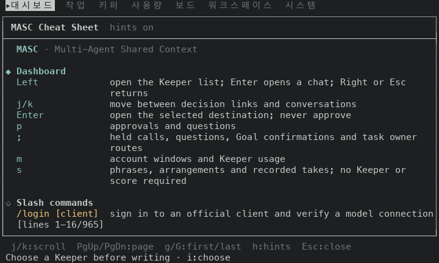
*Before: the footer lists scroll, page, first/last and hints, and no key for a filter.*

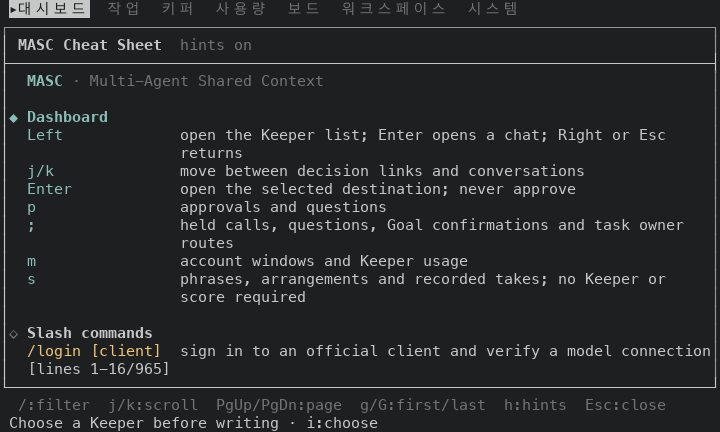
*After: the same sheet with `/:filter` first in the footer.*


*Typing `/approve` at 120x35: four sections remain in two columns, and the title row shows the query with the caret.*

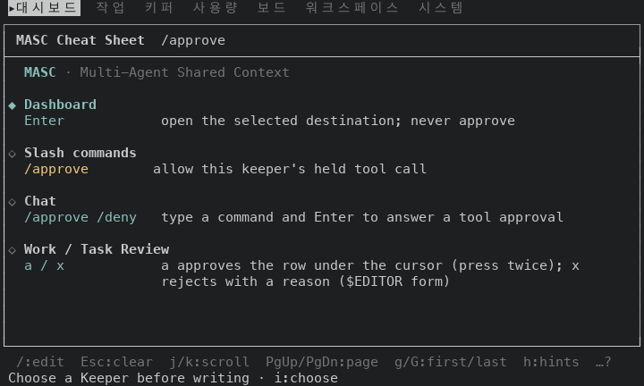
*After Enter at 80x24: the query stays in the title row without the caret, and the footer offers `/:edit` and `Esc:clear`.*

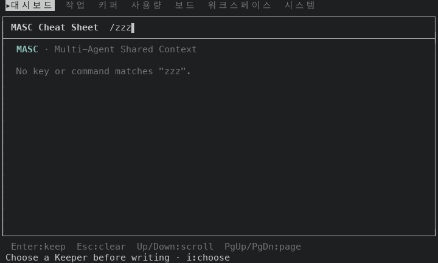
*A query with no match: one line says so and the footer keeps `Enter:keep` and `Esc:clear`.*

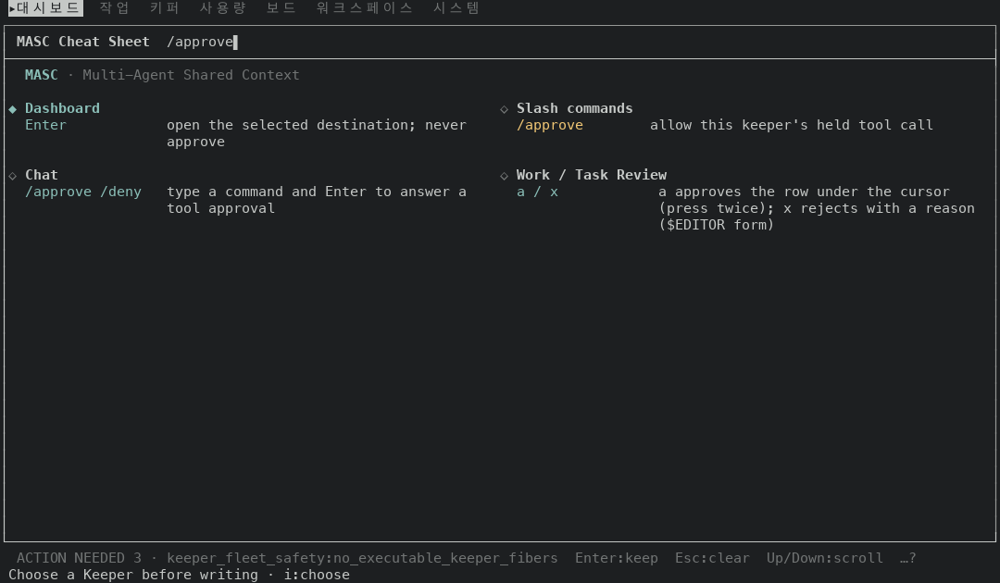
*Hangul `메ㅔ갶ㄷ` typed at 120x35: the title row and the four sections are the ones the English capture shows for `/approve`.*

### Layer 34: Task detail headings carry no number (#48481)

Work, Tasks (`t` on the Work tab), then Enter on a Task. The Description and
Handoff & Completion Contract sections appear only when the Task has content for
them, so the numbers read 1, 2, 4 for a Task without a handoff. Before is the
layers 1 to 33 build. After is the layers 1 to 34 build.

```
Task                         before                          after
task-002 (verification)      1. 2. 3. 4.                     four headings, no number
task-004 (claimed)           1. 2. 4.   (3 is skipped)       three headings, no number
```

Each heading row loses its `N. ` prefix and keeps the rest of its text, for
example `[ 2. 작업 설명 · 대상 파일 (Description & Files) ]` becomes
`[ 작업 설명 · 대상 파일 (Description & Files) ]`. The sections keep their order
and their rows. Each side seeded its own fresh workspace, so the times, the
event log line numbers, the duration values and the order of the Task list on
the left differ between the sides. With those four masked, 7 of the 8
captures of the verification and claimed Tasks (120x35 and 80x24, top and
scrolled) differ only in the heading rows. The eighth (verification, 80x24,
scrolled) also differs in two rows that read `refreshing`, the read state at the
moment of the capture. The in-progress captures opened a different Task on each
side (task-006 and task-007) and are left out of the comparison.

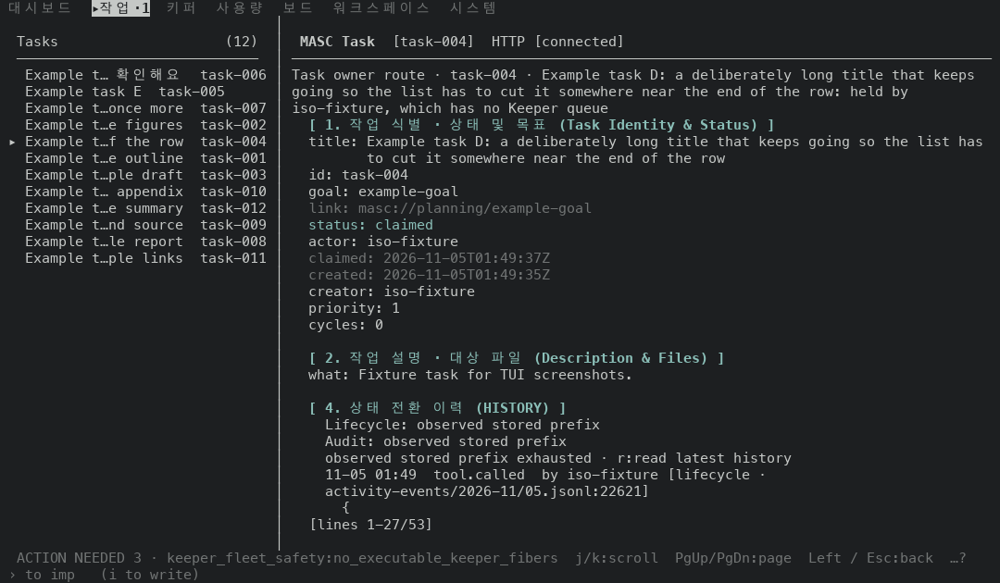
*Before: the claimed Task shows headings 1, 2 and 4, with no 3 between them.*

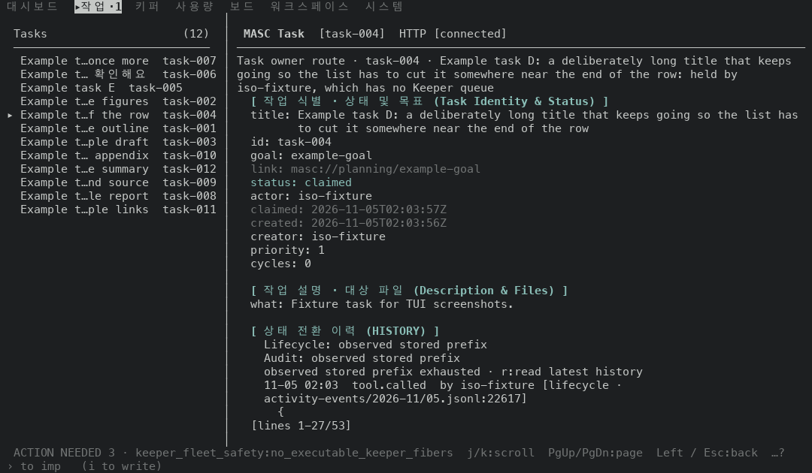
*After: the same three headings without numbers; the rows under them are the same.*

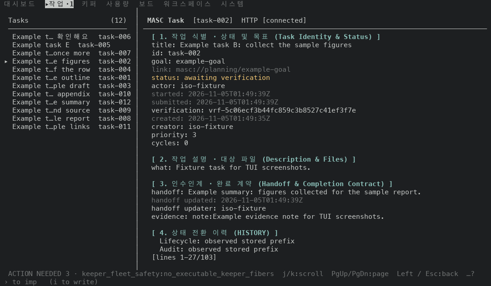
*Before: the Task awaiting verification shows headings 1 to 4.*

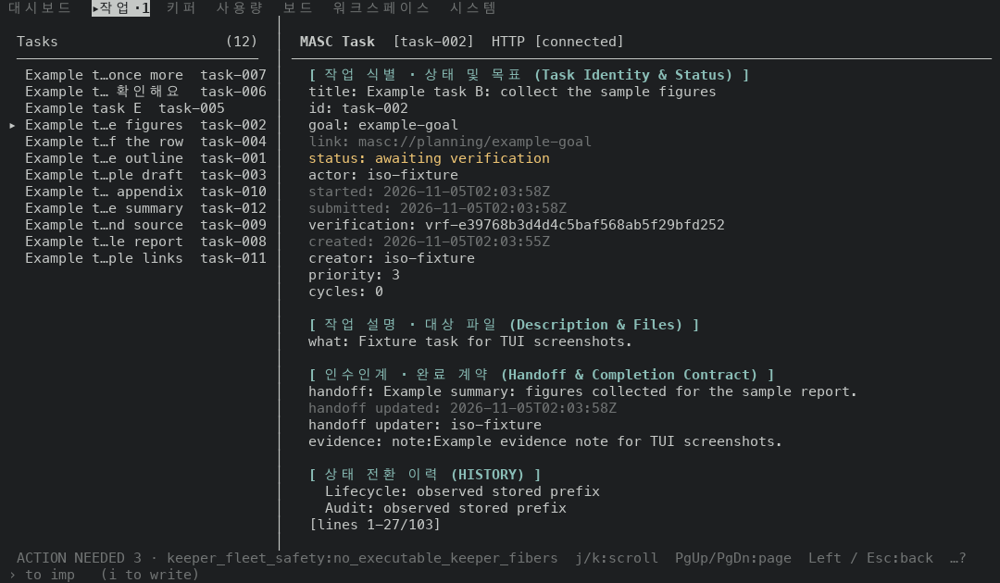
*After: the four headings without numbers.*

### Layer 35: a word wider than its row breaks after a separator (#48493)

The Dashboard, the screen the TUI opens on. The fixture's server reports three
reasons for action needed. Each is one word with no space, and the Action
needed card lists one per row. The card is 54 cells wide at 120x35 and 44 cells
wide at 100x30. At 80x24 no card is drawn, so that capture is the same on both
sides. Before is the layers 1 to 34 build. After is the layers 1 to 35 build.

```
Each pair shows the two rows a reason takes; "/" stands for the row break.

120x35  keeper_identity_drift:configured_keeper_without_runtime_meta
  before  keeper_identity_drift:configured_keeper_without_runtim / e_meta
  after   keeper_identity_drift:configured_keeper_without_       / runtime_meta
100x30  keeper_fleet_safety:no_executable_keeper_fibers
  before  keeper_fleet_safety:no_executable_keeper_fib / ers
  after   keeper_fleet_safety:no_executable_keeper_    / fibers
100x30  keeper_identity_drift:configured_keeper_without_runtime_meta
  before  keeper_identity_drift:configured_keeper_with / out_runtime_meta
  after   keeper_identity_drift:configured_keeper_     / without_runtime_meta
```

Before, the card cut each word at its width, so a reason code ended in the
middle of `runtime`, `fibers` or `without`. After, a word wider than the row
breaks after the last `_`, `:`, `/`, `.` or `-` that fits. Every other row of
the screen is the same on both sides once digits are masked: at 120x35 the
diff is two rows, at 100x30 four rows, and at 80x24 none.

To see what else the change moves, the first screen of each of the 15 palette
destinations (Task Review, Task Verdicts, Approvals, Features, Schedules,
Memory, Fusion, Clients, Tools, Artifacts / Resources, Code, Logs, Activity,
Runtime and Changes) was captured at 60x24, 80x24 and 120x35 on both builds.
With digits and hex ids masked, 41 of the 45 captures are the same. The other
four differ in text that has nothing to do with wrapping: the read state
shown at the end of the title row and in the footer (`finishing refresh`,
`Refreshing Keeper list`, in Approvals at 60x24 and 80x24 and in Schedules at
60x24), and which log lines the Logs screen had received at 120x35.

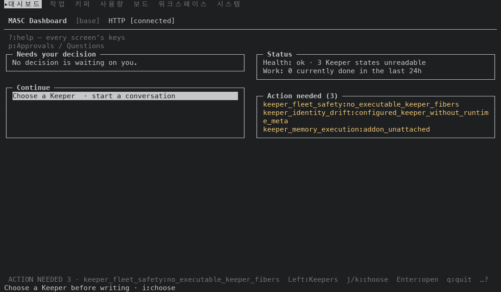
*Before: the second reason breaks inside `runtime`, leaving `e_meta` on the next row.*

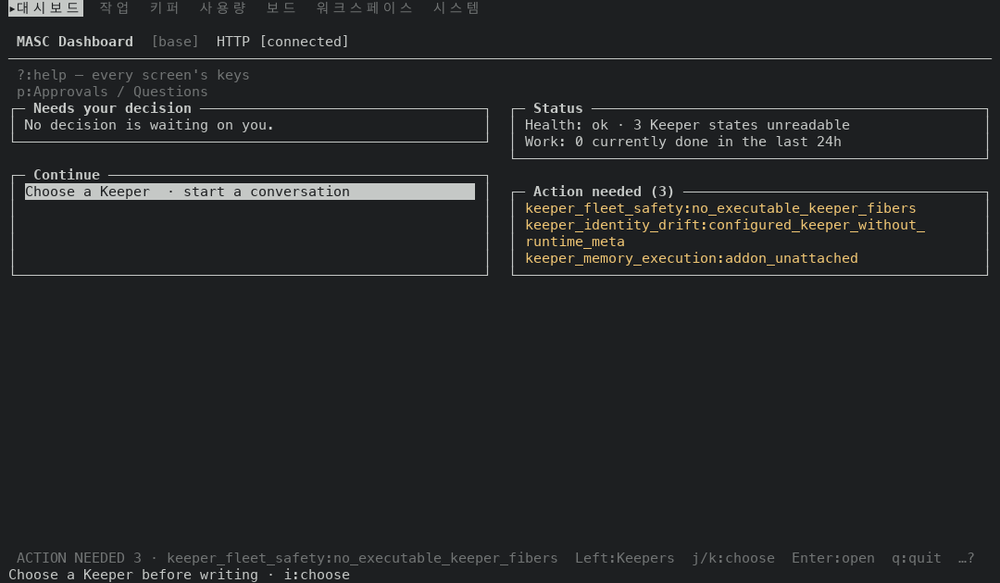
*After: the same reason breaks after `without_`, and `runtime_meta` is whole on the next row.*

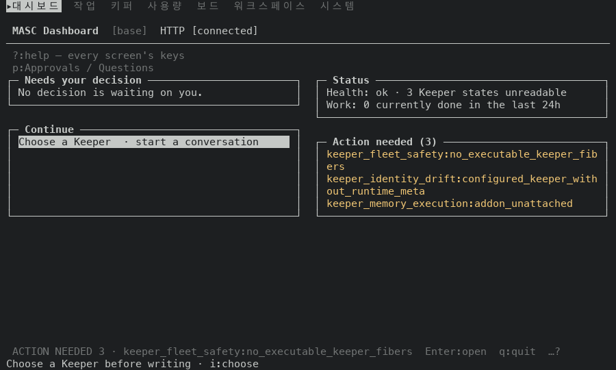
*Before: at 44 cells two reasons break inside `fibers` and `without`.*

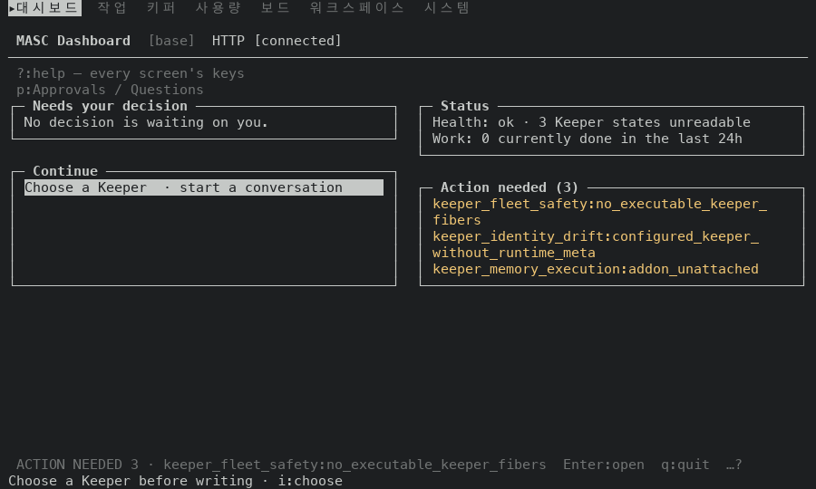
*After: both break after `keeper_`, and the rows read `fibers` and `without_runtime_meta`.*

The rule sits in `wrap_words`, which the screens call to wrap their rows, so
the Task detail was captured on both builds as well, at 120x35 and 80x24: the
Task in progress, the claimed Task and the Task awaiting verification, each at
the top and scrolled to its history. A history entry shows its note as JSON,
and the note's `tool_args_preview` is one long string. Spaces appear in it only
inside the free text it quotes. With times, `.jsonl` offsets and durations
masked, no row differs at the top of any of the three Tasks. Scrolled to the history at 120x35, the rows
of that string differ in all three Tasks (seven rows in all). At 80x24 the only
differing rows are the read state text of the awaiting Task (`refreshing` and
`Refreshing Keeper list`).

```
120x35, scrolled to the history; "/" stands for the row break.

claimed (task-004)
  before  "{\"_agent_name\":\"iso-fixture\",\"task_id\":\"task-004\",\"action\":\"clai / m\"}",
  after   "{\"_agent_name\":\"iso-fixture\",\"task_id\":\"task-004\",\"action\":        / \"claim\"}",
in progress (task-007)
  before  "{\"_agent_name\":\"iso-fixture\",\"task_id\":\"task-007\",\"action\":\"star / t\"}",
  after   "{\"_agent_name\":\"iso-fixture\",\"task_id\":\"task-007\",\"action\":        / \"start\"}",
awaiting verification (task-002), three rows
  before  ...\"action\":\"subm / it_for_verification\",\"notes\":\"Example evidence: the sample figures are / collected.\",...
  after   ...\"action\":       / \"submit_for_verification\",\"notes\":\"Example evidence: the sample figures / are collected.\",...
```

Before, the name of the action was cut inside the word, as in `clai` and `m`.
After, the row ends at `\"action\":` and the name starts the next row whole.

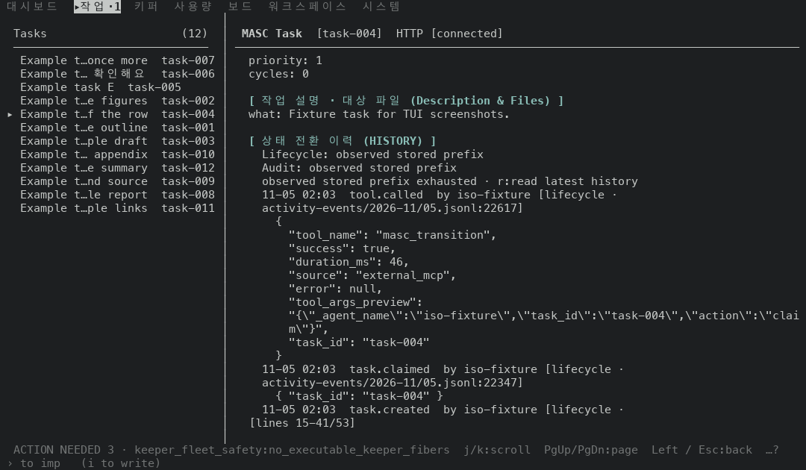
*Before: the action name is cut inside `claim`, leaving `m\"}` on the next row.*


*After: the row ends at `\"action\":` and `\"claim\"}` is whole on the next row.*

### Layer 36: coloured names and names with a mark break after a separator too (#48516)

Layer 35 made a plain word wider than its row break after the last `_`, `:`,
`/`, `.` or `-` that fits. Three kinds of text still went another way. A word
that carries a style escape was cut at the row's width. A separator followed by
a combining mark took no break. A word that is not valid UTF-8 could fill a row
wider than the budget. Layer 36 changes the one function that looks for the
break, `separator_cut`. It now walks the pieces a row is drawn from (a
character with its marks, or a whole escape) where it walked the row's bytes.
`split_word` sends a word that is not valid UTF-8 to the width cut, where layer
35 sent a word that held an escape.

`wrap_styled_words`, the call that keeps colour across rows, is used by the
Work, Keepers and Runtime screens. No screen the fixture can draw holds a
coloured word wider than its row, so the screens of this layer are a control.
Before is the layers 1 to 35 build. After is the layers 1 to 36 build, and both
were captured the same way.

- The Dashboard at 80x24, 100x30 and 120x35: no row differs once digits are
  masked, in the text or in the colour codes.
- The first screen of each of the 15 palette destinations at 60x24, 80x24 and
  120x35 (45 captures): two captures differ, and only in the read state text.
  Schedules at 60x24 ends its title row with `· r…` and its footer with
  `Refreshing Keeper list: waiting…` on the Before build only. Fusion at 80x24
  ends them with `· refreshing` and `Refreshing Keeper list: reading metadata`
  on the After build only.
- The Task detail at 120x35 and 80x24, for the Task in progress, the claimed
  Task and the Task awaiting verification, each at the top and scrolled to its
  history (12 captures): one capture differs, the awaiting Task scrolled at
  120x35, and only in the read state text (`finishing refresh` and
  `Refreshing Keeper list: result awaiting state application`).

The rows below come from calling `wrap_styled_words` and `wrap_words` of the
layer 35 and layer 36 sources directly, which is the call the screens make. The
first input is the Dashboard reason from layer 35 in yellow. The others are
made-up names.

```
Each pair shows the rows a call returns; "/" stands for the row break.
<33m> is the escape that opens yellow, <2m> opens dim and <0m> closes them.

wrap_styled_words, 54 cells, the layer 35 Dashboard reason in yellow
  before  <33m>keeper_identity_drift:configured_keeper_without_runtim<0m> / <33m>e_meta<0m>
  after   <33m>keeper_identity_drift:configured_keeper_without_<0m> / <33m>runtime_meta<0m>
wrap_styled_words, 30 cells, a path in dim
  before  <2m>/home/example/workspace/projec<0m> / <2m>t/.worktrees/feature/tui-ux-lo<0m> / <2m>op/bin/masc_tui.ml<0m>
  after   <2m>/home/example/workspace/<0m> / <2m>project/.worktrees/feature/<0m> / <2m>tui-ux-loop/bin/masc_tui.ml<0m>
wrap_words, 12 cells, abcdefgh_ + U+0301 (a mark) + ijklmnopqrstuvwxyz
  before  abcdefgh_U+0301ijk / lmnopqrstuvw / xyz
  after   abcdefgh_U+0301 / ijklmnopqrst / uvwxyz
wrap_words, 1 cell, two U+1F1FA (the two letters of a flag) and the byte 0xFF
  before  both letters in one row (width 2) / 0xFF (width 1)
  after   one letter per row, then 0xFF (widths 1, 1, 1)
```

Before, a coloured word was cut at the width, as in `runtim` and `e_meta`.
After, it breaks after the last separator that fits, and each row opens and
closes its own colour. The mark stays with the separator it follows. A word
that is not valid UTF-8 is cut at the width, as it was before layer 35.

`test/test_tui_wrap_words.ml` has 18 cases. Ten copies of
`masc_tui_message_layout.ml`, each with one fault put in on purpose, were each
failed by at least one case:

```
plain-cut        sends every wide word to the width cut                  9 cases fail
no-half-fill     drops the rule that a row is at least half full         4
bytes-in-piece   counts a separator's cells as bytes (character pieces)  2
bytes-in-ascii   counts a separator's cells as bytes (ASCII pieces)      3
bytes-in-drain   measures the rest of the word in bytes                  3
first-separator  breaks after the first separator, not the last          7
raw-bytes        scans the row's bytes, not its pieces                   5
no-utf8-guard    sends a word that is not UTF-8 to the separator search  1
mark-parted      cuts between a separator and its mark                   3
per-row-pass     scans the whole word again for every row                1
```

A random comparison ran 300000 texts at widths 2 to 41, mixing English
letters, the five separators, Chinese and Hangul characters, emoji, marks,
joiners, escapes and spaces. It found no exception, no lost character, no text
with more over-wide rows than the layers 1 to 34 build gives it, and no
difference from layer 35 that an escape or a mark does not explain. 151323
texts differ from layers 1 to 34, and 150137 texts with an escape and 73 texts
with a mark or joiner differ from layer 35. In the same run, 60000 words that
are not valid UTF-8 were split exactly as `split_cells` splits them. A second
run took 200000 such words at widths 1 to 30. Layer 35 left a row wider than
the budget in 7120 of them, and a row wider than the widest row of layers 1 to
34 in 1056. The widest row of layer 36 is never wider than that of layers 1 to
34.

With a style escape only between characters, the visible rows never differed
from the rows of the same text without escapes (287891 texts). With an escape
anywhere, including between an emoji and its joiner, 24810 of 287321 texts
differed, where layers 1 to 34 gave 15481. An escape inside such a cluster cuts
the cluster in two. Whether a screen puts an escape there was not checked.

Time to wrap one word of the size each row names, median of five runs on one
macOS machine. Only a word wider than its row reaches this code.

```
                                   layers 1-34   layer 35   layer 36
ASCII, with separators                    7 ms      28 ms      54 ms
ASCII, no separator                       8 ms      46 ms      50 ms
wide characters, 700k cells             108 ms     148 ms     217 ms
coloured, 60k escape pairs               57 ms      48 ms     101 ms
with a mark, 900k bytes                 146 ms     185 ms     262 ms
not UTF-8, 900k bytes                   137 ms     166 ms     148 ms
```

### Layer 38: a Task history note that is JSON is drawn in colour (#48534)

A history entry of a Task shows its note. For the tool call and task events of
the fixture the note is a JSON object. The Task detail drew every note in one
colour, so a key and its value looked alike. The Keeper chat draws a served
JSON document with a colour for each kind of token, through
`Masc_tui_tool_detail.document`. Layer 38 draws a history note the same way
when the note is a JSON object or an array: keys, strings, numbers, `true`,
`false`, `null` and punctuation each have a colour, and a string that holds a
JSON document is opened into rows. Any other note (prose, a number or a string
on its own, text that is not JSON) keeps the one colour.

Before is the layers 1 to 36 build. After is the layers 1 to 38 build. Layer 37
changes no code. The colours of the After captures, read from the `.ansi` files
(tmux's own encoding of the screen), match the theme's JSON colours:

```
key                ESC[96m  bright cyan
string             ESC[92m  bright green
number             ESC[93m  bright yellow
true, false, null  ESC[95m  bright magenta
punctuation        ESC[2m   dim
```

The fixture's history notes are JSON objects with the members `tool_name`,
`success`, `duration_ms`, `source`, `error`, `tool_args_preview` and `task_id`.
The Task detail was captured at 120x35 and 80x24 for the Task in progress, the
claimed Task and the Task awaiting verification, each at the top and scrolled
to its history (12 captures).

Colour codes differ in the seven captures that have a history note on screen,
and in none of the other five. With times, `.jsonl` offsets and durations
masked, the text of the two builds differs in these rows only:

- The row count in the footer of the detail (`[lines a-b/N]`) grew in all 12
  captures, because the notes are drawn longer. At 120x35 it went from 103 to
  113 for the Task awaiting verification, from 53 to 57 for the claimed Task
  and from 68 to 76 for the Task in progress. At 80x24 it went from 105 to 114,
  53 to 57 and 68 to 76.
- The claimed and the in-progress Task scrolled to the history at 120x35: the
  `tool_args_preview` member and the small objects that the server sends on one
  row, such as `{ "task_id": "task-004" }`. Both are shown below.
- The Task awaiting verification scrolled at 120x35: the read state text
  (`finishing refresh` in the title row and `Refreshing Keeper list: result
  awaiting state application` in the footer, on the Before build only).

`tool_args_preview` holds a string that is itself a JSON document. Before, the
string wrapped over three rows with every quote escaped. After, it is opened
into an object with one member to a row. A small object takes three rows where
it took one.

```
claimed (task-004), 120x35, scrolled to the history

  before  "tool_args_preview":
          "{\"_agent_name\":\"iso-fixture\",\"task_id\":\"task-004\",\"action\":
          \"claim\"}",
          ...
          { "task_id": "task-004" }

  after   "tool_args_preview": {
            "_agent_name": "iso-fixture",
            "task_id": "task-004",
            "action": "claim"
          },
          ...
          {
            "task_id": "task-004"
          }
```

The Task awaiting verification has a `tool_args_preview` that the server cut
and ended with `...(truncated)`. That is not a JSON document, so it stays one
string. It is drawn in the string colour over four rows, and each of the four
rows starts with ESC[92m, so a wrapped row carries the colour it continues.

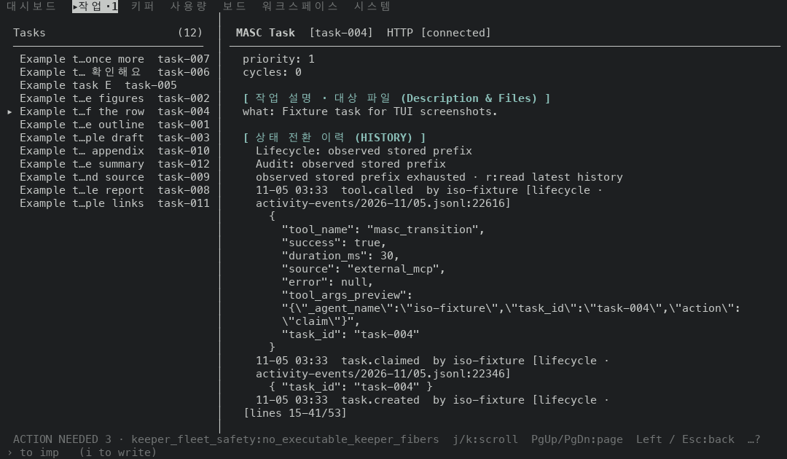
*Before: the whole note is one colour, and the quoted action is one escaped string over three rows.*

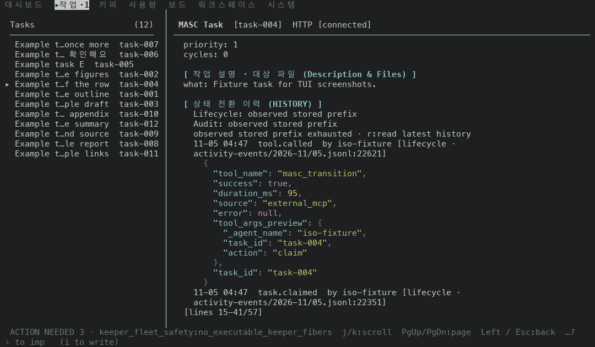
*After: keys are cyan, strings green, numbers yellow, `true` and `null` magenta, and the quoted action is an object.*

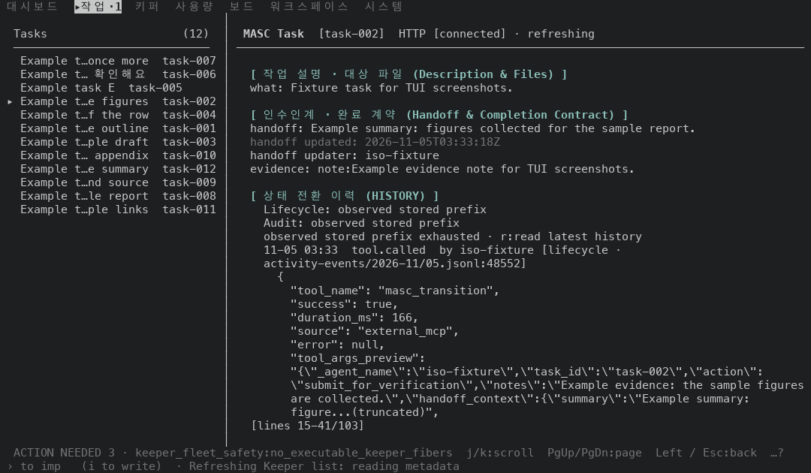
*Before: the cut string wraps in the one colour.*

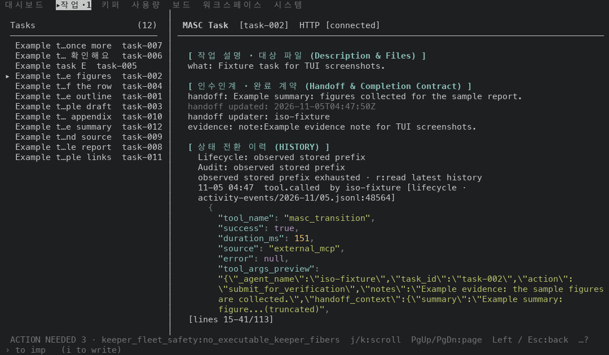
*After: the same four rows, each in the string colour.*

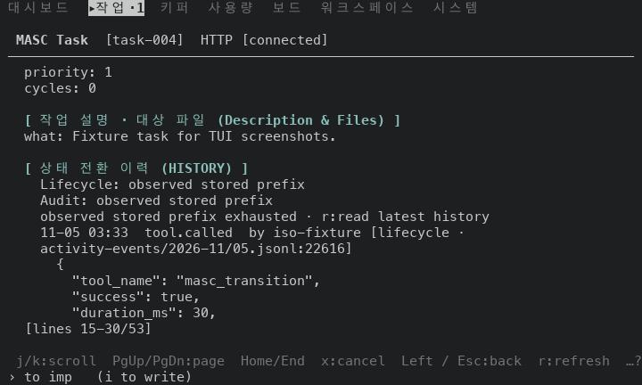
*Before, at 80x24: three members in the one colour.*

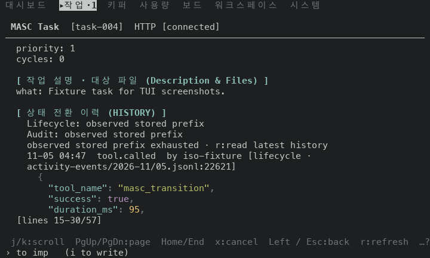
*After, at 80x24: the same three members in colour.*

Nothing else moved. The Dashboard at 80x24, 100x30 and 120x35 has no row that
differs in the text or in the colour codes. The first screen of each of the 15
palette destinations at 60x24, 80x24 and 120x35 (45 captures) has two captures
that differ in the text files and two in the colour-code files, and every
differing row is a read state phrase or a log line: Fusion at 80x24 and
Artifacts / Resources at 80x24 differ in `refreshing`, `finishing refresh` and
`Refreshing Keeper list`, and Logs at 120x35 differs in which log lines it had
received.

The rows below come from calling `Masc_tui_tool_detail.document` of the layer 38
source with no colours, which is the call the Task detail makes for a note.

```
note    {"x":1e3,"y":0.10,"z":1E-7,"neg":-0}
result  "x": 1000.0, "y": 0.1, "z": 1e-07, "neg": 0, one member to a row

note    {"b":1,"a":2,"b":3}
result  the members in the note's order, the repeated key kept

note    {"tool_args_preview":"{\"action\":\"claim\"}"}
result  "tool_args_preview": { "action": "claim" }, opened over rows

note    {"note":"line one\nline two"}
result  "note": | and then one row for each line

note    "just text"    42    Task claimed by iso-fixture    {"a":1} trailing
result  not a document, so the note keeps the one colour
```

A note is drawn again from its parsed form, not from its bytes: spaces change,
and a number is printed the way it parses. The server's own formatting of a
note, such as the one-row `{ "task_id": "task-004" }`, is not kept.

Control characters in the keys and values of a note were checked in the same
call. A JSON object with ESC, `ESC ] 0 ; t BEL`, BEL, DEL, NUL, CR, a C1 `CSI`
(U+009B) and a right-to-left override (U+202E) in a key and in a value was
drawn with each of them spelled as a JSON escape or replaced by a space, and
no ESC byte was left. A line separator (U+2028) is the one character it did
not remove: it was a space in one row and stayed as it was in another, and the
one-colour path leaves it in place as well.

`test/test_tui_text_block.ml` has 12 cases and `test/test_tui_tool_detail.ml`
has 8. They were run in a bytecode build outside the repository with small
stand-ins for the heavy modules, and all passed.
`test/test_tui_task_document_style.ml` (6 cases) needs the `masc` library, so
it was type-checked and not run. Eight copies of the two modules, each with one
fault put in on purpose, were each failed by at least one case:

```
styled-sanitises          passes a styled row through the sanitiser         3 cases fail
styled-plain-wrap         wraps a styled row with the plain wrap            1
styled-no-indent          drops the indent of a styled row                  3
document-always-some      makes a number, string, bool or null a document   1
document-skips-unfold     does not open a string that holds a document      1
document-objects-only     counts an object as a document and an array not   2
document-raises-on-prose  raises when the note is not JSON                  2
document-no-reset         leaves a coloured token without the reset         2
```

A random comparison made 24000 JSON values from English letters, separators,
Chinese and Hangul characters, emoji, marks, joiners, strings that hold JSON
documents, bytes that are not UTF-8, and the control characters above. 12092 of
them were documents (6573 with a string that holds a document). Their 94774 rows
were wrapped at 11 widths between 1 and 47 cells, which makes 5128386 rows
from the styled wrap. In every one the visible text matched the plain wrap of
the same line with its colour codes removed. No row ended with a colour left
open, and no escape other than the five palette colours and the reset was
found. No row held a C0 control, DEL, a C1 control or a bidirectional control.
Rows with U+2028 remained.

### Layer 40: a blank line inside a Task history note stays, and a number JSON cannot write is drawn (#48552)

A history entry of a Task shows its note. Layer 38 and the builds before it got
two things wrong, and layer 40 fixes both.

A note went to the text block one line at a time. The block drops a blank line
at either end of the text it is given, so each blank line of a note stood at the
end of its own one-line text and was dropped: the paragraphs of a note ran
together. Layer 40 hands over the whole note as one text. A blank line between
two lines of a note stays, and only the blank lines before the first line and
after the last line go.

`Masc_tui_tool_detail.document` raised on a JSON note that holds `NaN`,
`Infinity`, `-Infinity` or a number too large for a float (`1E400`). Yojson reads
these and its writer cannot write them. The Task history and the Keeper chat
tool call preview both call that function. Layer 40 draws each of them as the
word `NaN`, `Infinity` or `-Infinity`, in the number's colour.

Before is the layers 1 to 38 build. After is the layers 1 to 40 build. Layer 39
changes no code.

The claimed Task (`task-004`) was claimed through `masc_transition` with a note
of two paragraphs: `Taking this one.`, a blank line, and `The second source is
slow, so the figures come last.` The activity log records the call as a
`tool.called` event, so the history note is a JSON object. Its
`tool_args_preview` holds that string under `"notes"`. The Task detail was
captured at 120x35 and 80x24, at the top and scrolled to the history (4
captures).

With times, `.jsonl` offsets and durations masked, the text of the two builds
differs in these rows only:

- The row count in the footer of the detail (`[lines a-b/N]`) went from 60 to 61
  in all four captures.
- At 120x35, scrolled to the history: one blank row between the two paragraphs
  inside `"notes": |`. The rows under it moved down by one, so the row for
  `"task_id": "task-004"` is below the pane after the change.
- At 80x24, at the top: the read state text (`· refreshing` in the title row and
  `Refreshing Keeper list: reading metadata` in the footer) on the After build
  only, which is a refresh in flight.

The 80x24 history capture ends at line 30 of the detail, above the note, so only
its footer count changed there. With digits masked, colour codes differ in 2 rows
of the 80x24 capture at the top (the two read state rows) and in 3 rows of the
120x35 history capture (the rows the blank row moved down).

```
claimed (task-004), 120x35, scrolled to the history

  before  "notes": |
            Taking this one.
            The second source is slow, so the figures come last.
          },
          "task_id": "task-004"

  after   "notes": |
            Taking this one.

            The second source is slow, so the figures come last.
          },
```

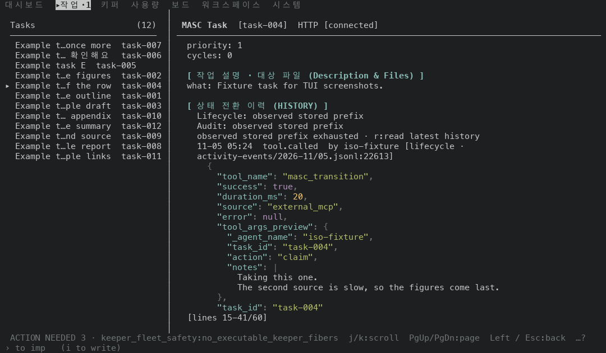
*Before: the two paragraphs of the claim note sit on consecutive rows.*

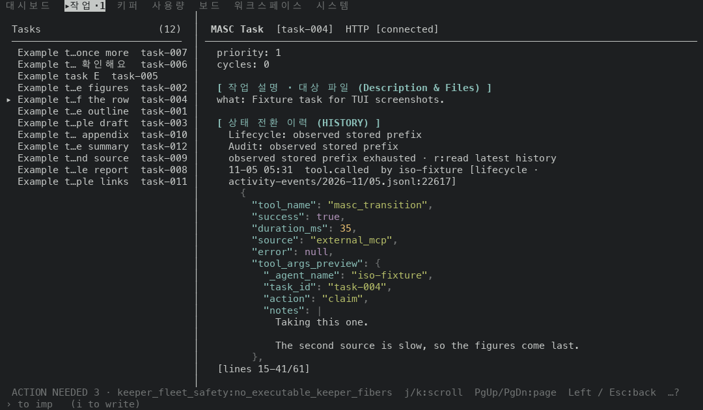
*After: a blank row separates the paragraphs. The footer counts 61 lines, and `"task_id": "task-004"` is below the pane.*

The fixture has no note with a carriage return and none with `NaN` or `Infinity`.
The rows below come from calling `Masc_tui_task_document.history` of the layer 38
source and of the layer 40 source at 60 columns, with colours off. Both ran in
the bytecode build described further down.

```
note    "Checked the build.\n\nThe type check passes; the tests are still
         running.\n\nNext: wait for CI."
before  3 rows, one paragraph under the other
after   5 rows, a blank row between the paragraphs

note    {"summary": "Checked the build.\n\nThe type check passes.", "count": 3}
before  "summary": | and the two lines one under the other
after   "summary": | and the two lines with a blank row between them

note    {"ratio": NaN, "limit": Infinity, "values": [1, -Infinity, 1E400]}
before  raises Yojson__Common.Json_error("NaN value not allowed in standard JSON")
after   "ratio": NaN, "limit": Infinity, "values": [ 1, -Infinity, Infinity ],
        one member to a row
```

`1E400` is read as infinity by Yojson, so it is drawn as `Infinity`.

A random comparison of the History rows made 6000 notes and drew each at 12, 30
and 100 columns with the layer 38 code and with the layer 40 code (18000 pairs).
A note is a JSON document (with strings that hold a document and strings with
line breaks) or prose. Its text comes from English letters, separators, Hangul,
Chinese characters, emoji, marks, zero width characters, line breaks, tabs,
carriage returns, ESC with and without a colour code, BEL, DEL, NUL, bytes that
are not UTF-8 and a right-to-left override. The generator makes no number that
JSON cannot write, because the layer 38 code raises on one.

- 17988 pairs have the same rows apart from blank rows. 14553 of them are
  identical and 3435 have blank rows more in the After build.
- No pair has fewer blank rows in the After build. Over the 18000 pairs it has
  5667 more.
- 12 pairs (4 notes at 3 widths) differ in a carriage return too. Each of the
  four notes has a line that ends in two carriage returns before its line break.
  The layer 38 code took one off in `Masc_tui_text_block.lines` and another in
  `rows_of_line`. The layer 40 code takes one off, so the second is drawn as
  `\x0D`, which is how the module's own comment says a carriage return that does
  not end a line is drawn.
- No pair differs in any other way.

The random comparison of layer 38 was run again on the layer 40 source with the
same seeds: 24000 JSON values, of which 12092 are documents (6573 with a string
that holds a document). Their 94774 lines, wrapped at 11 widths between 1 and 47
cells, give 5128386 rows. In every row the visible text matched the plain wrap of
the same line with its colour codes removed. No row ended with a colour left
open, and no escape other than the five palette colours and the reset was found.
No row held a C0 control, DEL, a C1 control or a bidirectional control. Rows with
a line or paragraph separator remain (67886, and 80654 in the one-colour path
over the same notes), as in layer 38. The generator makes no number that JSON
cannot write.

`test/test_tui_text_block.ml` has 12 cases, `test/test_tui_tool_detail.ml` has 10
and `test/test_tui_task_document_style.ml` has 8. The first two ran in a bytecode
build outside the repository with small stand-ins for the heavy modules, and all
passed. The third needs the `masc` library. It ran in a build made of the real
text of the History part of `masc_tui_task_document.ml` with stand-ins for the
modules that part reads, and all 8 cases passed. That build has no Body, so the
two cases that read Body rows passed without a row to check. The `type-check`
check passed on the head of the layer 40 pull request.

Nineteen copies of the text block and tool detail modules, each with one fault
put in on purpose, were each failed by at least one case of the first two files.
Three copies of the History part were each failed by a case of the third file:

```
styled-sanitises            passes a styled row through the sanitiser          3 cases fail
styled-plain-wrap           wraps a styled row with the plain wrap             1
styled-no-indent            drops the indent of a styled row                   3
document-always-some        makes a number, string, bool or null a document    1
document-skips-unfold       does not open a string that holds a document       3
document-unfolds-one-level  opens a string document one level only            1
document-objects-only       counts an object as a document and an array not    4
document-raises-on-prose    raises when the note is not JSON                   2
document-no-reset           leaves a coloured token without the reset          2
document-ignores-palette    draws a document with no palette                   4
non-finite-raises           raises on NaN and Infinity                         1
non-finite-nan-as-infinity  draws NaN as Infinity                              1
non-finite-sign-lost        draws -Infinity as Infinity                        1
number-in-literal-role      paints a number as true, false and null are        2
key-in-string-role          paints a key as a string is                        3
block-painted-as-string     paints the lines of a | block as a string is       1
key-unsanitised             writes a key without making it terminal safe       2
string-unsanitised          writes a string without making it terminal safe    2
block-unsanitised           writes a | block line without making it safe       1

History part:
note-per-line               hands a note over one line at a time               1
any-json-is-a-document      draws any JSON value as a document                 5
non-finite-raises           raises on NaN and Infinity                         1
```

## Not verified

- Layer 11 with a waiting question, and on a terminal that reports its palette:
  the fixture has no question to ask, and the capture terminal does not answer
  the palette query, so neither the warning style nor the blended colour was
  drawn.
- Layer 10 at 200x55 and the Features lane history of lanes other than
  Librarian and HITL Auto Judge at 120x35.
- Layers 15 and 16 on the Code project root and on Repositories. Their back
  key depends on more than a list and one detail (tree, file, history, Git
  changes, activity), so their list footers still name `Left / Esc`.
- Schedules, Task Verdicts and Changes with a detail or diff open: the fixture
  has no schedule, verdict or file change, so those detail footers were not
  drawn. Task Review, Work Goals, Board and Runtime details were.
- The Changes list footer without an `ACTION NEEDED` row: the fixture always
  reports three reasons, so the footer that fits all its items was not drawn.
- Layer 13 on a server that reports no reason, and with a reason too long for
  the card at 80x24: the Dashboard was captured at 120x35 and 200x55 only.
- Layer 17 with the English UI and at widths between 80 and 120 cells: the
  System tab was captured at 80x24 and 120x35 with the Korean UI.
- Layer 4, Harness detail and the Code draft keys: the fixture has no Harness
  verdicts and no repository, so neither screen was reached.
- Only the 120x35 Keepers list was measured for column positions. The 200x55
  and 80x24 Keepers screens differ in the same header text and were not measured.
- Layer 19 at widths between 120 and 200 cells, and with a reading that says
  `Work: reading unavailable`: the fixture reads Work and the Dashboard was
  captured at 120x35 and 200x55 only.
- Layer 20 with an account that has an email, with an account that reported but
  has no window, and at widths below 80 cells: the fixture has ten accounts,
  none with an email, none that reported, and the Usage tab was captured at
  80x24 and 120x35 only.
- Layer 22 with more than one Task in review, and at widths between 88 and 99
  cells: the fixture has one Task in review and Task Review was captured at
  60x24, 80x24, 86x24, 87x24, 100x30 and 120x35.
- Layer 23 with a Feature name longer than 25 cells or a state sentence longer
  than 44 cells, where the two columns do not fit together and the list keeps
  the earlier split.
- Layer 24 with a lane name longer than its column (the middle fold is
  unchanged) and at widths above 140 cells.
- Layer 25 with a Task that has several goals, with the English UI, and at
  widths below 60 cells: the fixture gives each Task at most one goal.
- Layer 27 with a done or cancelled Task, with a terminal that answers the
  palette query, and in the Tools view of a Task from an async request: the Work
  list shows open Tasks only, the capture terminal does not answer the palette
  query, and the fixture has no async request source.
- Layer 29 with a published report, with a Side_by_side layout and at widths
  below 60 cells: the fixture publishes no report, so the `CHECK` and `DAY`
  columns and the report name, author, time and size were not drawn, and the
  capture driver only opens the full-width list.
- Layer 29 with a terminal that answers the palette query: the capture terminal
  does not, so the receded colour of `TYPE`, `DETAIL`, `META` and the header row
  was not drawn. The name is bold and the cursor row is reversed.
- Layer 31 with a pending approval or a question waiting: the fixture has
  none, so the queue held `(no pending approvals)` and the row it gives up at
  narrow widths was measured only as a blank row.
- Layer 31 with Gate modes other than the fixture's, such as `Allow every call
  without review` in both lanes, and with a rule in the Always-allow row.
- Layer 31 on a terminal that answers the palette query: the capture terminal
  does not, so the Gate rows are the fallback bright cyan (SGR 96).
- Layer 33 with a Hangul query that matches a row the sheet writes in Hangul
  (`Event evidence`, and the Runtime detail rows in the Korean UI): a Hangul
  key is read back as the Latin keys that produced it, so those rows are found
  by their English key column only. The query was typed at the top of the
  sheet, never after scrolling, and not at widths between 96 and 100 cells.
- Layer 33 with a paste into the filter: the sheet rejects a paste, as it did
  before, and the capture driver did not paste. On a terminal that answers
  the palette query the key and heading colours are the palette's own. The
  capture terminal does not, so those are the fallbacks.
- Layer 34 with an in-progress Task and with a Task that has no description or
  files: the two sides opened different in-progress Tasks (task-006 and
  task-007), so no pair was compared, and every captured Task had a
  description, so a Task that skips section 2 was not drawn.
- Layer 35 on screens with a word wider than its row beyond the Dashboard
  card and the Task history note: the fixture's first screens hold none, so the
  other 14 destinations and the Dashboard at 80x24 were the same on both
  sides. Chat bodies, journal
  rows, file paths in the Task detail and the Keeper roster were not captured
  with a long name. `wrap_words` has about 100 callers, and the unit tests
  and a random comparison of 300000 strings stand in for those screens.
- Layer 36 on a screen with a coloured word wider than its row. These callers
  pass coloured text to `wrap_styled_words`: the Work Goal actions row, the
  Keepers Execute terminal and detail fields, and the Runtime Usage rows. The
  fixture has no running Keeper and no name that wide, so no captured screen
  holds such a word and none differs between the two builds. The rows above
  come from calling the module itself. `split_styled_cells` is the same as
  before and still cuts a word at its width.
- Layer 36 for a word that is not valid UTF-8 on a screen: no capture holds
  one, so the module call and the unit tests stand in for it. Whether any
  caller can receive such a word was not traced.
- Layer 38 with a note that is a JSON array, with a string that spans lines
  (drawn as a block under `|`) and with a number such as `1e3`: the fixture's
  notes are objects whose strings are single lines, so those were drawn only by
  the module call and the unit tests.
- Layer 38 in the Tools view of a Task from an async request, which draws the
  same history rows: the fixture has no async request source.
- Layer 38 with colours off and on a terminal with another palette: the colours
  are fixed SGR codes, and the capture terminal drew them with its own palette.
- Layer 40 on screens other than the claimed Task detail: only the four
  captures of the claimed Task were taken for this layer, so the Dashboard and
  the first screens of the other destinations were not compared again.
- Layer 40 with a note that holds `NaN`, `Infinity` or a carriage return, and
  with a tool call preview in the Keeper chat that holds `NaN` or `Infinity`:
  the fixture has no such note and no such preview, so those were drawn only by
  the module calls and the tests.
- Layer 40 at 80x24 with the note on screen: the capture at that size stops
  above the note.
- Layer 40 with a note of many paragraphs or a very deep object: only a note of
  two paragraphs was captured. The text of a deeply nested note grows with the
  square of its depth (#48554), which this layer does not change.
- Screens come from the CI-built binaries on one macOS machine. Nothing here
  was run on Linux or in a terminal other than tmux.
