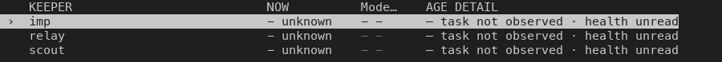
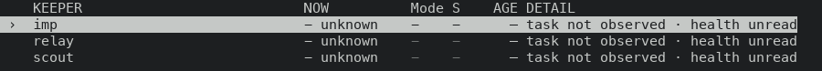
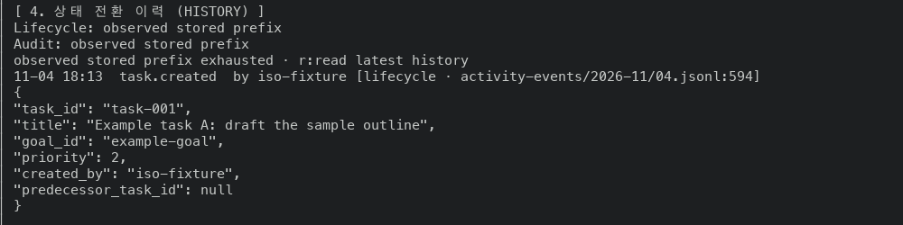
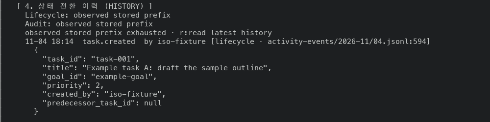

# TUI UX stack #48234: before and after screens

Scope: layers 1 to 5 of the stack (#48231, #48232, #48233, #48250, #48254).
Layer 6 (#48266) is not covered because no proof build contains it yet.

## Source

Both sides are the `masc-tui` and `masc` binaries that the native TUI proof
workflow built on a macOS arm64 runner. Each artifact carries a `receipt.json`
whose `sha256` and `server_sha256` match the files that were run, and
`masc-tui --build-commit` prints the source commit below.

| Side | Source commit | Proof run | `masc-tui` sha256 | `masc` sha256 |
| --- | --- | --- | --- | --- |
| Before | `8478b73c5ed93bb3dc2af59a4d4f479f3711ffd5` (main) | 41875751621 | `57b3f6c019aac22f78a0eb9e9cb5590180f74f10921b9cf453305842446b2999` | `bbf78bbbbc852e1443b8fe10ccffbcdfc51cb3517580d9624cda72b7963a0e41` |
| After | `a8ac7782e3c4e76c80851efbdb2a7682be843076` (layers 1 to 5) | 41882548710 | `1d9b46b26ccbbaafb5b8e29303691a0b8d35996525067df74947fc066b97fa62` | `1a055097b60d66d1fcf1b768946af1a7d794c4ae1fd9c62c7283362cb49fd403` |

Commit `68231ced9d9` was added to layer 5 after the After build. It changes
`test/dune` only, so the After binary is the one the layer 5 head would build.

Both proof runs ended `cancelled`. In each, the `test_workspace_file_confidentiality`
suite failed one case (`Board startup workspace authority`), the same case on
main and on the stack (#48260). The artifacts were uploaded after that failure.

## Environment

- macOS arm64 machine, one terminal per capture, driven through tmux at a fixed
  size. Sizes: 200x55, 120x35, 80x24, and 320x50 for the footer comparison.
- Every process ran under `env -i` with `PATH`, `HOME` (an empty directory),
  `TERM=xterm-256color` and `LANG=en_US.UTF-8`. No credential, Keeper or
  workspace of the operator was read.
- A fresh workspace per side: `masc init`, `masc start --port <port>` from the
  same artifact as the TUI, an expiring bearer from `masc mcp-config --expiring`.
- The fixture is neutral text written through MCP: one Goal (`example-goal`),
  three Tasks, one Board post with one comment. `task-002` was claimed,
  started, and submitted for verification with a note and one evidence note.
  Three Keeper definitions (`imp`, `relay`, `scout`) are present but none can
  run on this machine, so every footer starts with `ACTION NEEDED 3`.
- The key sequences are in the sections below. Each capture starts a new TUI
  process, waits for `HTTP [connected]`, settles for a few seconds, and then
  sends the keys. The capture driver is not part of the repository.

## Observed results

### Layer 1: Keepers header (#48231)

Keepers list at 120x35.

| Side | Header text | Header `AGE` right edge | Row `—` column |
| --- | --- | --- | --- |
| Before | `Mode…` | 61 | 59 |
| After | `Mode S` | 62 | 62 |




### Layer 2: `Left` closes a Task detail (#48232)

Work, `t` for Tasks, `Enter` for a detail, then `Left`.

- Before: the detail stays open. The screen still reads `MASC Task [task-002]`
  and the footer still offers `Left / Esc:back`.
- After: the Tasks list is on screen (`MASC Work / Tasks`) and the footer reads
  `j/k:select  t / Esc:Goals  Enter:detail  r:refresh  Tab:next  q:quit`.

### Layer 3: footers follow the open detail (#48233)

Work, `Enter` on the Goal. Footer at 200x55.

```
before  z:Candle  j/k:move  t:Goals / Tasks  Left / Esc:back  q:quit  …?
after   z:Candle  j/k:move  v:next Work tab  f:filter  Left / Esc:back  q:quit  …?
```

`t` toggles Goals and Tasks on the list only. With the footer no longer
spending a slot on it, two more keys fit.

The Board list and post footers are the same before and after at 200x55.
`c:reply` did not fit in either, so the Board part of layer 3 changes the key
table without changing that screen.

### Layer 4: search keys leave the detail footers (#48250)

System, `L` for the log list, `Enter` for a detail, at 320x50 so the footer is
not cut.

```
before  … Left / Esc:back  /:find  n / N:next / previous match  q:quit  1-16/16  …?
after   … Left / Esc:back  r:refresh  Tab:next  q:quit  ?:help  1-16/16
```

The Verification (Task Review) list and detail footers are the same before and
after at 320x50, and its detail footer did not list `/:find` before either.
The cause was not examined. Layer 4 changes the key table for that surface
without a visible change in this capture.

### Layer 5: Task history keeps its indentation (#48254)

Work, `t`, `j`, `Enter` on a Task. Before, the history heading, its status
rows, the event rows and the JSON all start at the left edge. After, the
heading sits in the column of the other headings, rows are indented under it,
and the JSON keeps its nesting. A wrapped line continues at its own indent.




## Not verified

- Layer 6 (Goal detail headings and one-row Tasks): needs a proof build of its head.
- Layer 4, Harness detail and the Code draft keys: the fixture has no Harness
  verdicts and no repository, so neither screen was reached.
- Only the 120x35 Keepers list was measured for column positions. The 200x55
  and 80x24 Keepers screens differ in the same header text and were not measured.
- Screens come from the CI-built binaries on one macOS machine. Nothing here
  was run on Linux or in a terminal other than tmux.
