# TUI UX stack #48234: before and after screens

Scope: layers 1 to 6, 8 to 11, 13 to 17, 19, 20, 22 to 25, 27, 29 and 31 of
the stack (#48231, #48232, #48233, #48250, #48254, #48266, #48289, #48292,
#48299, #48306, #48327, #48329, #48341, #48344, #48350, #48365, #48370, #48386,
#48389, #48392, #48401, #48411, #48424, #48436). Layer 7 is the first version
of this document. Layer 12 added layers 6 and 8 to 11. Layer 18 added layers 13
to 17. Layer 21 added layers 19 and 20. Layer 26 is an RFC and has no screens.
Layer 28 added layers 22 to 25 and 27. Layer 30 added layer 29. The layer that
carries this text added layer 31.

## Source

Both sides are the `masc-tui` and `masc` binaries that the native TUI proof
workflow built on a macOS arm64 runner. Each artifact carries a `receipt.json`
whose `sha256` and `server_sha256` match the files that were run, and
`masc-tui --build-commit` prints the source commit below.

| Side | Source commit | Proof run | `masc-tui` sha256 | `masc` sha256 |
| --- | --- | --- | --- | --- |
| Before | `8478b73c5ed93bb3dc2af59a4d4f479f3711ffd5` (main) | 41875751621 | `57b3f6c019aac22f78a0eb9e9cb5590180f74f10921b9cf453305842446b2999` | `bbf78bbbbc852e1443b8fe10ccffbcdfc51cb3517580d9624cda72b7963a0e41` |
| After (layers 1 to 5) | `a8ac7782e3c4e76c80851efbdb2a7682be843076` | 41882548710 | `1d9b46b26ccbbaafb5b8e29303691a0b8d35996525067df74947fc066b97fa62` | `1a055097b60d66d1fcf1b768946af1a7d794c4ae1fd9c62c7283362cb49fd403` |
| After (layers 1 to 9) | `31d56f094eb2407c43a798fe28a655acb5bb5d41` | 41891144314 | `bc4ab5e3b3eceb61d592e41c7b36086d4933fc4f0dc37ef0fbb15c84f60108e2` | `121c5a7df6451a861c66d6ecdf29bc4aa2b76338c3b9bf7764afdea88c965644` |
| After (layers 1 to 10) | `cf512249ace0a8004473911ffd498e018e8ffd2b` | 41893673935 | `72b75b64133b8958647af57c81adc81c4d00dea267c81c11fc8a0b13da58b8dd` | `6ff4917f53ff0b47e3fb48a6f35b5e7a08f74206b6380f92f8345294cc5fd478` |
| After (layers 1 to 11) | `8969a8b26271b91b109849c96588c1f64d02f8ee` | 41895649701 | `15455664f4f711583f9e80554ed92c8234f2b09266aff89ca8a74b40124c7a5a` | `743b72a707f3eb76777b6ae6bf630b3dee1293727c9f1c3c132f1283c66329af` |
| After (layers 1 to 13) | `a91bcfe34a7163537d732604111babe587a2e166` | 41902049950 | `217ce2ec9cc4c4924d8bd4bc602e64f3848ed4a9c5e06a9099ba9f43f3c2ae24` | `45624e505eed03820a9e0c27d1e4b66155e9598f1240e0694e19c2a0e961b3cb` |
| After (layers 1 to 14) | `b4024cd1b69969af074544e33dbcbe7ed2e91bb9` | 41902957736 | `e274ba9288ff5ee1a40d6988c8291ad62a97b88899e4cf85c49638869952baa2` | `108103f1eb58106a2088d3298a304dc1b5e2e3bbd351e8b8ec5f06ce0e3b2280` |
| After (layers 1 to 16) | `3a2c8c907ada34d56ab902c35d5c445ef81a3351` | 41907039543 | `0a7e5caff4a8edc16a19df2c4cc68cc1572585a9a352ecf6934e1ff5aa498ff8` | `a3d493e9b978ca472df16d9e6caf6f16e893124d4bb64fe0e81af9673b8a3a24` |
| After (layers 1 to 17) | `9257388f916e738faf8c7acd2115a8101368c7d0` | 41909034875 | `ad08fcc424bbcc32076b440fd142b2c6d7c71d7aa75d849d059ef0f1aa0ea1c0` | `bc0396352e13b30b2ac262552ee0e7cabe04d8266b612a3b59dc1eaf5b916d1c` |
| After (layers 1 to 19) | `66a120b1993303d4c41b6c76a4ac5af50783d650` | 41913436954 | `8ef3094b19cef732d6c2057218cb189c2c1412b45375a4fadd1e77bbd838039a` | `fd8d22b0cff9f377e02a2696cefdf8fd2156b1ad9311b05fd970f9f5f4971716` |
| After (layers 1 to 20) | `8394991844dee9b123c3b577334bf368a3a7906d` | 41915100410 | `809e534c1b99241c45c51639e78fa46c7701beb8657ac8f470e2be6c3f87fa09` | `cac9d03ef037ce87bc341b97438438332b3c848c5037970b57c051b5e0a1752b` |
| After (layers 1 to 22) | `a6e907b07070ea13dc207c745be240f006bfbe8a` | 41919019723 | `eb92caef0a73d7935b05a0285c4873bb96ad59c437023a8bc45d8b75f990e76d` | `50a2c1484a131bba574f8d11955ebdc78e2f2dfc06f30dbfd5b61103555308ef` |
| After (layers 1 to 25) | `c514194fc2b378b3569485d5e8a58189b24ca69a` | 41925502321 | `c290ad1f9eb83919fbe77958bd7f614186d64e62123a0a0f948f3de241aa8700` | `bce80de3f7c0a05d0069469e1e13b8241cdaadf1fbee0912409d078ec6925990` |
| After (layers 1 to 27) | `d738d2334693f14ffa475ca8e5552dbe0425daf4` | 41929495694 | `8f0ca03fe34d837dafb2b17453ecef13dbb39ef3fe8aaa9c33ff7105e0cbe26f` | `76dd1f564067a2533487100dc6e772cc8debd74187b7cabf8b37c11b38e264ba` |
| After (layers 1 to 29) | `b9161eaa6acd24bae552597a20fadf638eaa0730` | 41934340932 | `b39991f1dad8a7b8913daf0d2ae8c7785a20d0be2c29eae992cd5088a3f89acb` | `c5cf37f66a5896cefba4beb3f712b12d9993d96e778e83b75a8cc247c712331f` |
| After (layers 1 to 31) | `8b86dd384c842d8f7f20027ae5ddc39132e26f08` | 41937783831 | `3dee2c63f3fe896f814dd14fa55e0c0e046581f003205141d3344556575a272b` | `6a00ffc156c1e6cb0c26e887636db87a8f6a53c4c43fea32a3ddddb4c38ba358` |

Commit `68231ced9d9` was added to layer 5 after the After build. It changes
`test/dune` only, so the After binary is the one the layer 5 head would build.

Every proof run ended `cancelled` or `failure`. In each, the
`test_workspace_file_confidentiality` suite failed one case (`Board startup
workspace authority`), the same case on main and on the stack (#48260). The
artifacts were uploaded after that failure.

## Environment

- macOS arm64 machine, one terminal per capture, driven through tmux at a fixed
  size. Sizes: 200x55, 120x35, 80x24, 320x50 and 400x50 for the footer
  comparisons, and 56x24, 68x24, 88x24 and 100x30 for the title rows of layer
  10. Screens opened with the command palette (`:`, then `go <name>`
  and Enter) are the ones with no key path from the Dashboard that the capture
  needed. Layers 13 to 17 used 200x55 and 120x35 (Dashboard), 100x30 and 80x24
  (Features), 120x35 (the footers of layers 15 and 16) and 120x35 and 80x24 (System
  menu). Layer 19 used 120x35 and 200x55 (Dashboard). Layer 20 used 80x24 and 120x35
  (Usage). Layer 22 used 60x24, 80x24, 86x24, 87x24, 100x30 and 120x35 (Task
  Review). Layer 23 used 60x24, 80x24, 120x35 and 200x55 (Features). Layer 24 used
  80x24, 100x30, 120x35 and 140x40 (Runtime). Layer 25 used 60x24, 80x24, 120x35
  and 200x55 with 42 open tasks (Work, Tasks). Layer 27 used 120x35 and 80x24 with
  the 12-task fixture (Task detail). Layer 29 used 60x24, 80x24, 120x35 and 200x55
  (Artifacts / Resources). Layer 31 used 60x24, 80x24, 90x28, 100x30 and 120x35
  (Approvals).
- Every process ran under `env -i` with `PATH`, `HOME` (an empty directory),
  `TERM=xterm-256color` and `LANG=en_US.UTF-8`. No credential, Keeper or
  workspace of the operator was read.
- A fresh workspace per side: `masc init`, `masc start --port <port>` from the
  same artifact as the TUI, an expiring bearer from `masc mcp-config --expiring`.
- The fixture is neutral text written through MCP: one Goal (`example-goal`),
  three Tasks, one Board post with one comment. `task-002` was claimed,
  started, and submitted for verification with a note and one evidence note.
  Three Keeper definitions (`imp`, `relay`, `scout`) are present but none can
  run on this machine, so every footer starts with `ACTION NEEDED 3`. Each
  side seeds its own fresh workspace, so timestamps differ between the sides.
  Layers 25 and 27 seeded extra Tasks with the same neutral text (42 open Tasks
  for layer 25, 12 for layer 27).
- The key sequences are in the sections below. Each capture starts a new TUI
  process, waits for `HTTP [connected]`, settles for a few seconds, and then
  sends the keys. The capture driver is not part of the repository.

## Observed results

### Layer 1: Keepers header (#48231)

Keepers list at 120x35.

| Side | Header text | Header `AGE` right edge | Row `—` column |
| --- | --- | --- | --- |
| Before | `Mode…` | 61 | 59 |
| After | `Mode S` | 62 | 62 |


### Layer 2: `Left` closes a Task detail (#48232)

Work, `t` for Tasks, `Enter` for a detail, then `Left`.

- Before: the detail stays open. The screen still reads `MASC Task [task-002]`
  and the footer still offers `Left / Esc:back`.
- After: the Tasks list is on screen (`MASC Work / Tasks`) and the footer reads
  `j/k:select  t / Esc:Goals  Enter:detail  r:refresh  Tab:next  q:quit`.

### Layer 3: footers follow the open detail (#48233)

Work, `Enter` on the Goal. Footer at 200x55.

```
before  z:Candle  j/k:move  t:Goals / Tasks  Left / Esc:back  q:quit  …?
after   z:Candle  j/k:move  v:next Work tab  f:filter  Left / Esc:back  q:quit  …?
```

`t` toggles Goals and Tasks on the list only. With the footer no longer
spending a slot on it, two more keys fit.

At 400x50 no footer is cut. Goal detail, with the middle of the row left out:

```
before  z:Candle  j/k:move  t:Goals / Tasks  p:Approvals  v:next Work tab  …  Y:copy link  /:find  q:quit  …?
after   z:Candle  j/k:move  v:next Work tab  …  Y:copy link  Tab:next  q:quit  ?:help
```

`t`, `p` and `/` are gone from the open detail. `p` is Pause there, so
`p:Approvals` named the wrong action.

Board list at 400x50:

```
before  … v / V:up / down  c:reply  Y:copy link  …
after   … v / V:up / down  Y:copy link  …
```

The Board post footer keeps `c:reply` on both sides. At 200x55 the Board list
footer is the same before and after, because `c:reply` did not fit in either.
The Work Goals list, Tasks list and Task detail footers are the same before
and after at 400x50.

### Layer 4: search keys leave the detail footers (#48250)

System, `L` for the log list, `Enter` for a detail, at 320x50 so the footer is
not cut.

```
before  … Left / Esc:back  /:find  n / N:next / previous match  q:quit  1-16/16  …?
after   … Left / Esc:back  r:refresh  Tab:next  q:quit  ?:help  1-16/16
```

Work, `v` for Task Review, `Enter` for a detail. The footer fitter drops items
from the back, and at 320x50 it had already cut the Task Review detail footer
before `/:find` on both sides, so nothing differs there. At 400x50 it does:

```
before  … a / x:approve / reject  /:find  q:quit  …?
after   … a / x:approve / reject  r:refresh  q:quit  …?
```

The Task Review list footer is the same before and after at 320x50 and 400x50.

### Layer 5: Task history keeps its indentation (#48254)

Work, `t`, `j`, `Enter` on a Task. Before, the history heading, its status
rows, the event rows and the JSON all start at the left edge. After, the
heading sits in the column of the other headings, rows are indented under it,
and the JSON keeps its nesting. A wrapped line continues at its own indent.


### Layer 6: Goal detail headings and one row per Task (#48266)

Work, `Enter` on the Goal, at 200x55. Before is the layers 1 to 5 build, after
is the layers 1 to 9 build; no layer between them touches this screen.

- Before: the section headings and every field line are dim, and each linked
  Task takes three rows (`Task:`, `Title:`, `Link:`).
- After: the headings use the info colour and bold, the style the Log, Lane,
  Fusion and Config detail headings already use. Title, Goal, Stage, Next,
  Metric, Target, Due and Priority are drawn in the normal foreground. Created,
  Updated and Link stay dim. Each linked Task is one row:
  `task-001  todo · Example task A: draft the sample outline`.

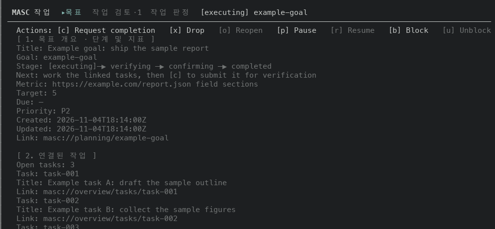
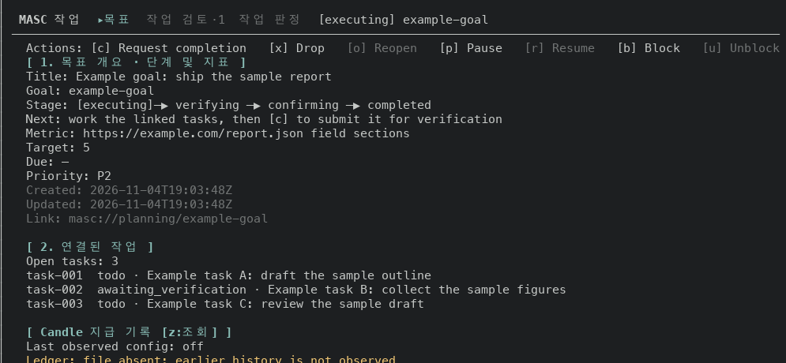

### Layer 8: Keepers summary row (#48289)

Keepers list. The count items now lead and the layout and sort name trails; an
item that does not fit is left out whole.

```
80x24   before  compact · priority   ! 0 attention   ▶ 0 active   ◌ 0 waiting   ○ 0 inactiv…
80x24   after   ! 0 attention   ▶ 0 active   ◌ 0 waiting   ○ 0 inactive   ? 3 unknown
120x35  before  compact · priority   ! 0 attention   ▶ 0 active   ◌ 0 waiting   ○ 0 inactive   ? 3 unknown
120x35  after   ! 0 attention   ▶ 0 active   ◌ 0 waiting   ○ 0 inactive   ? 3 unknown   compact · priority
```

200x55 has the same order as 120x35. Before is the layers 1 to 5 build, after is
the layers 1 to 9 build.

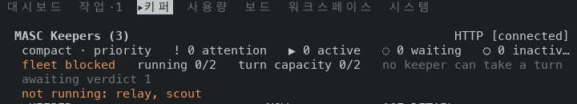
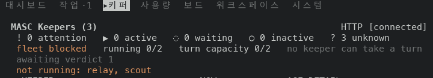

### Layer 9: terminal title leads with the attention count (#48292)

Dashboard at 120x35. The window title is what tmux holds after the program sets
it with OSC 0 (`#{pane_title}`). The footer of the same screen starts with
`ACTION NEEDED 3`, because the three fixture Keepers cannot run.

```
before (main 8478b73c5ed)       connected · base
after  (layers 1 to 9)          (3) connected · base
```

The unit tests added in #48292 were not run: local Dune is blocked and the pull
request checks only run the type check.

### Layer 10: title rows at 80 columns (#48299)

Activity, Logs and the Features lane history, opened with `go Activity`,
`go Logs` and `go Librarian history` from the command palette. Before is the
layers 1 to 5 build at 80x24 and the layers 1 to 9 build at 120x35; after is
the layers 1 to 10 build. Clocks differ because each side seeds its own
workspace.

```
80x24   lane history  before  MASC Features · Librarian            (0 loaded / 0 retained · end)  HTTP [co…
80x24   lane history  after   MASC Features · Librarian (0 loaded / 0 retained · end)  HTTP [connected]
80x24   Logs          before  MASC Activity  (213 of 213)  seq 212  level≥DEBUG  03:58:04  Server  HTTP [c…
80x24   Logs          after   MASC Activity  (213 of 213)  seq 212  le…  04:16:19  Server  HTTP [connected]
80x24   Events        before  MASC Activity  ▸Even…  ·  (1 row · 4 events held)  03:58:06  HTTP [connected]
80x24   Events        after   MASC Activity  (1 row · 4 events held)  04:16:22  HTTP [connected]
120x35  lane history  before  MASC Features · Librarian            (0 loaded / 0 retained · end)  HTTP [connected]
120x35  lane history  after   MASC Features · Librarian (0 loaded / 0 retained · end)  HTTP [connected]
```

The same screens at the other widths, both sides built as above:

```
56x24   Events        before  MASC Activity  (1 row · 3 events held)  04:22:28  HT…
56x24   Events        after   MASC Activity  (1 row · …  04:23:09  HTTP [connected]
56x24   Logs          before  MASC Activity  (199 of 199)  seq 198  level≥DEBUG  0…
56x24   Logs          after   MASC Activity  (…  04:23:11  Server  HTTP [connected]
56x24   lane history  before  MASC Features · Librarian            (0 loaded / 0 r…
56x24   lane history  after   MASC Features · Librarian (0 loade…  HTTP [connected]
100x30  Logs          before  MASC Activity  ‹1  ▸L…  ·  (213 of 213)  seq 212  level≥DEBUG  04:23:00  Server  HTTP [connected]
100x30  Logs          after   MASC Activity  (213 of 213)  seq 212  level≥DEBUG  04:23:42  Server  HTTP [connected]
```

At 68x24 the rows read like the 56x24 ones with a longer reading. At 88x24 and
at 100x30 the Events row is the same before and after, with the strip drawn.
At 88x24 the Logs row is the same before and after, with no strip on either side.
At 120x35 the Logs and Events rows are the same before and after. At 80x24 the
`HITL Auto Judge` history reads `MASC Features · HITL…to Judge (0 loaded / 0
retained · end)  HTTP [connected]`: the name folds in the middle so the badge
stays whole.

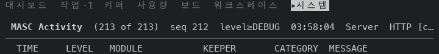
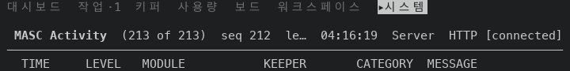
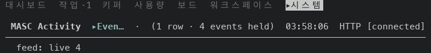
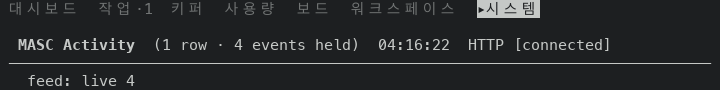
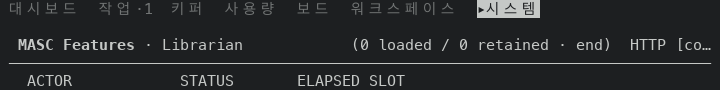
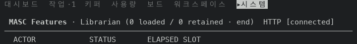

### Layer 11: Approvals question heading (#48306)

Approvals at 120x35, opened with `go Approvals`. No question is waiting. Before
is the layers 1 to 10 build, after is the layers 1 to 11 build. The text of the
heading `[?] Questions waiting on you (0) · a:open answers` is the same on both
sides; the style is not.

- Before: bold and yellow (`ESC[1m ESC[93m`).
- After: no weight or colour code on the heading. `Theme.recede` draws the
  terminal's own foreground when the terminal has not reported its palette,
  which is the case under tmux here; on a terminal that reports it, the colour
  is blended toward the background. The `none -- nobody is waiting on a
  decision` row under it stays dim (`Ansi.dim`).

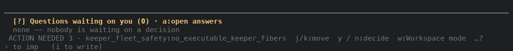
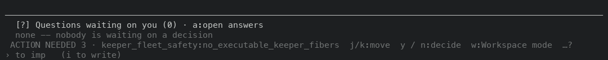

### Layer 13: Dashboard lists every reason (#48327)

Dashboard at 120x35 and 200x55. The server of the fixture reports three
reasons it needs the operator, so the footer starts with `ACTION NEEDED 3` on
both sides and names the first reason only. Before is the layers 1 to 11 build,
after is the layers 1 to 13 build.

```
120x35  before  no card; the right column ends with the Status card
120x35  after   a card `Action needed (3)` under the Status card, one row per reason:
                keeper_fleet_safety:no_executable_keeper_fibers
                keeper_identity_drift:configured_keeper_without_runtim / e_meta
                keeper_memory_execution:addon_unattached
200x55  after   the same three rows, each on one line
```

The second reason is 60 cells wide and the text area of the card is 54, so it
wraps at the card edge. The Continue card on the left grows to end on the same row as the
right column. The footer is the same on both sides.

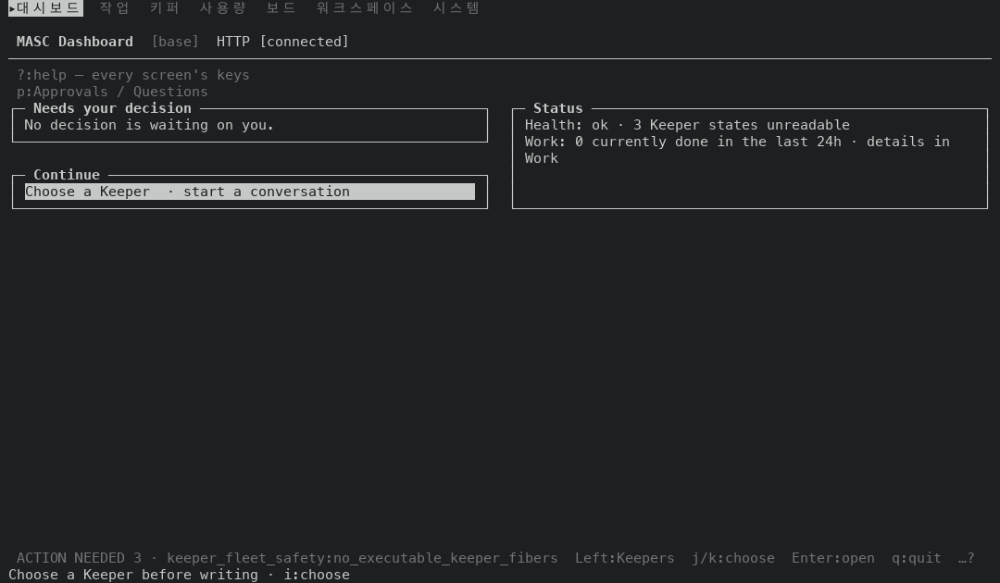
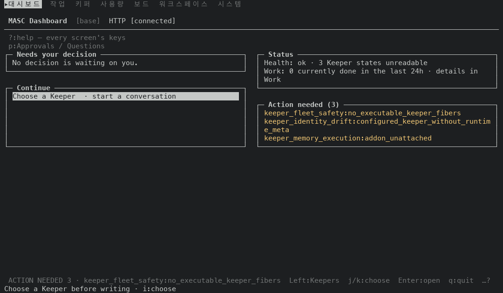

### Layer 14: summary rows leave out whole items (#48329)

Features, opened with `go Features`. Before is the layers 1 to 11 build, after
is the layers 1 to 14 build.

```
80x24   before  All features · observed 05:21:12 · 4 ready · 2 waiting · 1 failing · 4 not …
80x24   after   All features · observed 05:21:22 · 4 ready · 2 waiting · 1 failing
100x30  before  All features · observed 05:21:15 · 4 ready · 2 waiting · 1 failing · 4 not set up
100x30  after   All features · observed 05:21:25 · 4 ready · 2 waiting · 1 failing · 4 not set up
```

At 80 cells the item `4 not set up` does not fit and the row used to end in
the middle of it. It now ends at the last item that fits. At 100 cells every
item fits and the row is the same on both sides. The Keepers summary row
(`! 0 attention ▶ 0 active ...`) is the same before and after at 60, 66, 80,
100 and 120 cells on this fixture, because layer 8 already left out whole items
there; layer 14 moves that rule into the function the Features row shares.

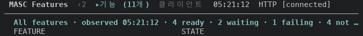
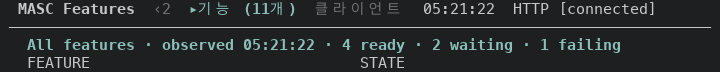

### Layers 15 and 16: the back key follows the open detail (#48341, #48344)

`Left` closes an open detail or diff. With none open it does nothing. `Esc`
closes it too and, on a list, leaves the screen. The layers 1 to 11 build was
driven at 120x35: on each list below, the title row is the same after `Left`,
and after `Esc` it names the screen the key went to.

| List, nothing open | After `Left` | After `Esc` |
| --- | --- | --- |
| Work Goals | same screen | Dashboard |
| Board | same screen | Dashboard |
| Schedules | same screen | Work (Goals) |
| Task Review | same screen | Work (Goals) |
| Task Verdicts | same screen | Work (Goals) |
| System Logs | same screen | Activity (Events) |
| Changes | same screen | Keepers list |
| Runtime | same screen | Config |

Footers at 120x35 with the list on screen. Before is the layers 1 to 11 build,
after is the layers 1 to 16 build. The leading `ACTION NEEDED 3 · ...` row, where
there is one, is left out of the lines below.

```
Work Goals     before  Right / Enter:detail  Left / Esc:back  q:quit  …?
               after   Right / Enter:detail  Esc:back  q:quit  …?
Board          before  j/k:move  s:sort  Ctrl-W:pane  PgUp/PgDn:page  Right / Enter:read  Left / Esc:back  v / V:up / down  q:quit  …?
               after   j/k:move  s:sort  Ctrl-W:pane  PgUp/PgDn:page  Right / Enter:read  Esc:back  v / V:up / down  q:quit  …?
Schedules      before  Right / Enter:details  Left / Esc:back  q:quit  …?
               after   Right / Enter:details  Esc:back  q:quit  …?
Task Review    before  j/k:move  v:next Work tab  Right / Enter:details  Left / Esc:back  a / x:approve / reject  q:quit  …?
               after   j/k:move  v:next Work tab  h:queue / history  Right / Enter:details  Esc:back  a / x:approve / reject  q:quit  …?
Task Verdicts  before  j/k:move  v:next Work tab  PgUp/PgDn:page  Right / Enter:verdict  Left / Esc:back  y / x:agree / overrule  q:quit  …?
               after   j/k:move  v:next Work tab  PgUp/PgDn:page  Right / Enter:verdict  Esc:back  y / x:agree / overrule  q:quit  …?
System Logs    before  Right / Enter:detail  Left / Esc:back  q:quit  …?
               after   Right / Enter:detail  Esc:back  q:quit  …?
Changes        before  j/k:move  [ / ]:keeper  PgUp/PgDn:page  Home/End:top/bottom  Right / Enter:written diff  Left / Esc:back  q:quit  …?
               after   Right / Enter:written diff  Esc:back  q:quit  …?
Runtime        before  Right / Enter:detail  Left / Esc:back  q:quit  …?
               after   Right / Enter:detail  Esc:back  q:quit  …?
```

`Left / Esc:back` becomes `Esc:back` in the lines above, which frees seven cells.
On the Task Review list one more item fits in them: `h:queue / history`.

On the Changes list the footer did not start with the `ACTION NEEDED` row
before layer 16 and does now, like the Goals, Schedules, Logs and Runtime lists.
The footer never drops `Right / Enter:written diff`, `Esc:back`, `q:quit` and the
`…?` help mark, and it gives up the other keys before it gives up the notice.
Those items take 55 cells with `Left / Esc:back` and 48 with `Esc:back`. With the
65-cell notice and a gap of two cells that is 122 cells against 115, in a row of
120. So the notice did not fit before and fits now, and `j/k:move`,
`[ / ]:keeper`, `PgUp/PgDn:page` and `Home/End:top/bottom` no longer fit beside
it and are left out of the line above. They stay in the `?` cheat sheet. The
widths come from the footer strings shown above, not from a measurement of the
fitting code. The Goals, Schedules, Logs and Runtime lists already left their
movement items out on both sides. The Board, Task Review and Task Verdicts
footers carry no such row on either side.

With a detail open the footer still names `Left / Esc`, on both sides:

```
Work Goal detail   before  z:Candle  j/k:move  Left / Esc:back  q:quit  …?
                   after   z:Candle  j/k:move  Left / Esc:back  q:quit  …?
Board post         before  j/k:body  v / V:up / down  Left / Esc:back  …?
                   after   j/k:body  v / V:up / down  Left / Esc:back  …?
Task Review detail before  Left / Esc:back  a / x:approve / reject  q:quit  …?
                   after   Left / Esc:back  a / x:approve / reject  q:quit  …?
Runtime detail     before  j/k:스크롤  Left / Esc:목록  행 1-28/38  …?
                   after   j/k:스크롤  Left / Esc:목록  행 1-28/38  …?
```

The Runtime detail footer is in Korean and the Runtime list footer in English
on both sides. Layers 15 and 16 do not change that.

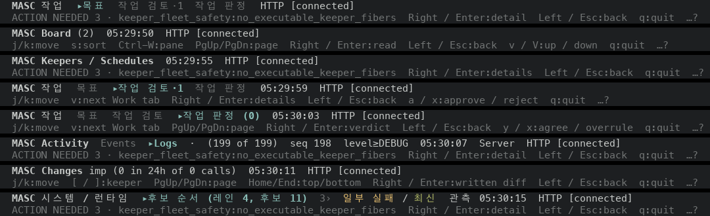
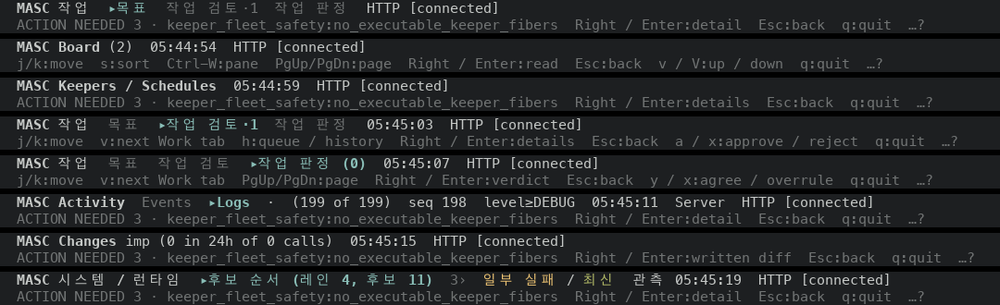
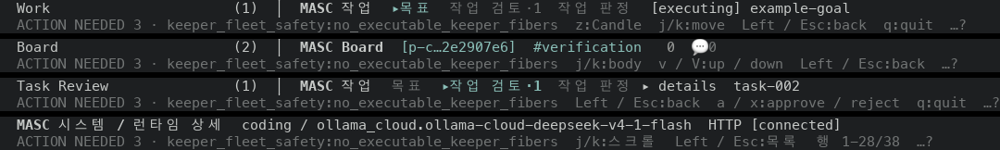
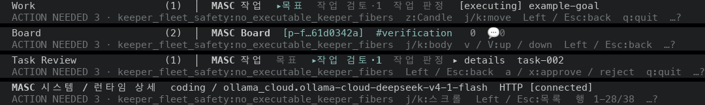

### Layer 17: the System menu row leaves out the language chip whole (#48350)

System tab, Config view (`Tab` six times from the Dashboard). The row under the
title lists the views and, to the right, the language chip. Before is the
layers 1 to 11 build, after is the layers 1 to 17 build.

```
80x24   before  시스템 메뉴: 9:런타임 · s:리소스 · t:도구·스킬 · A:활동 · L:로그   [언어:KO…
80x24   after   시스템 메뉴: 9:런타임 · s:리소스 · t:도구·스킬 · A:활동 · L:로그
120x35  before  시스템 메뉴: 9:런타임 · s:리소스 · t:도구·스킬 · A:활동 · L:로그   [언어:KO 전환]
120x35  after   시스템 메뉴: 9:런타임 · s:리소스 · t:도구·스킬 · A:활동 · L:로그   [언어:KO 전환]
```

At 80 cells the chip does not fit and the row used to end in the middle of it.
It now ends at the last view. At 120 cells the row is the same on both sides.

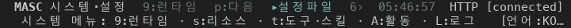
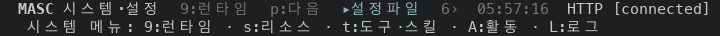

### Layer 19: the Status card keeps its Work pointer whole (#48365)

Dashboard, Status card. The `Work` row is a reading followed by where its
details live. Before is the layers 1 to 17 build, after is the layers 1 to 19
build.

```
120x35  before  Work: 0 currently done in the last 24h · details in
                Work
120x35  after   Work: 0 currently done in the last 24h
200x55  before  Work: 0 currently done in the last 24h · details in Work
200x55  after   Work: 0 currently done in the last 24h · details in Work
```

The text area of the card is 54 cells at 120 columns. The pointer
`details in Work` does not fit after the reading, and the card used to wrap it
and leave `Work` alone on the second line. It now leaves the pointer out when it
does not fit whole. At 200 columns it fits, and the row is the same on both
sides.

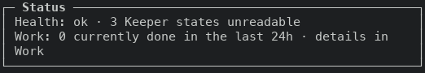
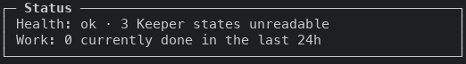

### Layer 20: Usage lists accounts with no report under one line (#48370)

Usage tab (`Tab` three times from the Dashboard), Plan view. The server has not
heard from any of the fixture's ten accounts since it started, so all ten are in
the `No windows to show` section. Before is the layers 1 to 19 build, after is
the layers 1 to 20 build. The account ids differ between the sides, which start
separate workspaces.

```
80x24   before  [rows 1-14/29 · j/k to scroll]   3 accounts on the first screen
80x24   after   [rows 1-14/17 · j/k to scroll]   7 accounts on the first screen
120x35  before  20 rows from the heading: five rows of two cards, three rows each
120x35  after   12 rows from the heading: one sentence, then ten names
```

Before, each account was a card (120 cells) or a block of two or three rows
(80 cells) that repeated `No usage report since server start`. The section now
says it once and lists the accounts by name and id, one per row. An account with
an email, an account that reported with no window, and an account with a
catalogue exhausted tag are not in this fixture and were not drawn.

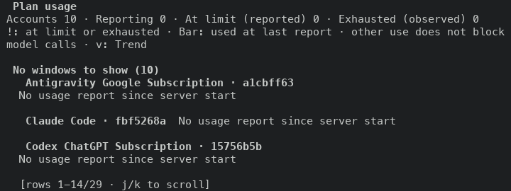
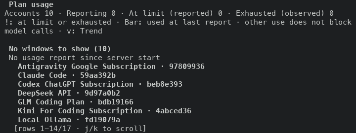
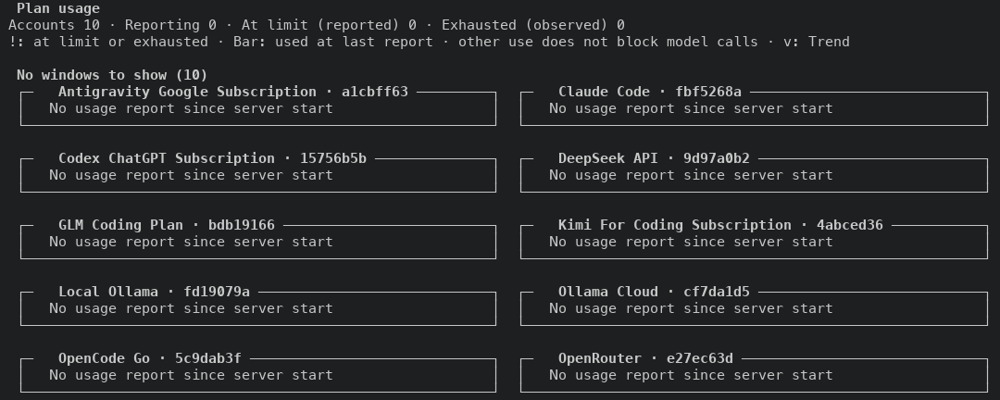
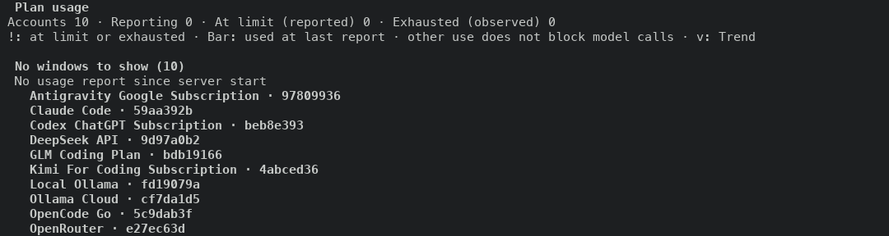

### Layer 22: Task Review leaves out whole columns before it cuts the title (#48386)

Task Review (`:`, `go Task Review`, Enter). The fixture has one Task in
review. Before is the layers 1 to 20 build, after is the layers 1 to 22 build.

```
60x24   before  TASK, SUBMITTED BY, 제출 / 요구, start of 자동 검증   TITLE is not on the screen
60x24   after   TASK, 자동 검증, TITLE                               title 24 cells
80x24   before  all five columns                                     title 9 cells
80x24   after   TASK, 제출 / 요구, 자동 검증, TITLE                  title 26 cells
86x24   before  all five columns                                     title 15 cells
86x24   after   TASK, 제출 / 요구, 자동 검증, TITLE                  title 32 cells
87x24   before and after: all five columns, title 16 cells, the same screen
```

Before, the five columns were drawn at every width and TITLE received what
was left: 9 of 76 cells at 80x24, none at 60x24. After, `Masc_tui_table.fit`
keeps 16 cells for TITLE and drops SUBMITTED BY, then 제출 / 요구, then 자동
검증 until the row fits. At 87x24 and wider all five columns fit and the screen
did not change (87x24, 100x30 and 120x35 were captured on both sides). The
screen that Enter opens was not captured for this layer.

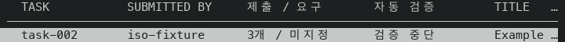
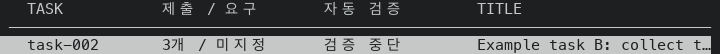
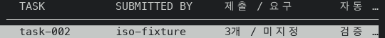
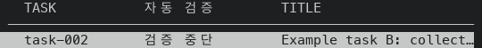

### Layer 23: Features sizes its two columns to their longest values (#48389)

Features (`:`, `go Features`, Enter). Before is the layers 1 to 20 build, after
is the layers 1 to 25 build, which holds layer 23 and nothing else that changes
this list.

```
width   before: STATE starts this far from FEATURE   after
60x24   27 cells, sentence ends `· 2…`               the same screen
80x24   37 cells, sentence ends `2 admitted …`       27 cells, whole sentence `… 2 admitted slots`
120x35  72 cells                                     27 cells
200x55  96 cells                                     27 cells
```

Before, the FEATURE column took every cell the row had left and STATE sat at
the right edge. After, each column takes the width of its longest value:
FEATURE is 25 cells (`Browser Lane (automation)`) plus the 2-cell gap. At 80x24
STATE had 39 cells and now has 43, which holds the longest sentence. At 60x24
the two columns do not fit together, so the list keeps the earlier split.

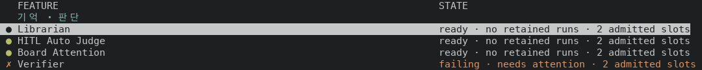
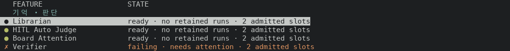
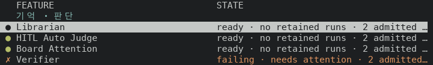
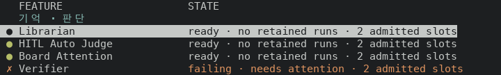

### Layer 24: Runtime leaves a fallback label out whole when the lane column is short (#48392)

Runtime (`:`, `go Runtime`, Enter), the `coding` lane, which has two
candidates. Before is the layers 1 to 20 build, after is the layers 1 to 25
build. The lane cell of a fallback row is a 2-cell indent, a branch mark, the
word `fallback` and a number (`└─ fallback #1`), 16 cells in all.

```
width   lane column   before            after
80x24   10 cells      `└─ fall…`        `└─`
100x30  10 cells      `└─ fall…`        `└─`
120x35  14 cells      `└─ fallback…`    `└─ fallback`
140x40  18 cells      `└─ fallback #1`  `└─ fallback #1`
```

Before, the cell was cut at the column edge and the cut word read like a name.
After, only the parts that fit whole are kept (`Message_layout.join_fitting`).
The candidate column still carries `2/2`, so the order is visible at every
width. Lane names longer than the column still fold in the middle.

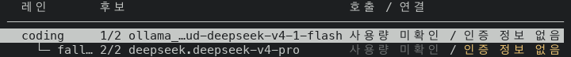
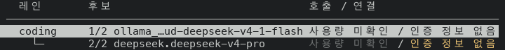
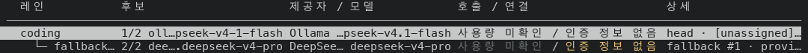


### Layer 25: the Work Tasks list names its columns (#48401)

Work, Tasks (`Tab`, then `t`), 42 open tasks. Before is the layers 1 to 22
build (the list is untouched by layers 23 and 24), after is the layers 1 to 25
build. Status columns are in cells from the left edge of the capture.

```
width   before: status word at     GOAL shown on      after: status word at   GOAL shown on
60x24   cell 26 to 52              0 of 13 rows       cell 38 on every row    0 of 12 rows
80x24   cell 37 to 72              5 of 13 rows       cell 43 on every row    12 of 12 rows
120x35  cell 69 to 99              23 of 24 rows      cell 69 on every row    23 of 23 rows
200x55  cell 93 to 123             41 of 42 rows      cell 93 on every row    42 of 42 rows
```

Before, each task was one joined line and the title took what its neighbours
left, so the status started at a different cell on every row and the goal
showed only where the line had room. After, the list is a table: `TASK`,
`TITLE`, `STATUS`, `OWNER`, `GOAL` and a `!` for top priority. The header costs
one row, so one task fewer fits on the first screen. At 60x24 `GOAL` is dropped
first and the status word takes its short spelling (`active`, `verify`). The
header stays in place when the list scrolls.

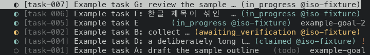
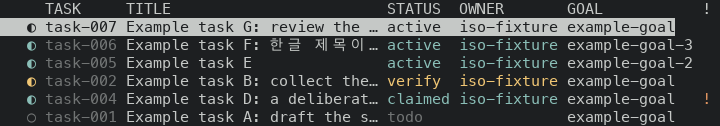
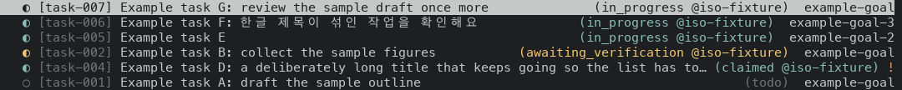
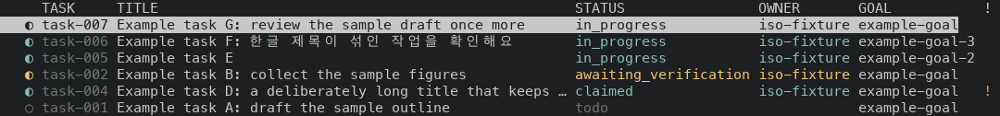
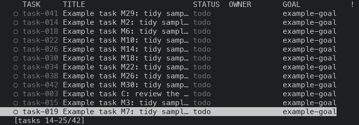

### Layer 27: the Task detail colours its headings, status and time rows (#48411)

Work, Tasks, Enter on a Task. The fixture has 12 tasks. Before is the layers 1
to 25 build (layers 1 to 26 do not touch the Task detail), after is the layers
1 to 27 build. The `.txt` captures hold no colour, so the table lists the SGR
codes that the `.ansi` captures carry on each row. "Bright cyan" is SGR 96 and
"bright yellow" is SGR 93: the capture terminal does not answer the palette
query, so the info and warn roles come out as these two.

```
Task in review, 120x35 (the detail pane)
row                                                       before   after
[ 1. 작업 식별 · 상태 및 목표 (Task Identity & Status) ]   plain    bold + bright cyan
title, id, goal                                           plain    plain
link: masc://planning/example-goal                        plain    dim
status: awaiting verification                             plain    bright yellow
actor                                                     plain    plain
started, submitted, created                               plain    dim
verification, creator, priority, cycles                   plain    plain
[ 2. 작업 설명 · 대상 파일 (Description & Files) ]          plain    bold + bright cyan
[ 3. 인수인계 · 완료 계약 (Handoff & Completion Contract) ]  plain    bold + bright cyan
handoff updated                                           plain    dim
handoff, handoff updater, evidence                        plain    plain
[ 4. 상태 전환 이력 (HISTORY) ]                             plain    bold + bright cyan
Lifecycle, Audit, history rows, JSON                      plain    plain

status row by state     before   after
claimed                 plain    bright cyan
in progress             plain    bright cyan
awaiting verification   plain    bright yellow
```

Before, every row of the detail was drawn in the default colour, so a
heading, the status and a timestamp looked like the title and the description.
After, headings are bold in the info colour, the `status` row uses the colour
of the same Task's row in the list, and the rows that say when something
happened, plus the Goal `link` row, are dim. Rows are coloured after they are
wrapped, so a wrapped row carries its colour on every line and each line ends
with a reset. The history heading is its own row (`history_heading_rows`)
because the two callers send the status lines through a wrapper that writes
ESC as text.

The 80x24 capture (the detail uses the full width) and the scrolled capture
(the `[ 2. ... ]` heading at the top, history below) carry the same colours.
In the scrolled capture the history rows and the JSON are still plain.

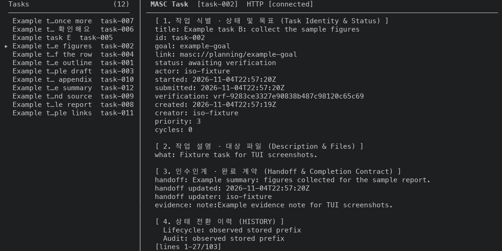
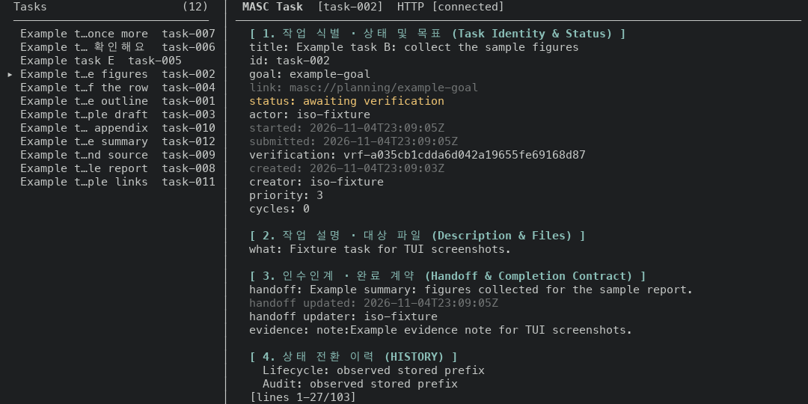
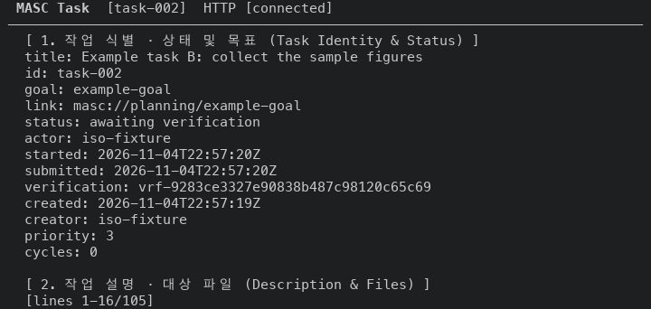
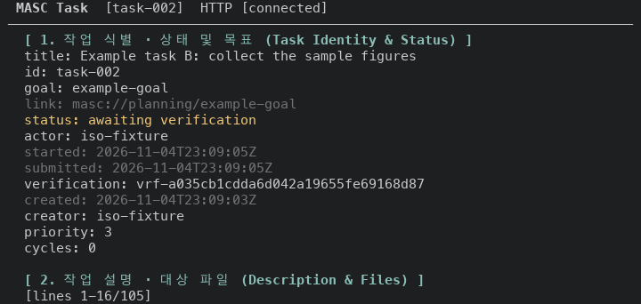
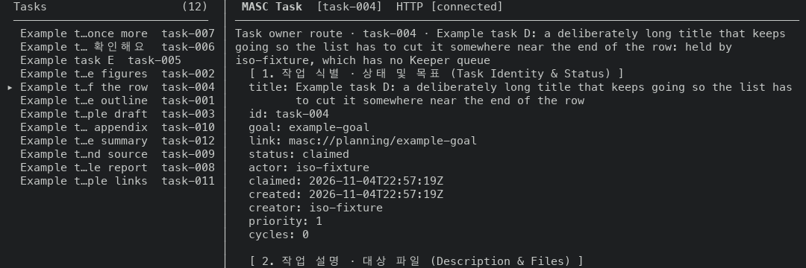
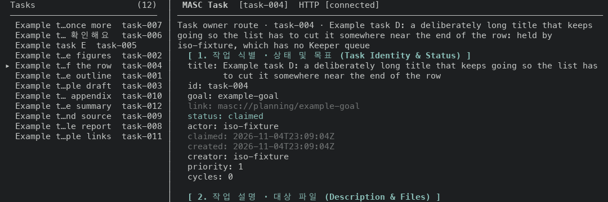


### Layer 29: the Resources list draws one row per resource (#48424)

System, Artifacts / Resources (`:`, then `go Artifacts / Resources` and Enter),
131 MCP resources and no report. Before is the layers 1 to 27 build: no commit
from the main commit above to that build touches the list. After is the layers
1 to 29 build. The counts are the `[MCP]` rows on the first screen. The screen
with the cursor 40 rows down shows the same number.

```
size    before (cards)   after (rows)   columns drawn
60x24    5 of 131        14 of 131      TYPE, NAME
80x24    5 of 131        14 of 131      TYPE, NAME, DETAIL
120x35   9 of 131        25 of 131      TYPE, NAME, DETAIL, META
200x55  16 of 131        45 of 131      TYPE, NAME, DETAIL, META
```

Before, each resource was a card of three rows (name, description, media type)
and most of the width on the second and third row was empty. After, each
resource is one row under a header row. `META` is the first column to go when
the pane narrows. `DETAIL` goes when it would get fewer than 20 cells. The
table spreads over 120 cells at most, so at 200x55 the extra width goes to
`DETAIL`. With the cursor 40 rows down the header row stays at the top and the
cursor row keeps the columns of the other rows. The reading that Enter opens is
unchanged: its captures at 60x24, 80x24, 120x35 and 200x55 match line by line
once the clock is masked.


### Layer 31: Approvals gives each Gate lane its own row when the two do not fit (#48436)

Approvals (`:`, then `go Approvals` and Enter). The fixture's lanes read `Let
Auto Judge decide` (Workspace) and `Ask me for each decision` (Outside
services). Before is the layers 1 to 29 build: the only earlier commit that
touches `masc_tui_render_approvals.ml` changes the question heading (layer 11),
not the lane row. After is the layers 1 to 31 build.

```
size    before                                      after
60x24   one row, ends "[e] Outside se…"             two rows, both modes whole
80x24   one row, ends "Ask me for e…"               two rows, both modes whole
90x28   one row, ends "Ask me for each decisi…"     two rows, both modes whole
100x30  one row, whole                              unchanged
120x35  one row, whole                              unchanged
```

With these two modes the two lanes need 89 cells on one row. Before, a pane
narrower than that cut the row at its right edge, so the Outside services mode
was cut in the middle of a word (90 and 80 cells) or left out (60 cells). After,
each lane gets its own row when the two do not fit together, and the rule rows
under them keep their place. The queue area gives up one row at 60x24, 80x24
and 90x28 (11 non-blank rows become 12). The divider, the question block and the
footer stay on the same row numbers. At 100x30 and 120x35 every row of the
screen is identical once the clock is masked.


## Not verified

- Layer 11 with a waiting question, and on a terminal that reports its palette:
  the fixture has no question to ask, and the capture terminal does not answer
  the palette query, so neither the warning style nor the blended colour was
  drawn.
- Layer 10 at 200x55 and the Features lane history of lanes other than
  Librarian and HITL Auto Judge at 120x35.
- Layers 15 and 16 on the Code project root and on Repositories. Their back
  key depends on more than a list and one detail (tree, file, history, Git
  changes, activity), so their list footers still name `Left / Esc`.
- Schedules, Task Verdicts and Changes with a detail or diff open: the fixture
  has no schedule, verdict or file change, so those detail footers were not
  drawn. Task Review, Work Goals, Board and Runtime details were.
- The Changes list footer without an `ACTION NEEDED` row: the fixture always
  reports three reasons, so the footer that fits all its items was not drawn.
- Layer 13 on a server that reports no reason, and with a reason too long for
  the card at 80x24: the Dashboard was captured at 120x35 and 200x55 only.
- Layer 17 with the English UI and at widths between 80 and 120 cells: the
  System tab was captured at 80x24 and 120x35 with the Korean UI.
- Layer 4, Harness detail and the Code draft keys: the fixture has no Harness
  verdicts and no repository, so neither screen was reached.
- Only the 120x35 Keepers list was measured for column positions. The 200x55
  and 80x24 Keepers screens differ in the same header text and were not measured.
- Layer 19 at widths between 120 and 200 cells, and with a reading that says
  `Work: reading unavailable`: the fixture reads Work and the Dashboard was
  captured at 120x35 and 200x55 only.
- Layer 20 with an account that has an email, with an account that reported but
  has no window, and at widths below 80 cells: the fixture has ten accounts,
  none with an email, none that reported, and the Usage tab was captured at
  80x24 and 120x35 only.
- Layer 22 with more than one Task in review, and at widths between 88 and 99
  cells: the fixture has one Task in review and Task Review was captured at
  60x24, 80x24, 86x24, 87x24, 100x30 and 120x35.
- Layer 23 with a Feature name longer than 25 cells or a state sentence longer
  than 44 cells, where the two columns do not fit together and the list keeps
  the earlier split.
- Layer 24 with a lane name longer than its column (the middle fold is
  unchanged) and at widths above 140 cells.
- Layer 25 with a Task that has several goals, with the English UI, and at
  widths below 60 cells: the fixture gives each Task at most one goal.
- Layer 27 with a done or cancelled Task, with a terminal that answers the
  palette query, and in the Tools view of a Task from an async request: the Work
  list shows open Tasks only, the capture terminal does not answer the palette
  query, and the fixture has no async request source.
- Layer 29 with a published report, with a Side_by_side layout and at widths
  below 60 cells: the fixture publishes no report, so the `CHECK` and `DAY`
  columns and the report name, author, time and size were not drawn, and the
  capture driver only opens the full-width list.
- Layer 29 with a terminal that answers the palette query: the capture terminal
  does not, so the receded colour of `TYPE`, `DETAIL`, `META` and the header row
  was not drawn. The name is bold and the cursor row is reversed.
- Layer 31 with a pending approval or a question waiting: the fixture has
  none, so the queue held `(no pending approvals)` and the row it gives up at
  narrow widths was measured only as a blank row.
- Layer 31 with Gate modes other than the fixture's, such as `Allow every call
  without review` in both lanes, and with a rule in the Always-allow row.
- Layer 31 on a terminal that answers the palette query: the capture terminal
  does not, so the Gate rows are the fallback bright cyan (SGR 96).
- Screens come from the CI-built binaries on one macOS machine. Nothing here
  was run on Linux or in a terminal other than tmux.
