# TUI UX stack #48658: before and after screens

Scope: layers 1 to 4 of the stack: #48648 (tab strip), #48657 (heading
readings), #48670 (footer `ACTION NEEDED`) and #48684 (new question banner). The
layer that carries this text adds the document and its images.

## Source

Both sides are the `masc-tui` and `masc` binaries that the native TUI proof
workflow built on a macOS arm64 runner. Each artifact carries a `receipt.json`
whose `sha256` and `server_sha256` match the files that were run, and
`masc-tui --build-commit` prints the source commit below.

| Side | Source commit | Proof run | `masc-tui` sha256 | `masc` sha256 |
| --- | --- | --- | --- | --- |
| Before | `6a312f9228bdc1aec49e8d10372a3672bed70b4a` (main) | 42002224879 | `5e466f48c1f3ecbd28fecdcdedef38099de8ba438d3b448cdd81524c2db77afe` | `ff536fa8eeb7b09a36abd4e049ea6eac42fa1fb4ad01a688f2f5d6f5101b02fd` |
| After (layers 1 to 2) | `c28bfab415f0ee81b38551f246cc0a1ce91e3627` | 42006884359 | `3fc398168b5715c82d4979fabc511c0befc8a5d9d7edca94b8fa554f25bf4dfd` | `3519bf90e12794dea5c17dd626ed170dd2e0606e023819faebdafa19392204f3` |
| After (layers 1 to 3) | `094cf1f78944f40daa1b8bf7b236bc0fb84ac706` | 42009047180 | `baddfad646d9119eef235abb39ca7d6638dbd7dfa7baace32e03e8d52cfeac40` | `b00dfe06eb5248885360f901c40a96b9ae03fa23ff932f4bb9cf6fe4efbcddb9` |

Layer 4 has no proof build. Its evidence is the bytes of one function from a
bytecode build, described under layer 4.

## Environment

- macOS arm64 machine, one terminal per capture, driven through tmux at a fixed
  size. The Dashboard was captured in 13 sizes by each build: 120x35, 100x30,
  90x30, 80x24 and 60x24; 80 columns with 18, 16 and 15 rows; and the card
  layout at 120x20, 120x18, 120x16, 100x22 and 100x20. The first screen of 15
  command palette destinations (`:`, then `go <name>` and Enter) was captured at
  80x24, 90x30 and 100x30: Task review, Task verdicts, Approvals, Features,
  Schedules, Memory, Fusion, Clients, Tools, Artifacts / Resources, Code, Logs,
  Activity, Runtime and Changes.
- Every process ran under `env -i` with `PATH`, `HOME` (an empty directory),
  `TERM=xterm-256color` and `LANG=en_US.UTF-8`. No credential, Keeper or
  workspace of the operator was read.
- A fresh workspace per side: `masc init`, `masc start --port <port>` from the
  same artifact as the TUI, an expiring bearer from `masc mcp-config --expiring`.
- The fixture is neutral text written through MCP: one Goal (`example-goal`),
  three Tasks, one Board post with one comment. Three Keeper definitions (`imp`,
  `relay`, `scout`) are present but none can run on this machine, so the server
  reports three reasons it needs the operator. Each side seeds its own fresh
  workspace, so times of day differ between the sides.
- Each capture starts a new TUI process, waits for `HTTP [connected]`, settles
  for a few seconds, and then sends the keys. The capture driver is not part of
  the repository.
- The PNGs are full-width rows cut out of `tmux capture-pane -e -p` captures
  (9x18 px per cell). The text beside each pair is the text of the same rows,
  with `<clock>` for a time of day.
- Words next to the connection badge such as `finishing refresh`, `refreshing`
  and `reading dashboard +1` appear on one side of some pairs. They name a
  refresh in flight at the capture moment. The 60x24 Dashboard was captured
  three more times by each build: all six captures read `[base]` and none shows
  such a word.

## Observed results

### Layer 1: the tab strip draws nothing when its current entry does not fit (#48648)

Before is main. After is the layers 1 to 2 build, whose second layer does not
touch these rows.

At 80x24 the heading of Clients and Runtime drew the strip as a cut name,
`▸클라이언트…` and `▸후…`, which does not say which tab is current. At 90x30
Runtime drew `▸후보 순서 ( …` and at 100x30 `▸후…`. When the current entry and
the hidden-entry marks do not fit, the strip is now left out and the heading
goes on with the clock and the connection badge. A strip that fits whole, and the
window around the current entry, are drawn as before.

```
80x24  Clients  before  MASC System / Runtime / Clients  ‹3  ▸클라이언트…  <clock>  HTTP [connected]
                after   MASC System / Runtime / Clients    <clock>  HTTP [connected]
80x24  Runtime  before  MASC 시스템 / 런타임  ▸후…  일부 실패 / 최신  관측 <clock>  HTTP [connected]
                after   MASC 시스템 / 런타임    일부 실패 / 최신  관측 <clock>  HTTP [connected]
```

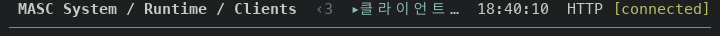

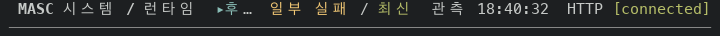


Of the 45 survey captures, the strip changed in two at 80x24, two at 90x30 and
one at 100x30. The other differences are times of day, two Logs rows in another
order at 100x30, and refresh words. At 90x30 Task verdicts was
captured with `finishing refresh` beside the badge, and its strip shrank to the
window `‹2  ▸작업 판정 (0)` that the same code draws when the right side is
longer.

### Layer 2: heading readings are left out whole instead of cut (#48657)

Before is main. After is the layers 1 to 2 build.

The System Logs heading at 80x24 ended in `le…`, the start of `level≥DEBUG`. A
reading that does not fit is now left out whole, last reading first. The Logs
heading at 90x30 and 100x30 is the same on both sides, because every reading
fits there. The one heading changed by this layer in the survey is Logs at 80x24.

```
80x24  Logs  before  MASC Activity  (213 of 213)  seq 212  le…  <clock>  Server  HTTP [connected]
             after   MASC Activity  (213 of 213)  seq 212  <clock>  Server  HTTP [connected]
```

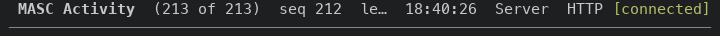


### Layer 3: the footer `ACTION NEEDED` keeps its count when the reason does not fit (#48670)

Before is main. After is the layers 1 to 3 build.

The fixture's first reason is `keeper_fleet_safety:no_executable_keeper_fibers`,
so `ACTION NEEDED 3 · keeper_fleet_safety:no_executable_keeper_fibers` is 65
cells and the notice was left out of every footer narrower than that notice plus
the keys that cannot be dropped. The notice now steps down to `ACTION NEEDED 3`
before it is left out.

Screens whose footer holds `ACTION NEEDED` among the first screens of the 15
destinations:

| Terminal | Before | After | Drawn newly | Keys that left the footer |
| --- | --- | --- | --- | --- |
| 80x24 | 0 of 15 | 13 of 15 | 13 | 14, at most 2 on one screen |
| 90x30 | 1 of 15 | 15 of 15 | 14 | 14, at most 2 on one screen |
| 100x30 | 2 of 15 | 15 of 15 | 13 | 13, at most 2 on one screen |

The keys that left, with the number of screens: at 80x24 `PgUp/PgDn:page` 3,
`h/l:pane` 2, and one each of `[ / ]:ask`, `o / A:Plugins`, `K:calling Keeper`,
`Home/End:top/bottom`, `e:Events`, `j/k:move`, `f:filter`, `j/k:move / scroll`
and `[ / ]:keeper`; at 90x30 `j/k:move` 2, `Home/End:top/bottom` 2,
`PgUp/PgDn:page` 2, and one each of `d:reading`, `K:calling Keeper`,
`p:section`, `Ctrl-W:focus`, `j/k:move / scroll`, `f:filter`,
`PgUp/PgDn:detail page` and `[ / ]:keeper`; at 100x30 `v:next Work tab` 2,
`Home/End:top/bottom` 2, `PgUp/PgDn:page` 2, and one each of `i:read issues`,
`< / >:schedule pages`, `B:Board evidence`, `/:find`, `Ctrl-W:focus`,
`j/k:move / scroll` and `PgUp/PgDn:detail page`. The keys that cannot be
dropped (`Enter`, `Esc`, `q`, `y / n`, `a / x`) stayed on every screen.

```
80x24   Approvals    before  j/k:move  y / n:decide  w:Workspace mode  e:Outside mode  [ / ]:ask  …?
                     after   ACTION NEEDED 3  j/k:move  y / n:decide  w:Workspace mode  e:Outside mode  …?
80x24   Memory       before  j/k:move  PgUp/PgDn:page  Enter:facts  Esc:clear / back  q:quit  …?
                     after   ACTION NEEDED 3  j/k:move  Enter:facts  Esc:clear / back  q:quit  …?
90x30   Task review  before  j/k:move  Right / Enter:details  Esc:back  a / x:approve / reject  q:quit  …?
                     after   ACTION NEEDED 3  Right / Enter:details  Esc:back  a / x:approve / reject  q:quit  …?
60x24   Dashboard    before  Left:Keepers  j/k:choose  Enter:open  q:quit  …?
                     after   ACTION NEEDED 3  Left:Keepers  Enter:open  q:quit  …?
```

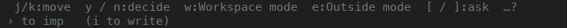
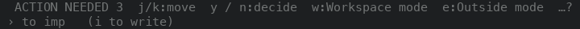
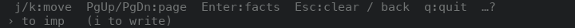
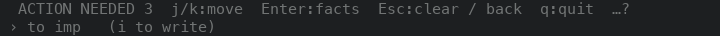
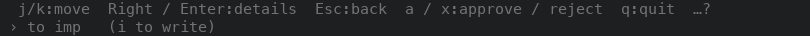
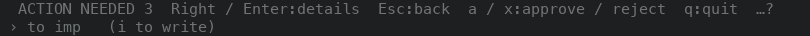
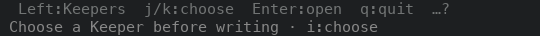
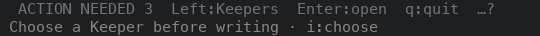

Task review and Task verdicts at 80x24 draw no notice on either side. Their
footer is 79 cells with `j/k:move`, and 69 cells with only the keys that cannot
be dropped (`Right / Enter`, `Esc`, `a / x` or `y / x`, `q`, `…?`). The notice
adds 17 cells, which makes 86. Both screens draw it from 90 columns.

Dashboard, 13 sizes. The footer differs at 60x24, 80x24, 90x30, 80x18, 80x16 and
80x15, and only by the notice and the keys it displaced: `j/k:choose` at 60x24,
`g:quiz` and `;:agenda` at 80x24, 80x18, 80x16 and 80x15, and `;:agenda` and
`m:Usage` at 90x30. At 120x35, 100x30 and the five card-layout sizes from
120x20 to 100x20 the captures are the same on both sides.

### Layer 4: the new question banner writes the asker's name as visible text (#48684)

There is no screen for this layer. The banner is a desktop notification that the
terminal raises from `BEL ESC ] 9 ; <text> BEL`. The bytes were compared in a
bytecode build that holds the real `arrival_notification` and the real
`Tui_terminal_text`; the before bytes are the frame and the text the earlier
`notify_new_asks` wrote. A name is the title of an installation's question.
`\NNN` is a decimal byte, as OCaml prints it.

```
name    x BEL ESC [2J
before  "\007\027]9;x\007\027[2J is waiting on a decision\007"        BEL 3, ESC 2
after   "\007\027]9;x\\x07\\x1B[2J is waiting on a decision\007"      BEL 2, ESC 1

name    x U+009C ESC [2J
before  "\007\027]9;x\194\156\027[2J is waiting on a decision\007"    BEL 2, ESC 2
after   "\007\027]9;x\\u009C\\x1B[2J is waiting on a decision\007"    BEL 2, ESC 1

name    Weather Pack
before  "\007\027]9;Weather Pack is waiting on a decision\007"
after   "\007\027]9;Weather Pack is waiting on a decision\007"
```

Before, the second BEL ends the notification and `ESC [2J` goes to the terminal
as a command. After, only the frame holds BEL and one ESC, and the name shows
`\x07` and `\x1B` as text.

## Not verified

- Layers 1 and 2 at sizes other than 80x24, 90x30 and 100x30, and on screens
  other than the first screen of the 15 destinations. Headings whose reading is a
  single piece (Keeper calls, Git changes, Changes, Memory facts, Lanes) and the
  Config pane titles still cut a reading at the end.
- Layer 3 below 60 columns. The other leading notices (workspace mismatch,
  build mismatch, worktree server, armed action) have no shorter text and were
  not captured. That each key which left a footer is on the `?` sheet of that
  screen was not checked screen by screen.
- Layer 4 in a real terminal: no desktop notification was raised or observed, the
  write path of `notify_new_asks` was not run, and whether a terminal ends an OSC
  sequence at the C1 byte `U+009C` was not tried.
- Screens come from the CI-built binaries on one macOS machine. Nothing here
  was run on Linux or in a terminal other than tmux.
