# TUI UX stack #48762: before and after screens

Scope: layers 2 to 4 and layer 7 of the stack: #48760 (key hints under the
Features detail pane), #48789 (model candidates on the Lane reading page),
#48798 (model candidates in the Features summary pane) and #48831 (section
titles of the Features summary pane). Layer 1 (#48743) changes a test and layer
5 (#48823) moves code and tests; neither changes what is drawn. For layer 5 the
old and the new packing code were run on the five Features hints at every width
from 1 to 200 cells and gave the same rows; that is a comparison of code, not a
capture. Layer 6 (#48827) adds this document and its images. Layer 7 adds its
own section and images.

## Source

Every side is the `masc-tui` and `masc` binaries that the native TUI proof
workflow built on a macOS arm64 runner. Each artifact carries a `receipt.json`
whose `sha256` and `server_sha256` match the files that were run, and
`masc-tui --build-commit` prints the source commit below.

| Side | Source commit | Proof run | `masc-tui` sha256 | `masc` sha256 |
| --- | --- | --- | --- | --- |
| Before (layer 1 head) | `c234911d258b110a9b1181aef4d38aedb9eee13a` | 42028120625 | `ed02bbb06ead6f93403cc2bf2d4d054c7829dec7ca4c729e56535057b0e23306` | `ec7795016128067a2ebeeefce0492ec0fc4df8b8ea6e47d4981e91b749047ed3` |
| After layer 2 | `1e4970910562f59a9205dc3d94352ed2987a0abf` | 42028125752 | `8e4817bc05f1114962bdaa6bd1735e2fa5af8bc5b43837107a868ff4d6ed6bea` | `5bed225d2a192096aabca1436876e669a0c0a111c449d54941b20f2d9572dcac` |
| After layer 3 | `7d1123011a35ae369ebb407952e1c7e9a486cb30` | 42035609215 | `b29631f82ae84b32f896fc07c031775242a6ace63f4425d8a0cf76f02d140ebe` | `5f75334bbcf3c0a69529ea32b42e5568954de163d50bef6abc97e91efe2f9ae9` |
| After layer 4 | `b4939ab9c204e6693cd46ce1fd9cf76c306b8ced` | 42038867820 | `8735ba7eb65e31da977588f3751ee1d9bbddc942d146ce45794c8b4b7b924768` | `e5b889888cdf0b6e9cc1c0e9e742ce157172b3d39af923145965a32502dc4fcc` |
| After layer 7 | `2a7307c016c17f2e541148e770a845af3bd078d8` | 42048293739 | `6bf245278bb18d3446191e5e936524ffdf7dadfcde33b2dea5f3877fdf9a82b5` | `922ea96eb03c99f755338c0bd4dc76c46459de73723bdbf1e55cbec9546499ef` |

The before side of layers 3 and 4 is the layer 2 build: layer 2 does not touch
the Lane reading page or the candidate rows of the summary pane. The before
side of layer 7 is the layer 4 build: layers 5 and 6 move code and add this
document. The source commits are the code commits of each layer; the changelog
commit above each one changes no source.

## Environment

- macOS arm64 machine, one terminal per capture, driven through tmux at a fixed
  size: 80x24, 100x24, 100x30, 120x20, 120x24 and 120x35 for the Features
  screen, 80x24 and 100x30 for the Lane reading page.
- Every process ran under `env -i` with `PATH`, `HOME` (an empty directory),
  `TERM=xterm-256color` and `LANG=en_US.UTF-8`. No credential, Keeper or
  workspace of the operator was read.
- A fresh workspace per side: `masc init`, `masc start --port <port>` from the
  same artifact as the TUI, an expiring bearer from `masc mcp-config --expiring`.
- The fixture is neutral text written through MCP: one Goal, three Tasks, one
  Board post with one comment. Three Keeper definitions (`imp`, `relay`,
  `scout`) are present but none can run on this machine. Exact lanes carry the
  candidates of the fresh workspace's default configuration: the Librarian and
  HITL Auto Judge rows list two HTTP candidates and no CLI candidate.
- Each capture starts a new TUI process, waits for `HTTP [connected]`, settles
  for a few seconds, and then sends the keys. The capture driver is not part of
  the repository.
- The PNGs are full-width rows cut out of `tmux capture-pane -e -p` captures
  (9x18 px per cell). The text beside each pair is the text of the same rows.

## Observed results

### Layer 2: key hints break between hints, not inside one (#48760)

Before is the layer 1 build. After is the layer 2 build. Features, the HITL
Auto Judge row, 100x30.

At 100 columns the hint line ended at the key `d:` and the next line began with
its words. The hints were one string wrapped at every space. After the change a
hint is a key and a label, and a line is filled with whole hints.

```
before  Enter: 실행 기록 · s: 모델 순서 변경 · a: 후보 추가 · Space: 켜기/끄기 · d:
        상세(슬롯통계·설정·계약)

after   Enter: 실행 기록 · s: 모델 순서 변경 · a: 후보 추가 · Space: 켜기/끄기
        d: 상세(슬롯통계·설정·계약)
```

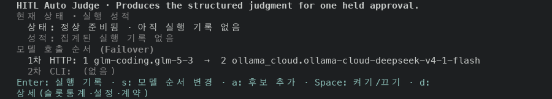
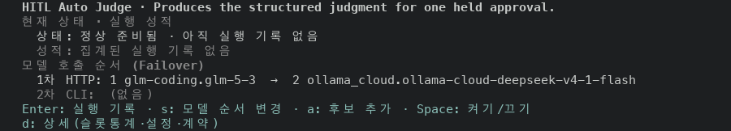

Over the first 14 Features rows at 100x30, 13 rows show hints on 18 hint lines.
Before, 5 of those lines ended at a bare key; after, none does. At 80x24 no hint
line is visible on either side: the pane is clipped and its last row reads
`… d: full reading`. At 120x35 all hints of a row fit on one line on both sides.

### Layer 3: model candidates are numbered rows on the Lane reading page (#48789)

Before is the layer 2 build. After is the layer 3 build. Features, the
Librarian row, `d`, 100x30.

The candidates were one sentence. A row ended at the number `2` and the model id
began the next row. After the change each candidate is a row, nested under its
label, with its number in front.

```
before  1차 HTTP 후보 (순서대로 시도): 1 glm-coding.glm-5-3  →  2
        ollama_cloud.ollama-cloud-deepseek-v4-1-flash
        2차 CLI 후보 (HTTP 모두 실패 시): (없음)

after   1차 HTTP 후보 (순서대로 시도):
          1  glm-coding.glm-5-3
          2  ollama_cloud.ollama-cloud-deepseek-v4-1-flash
        2차 CLI 후보 (HTTP 모두 실패 시): (없음)
```

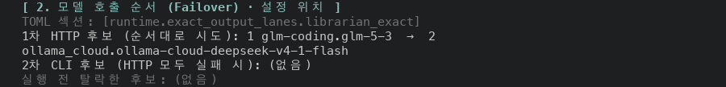
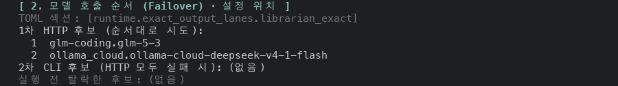

The page is one row longer: the footer reads `1-17/23` before and `1-17/24`
after at 80x24. The Candle Appraiser, Browser Lane and MSX pages are identical
on both sides at 100x30.

### Layer 4: the summary candidate chain breaks at an arrow (#48798)

Before is the layer 2 build (layer 3 does not touch this pane). After is the
layer 4 build. Features, the HITL Auto Judge row.

The summary pane wrote the candidates as `1 name  →  2 name`, each number a
space away from its name, so a pane that wrapped the line could end it at a
number. After the change the chain has no numbers: the arrows carry the order,
and a wrapped chain breaks at an arrow.

120x35, the summary pane (two columns; the candidates are the right one):

```
before  1차 HTTP: 1 glm-coding.glm-5-3  →  2
          ollama_cloud.ollama-cloud-deepseek-v4-1-flash
        2차 CLI:  (없음)

after   1차 HTTP: glm-coding.glm-5-3  →
          ollama_cloud.ollama-cloud-deepseek-v4-1-flash
        2차 CLI:  (없음)
```

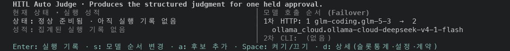
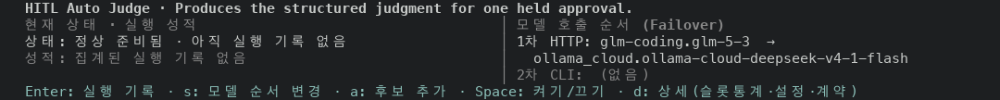

80x24, the summary pane (one column, clipped; its last row reads
`… d: full reading`):

```
before  모델 호출 순서 (Failover)
          1차 HTTP: 1 glm-coding.glm-5-3  →  2
        … d: full reading

after   모델 호출 순서 (Failover)
          1차 HTTP: glm-coding.glm-5-3  →
        … d: full reading
```

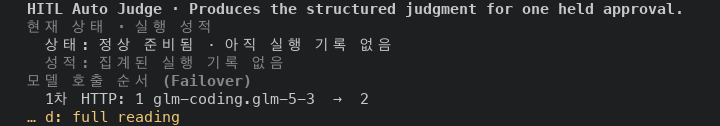
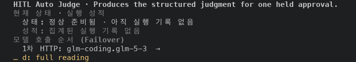

At 100x30 both candidates fit on one row on both sides: `1차 HTTP: 1
glm-coding.glm-5-3  →  2 ollama_cloud.ollama-cloud-deepseek-v4-1-flash` before,
the same without the two numbers after. At 80x24 the pane is clipped on both
sides, so the second candidate is not visible in either. The rule that clips the
pane is not part of this change.

### Layer 7: the summary pane leaves out its section titles before it clips (#48831)

Before is the layer 4 build. After is the layer 7 build. Features, one capture
per row of the list (14 rows), each with the row selected.

The pane under the list summarizes the selected row: its purpose, then the
state and run results, then the model call order. Each of the last two has a
title row. A terminal 110 columns wide or more puts them side by side; a
narrower one stacks them. When the pane is shorter than its summary, its last
row is replaced by `… d: full reading`. At 80x24 the pane has seven rows and the
two titles use two of them, so the pane ended on a title in 9 of the 14 rows,
and no row showed a key hint line. After the change the pane is built without
its titles when the version with titles does not fit. The rows keep their own
names (`상태:`, `성적:`, `1차 HTTP:`).

Counts over the 14 rows, taken from the text of the captures:

| Size | Pane cut, before → after | Ends on a title, before → after | Key hints shown, before → after |
| --- | --- | --- | --- |
| 80x24 | 14 → 6 | 9 → 0 | 0 → 8 |
| 100x24 | 13 → 4 | 3 → 0 | 1 → 10 |
| 100x30 | 1 → 0 | 0 → 0 | 13 → 14 |
| 120x24 | 1 → 0 | 0 → 0 | 13 → 14 |
| 120x20 | 8 → 2 | 0 → 0 | 6 → 12 |
| 120x35 | 0 → 0 | 0 → 0 | 14 → 14 |

The rows that changed are the ones whose pane was cut. At 80x24 the six rows
that are still cut are rows 1 to 6 of the list. At 100x30 and 120x24 one row
changes (Candle Appraiser). 120x20 is a short terminal wide enough for two
columns: no row ends on a title on either side there, and the cut rows go from
8 to 2. Every other row has the same text on both sides
apart from the clock, elapsed-time figures (`19s ago`, `p50 28ms`) and a
`finishing refresh` note in the header.

80x24, the Board Attention row (one column):

```
before  Board Attention · Judges one durable Board candidate for Keeper attention.
        현재 상태 · 실행 성적
          상태: 정상 준비됨 · 아직 실행 기록 없음
          성적: 집계된 실행 기록 없음
          JEV:  꺼짐 (OFF)
        모델 호출 순서 (Failover)
        … d: full reading

after   Board Attention · Judges one durable Board candidate for Keeper attention.
        상태: 정상 준비됨 · 아직 실행 기록 없음
        성적: 집계된 실행 기록 없음
        JEV:  꺼짐 (OFF)
        1차 HTTP: glm-coding.glm-5-3  →
          ollama_cloud.ollama-cloud-deepseek-v4-1-flash
        … d: full reading
```

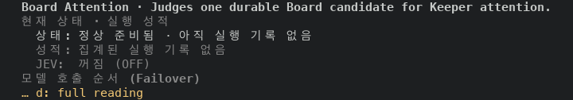
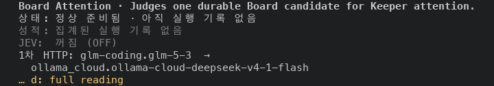

100x30, the Candle Appraiser row (one column). The summary with titles takes 11
rows and the pane has 10. Without titles it takes 9, with both key hint lines:

```
before  Candle Appraiser · Appraises a confirmed Goal payout grade, each candidate Task's relation to
        the Goal, and Keeper contribution weights.
        현재 상태 · 실행 성적
          상태: 미설정 — 지정된 모델 후보가 없음
          성적: 집계된 실행 기록 없음
          오류: exact-output lane "candle_appraiser" is not configured
        모델 호출 순서 (Failover)
          1차 HTTP: (없음)
          2차 CLI:  (없음)
        … d: full reading

after   Candle Appraiser · Appraises a confirmed Goal payout grade, each candidate Task's relation to
        the Goal, and Keeper contribution weights.
        상태: 미설정 — 지정된 모델 후보가 없음
        성적: 집계된 실행 기록 없음
        오류: exact-output lane "candle_appraiser" is not configured
        1차 HTTP: (없음)
        2차 CLI:  (없음)
        Enter: 실행 기록 · s: 모델 순서 변경 · a: 후보 추가 · Space: 켜기/끄기
        d: 상세(슬롯통계·설정·계약)
```

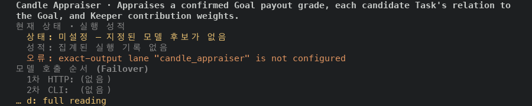
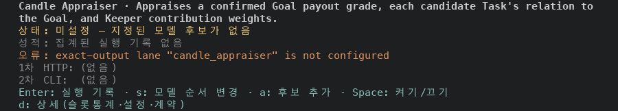

120x24, the same row in two columns. Without titles both columns start on
their first row, the whole error message shows, and the key hints fit:

```
before  현재 상태 · 실행 성적                                    │ 모델 호출 순서 (Failover)
        상태: 미설정 — 지정된 모델 후보가 없음                   │ 1차 HTTP: (없음)
        성적: 집계된 실행 기록 없음                              │ 2차 CLI:  (없음)
        오류: exact-output lane "candle_appraiser" is not        │
        … d: full reading

after   상태: 미설정 — 지정된 모델 후보가 없음                   │ 1차 HTTP: (없음)
        성적: 집계된 실행 기록 없음                              │ 2차 CLI:  (없음)
        오류: exact-output lane "candle_appraiser" is not        │
          configured                                             │
        Enter: 실행 기록 · s: 모델 순서 변경 · a: 후보 추가 · Space: 켜기/끄기 · d: 상세(슬롯통계·설정·계약)
```

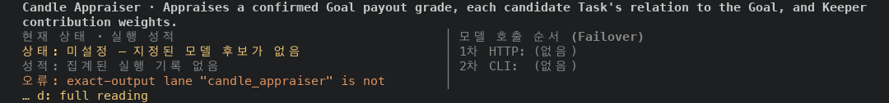
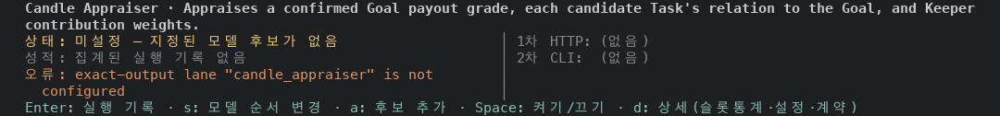

## Not verified

- The fixture has no Package rows, so the two Package hint lists of layer 2 are
  not in any capture.
- No lane in the fixture has a CLI candidate, a dropped candidate or a
  preserved list of a switched-off lane, so the numbered rows (layer 3) and the
  arrow chain (layer 4) are captured with HTTP candidates only. The empty list
  `(없음)` is captured.
- No lane in the fixture has run, so section 3 of the Lane reading page (slot
  selection history) is empty on every side.
- Terminals of 140 columns or wider, and 90 columns, were not captured.
- The fixture has no Package row. A Package row lists its outputs under a plain
  `Exact outputs (...)` row, and the pane can still be cut right after that row
  (#48840). Layer 7 only leaves out the two section titles.
