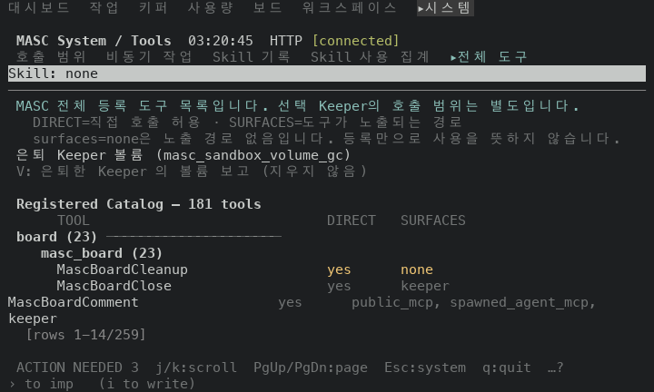
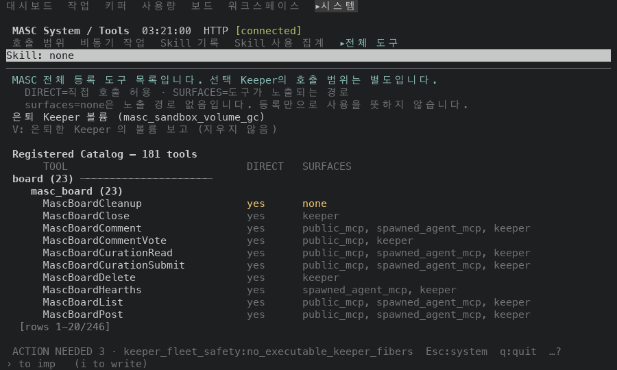
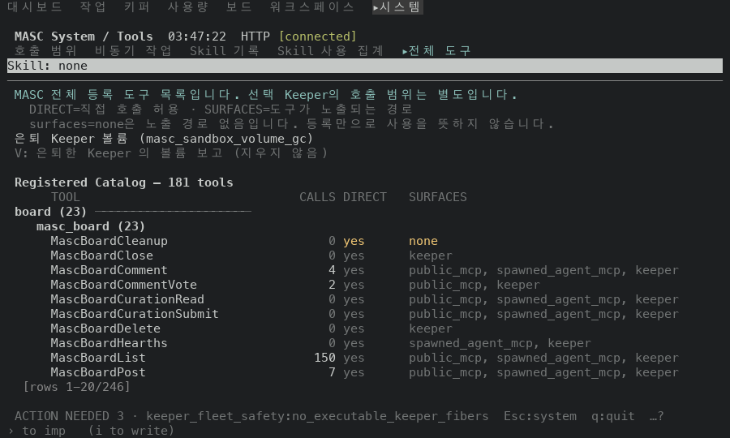
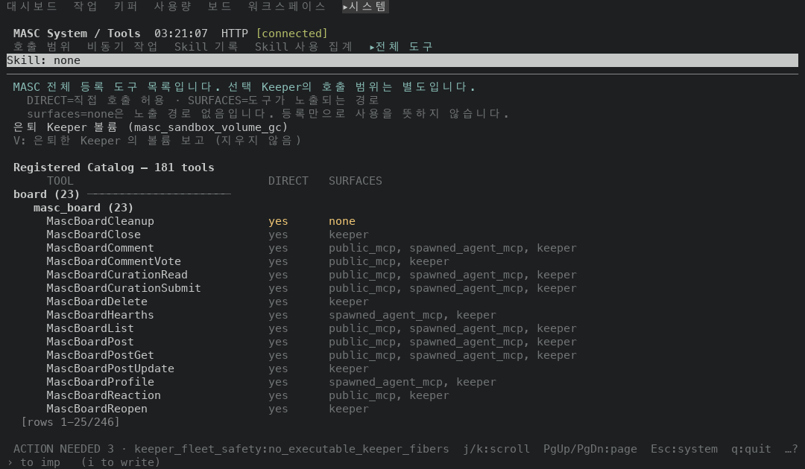
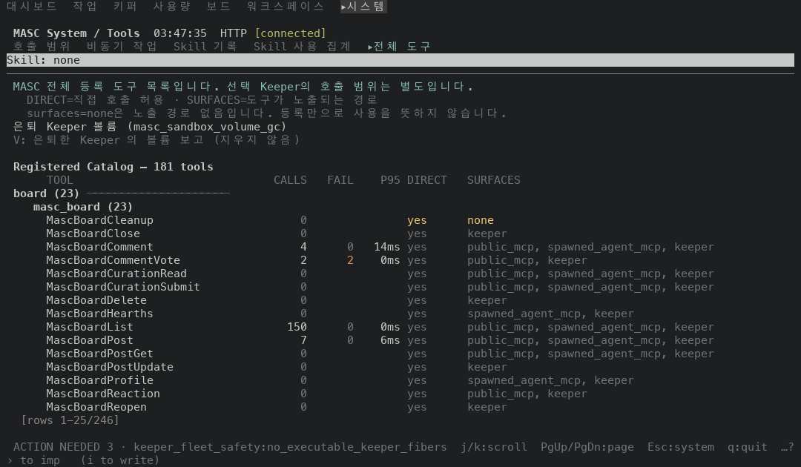

# Tools 카탈로그 호출·실패·p95 열 (#49482)

같은 일회용 워크스페이스(`EV_RICH` 시딩에 `masc_board_list` 호출 150번과 실패하는 `masc_board_comment_vote` 호출 2번을 더했어요)에서 Tools > 전체 도구 창의 첫 화면을 크기별로 찍었어요. 앞은 이 PR 의 바닥 `6415b78c514`(run 42229365992), 뒤는 머리 `ff1838a0db3`(run 42270713148)의 증명 빌드예요.

## 크기별로 그려진 열

| 터미널 | Tools 창 폭(칸) | 앞 | 뒤 | 도구 줄 바뀐 곳 |
|---|---|---|---|---|
| 80x24 | 80 | TOOL DIRECT SURFACES | TOOL DIRECT SURFACES | 없음(글이 같아요) |
| 90x28 | 90 | TOOL DIRECT SURFACES | TOOL DIRECT SURFACES | 없음(글이 같아요) |
| 100x30 | 100 | TOOL DIRECT SURFACES | TOOL CALLS DIRECT SURFACES | 있음 |
| 120x35 | 120 | TOOL DIRECT SURFACES | TOOL CALLS FAIL P95 DIRECT SURFACES | 있음 |
| 160x40 | 104 | TOOL DIRECT SURFACES | TOOL CALLS FAIL DIRECT SURFACES | 있음 |

열은 머리 줄에서 읽었어요. 열을 정하는 건 터미널 폭이 아니라 Tools 창 폭이에요. 오른쪽에 다른 창이 서는 크기에서는 그 창이 뺀 만큼 좁아져요. 창 폭은 프레임에서 두 창 사이 `│` 가 선 칸(없으면 터미널 폭)이에요. 좁아지면 P95, FAIL, CALLS 순으로 빠지고, SURFACES 는 가장 긴 읽기(`public_mcp, spawned_agent_mcp, keeper`, 37칸)가 한 줄에 다 들어갈 때만 옆에 숫자를 둬요.

## 서버가 센 값과 화면

사건은 서버가 `.masc/tool-metrics.sqlite3` 의 `tool_metric_events` 에 쓴 줄을 도구별로 센 거예요(복사본을 읽었어요). `by_tool-seeded.json` 은 하네스가 시딩한 호출이 모두 반영될 때까지 기다린 뒤 서버의 `/api/v1/dashboard/tools` 에서 받은 `tool_usage.by_tool` 이에요. 아래는 120x35 뒤 프레임에 보이는 도구 줄을 이 두 값과 맞춰 본 거예요.

| 도구 | sqlite 사건: 호출/실패 | by_tool: 호출/실패/p95(ms) | 화면 CALLS FAIL P95 | 일치 |
|---|---|---|---|---|
| `MascBoardComment` | 4 / 0 | 4 / 0 / 14.36 | 4 0 14ms | 예 |
| `MascBoardCommentVote` | 2 / 2 | 2 / 2 / 0.06 | 2 2 0ms | 예 |
| `MascBoardList` | 150 / 0 | 150 / 0 / 0.04 | 150 0 0ms | 예 |
| `MascBoardPost` | 7 / 0 | 7 / 0 / 6.29 | 7 0 6ms | 예 |

보이는 도구 4개 가운데 4개가 서버 값과 일치해요.
서버가 sqlite 에 쓴 사건은 모두 188건이고 by_tool 의 `total_calls` 는 188이에요.

서버가 호출 기록이 없는 도구는 `by_tool` 에 행을 안 보내요. 화면에서 그 도구는 CALLS 가 `0`(어둡게)이고 FAIL·P95 는 비어요.

FAIL 칸을 빨갛게(`\x1b[91m`) 칠한 줄은 `MascBoardCommentVote`이고, 서버 값에서 모든 호출이 실패한 도구 가운데 이 화면에 보이는 것은 `MascBoardCommentVote`이에요. 같아요.

## 프레임 (글)

### 120x35 뒤

```
  Registered Catalog — 181 tools
       TOOL                              CALLS   FAIL    P95 DIRECT   SURFACES
  board (23) ─────────────────────
     masc_board (23)
       MascBoardCleanup                      0               yes      none
       MascBoardClose                        0               yes      keeper
       MascBoardComment                      4      0   14ms yes      public_mcp, spawned_agent_mcp, keeper
       MascBoardCommentVote                  2      2    0ms yes      public_mcp, keeper
       MascBoardCurationRead                 0               yes      public_mcp, spawned_agent_mcp, keeper
       MascBoardCurationSubmit               0               yes      public_mcp, spawned_agent_mcp, keeper
       MascBoardDelete                       0               yes      keeper
       MascBoardHearths                      0               yes      spawned_agent_mcp, keeper
       MascBoardList                       150      0    0ms yes      public_mcp, spawned_agent_mcp, keeper
       MascBoardPost                         7      0    6ms yes      public_mcp, spawned_agent_mcp, keeper
       MascBoardPostGet                      0               yes      public_mcp, spawned_agent_mcp, keeper
       MascBoardPostUpdate                   0               yes      keeper
       MascBoardProfile                      0               yes      spawned_agent_mcp, keeper
       MascBoardReaction                     0               yes      public_mcp, keeper
       MascBoardReopen                       0               yes      keeper
```

### 100x30 뒤

```
  Registered Catalog — 181 tools
       TOOL                              CALLS DIRECT   SURFACES
  board (23) ─────────────────────
     masc_board (23)
       MascBoardCleanup                      0 yes      none
       MascBoardClose                        0 yes      keeper
       MascBoardComment                      4 yes      public_mcp, spawned_agent_mcp, keeper
       MascBoardCommentVote                  2 yes      public_mcp, keeper
       MascBoardCurationRead                 0 yes      public_mcp, spawned_agent_mcp, keeper
       MascBoardCurationSubmit               0 yes      public_mcp, spawned_agent_mcp, keeper
       MascBoardDelete                       0 yes      keeper
       MascBoardHearths                      0 yes      spawned_agent_mcp, keeper
       MascBoardList                       150 yes      public_mcp, spawned_agent_mcp, keeper
       MascBoardPost                         7 yes      public_mcp, spawned_agent_mcp, keeper
```

## 프레임 (그림)

| 80x24 앞 | 80x24 뒤 |
|---|---|
|  |  |

| 100x30 앞 | 100x30 뒤 |
|---|---|
|  |  |

| 120x35 앞 | 120x35 뒤 |
|---|---|
|  |  |

