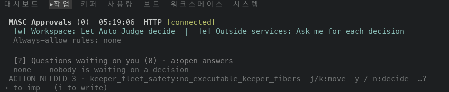
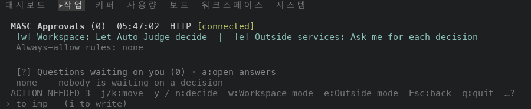
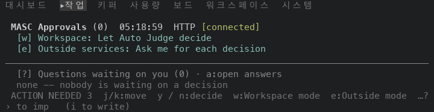
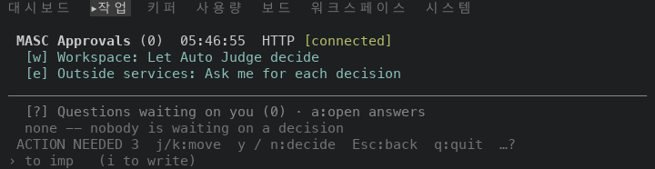

# TUI Approvals queue footer: the way out (#48960)

Scope: layer 8 of stack #48922. `footer_hints_approvals Approval_browsing` in
`bin/masc_tui_keys.ml` gains two items at the end of its row, `Esc:back` and `q:quit`.
Nothing else changes.

The Approvals queue draws its footer from a builder of its own, not from the key
table of the surface. The builder listed the keys of the queue (`j/k`, `y / n`, `w`,
`e`, `[ / ]`, `a`, `o / O`, `r`, `Tab`) and stopped there. The footer fitter keeps
Esc, q, Enter and `y / n` whenever it cuts a row (`never_dropped_keys` in
`bin/masc_tui_footer.ml`), but a key that the builder does not list gives it nothing to
keep. The footer of the queue named neither Esc nor q at any captured width, from 60
to 200 columns.

## Source

Both sides are the `masc-tui` and `masc` binaries that the native TUI proof workflow
built on a macOS arm64 runner. Each artifact carries a `receipt.json` whose `sha256`
and `server_sha256` match the files that were run, and `masc-tui --build-commit`
prints the source commit below.

| Side | Source commit | Proof run | `masc-tui` sha256 | `masc` sha256 |
| --- | --- | --- | --- | --- |
| Before (layer 7, first commit) | `2e55a84ef5ece33a993ed7f2d054b85cc0de009c` | 42095367342 | `f13e6cf6997157938dfe22a0ad7c535098137bd623e6ddb0b3542ed54f6cf0fd` | `996faca8e8cafddf81fd7c1d2062148eba859727d9a908a4934ca4af68e6cec2` |
| After (layer 8, first commit) | `1d9e9702d7eef67381a43e211aba0ca26b0ea9cb` | 42102091255 | `0e3af9e5b2787e1df9916b86f85ebaff1e7d6dc3315b4f1e5e2e65fbdd5913c2` | `d48ef30eece9b5653aaa88615f7ffd52acb2b75825f19b8a058f82b40612ff99` |

The first commit of layer 8 is the code change and the second commit adds this
document, the images and a changelog fragment. Layer 7 works the same way, with
`bin/masc_tui_render_schedule.ml` in its first commit. Files under `bin/` and `lib/`
that differ between the two source commits (`git diff --name-only`): `bin/masc_tui_keys.ml`.

## Environment

The same as in `../2026-11-06-tui-ux-stack-48922/README.md`: one isolated workspace per
capture, every process under `env -i`, the fixture server started from the same
artifact as the TUI, tmux at a fixed size, a new TUI process per capture. Each capture
opens the command palette with `:`, types `go Approvals`, presses Enter and settles for
five seconds. The PNGs are drawn from `tmux capture-pane -e -p` captures (9x18 px per
cell) and keep the five top rows and the five bottom rows of the screen.

The fixture has no pending approval and no open question (`(no pending approvals)`,
`Questions waiting on you (0)`), and three pending operator actions, which is the
`ACTION NEEDED 3` at the left of every footer.

## Observed results

### 1. The footer row at five sizes

| Size | Build | Footer row | Notice | Esc | q |
| --- | --- | --- | --- | --- | --- |
| 60x24 | before | `ACTION NEEDED 3  j/k:move  y / n:decide  …?` | count | no | no |
| 60x24 | after | `ACTION NEEDED 3  y / n:decide  Esc:back  q:quit  …?` | count | yes | yes |
| 80x24 | before | `ACTION NEEDED 3  j/k:move  y / n:decide  w:Workspace mode  e:Outside mode  …?` | count | no | no |
| 80x24 | after | `ACTION NEEDED 3  j/k:move  y / n:decide  Esc:back  q:quit  …?` | count | yes | yes |
| 100x30 | before | `ACTION NEEDED 3 · keeper_fleet_safety:no_executable_keeper_fibers  j/k:move  y / n:decide  …?` | reason | no | no |
| 100x30 | after | `ACTION NEEDED 3  j/k:move  y / n:decide  w:Workspace mode  e:Outside mode  Esc:back  q:quit  …?` | count | yes | yes |
| 120x35 | before | `ACTION NEEDED 3 · keeper_fleet_safety:no_executable_keeper_fibers  j/k:move  y / n:decide  w:Workspace mode  …?` | reason | no | no |
| 120x35 | after | `ACTION NEEDED 3 · keeper_fleet_safety:no_executable_keeper_fibers  j/k:move  y / n:decide  Esc:back  q:quit  …?` | reason | yes | yes |
| 200x40 | before | `ACTION NEEDED 3 · keeper_fleet_safety:no_executable_keeper_fibers  j/k:move  y / n:decide  w:Workspace mode  e:Outside mode  [ / ]:ask  …?` | reason | no | no |
| 200x40 | after | `ACTION NEEDED 3 · keeper_fleet_safety:no_executable_keeper_fibers  j/k:move  y / n:decide  w:Workspace mode  Esc:back  q:quit  …?` | reason | yes | yes |

- Before the change the row names Esc at 0 of 5 sizes and q at 0 of 5. After it
  names both at 5 of 5.
- The notice keeps its reason text at 100x30, 120x35, 200x40 before and at
  120x35, 200x40 after. At 100x30 it is drawn as its count. The fitter
  does this by its own rule: a notice too wide to sit beside the keys that cannot be dropped
  is drawn in a shorter text (`drawable_conflicts` in `bin/masc_tui_footer.ml`), and Esc and q
  are now among those keys.
- Hints that left the row because Esc and q took their cells: 60x24 `j/k:move`; 80x24 `w:Workspace mode`, `e:Outside mode`; 120x35 `w:Workspace mode`; 200x40 `e:Outside mode`, `[ / ]:ask`. Hints that entered
  the row: 100x30 `w:Workspace mode`, `e:Outside mode`. The row ends with `…?` where it cut hints, and `?` opens the key sheet.

### 2. 100x30

Before:

After:

### 3. 80x24

Before:

After:

### 4. The keys at 100x30

Each row is a new TUI process that opens the queue, then presses the keys.

| Build | Keys | Result at 100x30 |
| --- | --- | --- |
| before | Esc | title row `MASC 작업  ▸목표  작업 검토·1  작업 판정` |
| after | Esc | title row `MASC 작업  ▸목표  작업 검토·1  작업 판정` |
| before | q | footer row `ACTION NEEDED 3 · keeper_fleet_safety:no_executable_keeper_fibers  Resize to co…  y / n:decide  …?` |
| after | q | footer row `ACTION NEEDED 3  Resize to confirm quit  j/k:move  y / n:decide  Esc:back  q:quit  …?` |
| before | q, q | title row `MASC Approvals (0)` |
| after | q, q | title row `MASC Approvals (0)` |

Esc leaves the queue for the Work screen on both builds, so the footer names a key that
already did what it says. `q` does not leave the queue at this width on either build:
the first press draws `Resize to confirm quit` in the place of the confirmation, and the
second press leaves the screen as it was. This layer does not change that. The cause is
how the footer places the confirmation, and it is filed as #48966.

## Checks

- `ocamlfind ocamlc -stop-after typing` on `bin/masc_tui_keys.mli` and `.ml` against the
  compiled interfaces in the build directory of the `main` checkout: exit code 0.
- No test changes. The constitution does not test the wording, layout or row order of a
  TUI screen, and `docs/guides/TUI-KEYS.md` is generated from the key table, which this
  layer does not touch.

## Not shown

- A queue with pending approvals or open questions: the fixture has none. The footer
  builder is the same in that state, so the two items are there too, but the capture
  does not show it.
- The footers of the answering modes (`Approval_writing`, `Approval_armed`,
  `Approval_answering`) and of the open approval, which already name Esc.
- `Enter`, which opens an approval when the queue has one and does nothing on an empty
  queue, is not added: the footer builder has no way to say that the queue is empty.
- Widths other than the five listed, and mouse input.
