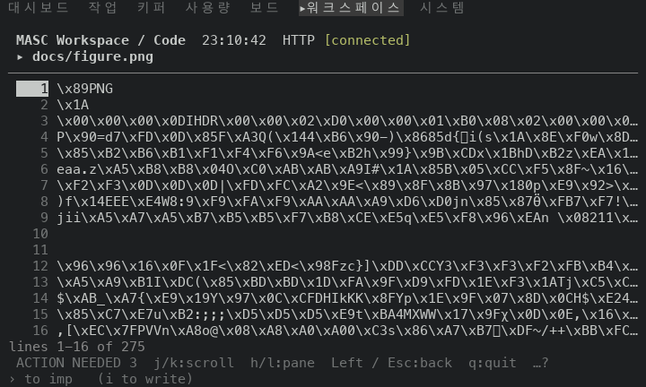
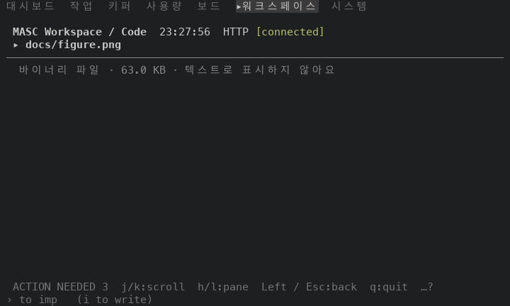
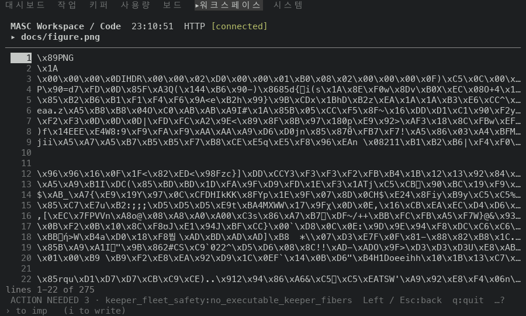
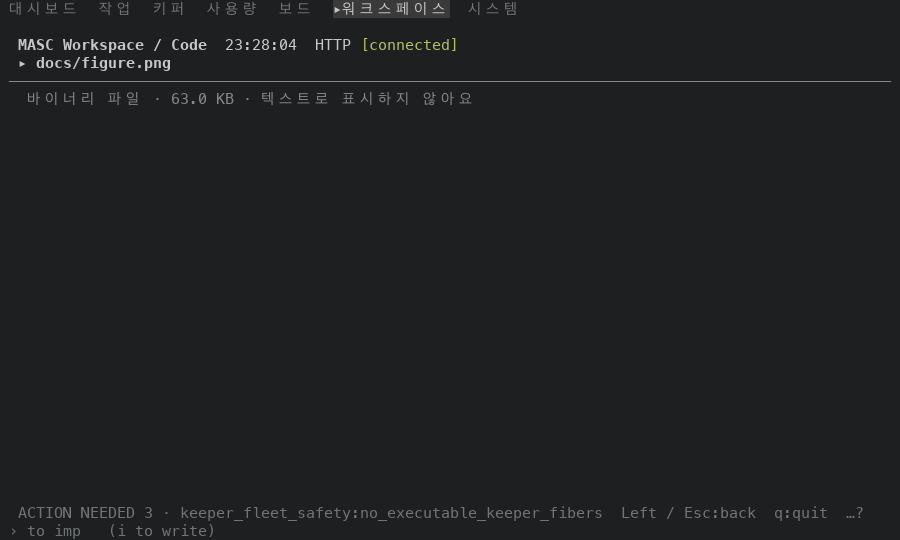
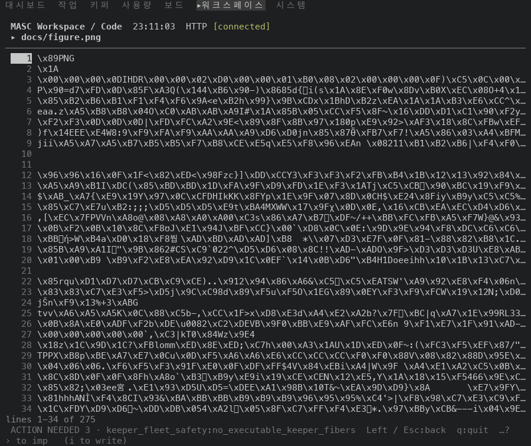
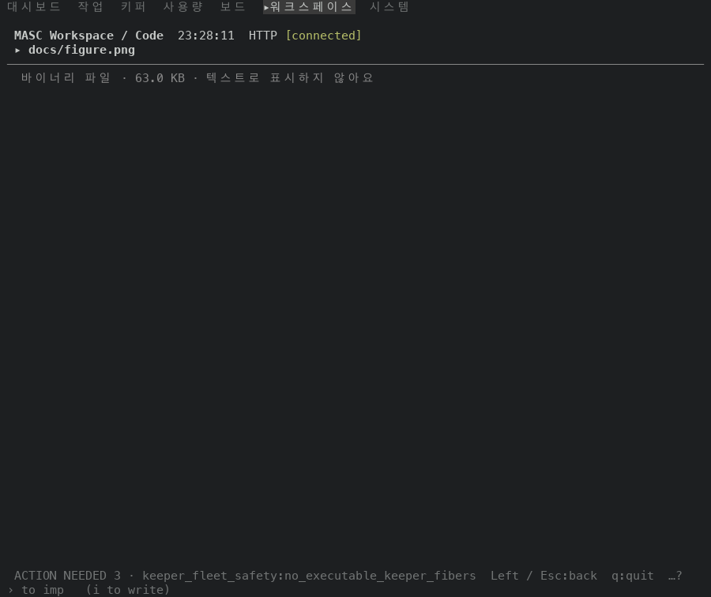
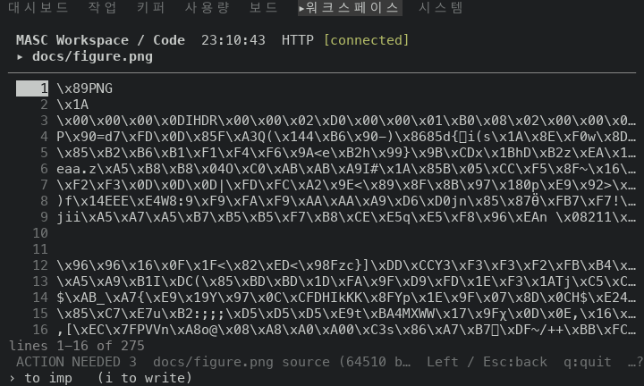
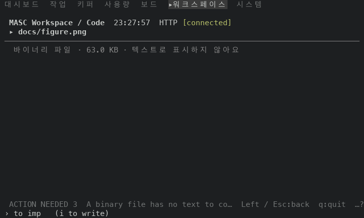

# The Code pane says a binary file is binary

PR #49398. Opening `docs/figure.png` in the Code pane drew its bytes as rows of escapes (`\x89PNG`, `\x1A`, `\x00`, ...), and the copy key and the editor key were offered the same bytes. The file read now applies the rule git uses for a blob, a NUL byte among the first 8000 bytes. Such a file opens as a document with a size and no text, and the pane says so in one dim row. Copy and edit answer with a refusal.

Before is the proof build of `6415b78c514`, the base of this PR (run 42229365992, masc-tui sha256 `bda390a9…a039`). After is the proof build of the PR head `2a60a9b6a0a` (run 42232510005, masc-tui sha256 `8b93d023…d8ea`). Between the two source trees the files under `bin/`, `lib/` and `test/` that differ are `bin/masc_tui_code_results.ml`, `bin/masc_tui_render_code.ml`, `bin/masc_tui_types.ml`, `test/test_tui_code_msg.ml`, `test/test_tui_keys.ml`, `test/test_tui_palette_matching.ml`. The evidence commit that carries this README comes after the head and changes only files under `docs/evidence/`.

## The fixture

A throwaway workspace with `docs/design.md` (text) and `docs/figure.png` (64510 bytes, a copy of a screenshot). Keys: open Code from the palette, `Right` (enter `docs`), `j` (select the PNG), `Enter` (open it), then `y` (copy the source). The copy key writes to the system clipboard, so the capture puts a stand-in `pbcopy` first on the TUI's PATH; it counts the bytes it is given and touches nothing.

## What the pane draws

| size | rows drawn before | caption before | `\x` escapes before | rows drawn after | `\x` escapes after |
|---|---|---|---|---|---|
| 80x24 | 16 | `lines 1-16 of 275` | 179 | 0 | 0 |
| 100x30 | 22 | `lines 1-22 of 275` | 331 | 0 | 0 |
| 100x42 | 34 | `lines 1-34 of 275` | 532 | 0 | 0 |

After the change the pane holds one row: `바이너리 파일 · 63.0 KB · 텍스트로 표시하지 않아요`. The title above it still names the file, and the rows below are empty.

## Frames

Each pair is the same keys on the same fixture at the same size; the clock differs per run.

| size | before | after |
|---|---|---|
| 80x24 |  |  |
| 100x30 |  |  |
| 100x42 |  |  |

## The copy key

| | row |
|---|---|
| before | `ACTION NEEDED 3  docs/figure.png source (64510 b…  Left / Esc:back  q:quit  …?` |
| after | `ACTION NEEDED 3  A binary file has no text to co…  Left / Esc:back  q:quit  …?` |

Rows are the footer at 80x24. Before, the stand-in `pbcopy` was handed 64510, 64510, 64510 bytes (one run per size). After, it was handed nothing.

At 100 columns and wider the footer keeps the full reason of the standing ACTION NEEDED notice and leaves the outcome of the key one cell, `d…` before and `A…` after, so the refusal is readable at 80x24 only on this fixture. The refusal is the same in every size; the stand-in `pbcopy` shows it. #49421 gives the outcome room beside that notice.

| before | after |
|---|---|
|  |  |

The editor key (`e`) takes the same source and hands it to `$EDITOR`. It was not captured: in the before build it would open an editor on the bytes. `test/test_tui_code_msg.ml` covers the refusal.

## Text files are unchanged

`docs/design.md` was opened with `Right`, `Enter` in both builds. 9 of 9 frames (3 sizes x 3 frames, `.ansi`, clock masked) are identical.

## How often this happens

Counted on the tracked files at `e0984208a32`, an earlier commit of this branch (the later commits change four source files and add this evidence): 1936 of 30023 tracked regular files (6.4%) hold a NUL among their first 8000 bytes. By extension: `.png` 1489, `.gz` 239, `.woff2` 128, `.jpg` 12, `.pdf` 11, `.bin` 11. Their median size is 62596 bytes. 25 of them are over 1 MiB; the file endpoint refuses those with `File too large` (limit `MASC_WORKSPACE_FILE_MAX_READ_BYTES`, 1,048,576 by default), so they never reached the pane's drawing.

## Not shown

- A text file that holds a NUL after its 8000th byte is still text, as before. `test/test_tui_code_msg.ml` checks the boundary (a NUL as the 8000th byte makes a file binary, as the 8001st does not).
- The history, diff and blame keys on a binary file are unchanged by this PR.
- A UTF-16 text file has NUL bytes in its first bytes and is treated as binary, as git treats it.
