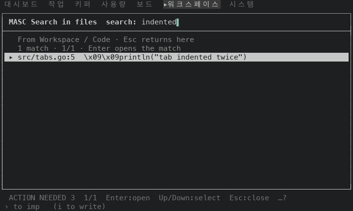
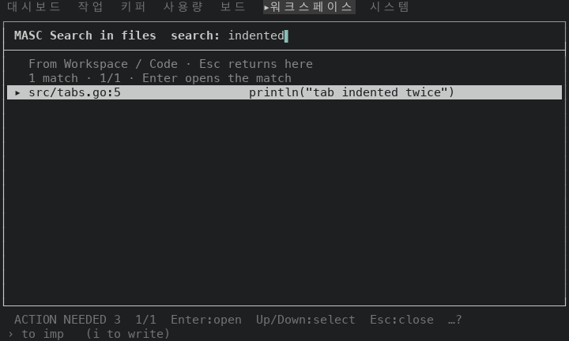
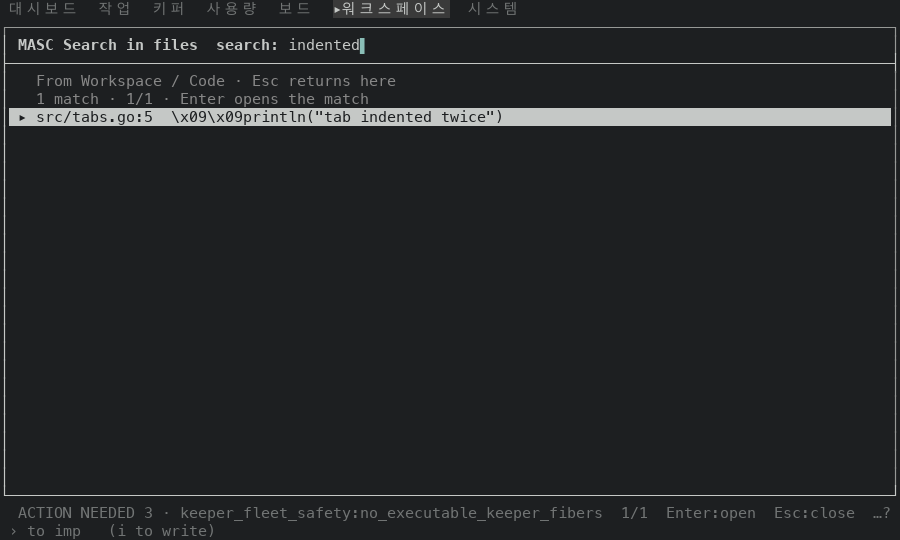
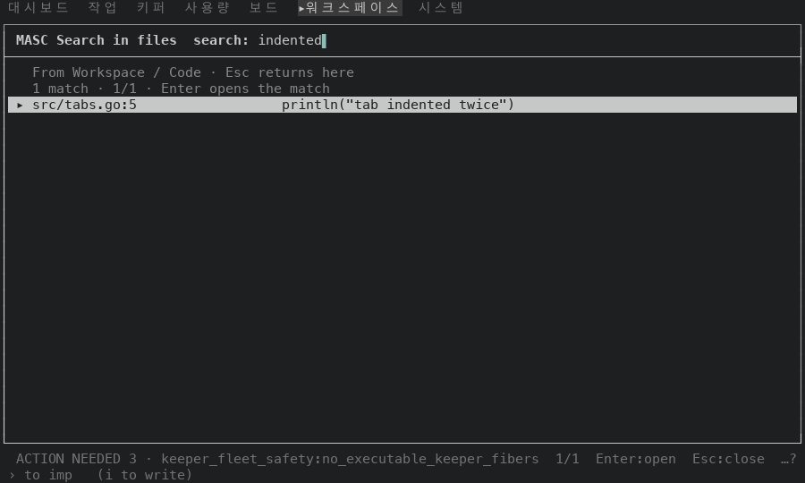
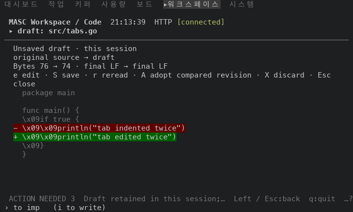
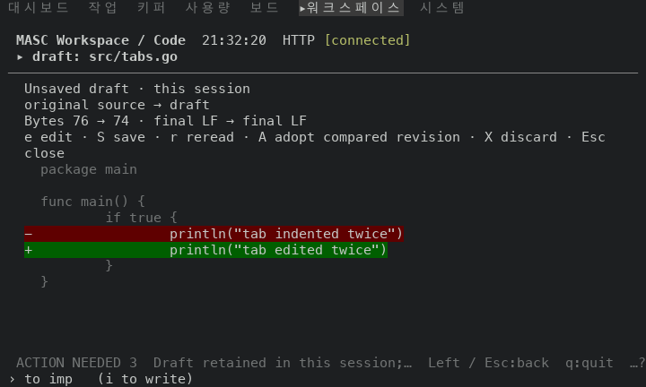
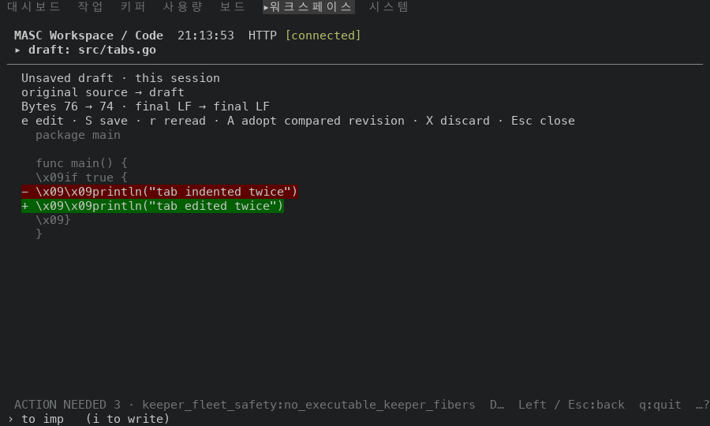
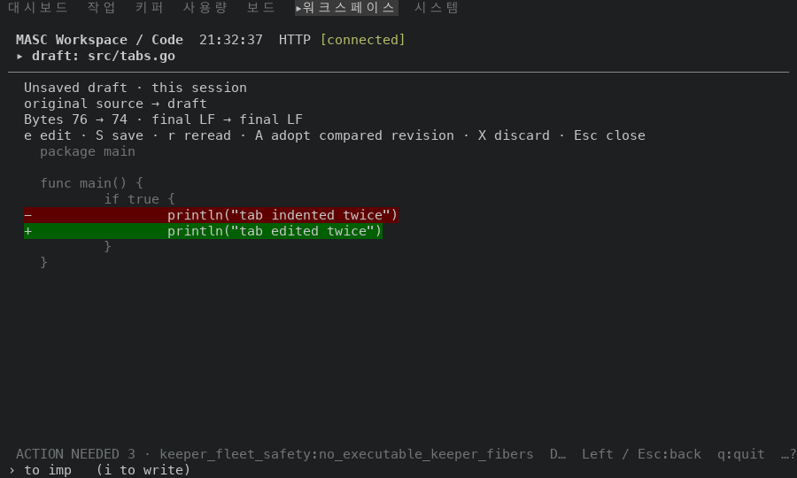

# The Code pane draws a tab as spaces in the draft comparison and in Ctrl-G rows

PR #49312. #49242 made the file view and the diff view draw a tab as the spaces up to the next tab stop. Two more rows of the Code pane still sent the tab to the terminal sanitizer, which writes it as the four characters `\x09`: the draft comparison (`e` on an open file, then the compared rows) and the answer rows of Ctrl-G search.

Before is the proof build of `main` at `497c3f0ed4c` (run 42211607592, masc-tui sha256 `8adc1f4d…1109`). After is the proof build of the PR head `2e10358a787` (run 42216332075, masc-tui sha256 `d25e6f5d…9d0c`). Between the two source trees the only changes under `bin/` are this PR's three files (`bin/dune`, `bin/masc_tui_palette.ml`, `bin/masc_tui_render_code.ml`); the other difference is the server side tool-stats series filter of #49287, which the Code pane does not read. The evidence commit that carries this README comes after the head and changes only files under `docs/evidence/`.

## The file

`src/tabs.go` in a Git checkout seeded for the capture (`<TAB>` marks a tab byte), 7 lines:

```
package main

func main() {
<TAB>if true {
<TAB><TAB>println("tab indented")
<TAB>}
}
```

## Ctrl-G rows

Keys: open Code from the palette, `Ctrl-G`, `indented`, `Enter` (the search answer). One match, line 5.

| | row of the answer at 100x30 |
|---|---|
| before | `▸ src/tabs.go:5  \x09\x09println("tab indented twice")` |
| after | `▸ src/tabs.go:5                  println("tab indented twice")` |

The literal `\x09` count on the screen goes from 2 to 0 (the same count at 80x24). The two tabs of line 5 are 16 cells of spaces, as in the file view. The row keeps the leading whitespace; this PR does not trim it.

## Draft comparison

Keys: open `src/tabs.go` from the tree (`j`, `j`, `Right`, `j` x5, `Enter`), then `e`. `$EDITOR` is a stub that runs `sed -i "" "s/tab indented/tab edited/"` on the draft file, so the draft differs from the original in line 5 only. The frame after `e` shows the comparison.

The rows with `println`, in the order they appear at 100x30:

| row | before | after |
|---|---|---|
| 1 | `- \x09\x09println("tab indented twice")` | `-                 println("tab indented twice")` |
| 2 | `+ \x09\x09println("tab edited twice")` | `+                 println("tab edited twice")` |

The rows around them (`if true {`, `}`) change in the same way. The literal `\x09` count on the screen goes from 6 to 0 (the same count at 80x24).

## Frames

Each pair is the same keys on the same file at the same size; the header clock differs. A comparison of all 22 Ctrl-G frames and all 24 draft frames of the two builds (`.ansi`, clock digits masked) found these differences only: the two Ctrl-G answer frames, the four draft comparison frames, and the header note of one 80x24 frame (`reading workspace verifi…` against `finishing refresh`, a background refresh that was in flight at a different moment).

| frame | before | after |
|---|---|---|
| Ctrl-G 80x24 |  |  |
| Ctrl-G 100x30 |  |  |
| draft 80x24 |  |  |
| draft 100x30 |  |  |

## Navigation trace

`MASC_TUI_NAV_TRACE` recorded both sessions (80x24 and 100x30) of each flow. The Ctrl-G traces hold 0 `key_unchanged` lines before and 0 after. The draft traces hold 1 before and 1 after, both for `enter` on the `code` surface at 80x24: the `Enter` that opens the file sends a read, and the file arrives after the first frame (RFC-0485 section 2.1 records request keys this way). This PR does not touch that path.

## Not shown

- Other rows that print a source line were not captured: the hover answer, history subjects, and Markdown blocks in chat notices.
- A tab inside a row (not at its start) expands to the next tab stop of that row's own text, counted from column 0 of the text, not from the screen column of the row.
- Ctrl-G rows still start the match text after the leading whitespace; a deeply indented match pushes the text to the right.
