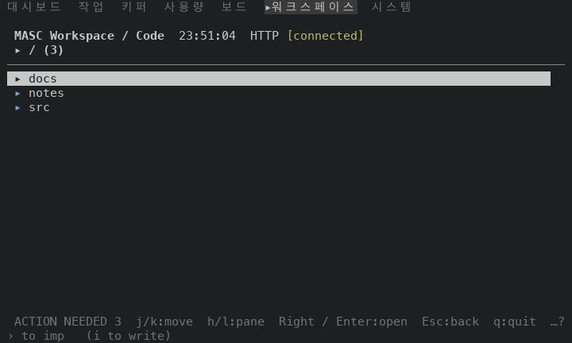
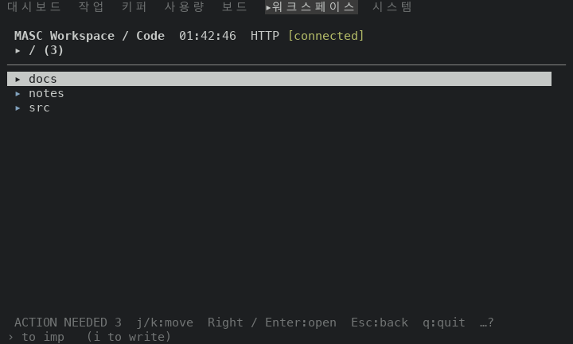
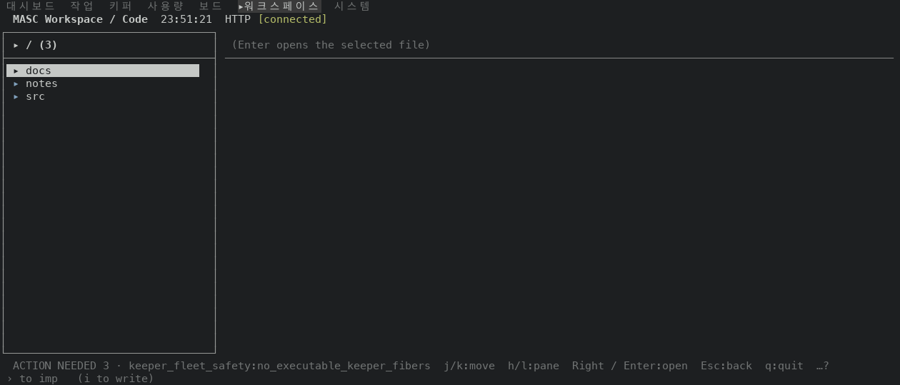
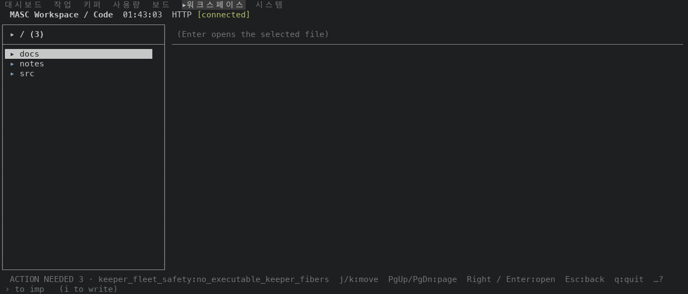
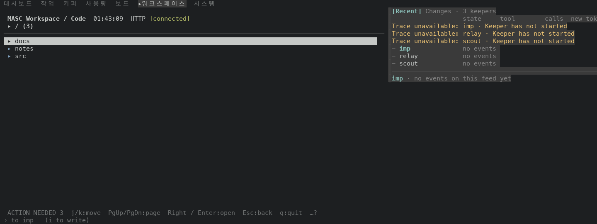
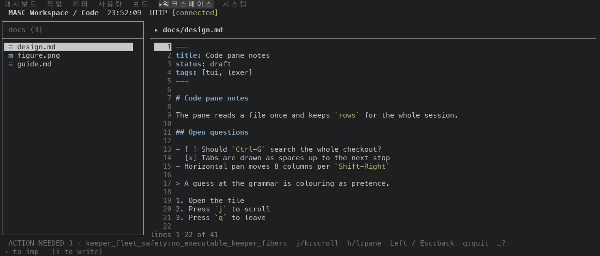

# The Code tree footer names h/l:pane only while a file read is current

PR #49430. On the first screen of Code no file is open, and the footer read `j/k:move  h/l:pane  …`. `h` and `l` move focus between the file list and a file, and only while a file read is current (loading, shown or failed). With none they end in `()`. The dispatcher already stopped there; the footer did not. Both now read one answer, `Masc_tui_keys.code_file_is_current`, and the footer's tree and project-root panes name `h/l` only when it is true.

Before is the proof build of `6415b78c514`, the base of this PR (run 42229365992, masc-tui sha256 `bda390a9…a039`). After is the proof build of the PR head `1d55d8153ba` (run 42252344442, masc-tui sha256 `8db9aa63…7d73`). Between the two source trees the files under `bin/`, `lib/` and `test/` that differ are `bin/dune`, `bin/masc_tui.ml`, `bin/masc_tui_keys.ml`, `bin/masc_tui_keys.mli`, `test/dune`, `test/test_tui_footer_detail_state.ml`. The evidence commit that carries this README comes after the head and changes only files under `docs/evidence/`.

## The fixture

A throwaway workspace whose project root holds `docs/` (with `design.md`, 41 lines, `figure.png` and `guide.md`) and `notes/`. Two flows run at six sizes (80, 100, 120, 140, 160 and 200 columns):

- `tree`: the Code screen is opened and `l`, then `h`, are pressed with no file open.
- `file`: `Right` opens `docs/`, `Enter` opens `design.md`, then `h` and `l` are pressed with the file open. This is the control.

At 80, 100 and 160 columns the screen draws one pane at a time; at 120, 140 and 200 it draws the file list and the file side by side.

## What the footer names

A frame is one step of a flow at one size. The columns count the sizes at which the footer row holds `h/l:pane`.

| flow | frame | keys pressed | file list | file read | sizes naming `h/l:pane` before | after |
|---|---|---|---|---|---|---|
| tree | k0-start | none | project root | none | 80, 100, 140, 160, 200 | none |
| tree | k1-l | `l` | project root | none | 80, 100, 140, 160, 200 | none |
| tree | k2-h | `l`, `h` | project root | none | 80, 100, 140, 160, 200 | none |
| file | k0-start | none | project root | none | 80, 100, 140, 160, 200 | none |
| file | k1-right | `Right` | inside `docs/` | none | 100, 140, 160, 200 | none |
| file | k2-enter | `Right`, `Enter` | inside `docs/` | current | 80, 120, 140, 200 | 80, 120, 140, 200 |
| file | k3-h | `Right`, `Enter`, `h` | inside `docs/` | current | 100, 140, 160, 200 | 100, 140, 160, 200 |
| file | k4-l | `Right`, `Enter`, `h`, `l` | inside `docs/` | current | 80, 120, 140, 200 | 80, 120, 140, 200 |

The footer row of the `l` frame of the tree flow, at each size:

before:

```
80x24  ACTION NEEDED 3  j/k:move  h/l:pane  Right / Enter:open  Esc:back  q:quit  …?
100x30 ACTION NEEDED 3  j/k:move  h/l:pane  PgUp/PgDn:page  Right / Enter:open  Esc:back  q:quit  …?
120x30 ACTION NEEDED 3 · keeper_fleet_safety:no_executable_keeper_fibers  j/k:move  Right / Enter:open  Esc:back  q:quit  …?
140x30 ACTION NEEDED 3 · keeper_fleet_safety:no_executable_keeper_fibers  j/k:move  h/l:pane  Right / Enter:open  Esc:back  q:quit  …?
160x30 ACTION NEEDED 3  j/k:move  h/l:pane  PgUp/PgDn:page  Right / Enter:open  Esc:back  q:quit  …?
200x30 ACTION NEEDED 3 · keeper_fleet_safety:no_executable_keeper_fibers  j/k:move  h/l:pane  Right / Enter:open  Esc:back  q:quit  …?
```
after:

```
80x24  ACTION NEEDED 3  j/k:move  Right / Enter:open  Esc:back  q:quit  …?
100x30 ACTION NEEDED 3  j/k:move  PgUp/PgDn:page  Right / Enter:open  Esc:back  q:quit  …?
120x30 ACTION NEEDED 3 · keeper_fleet_safety:no_executable_keeper_fibers  j/k:move  Right / Enter:open  Esc:back  q:quit  …?
140x30 ACTION NEEDED 3 · keeper_fleet_safety:no_executable_keeper_fibers  j/k:move  PgUp/PgDn:page  Right / Enter:open  Esc:back  q:quit  …?
160x30 ACTION NEEDED 3  j/k:move  PgUp/PgDn:page  Right / Enter:open  Esc:back  q:quit  …?
200x30 ACTION NEEDED 3 · keeper_fleet_safety:no_executable_keeper_fibers  j/k:move  PgUp/PgDn:page  Right / Enter:open  Esc:back  q:quit  …?
```

The 30 frames with no file read have 24 footers that differ between the builds. In every one of them the before footer names `h/l:pane` and the after footer does not. At 120 columns the before footer did not name it either: the notice takes the room of the lowest-priority hint.

## What h and l do with no file read

In the tree flow `l`, then `h`, leave the screen as it was before any key (clock masked) in 12 of 12 frames of the before build and in 12 of 12 frames of the after build. The keys do nothing in both builds, so the before footer advertised a key that did nothing.

The app's own navigation trace (`EV_NAV_TRACE`) wrote 1 line for the 12 presses of the before runs. It records a key only when the frame it draws is byte-identical to the one before, and the header clock changes every second, so it sees a press only when the press lands in the same second as the last draw (#49445 sets the clock aside). Events of the tree flow, before: `surface code, key h, advertised true`. After: `surface code, key char, advertised false`; `surface code, key char, advertised false`; `surface code, key char, advertised false`. `key char` is how the trace spells a letter that the footer does not name, so none of the lines after the change is a named key that did nothing.

## Rows with a file read current are unchanged

The 18 frames of the file flow with a file read current (`Enter`, `h`, `l` at 6 sizes) are identical before and after, text and colours (clock masked). In both builds `h` changes the screen at 6 of 6 sizes and `l` brings back the screen the file had at 6 of 6 sizes: with a file read the keys work and the footer still names them.

## Everything but the footer row is unchanged

In the 30 frames with no file read, every row other than the footer row is identical between the builds. The change is the footer row and nothing else on the screen.

## Frames

| frame | before | after |
|---|---|---|
| tree flow, k1-l, 80x24 |  |  |
| tree flow, k1-l, 140x30 |  |  |
| tree flow, k1-l, 160x30 |  |  |
| file flow, k4-l, 140x30 |  |  |

## Not shown

- The project-root pane and the pane inside `docs/` are separate cases in the key table (`Code_root` and `Code_tree`); both lose the hint with no file read, and the table above has both (`tree` flow at the root, `file` flow after `Right`).
- The test added in `test/test_tui_footer_detail_state.ml` asks the key table whether it names `h/l` before and after a file read is made current. It reads no footer text (`docs/constitution.xml` 354-355). Run 42252346487 of `test.yml` on the PR head ran test_tui_footer_detail_state, test_tui_keys, test_tui_footer_notice_forms: success.
- A file read that is loading or failed counts as current, as it does in the dispatcher. The captures hold only a read that was shown.
