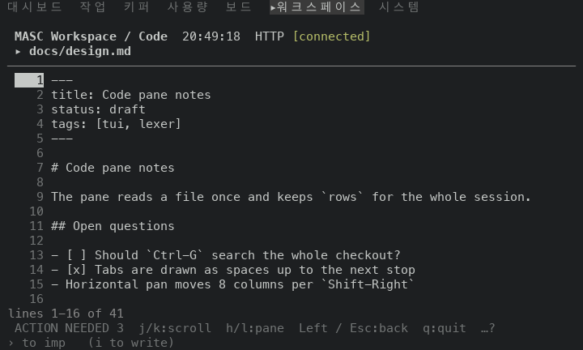
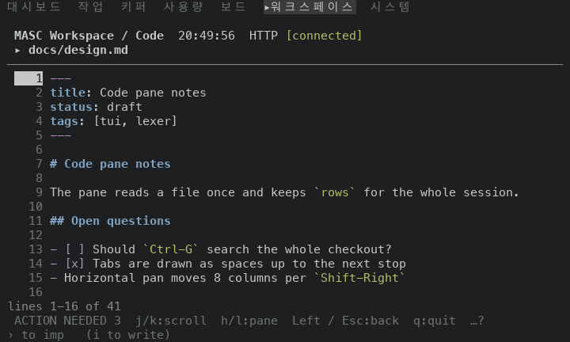
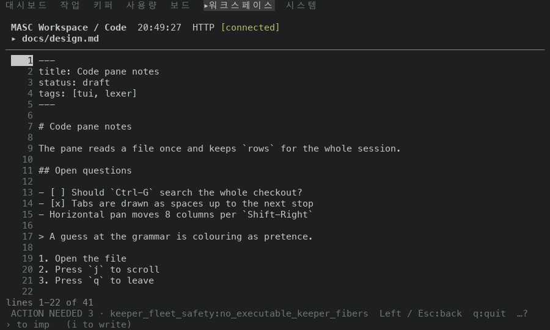
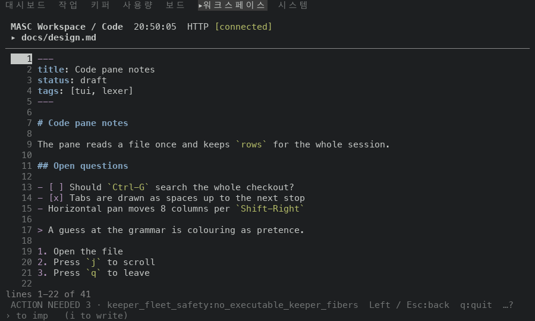
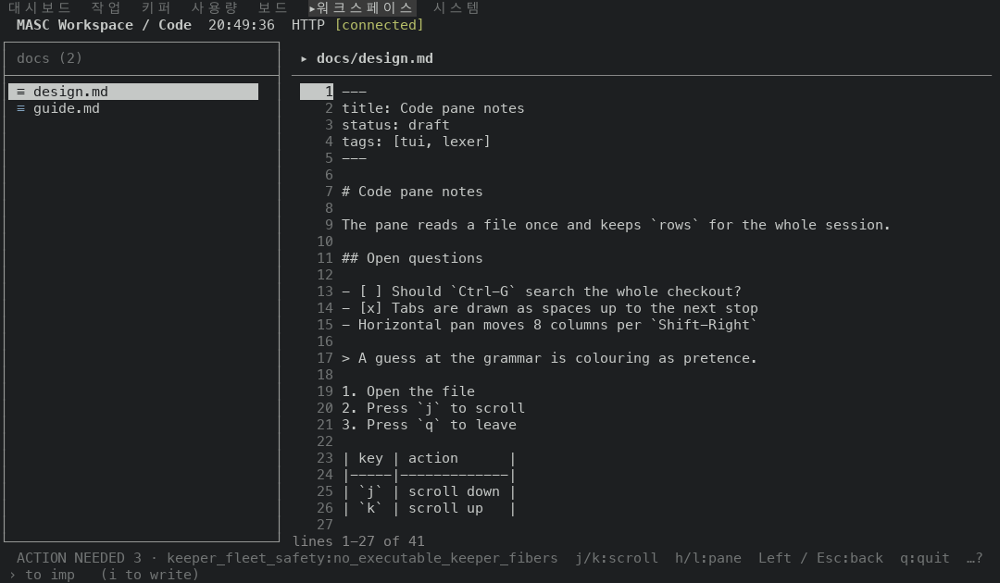
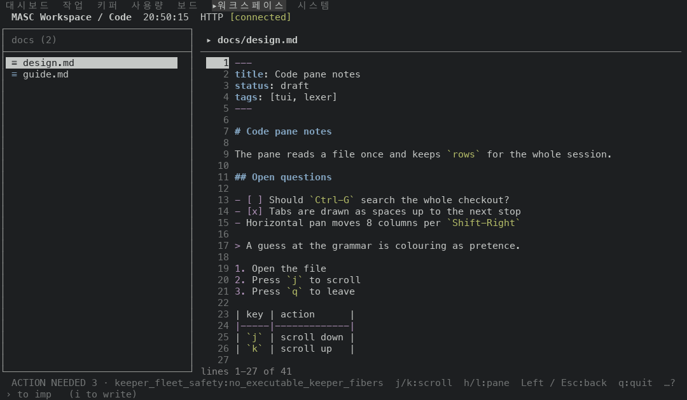
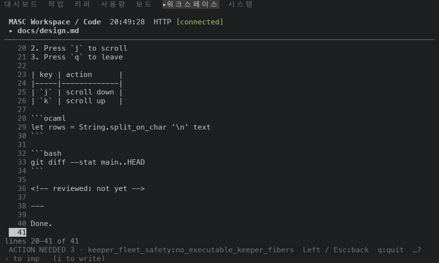
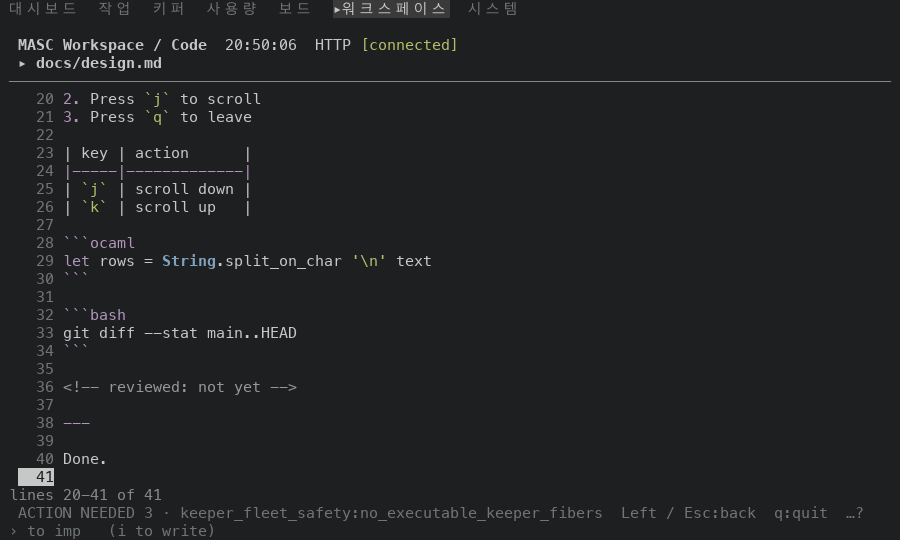

# The Code pane colours a Markdown file by line kind

PR #49288. A `.md` or `.markdown` file opened in the Code pane drew every row in one hue, because `language_of_path` had no entry for it. The lexer added by the PR reads the file line by line and the pane colours its headings, list and quote markers, rules, table rule rows, code fences, inline code, HTML comments, YAML front matter and the body of a fence.

Before is the proof build of `main` at `497c3f0ed4c` (run 42211607592, masc-tui sha256 `8adc1f4d…1109`). After is the proof build of the PR head `7acb3898acb` (run 42211425995, masc-tui sha256 `a8193988…ed97`). The evidence commit that carries this README comes after it and changes only files under `docs/evidence/`.

## The file

Seeded into a Git checkout as `docs/design.md`, 40 lines, opened from the Code pane with `Right`, `Enter`, then `End`.

```markdown
---
title: Code pane notes
status: draft
tags: [tui, lexer]
---

# Code pane notes

The pane reads a file once and keeps `rows` for the whole session.

## Open questions

- [ ] Should `Ctrl-G` search the whole checkout?
- [x] Tabs are drawn as spaces up to the next stop
- Horizontal pan moves 8 columns per `Shift-Right`

> A guess at the grammar is colouring as pretence.

1. Open the file
2. Press `j` to scroll
3. Press `q` to leave

| key | action      |
|-----|-------------|
| `j` | scroll down |
| `k` | scroll up   |

```ocaml
let rows = String.split_on_char '\n' text
```

```bash
git diff --stat main..HEAD
```

<!-- reviewed: not yet -->

---

Done.
```

## Before

The rows of the two frames at 100x30 (lines 1-22 and 20-41) carry no colour code other than the dim line number: 0 of 28 non-blank rows are coloured.

## After

25 of 28 non-blank rows carry a colour code. The hue of each run is the SGR code the capture holds for it (`95` bright magenta, bold `94` bright blue, `92` bright green, italic `90` gray). The theme draws the keyword and number kinds with the same hue (`Theme.Syntax.keyword` and `code_number`), so the table cannot tell a list marker from a task box.

| line | text | hue runs after |
|---|---|---|
| 1 | `---` | keyword/number:`---` |
| 2 | `title: Code pane notes` | type:`title` |
| 3 | `status: draft` | type:`status` |
| 4 | `tags: [tui, lexer]` | type:`tags` |
| 5 | `---` | keyword/number:`---` |
| 7 | `# Code pane notes` | type:`# Code pane notes` |
| 9 | `` The pane reads a file once and keeps `rows` for the whole session. `` | string:`` `rows` `` |
| 11 | `## Open questions` | type:`## Open questions` |
| 13 | `` - [ ] Should `Ctrl-G` search the whole checkout? `` | keyword/number:`-` keyword/number:`[ ]` string:`` `Ctrl-G` `` |
| 14 | `- [x] Tabs are drawn as spaces up to the next stop` | keyword/number:`-` keyword/number:`[x]` |
| 15 | `` - Horizontal pan moves 8 columns per `Shift-Right` `` | keyword/number:`-` string:`` `Shift-Right` `` |
| 17 | `> A guess at the grammar is colouring as pretence.` | keyword/number:`>` |
| 19 | `1. Open the file` | keyword/number:`1.` |
| 20 | `` 2. Press `j` to scroll `` | keyword/number:`2.` string:`` `j` `` |
| 21 | `` 3. Press `q` to leave `` | keyword/number:`3.` string:`` `q` `` |
| 24 | `\|-----\|-------------\|` | keyword/number:`\|-----\|-------------\|` |
| 25 | `` \| `j` \| scroll down \| `` | string:`` `j` `` |
| 26 | `` \| `k` \| scroll up   \| `` | string:`` `k` `` |
| 28 | `` ```ocaml `` | keyword/number:`` ```ocaml `` |
| 29 | `let rows = String.split_on_char '\n' text` | keyword/number:`let` type:`String` string:`'\n'` |
| 30 | `` ``` `` | keyword/number:`` ``` `` |
| 32 | `` ```bash `` | keyword/number:`` ```bash `` |
| 34 | `` ``` `` | keyword/number:`` ``` `` |
| 36 | `<!-- reviewed: not yet -->` | comment:`<!-- reviewed: not yet -->` |
| 38 | `---` | keyword/number:`---` |

Rows that are not listed (blank rows, paragraphs and table text) keep the default hue.

## Frames

Each pair is the same keys on the same file at the same size; the header clock differs.

| size | before | after |
|---|---|---|
| 80x24 top |  |  |
| 100x30 top |  |  |
| 120x35 top |  |  |
| 100x30 end |  |  |

## Navigation trace

`MASC_TUI_NAV_TRACE` recorded the three sessions per build. The after trace holds no `key_unchanged` line. The before trace holds one, for `enter` on the `code` surface at 80x24; the frame after it shows the file open, and the cause was not checked.

## Not shown

- Chat fences tagged `md` use the same lexer; no chat frame was captured.
- Files over 500,000 bytes are drawn plain, as before; none was captured.
- The memo reader now reads `.md` files through the lexer instead of the marker pair; `test_tui_memo` passed, and it has no `.md` case.
