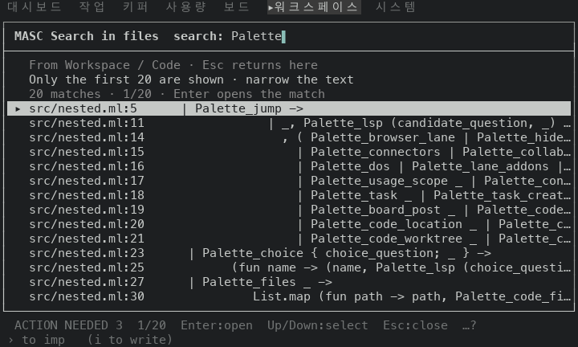
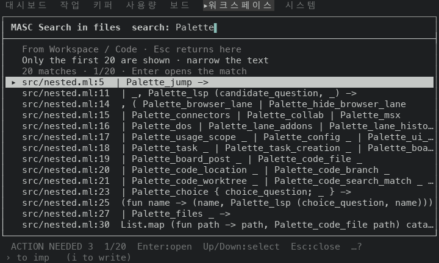
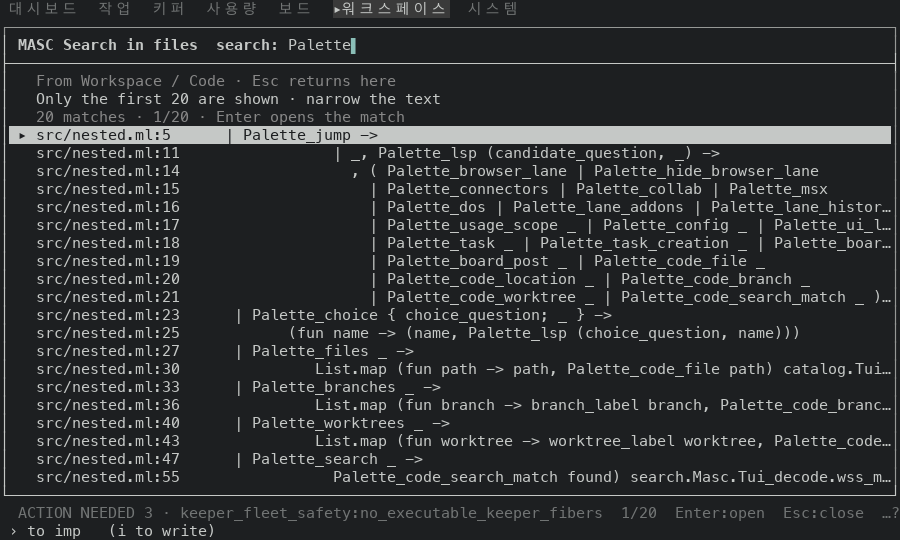
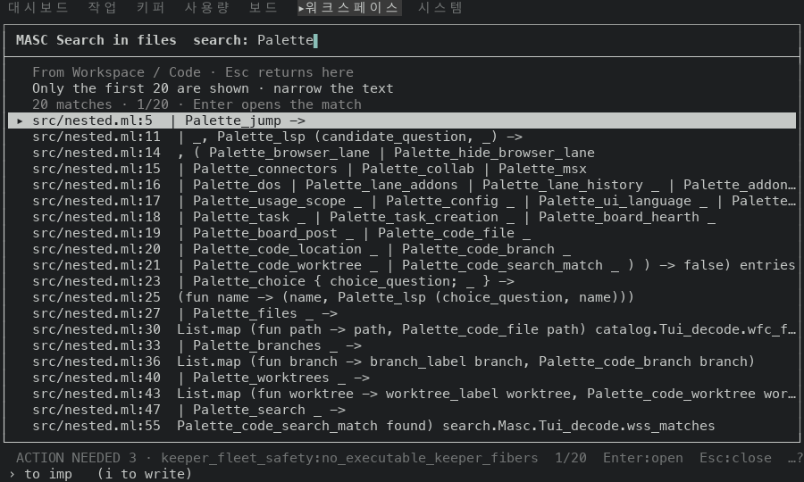

# Ctrl-G answer rows start the matched line at its first character

PR #49355, on top of #49312. A Ctrl-G answer row is `path:line`, two spaces and the matched line. The line kept its leading spaces, so a deeply nested match was pushed to the right and the frame cut it with `…`. The row now starts the line at its first character that is not a space (after tabs are expanded). The file view still shows the indentation once the match is opened, and the draft comparison keeps it, because there it is part of what changed.

Before is the proof build of the PR #49312 head `2e10358a787` (run 42216332075, masc-tui sha256 `d25e6f5d…9d0c`), which expands tabs and keeps the indentation. After is the proof build of `a7a7d963a4d` (run 42219826398). Between the two source trees `bin/masc_tui_palette.ml` is the only file under `bin/` or `lib/` that differs. The evidence commit that carries this README comes after the head and changes only files under `docs/evidence/`.

## The file

`src/nested.ml` in a Git checkout seeded for the capture: 65 lines, a copy of `palette_matches` from `bin/masc_tui_palette.ml` at `3bb99ab6e6f`. Keys: open Code from the palette, `Ctrl-G`, `Palette`, `Enter`. The server answers with its first 20 matches (`Only the first 20 are shown`).

## Rows

Counted from the captured frames of the answer (`k9-enter`). The server answers with 20 matches; the frame at 80x24 has room for 14 of them.

| size | rows | rows cut by `…` before | rows cut by `…` after | characters drawn before | characters drawn after |
|---|---|---|---|---|---|
| 80x24 | 14 | 11 | 5 | 450 | 582 |
| 100x30 | 20 | 8 | 4 | 825 | 921 |

Characters are the ones that are not spaces in the line after `path:line`, counted up to the right frame edge (a cut `…` is not counted). The rows at 100x30, with the indentation of the same line in the file:

| line | indent in the file | before | after |
|---|---|---|---|
| 5 | 4 | `    \| Palette_jump ->` | `\| Palette_jump ->` |
| 11 | 15 | `               \| _, Palette_lsp (candidate_question, _) ->` | `\| _, Palette_lsp (candidate_question, _) ->` |
| 14 | 17 | `                 , ( Palette_browser_lane \| Palette_hide_browser_lane` | `, ( Palette_browser_lane \| Palette_hide_browser_lane` |
| 15 | 19 | `                   \| Palette_connectors \| Palette_collab \| Palette_msx` | `\| Palette_connectors \| Palette_collab \| Palette_msx` |
| 16 | 19 | `                   \| Palette_dos \| Palette_lane_addons \| Palette_lane_histor…` | `\| Palette_dos \| Palette_lane_addons \| Palette_lane_history _ \| Palette_addon…` |
| 17 | 19 | `                   \| Palette_usage_scope _ \| Palette_config _ \| Palette_ui_l…` | `\| Palette_usage_scope _ \| Palette_config _ \| Palette_ui_language _ \| Palette…` |
| 18 | 19 | `                   \| Palette_task _ \| Palette_task_creation _ \| Palette_boar…` | `\| Palette_task _ \| Palette_task_creation _ \| Palette_board_hearth _` |
| 19 | 19 | `                   \| Palette_board_post _ \| Palette_code_file _` | `\| Palette_board_post _ \| Palette_code_file _` |
| 20 | 19 | `                   \| Palette_code_location _ \| Palette_code_branch _` | `\| Palette_code_location _ \| Palette_code_branch _` |
| 21 | 19 | `                   \| Palette_code_worktree _ \| Palette_code_search_match _ )…` | `\| Palette_code_worktree _ \| Palette_code_search_match _ ) ) -> false) entries` |
| 23 | 4 | `    \| Palette_choice { choice_question; _ } ->` | `\| Palette_choice { choice_question; _ } ->` |
| 25 | 10 | `          (fun name -> (name, Palette_lsp (choice_question, name)))` | `(fun name -> (name, Palette_lsp (choice_question, name)))` |
| 27 | 4 | `    \| Palette_files _ ->` | `\| Palette_files _ ->` |
| 30 | 13 | `             List.map (fun path -> path, Palette_code_file path) catalog.Tui…` | `List.map (fun path -> path, Palette_code_file path) catalog.Tui_decode.wfc_f…` |
| 33 | 4 | `    \| Palette_branches _ ->` | `\| Palette_branches _ ->` |
| 36 | 13 | `             List.map (fun branch -> branch_label branch, Palette_code_branc…` | `List.map (fun branch -> branch_label branch, Palette_code_branch branch)` |
| 40 | 4 | `    \| Palette_worktrees _ ->` | `\| Palette_worktrees _ ->` |
| 43 | 13 | `             List.map (fun worktree -> worktree_label worktree, Palette_code…` | `List.map (fun worktree -> worktree_label worktree, Palette_code_worktree wor…` |
| 47 | 4 | `    \| Palette_search _ ->` | `\| Palette_search _ ->` |
| 55 | 15 | `               Palette_code_search_match found) search.Masc.Tui_decode.wss_m…` | `Palette_code_search_match found) search.Masc.Tui_decode.wss_matches` |

## Frames

Each pair is the same keys on the same file at the same size; the header clock differs.

| size | before | after |
|---|---|---|
| 80x24 |  |  |
| 100x30 |  |  |

## Not shown

- 120x35 was not captured.
- A search with fewer than 20 matches, and a match that sits at column 0, look the same before and after.
- The row no longer tells how deep the match is nested; opening it (`Enter`) shows the line in the file with its indentation.
