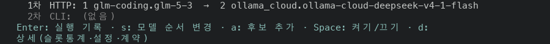
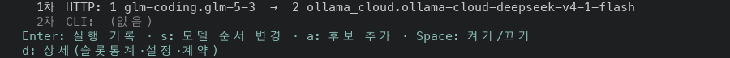
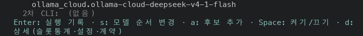
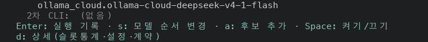
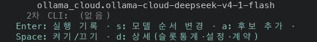
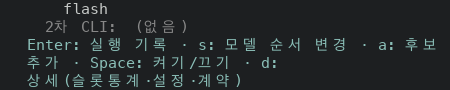
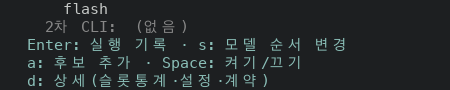
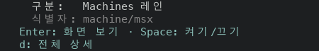

# The Features key hints break between hints

PR #49027, layer 14 of stack #48922. The last row of the Features summary is a list of key hints (`key: label`) joined by a middle dot. It was wrapped at any space, so a narrow terminal split a hint over two rows.

Before is the proof build of layer 12 (`9befc8c2cc9`, run 42129588554). Layer 13 only changes a test, so its code is the same. After is the proof build of this layer's code commit (`d1569dc589c`, run 42138077129). Both ran against a fixture server; the Features list shows five exact lanes, two Browser rows and two Machines rows.

## The hint rows on the screen

The rows from the first `Enter:` row to the blank row below it, as the capture drew them. The terminal height is 30 rows at 100 columns and taller at the narrower widths, because the summary pane is cut by the terminal height (see Not changed).

### 100x30

Selected row: an exact lane (Librarian)

Before

```text
Enter: 실행 기록 · s: 모델 순서 변경 · a: 후보 추가 · Space: 켜기/끄기 · d:
상세(슬롯통계·설정·계약)
```

After

```text
Enter: 실행 기록 · s: 모델 순서 변경 · a: 후보 추가 · Space: 켜기/끄기
d: 상세(슬롯통계·설정·계약)
```

### 80x40

Selected row: an exact lane (Librarian)

Before

```text
Enter: 실행 기록 · s: 모델 순서 변경 · a: 후보 추가 · Space: 켜기/끄기 · d:
상세(슬롯통계·설정·계약)
```

After

```text
Enter: 실행 기록 · s: 모델 순서 변경 · a: 후보 추가 · Space: 켜기/끄기
d: 상세(슬롯통계·설정·계약)
```

### 60x44

Selected row: an exact lane (Librarian)

Before

```text
Enter: 실행 기록 · s: 모델 순서 변경 · a: 후보 추가 ·
Space: 켜기/끄기 · d: 상세(슬롯통계·설정·계약)
```

After

```text
Enter: 실행 기록 · s: 모델 순서 변경 · a: 후보 추가
Space: 켜기/끄기 · d: 상세(슬롯통계·설정·계약)
```

### 50x46

Selected row: an exact lane (Librarian)

Before

```text
Enter: 실행 기록 · s: 모델 순서 변경 · a: 후보
추가 · Space: 켜기/끄기 · d:
상세(슬롯통계·설정·계약)
```

After

```text
Enter: 실행 기록 · s: 모델 순서 변경
a: 후보 추가 · Space: 켜기/끄기
d: 상세(슬롯통계·설정·계약)
```

Selected row: a Machines row (MSX)

Before

```text
Enter: 화면 보기 · Space: 켜기/끄기 · d: 전체
상세
```

After

```text
Enter: 화면 보기 · Space: 켜기/끄기
d: 전체 상세
```

The hint row has the same text before and after for: browser at 100x30, 80x40, 60x44, 50x46; machine at 100x30, 80x40, 60x44. It fits one row there.

## Where a hint row broke inside a hint

The two functions were run on the same hint lists, from 30 to 140 terminal columns (the hint row is laid out in columns minus four: the screen's inner width is columns minus two, and the row has two spaces of indent). A row counts as broken when it ends inside a hint or on the middle dot. This is a computed table, not a capture.

| Hint list | Cells on one row | Before (`wrap_words`) | After (`pack_clauses`) |
| --- | --- | --- | --- |
| exact | 100 | 30-54, 57-73, 76-103 columns | 30 columns |
| browser | 35 | 30-38 columns | none |
| machine | 50 | 30-38, 41-53 columns | none |
| package outputs | 60 | 30-33, 36-48, 51-63 columns | none |
| package | 26 | none | none |

The one column that still breaks is 30. The widest hint of the exact list (`d: 상세(슬롯통계·설정·계약)`, 27 cells) does not fit the 26 cells of the row, so a row cannot hold it whole.

The five lists were checked against the code before this README was written: every hint is a string literal in `bin/masc_tui_render_lanes.ml`, and each list joined with the middle dot is byte for byte the string the code held before this layer.

## Wide screen

At 200x50 the hint row is one row in both builds, with the same text for all three selected rows. With the clock replaced, the number of rows of the whole capture that differ between the two builds is: exact 0 of 51, browser 0 of 51, machine 0 of 51.

## Screens

From two rows above the first hint row to the last hint row, before then after.



















## What the change is

`lane_overview_summary_block` in `bin/masc_tui_render_lanes.ml` took the hint row as one string and wrapped it with `wrap_words`. It now takes `~actions` as a `string list` of hints and hands them to `Message_layout.pack_clauses` through `wrap_indented_clauses`. That helper already lays out the Memory and Fusion header rows and the Usage summary of layer 12: it fills a row with whole hints, joins them with the middle dot and starts the next row at a hint.

All five hint rows are lists now: the exact lane, the Browser row, the Machines row, and the Package row with and without outputs. A joined string no longer type checks at the call. `Space: 켜기/끄기` and `d: 전체 상세` were written in several of the old strings and are named once (`toggle_action`, `full_detail_action`).

## Test

This layer adds no test. `docs/constitution.xml` rules out tests of TUI layout and row order, so the breaks between hints are shown by the captures and the computed table above. The type change guards the call: a joined string no longer type checks. A type check of the file with the old call restored fails with `This constant has type string but an expression was expected of type string list`, and one with a wrong label on `pack_clauses` fails too.

## Not changed

- The summary pane is cut by the terminal height. In the layer 12 capture at 80x24 the pane ends with `… d: full reading` and the hint row is below the cut, so the split was visible only where the pane had room. This layer does not touch the height rules.
- A hint wider than the row still wraps at a space, as before (30 columns for the exact list).
- Other strings in `bin/` hold two or more `key: label` parts joined by a middle dot. The search `rg -n '"[^"\\]*[A-Za-z\])]: [^"\\]* · [^"\\]*[A-Za-z\])]: [^"\\]*"' bin/*.ml` matches 23 lines in 11 files. Some are key hints and some are other labels. The search says where such strings are written, not which of them are wrapped, so none of them is claimed here.
