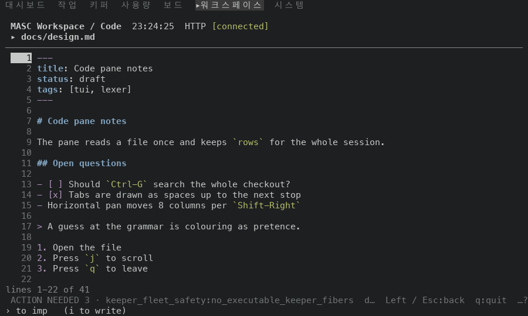
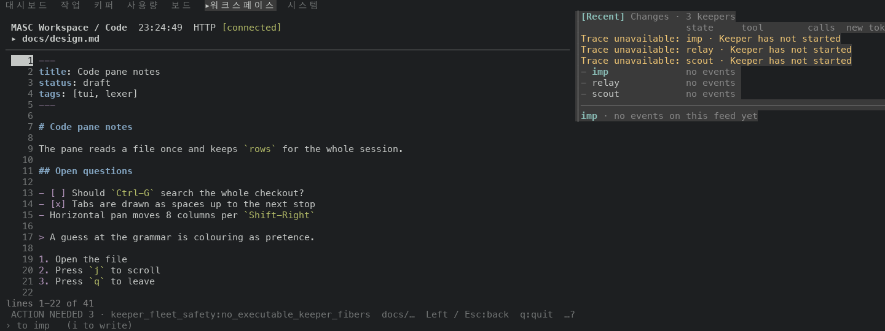
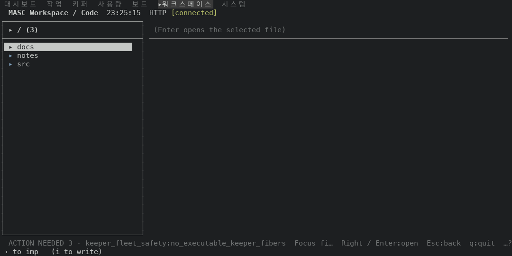
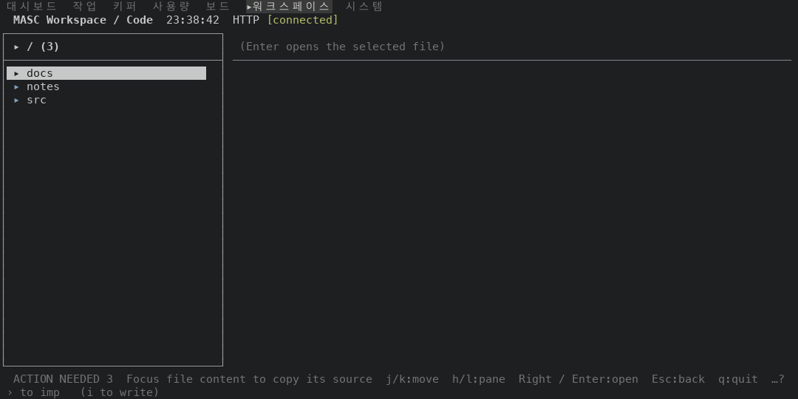

# The footer keeps the outcome of the last key beside an ACTION NEEDED notice

PR #49421. The Code pane's footer drew the outcome of a key (copy done, copy refused) in the cells left after every standing notice had its whole text. With `ACTION NEEDED 3 · keeper_fleet_safety:no_executable_keeper_fibers` on the row (the notice is 65 cells), the outcome of the copy key drew as `d…` at 100 columns while the reason kept every cell. The outcome stays for 12 seconds; the notice is on the row every frame. An outcome that does not fit whole beside the full notice now gets the room the reason takes: the notice steps down to `ACTION NEEDED 3`, as it already does where the keys need the room.

Before is the proof build of `6415b78c514`, the base of this PR (run 42229365992, masc-tui sha256 `bda390a9…a039`). After is the proof build of the PR head `72920a7a2fb` (run 42233478348, masc-tui sha256 `88fe44ab…f86e`). Between the two source trees the files under `bin/`, `lib/` and `test/` that differ are `bin/masc_tui_footer.ml`. The evidence commit that carries this README comes after the head and changes only files under `docs/evidence/`.

## The fixture

A throwaway workspace with `docs/design.md` (662 bytes). The server reports one operator action (`ACTION NEEDED 3`, first reason `keeper_fleet_safety:no_executable_keeper_fibers`), which is what puts the notice on the row. The copy key writes to the system clipboard, so the capture puts a stand-in `pbcopy` first on the TUI's PATH; it counts the bytes it is given and touches nothing. Frames are the Code screen at six sizes. The widest footer row drawn at 80, 100, 120, 140, 160 and 200 columns, margin included, is 80, 100, 120, 140, 104 and 144 cells.

## What the footer draws

Columns count the cells of the outcome that are on screen, out of the whole outcome. `reason` is the notice with its reason, `count` is `ACTION NEEDED 3` alone.

### copy

`docs/design.md` is opened (`Right`, `Enter`) and its source is copied (`y`). This is the longer outcome. The whole outcome is `docs/design.md source (662 bytes) copied with pbcopy` (52 cells).

| width | notice before | outcome before | notice after | outcome after |
|---|---|---|---|---|
| 80x24 | count | 32 of 52 cells | count | 32 of 52 cells |
| 100x30 | reason | 2 of 52 cells | count | 52 of 52 cells |
| 120x30 | reason | 22 of 52 cells | count | 52 of 52 cells |
| 140x30 | reason | 42 of 52 cells | count | 52 of 52 cells |
| 160x30 | reason | 6 of 52 cells | count | 52 of 52 cells |
| 200x30 | reason | 46 of 52 cells | count | 52 of 52 cells |

before:

```
80x24  ACTION NEEDED 3  docs/design.md source (662 byte…  Left / Esc:back  q:quit  …?
100x30 ACTION NEEDED 3 · keeper_fleet_safety:no_executable_keeper_fibers  d…  Left / Esc:back  q:quit  …?
120x30 ACTION NEEDED 3 · keeper_fleet_safety:no_executable_keeper_fibers  docs/design.md source…  Left / Esc:back  q:quit  …?
140x30 ACTION NEEDED 3 · keeper_fleet_safety:no_executable_keeper_fibers  docs/design.md source (662 bytes) copied …  Left / Esc:back  q:quit  …?
160x30 ACTION NEEDED 3 · keeper_fleet_safety:no_executable_keeper_fibers  docs/…  Left / Esc:back  q:quit  …?
200x30 ACTION NEEDED 3 · keeper_fleet_safety:no_executable_keeper_fibers  docs/design.md source (662 bytes) copied with…  Left / Esc:back  q:quit  …?
```

after:

```
80x24  ACTION NEEDED 3  docs/design.md source (662 byte…  Left / Esc:back  q:quit  …?
100x30 ACTION NEEDED 3  docs/design.md source (662 bytes) copied with pbcopy  Left / Esc:back  q:quit  …?
120x30 ACTION NEEDED 3  docs/design.md source (662 bytes) copied with pbcopy  j/k:scroll  Left / Esc:back  q:quit  …?
140x30 ACTION NEEDED 3  docs/design.md source (662 bytes) copied with pbcopy  j/k:scroll  h/l:pane  Left / Esc:back  q:quit  …?
160x30 ACTION NEEDED 3  docs/design.md source (662 bytes) copied with pbcopy  Left / Esc:back  q:quit  …?
200x30 ACTION NEEDED 3  docs/design.md source (662 bytes) copied with pbcopy  j/k:scroll  h/l:pane  Left / Esc:back  q:quit  …?
```

### refuse

`y` is pressed from the tree pane with no file open, and the pane answers with a refusal. This is the shorter outcome. The whole outcome is `Focus file content to copy its source` (37 cells).

| width | notice before | outcome before | notice after | outcome after |
|---|---|---|---|---|
| 80x24 | count | 19 of 37 cells | count | 19 of 37 cells |
| 100x30 | count | 37 of 37 cells | count | 37 of 37 cells |
| 120x30 | reason | 9 of 37 cells | count | 37 of 37 cells |
| 140x30 | reason | 29 of 37 cells | count | 37 of 37 cells |
| 160x30 | count | 37 of 37 cells | count | 37 of 37 cells |
| 200x30 | reason | 33 of 37 cells | count | 37 of 37 cells |

before:

```
80x24  ACTION NEEDED 3  Focus file content…  Right / Enter:open  Esc:back  q:quit  …?
100x30 ACTION NEEDED 3  Focus file content to copy its source  Right / Enter:open  Esc:back  q:quit  …?
120x30 ACTION NEEDED 3 · keeper_fleet_safety:no_executable_keeper_fibers  Focus fi…  Right / Enter:open  Esc:back  q:quit  …?
140x30 ACTION NEEDED 3 · keeper_fleet_safety:no_executable_keeper_fibers  Focus file content to copy i…  Right / Enter:open  Esc:back  q:quit  …?
160x30 ACTION NEEDED 3  Focus file content to copy its source  Right / Enter:open  Esc:back  q:quit  …?
200x30 ACTION NEEDED 3 · keeper_fleet_safety:no_executable_keeper_fibers  Focus file content to copy its s…  Right / Enter:open  Esc:back  q:quit  …?
```

after:

```
80x24  ACTION NEEDED 3  Focus file content…  Right / Enter:open  Esc:back  q:quit  …?
100x30 ACTION NEEDED 3  Focus file content to copy its source  Right / Enter:open  Esc:back  q:quit  …?
120x30 ACTION NEEDED 3  Focus file content to copy its source  j/k:move  h/l:pane  Right / Enter:open  Esc:back  q:quit  …?
140x30 ACTION NEEDED 3  Focus file content to copy its source  j/k:move  h/l:pane  PgUp/PgDn:page  Right / Enter:open  Esc:back  q:quit  …?
160x30 ACTION NEEDED 3  Focus file content to copy its source  Right / Enter:open  Esc:back  q:quit  …?
200x30 ACTION NEEDED 3  Focus file content to copy its source  j/k:move  h/l:pane  PgUp/PgDn:page  Right / Enter:open  Esc:back  q:quit  …?
```

The stand-in `pbcopy` was handed 662, 662, 662, 662, 662, 662 bytes in the copy runs of both builds (one run per size) and nothing in the refusal runs: the key does the same thing, only its outcome row differs.

## Frames

| frame | before | after |
|---|---|---|
| copy 100x30 |  |  |
| copy 160x30 |  |  |
| refuse 120x30 |  |  |

## Rows without an outcome are unchanged

24 frames of the same runs hold no outcome: the start of both flows, and the copy flow after `Right` and after `Enter` (6 sizes each). Their `.ansi` (clock masked) is identical before and after in all 24, so a notice with no outcome beside it keeps its reason.

## Not shown

- Only the operator action notice has a shorter text (`shorter = [ notice ]` in `bin/masc_tui_footer.ml`). The other notices that lead the row (armed key, running action, workspace and build conflicts) have none and keep their text beside an outcome as before.
- An outcome that fits whole beside the full notice is drawn as before. No captured size has one: the copy outcome is 52 cells and the refusal 37 cells, and the notice takes 65 cells before any key hint.
- At 80x24 the notice is already `ACTION NEEDED 3` before the change, so the outcome gets no more room: the copy outcome stays cut at 32 of 52 cells there. The keys that cannot be dropped take the rest of the row.
- No test of the footer text was added (`docs/constitution.xml` 354-355). Four of the five footer suites (`test_tui_footer_notice_forms`, `test_tui_action_notice`, `test_tui_footer_detail_state`, `test_tui_nav_trace`) pass on the PR head. The fifth, `test_tui_footer_status_items`, fails in its test 4 on main `6415b78c514` as well as on this branch, in a case with no notice and no outcome (issue #49427).
