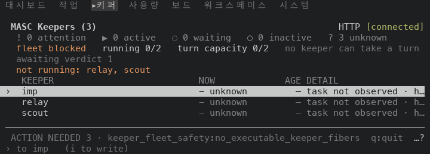
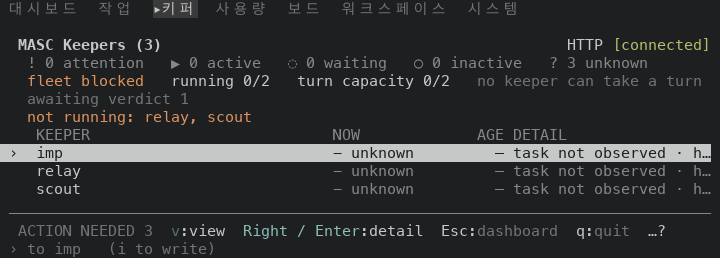
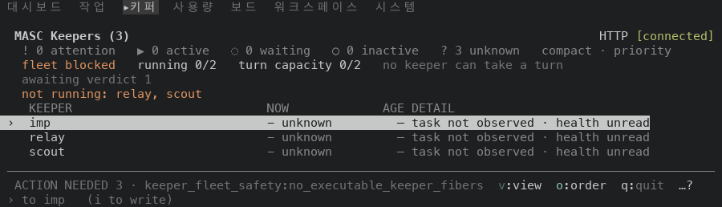
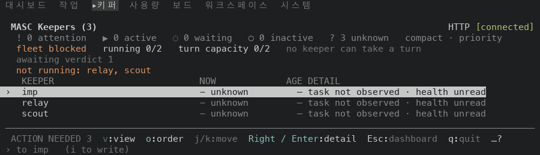

# TUI Keepers list footer: Right / Enter and Esc (#48962)

Scope: layer 9 of stack #48922. `keeper_control_hints` in `bin/masc_tui_render_prim.ml`
builds the footer of the Keepers roster and of the Keeper detail. On the roster
(`offers_back = false`) it now yields `Right / Enter:detail` and `Esc:dashboard`
where it yielded `right/enter:detail` and no Esc. The detail footers
(`offers_back = true`) are untouched.

The key `Enter` opens a Keeper from the roster and `Esc` returns to the Dashboard,
and the key table of the surface names both (`Right / Enter` detail, `Esc` dashboard).
The footer fitter keeps Esc, q, Enter and `y / n` whenever it cuts a row
(`never_dropped_keys` in `bin/masc_tui_footer.ml`), and it compares the key text
case by case. The roster wrote its key as `right/enter`, which holds no `Enter`, so
the fitter dropped it with the other unpinned hints, and the roster listed no Esc
item for it to keep. The audit of 2026-09-29 names the lowercase spelling (TU-F50 in
`docs/audits/2026-09-29-week-audit-findings.md`).

## Source

Both sides are the `masc-tui` and `masc` binaries that the native TUI proof workflow
built on a macOS arm64 runner. Each artifact carries a `receipt.json` whose `sha256`
and `server_sha256` match the files that were run, and `masc-tui --build-commit`
prints the source commit below.

| Side | Source commit | Proof run | `masc-tui` sha256 | `masc` sha256 |
| --- | --- | --- | --- | --- |
| Before (layer 7, first commit) | `2e55a84ef5ece33a993ed7f2d054b85cc0de009c` | 42095367342 | `f13e6cf6997157938dfe22a0ad7c535098137bd623e6ddb0b3542ed54f6cf0fd` | `996faca8e8cafddf81fd7c1d2062148eba859727d9a908a4934ca4af68e6cec2` |
| After (layer 9, first commit) | `66d989fbbaac19b2e0401796f9d62f1d5bf012e7` | 42108015985 | `77af31fcd73a389ca52cbd2fe6994a016c2e464f474c968d0c472232d133d38a` | `ad61f45f6651e6789476a7a8e2d550a0bb98abedaeddf5f38235d05d6733102e` |

The first commit of layer 9 is the code change and the second commit adds this
document, the images and a changelog fragment. Layers 7 and 8 work the same way. Files
under `bin/` and `lib/` that differ between the two source commits (`git diff
--name-only`): `bin/masc_tui_keys.ml`, `bin/masc_tui_render_prim.ml`. Of these, layer 8 changed `footer_hints_approvals`
in `bin/masc_tui_keys.ml`, which only the Approvals footers call, so on the Keepers list
screen the two builds differ by layer 9 alone.

## Environment

The same as in `../2026-11-06-tui-ux-stack-48922/README.md`: one isolated workspace per
capture, every process under `env -i`, the fixture server started from the same
artifact as the TUI, tmux at a fixed size, a new TUI process per capture. Each capture
opens the command palette with `:`, types `go Keepers`, presses Enter and settles for
five seconds. The PNGs are drawn from `tmux capture-pane -e -p` captures (9x18 px per
cell) and keep the eleven top rows and the three bottom rows of the screen.

The fixture holds three Keepers (`imp`, `relay`, `scout`) and three pending operator
actions, which is the `ACTION NEEDED 3` at the left of every footer.

## Observed results

### 1. The footer row at five sizes

| Size | Build | Footer row | Notice | Right / Enter | Esc |
| --- | --- | --- | --- | --- | --- |
| 60x24 | before | `ACTION NEEDED 3  v:view  o:order  j/k:move  q:quit  …?` | count | no | no |
| 60x24 | after | `v:view  Right / Enter:detail  Esc:dashboard  q:quit  …?` | none | yes | yes |
| 80x24 | before | `ACTION NEEDED 3 · keeper_fleet_safety:no_executable_keeper_fibers  q:quit  …?` | reason | no | no |
| 80x24 | after | `ACTION NEEDED 3  v:view  Right / Enter:detail  Esc:dashboard  q:quit  …?` | count | yes | yes |
| 100x30 | before | `ACTION NEEDED 3 · keeper_fleet_safety:no_executable_keeper_fibers  v:view  o:order  q:quit  …?` | reason | no | no |
| 100x30 | after | `ACTION NEEDED 3  v:view  o:order  j/k:move  Right / Enter:detail  Esc:dashboard  q:quit  …?` | count | yes | yes |
| 120x35 | before | `ACTION NEEDED 3 · keeper_fleet_safety:no_executable_keeper_fibers  v:view  o:order  j/k:move  p:boot  q:quit  …?` | reason | no | no |
| 120x35 | after | `ACTION NEEDED 3 · keeper_fleet_safety:no_executable_keeper_fibers  Right / Enter:detail  Esc:dashboard  q:quit  …?` | reason | yes | yes |
| 200x40 | before | `ACTION NEEDED 3 · keeper_fleet_safety:no_executable_keeper_fibers  v:view  o:order  j/k:move  p:boot  w:wake  s:shutdown  x:delete  q:quit  …?` | reason | no | no |
| 200x40 | after | `ACTION NEEDED 3 · keeper_fleet_safety:no_executable_keeper_fibers  v:view  o:order  j/k:move  Right / Enter:detail  Esc:dashboard  q:quit  …?` | reason | yes | yes |

- Before the change the row names `Right / Enter` at 0 of 5 sizes and Esc at 0 of 5. After it
  names `Right / Enter` at 5 of 5 and Esc at 5 of 5.
- The notice changes shape at: 60x24 count to none; 80x24 reason to count; 100x30 reason to count. The fitter does this by its own rule: a notice
  that cannot be drawn beside the keys that cannot be dropped and the cut marker is drawn in a
  shorter text, or not at all (`without_a_blocking_conflict` in `bin/masc_tui_footer.ml`), and
  `Right / Enter` and Esc are now among those keys.
  At 60x24 the short notice (15 cells), `Right / Enter:detail  Esc:dashboard  q:quit` (43 cells) and the cut marker `…?` need 66 cells with their separators, and the row has 60.
  At 80x24 the long notice (65 cells), `Right / Enter:detail  Esc:dashboard  q:quit` (43 cells) and the cut marker `…?` need 116 cells with their separators, and the row has 80.
  At 100x30 the long notice (65 cells), `Right / Enter:detail  Esc:dashboard  q:quit` (43 cells) and the cut marker `…?` need 116 cells with their separators, and the row has 100.
- Hints that left the row because `Right / Enter` and Esc took their cells: 60x24 `o:order`, `j/k:move`; 120x35 `v:view`, `o:order`, `j/k:move`, `p:boot`; 200x40 `p:boot`, `w:wake`, `s:shutdown`, `x:delete`. Hints that
  entered the row: 80x24 `v:view`; 100x30 `j/k:move`. The row ends with `…?` where it cut hints, and `?` opens the key
  sheet.

### 2. 80x24

Before, the row reads the notice and `q:quit`:

After:

### 3. 100x30

Before:

After:

### 4. The keys do what the footer says

On the new build at 100x30, from the roster: Esc leaves for `MASC Dashboard  [base]  HTTP [connected]`. Enter on the
selected Keeper opens `Keepers ▸ imp  ▸Info  Items  Sandbox  Settings  Secrets  GitHub  Identity  Channels  3›`.

## Checks

- `ocamlfind ocamlc -stop-after typing` on `bin/masc_tui_render_prim.mli` and `.ml`
  against the compiled interfaces in the build directory of the `main` checkout: exit
  code 0.
- No test or document change. No test reads the Keepers footer text, and
  `docs/guides/TUI-KEYS.md` is generated from the key table, which this layer does
  not touch.

## Not shown

- The Keeper detail footers, which keep `Left / Esc:back` and are built by the same
  function with `offers_back = true`.
- A roster whose Keepers are running, so that the lifecycle hints (`p`, `w`, `s`, `x`)
  take other labels. The fixture's three Keepers are not running.
- Widths other than the five listed, and mouse input.
