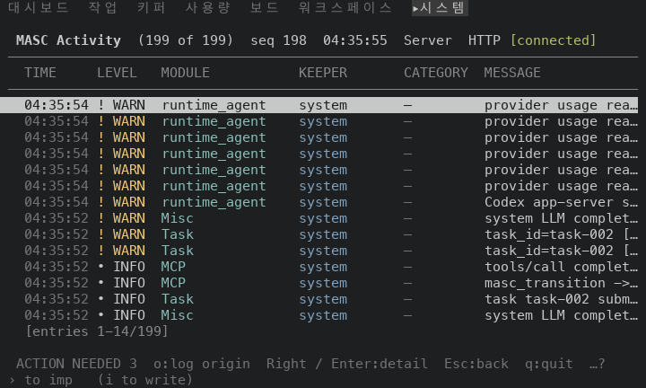
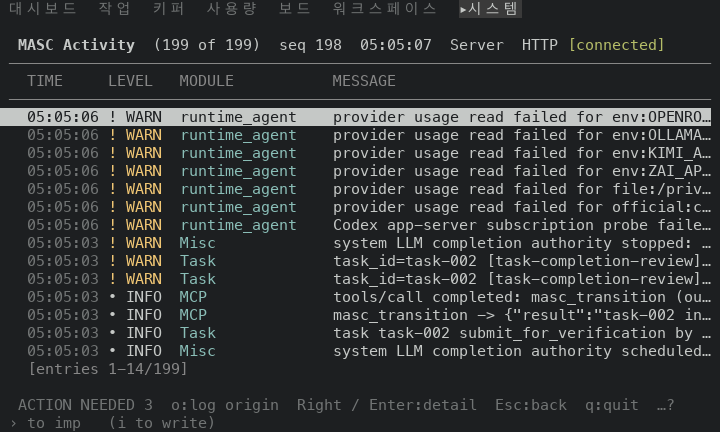
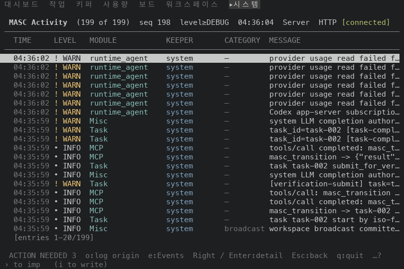
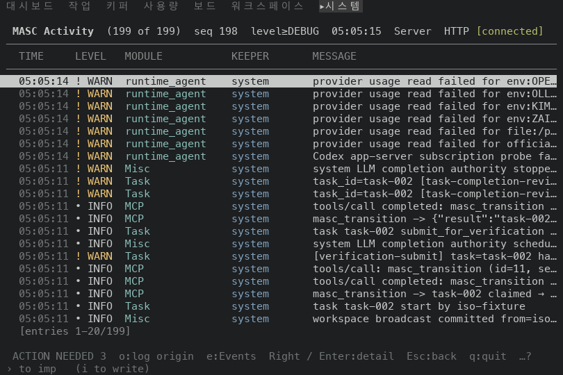
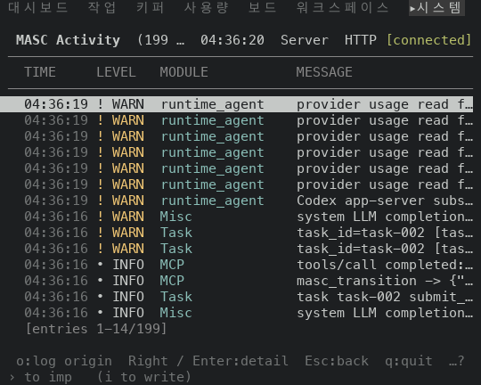
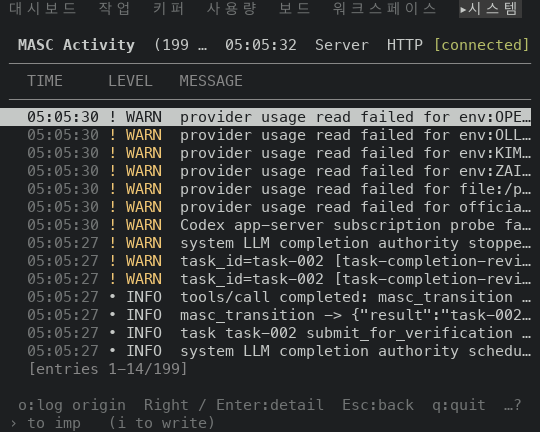

# TUI System logs: message floor (#48948)

Scope: layer 7 of stack #48922. One constant changes, `system_log_minimum_message_width`
in `bin/masc_tui_render_schedule.ml`, from 12 to 30.

The System logs table (Activity, Logs) gives its MESSAGE column the cells that the
other columns leave. When the row does not fit with MESSAGE at its floor, the table
drops CATEGORY first, then KEEPER, then MODULE. With the floor at 12 the table kept
all six columns at 80 columns and left MESSAGE 19 cells. With the floor at 30 it
drops CATEGORY and KEEPER at 80 columns and MESSAGE gets 42 cells.

## Source

Both sides are the `masc-tui` and `masc` binaries that the native TUI proof workflow
built on a macOS arm64 runner. Each artifact carries a `receipt.json` whose `sha256`
and `server_sha256` match the files that were run, and `masc-tui --build-commit`
prints the source commit below.

| Side | Source commit | Proof run | `masc-tui` sha256 | `masc` sha256 |
| --- | --- | --- | --- | --- |
| Before (layer 2 head) | `6cf1d47ccb88fd42a095afb80f57fbaa9748b41f` | 42083117821 | `44436808ba91c6bdfaa9d8fa62dd2cb427ebbd7ac132b19aeccf3064050cb60d` | `c06893f8792dac07dddc20a9f95e1f57fba9c0206caa3dc27ffaf3cf1b36db83` |
| After (layer 7, first commit) | `2e55a84ef5ece33a993ed7f2d054b85cc0de009c` | 42095367342 | `f13e6cf6997157938dfe22a0ad7c535098137bd623e6ddb0b3542ed54f6cf0fd` | `996faca8e8cafddf81fd7c1d2062148eba859727d9a908a4934ca4af68e6cec2` |

Layers 3 to 6 change tests, documents and changelog fragments only:
`git diff --name-only 6cf1d47ccb8 64ea51c76ce` lists files under `changelog.d/`,
`docs/` and `test/` and nothing under `bin/` or `lib/`. The layer 2 build therefore
runs the program of layers 1 to 6, and the two sides differ by layer 7 alone. Layer 7
changes `bin/masc_tui_render_schedule.ml` and nothing else. The head of the pull
request has one commit more than the built source: this document, its images and the
changelog fragment.

## Environment

The same as in `../2026-11-06-tui-ux-stack-48922/README.md`: one isolated workspace
per capture, every process under `env -i`, the fixture server started from the same
artifact as the TUI, tmux at a fixed size, a new TUI process per capture. Each capture
opens the command palette with `:`, types `go Logs`, presses Enter and settles for five
seconds. The PNGs are drawn from `tmux capture-pane -e -p` captures (9x18 px per cell)
and show the whole screen.

The Logs screen lists the log of the fixture's own server: 199 entries, 14 rows visible at
24 rows and 20 at 30. Six of them read `provider usage read failed for <source> ...`, one
per provider usage source, with a different source in each. The others are task, MCP and
LLM completion lines. Every KEEPER cell reads `system`. Every CATEGORY cell reads `—`
except one at 30 rows, which reads `broadcast` (row 20 of 20, so it is not
among the 14 rows visible at 24 rows).

## Observed results

### 1. What the table keeps at each width

"MESSAGE cells" is the widest MESSAGE cell among the visible rows, counted from the
column start. "Distinct rows" counts the different MESSAGE cell texts among the
visible rows, so a table that cuts six different messages to the same text
counts them once.

| Size | Build | Columns dropped | MESSAGE cells | Distinct rows |
| --- | --- | --- | --- | --- |
| 100x30 | before | none | 39 | 18 of 20 |
| 100x30 | after | none | 39 | 18 of 20 |
| 92x30 | before | none | 31 | 12 of 20 |
| 92x30 | after | none | 31 | 12 of 20 |
| 91x30 | before | none | 30 | 12 of 20 |
| 91x30 | after | none | 30 | 12 of 20 |
| 90x30 | before | none | 29 | 12 of 20 |
| 90x30 | after | CATEGORY | 39 | 18 of 20 |
| 80x24 | before | none | 19 | 7 of 14 |
| 80x24 | after | KEEPER, CATEGORY | 42 | 13 of 14 |
| 60x24 | before | KEEPER, CATEGORY | 22 | 7 of 14 |
| 60x24 | after | MODULE, KEEPER, CATEGORY | 39 | 13 of 14 |
| 52x24 | before | KEEPER, CATEGORY | 14 | 7 of 14 |
| 52x24 | after | MODULE, KEEPER, CATEGORY | 31 | 7 of 14 |
| 51x24 | before | KEEPER, CATEGORY | 13 | 7 of 14 |
| 51x24 | after | MODULE, KEEPER, CATEGORY | 30 | 8 of 14 |
| 50x24 | before | KEEPER, CATEGORY | 12 | 7 of 14 |
| 50x24 | after | MODULE, KEEPER, CATEGORY | 29 | 7 of 14 |
| 40x24 | before | MODULE, KEEPER, CATEGORY | 19 | 7 of 14 |
| 40x24 | after | MODULE, KEEPER, CATEGORY | 19 | 7 of 14 |

- 100x30: the two captures are line for line the same once the digits of the clock
  and of the sequence number are ignored, so this document carries no image of it.
- 91 and 92 columns: both builds draw all six columns with MESSAGE at 30 and 31
  cells, so the floor does not bind. The six `provider usage read failed for` rows
  still read the same there (12 of 20 distinct). The text that tells them apart starts after
  `provider usage read failed for `, which is 31 cells. Of the captured widths from 91
  columns up, 100 is the first that shows enough of it (18 of 20).
- 90 columns and below: the new build drops CATEGORY at 90 columns, CATEGORY and
  KEEPER at 80, and CATEGORY, KEEPER and MODULE from 60 down to 40. MESSAGE gets
  39, 42 and 39 cells at 90x30, 80x24 and 60x24 where it had 29, 19 and 22. The rows
  that read the same read differently: 13 of 14 distinct at 80x24 (before 7), 18 of 20 at
  90x30 (before 12), 13 of 14 at 60x24 (before 7).
- 50 columns: TIME, LEVEL and a 30-cell MESSAGE need more than the frame holds, so the
  row runs past the frame and the frame cuts it with `…`. MESSAGE shows 29 cells where
  the old build showed 12 next to a MODULE column. At 40 columns both builds draw the same
  three columns with 19 cells.

### 2. 80x24

Before, the six rows that start `provider usage read failed for` read `provider usage rea…`:

After:

### 3. 90x30

Before:

After:

### 4. 60x24

Before:

After:

### 5. What the dropped columns cost

Enter on a row opens the log detail, which lists Level, Message, Timestamp, Category,
Keeper, Turn, Module, Source, Origin and Sequence. At 80x24 on the new build the
detail of the first row shows all of them, so a column that the table drops stays one
key away.

What the table loses depends on the log. In the fixture every KEEPER cell is `system`,
so the dropped KEEPER column says nothing. One row at 30 rows has CATEGORY
`broadcast`, and the 90x30 capture of the new build does not show it in the table. A
workspace whose rows carry different Keepers, modules and categories loses more.

## Checks

- `ocamlfind ocamlc -stop-after typing` on `bin/masc_tui_render_schedule.ml` against the
  compiled interfaces in the build directory of the `main` checkout: exit code 0.
- The `type-check` check of the pull request passes on the first commit (run 42095304256).
- No test changes. The constitution does not test the wording, layout or row order of
  a TUI screen.

## Not shown

- Other tables carry their own floors for the column that holds a sentence: the
  Board title keeps 30, the Goals title, Harness reason, Change summary and Fusion run
  keep 12, the Work and Verification titles keep 16. They were not captured. Issue
  #48951 asks whether they should share one value.
- A workspace with several Keepers, categories or modules in the log.
- Widths between those listed (93 to 99, 81 to 89, 61 to 79, 41 to 49).
- Mouse input and the other keys of the Logs screen.
