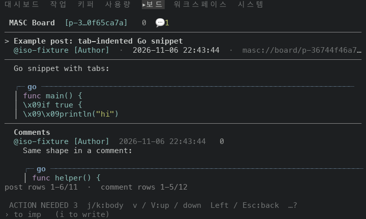
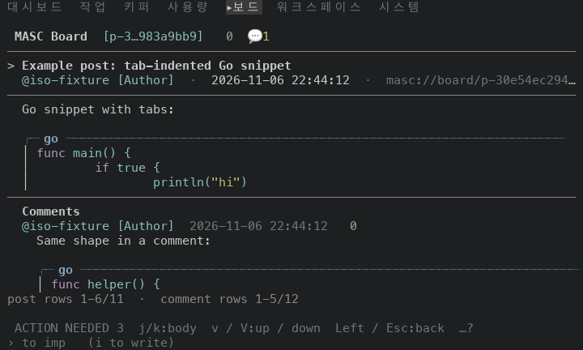
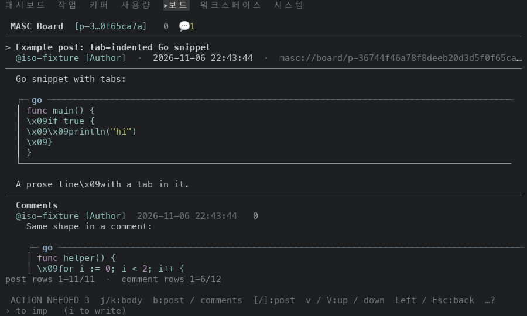
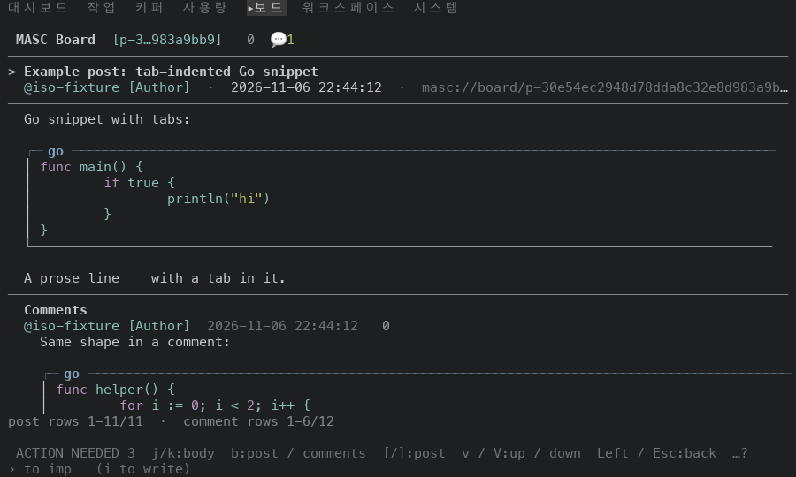
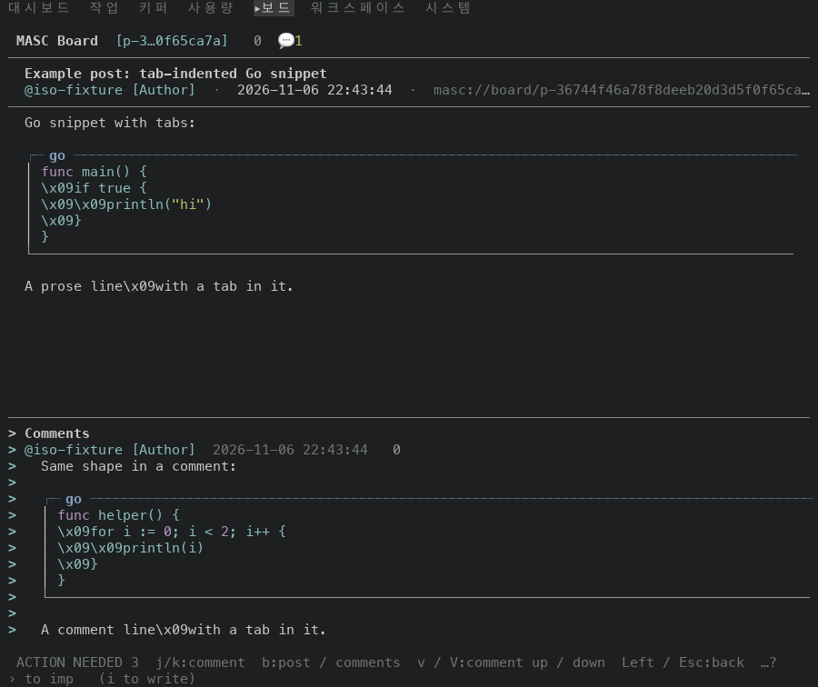
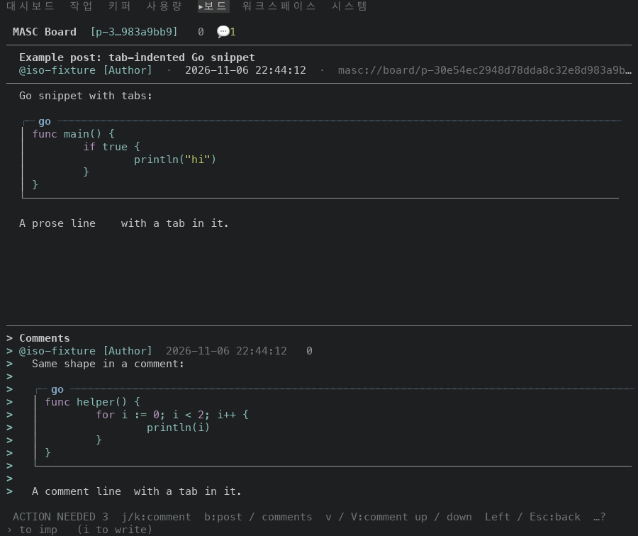

# A tab in a Markdown body is drawn as spaces up to the next stop

PR #49381, on top of #49380. A Board post, a Board comment, a resource document and other bodies handed to a Markdown renderer go through the terminal sanitizer line by line before the renderer reads them, and the sanitizer writes a tab as the four characters `\x09`. Inside a code fence that is the author's own indentation. A line that holds a tab is now expanded to the next stop of 8 cells first (the stops the Code pane uses); a line without a tab goes to the sanitizer as it was; a plain body (approval details and the like) keeps the escape.

Before is the proof build of the PR #49380 head `ab08ffb6eb0`, the base of this PR (run 42225808192, masc-tui sha256 `bea423a2…7316`). After is the proof build of the PR head `bfc0b413c68` (run 42225396707, masc-tui sha256 `e0909871…2018`). Between the two source trees the files under `bin/`, `lib/` and `test/` that differ are `bin/masc_tui_message_layout.ml`, `bin/masc_tui_message_layout.mli`, `bin/masc_tui_resource_document.ml`, `test/test_tui_message_layout.ml`. The evidence commit that carries this README comes after the head and changes only files under `docs/evidence/`.

## The fixture

A throwaway workspace the capture script seeds through the MCP tools: one post with a Go snippet written the way a model writes it (tab-indented inside a fence, plus a tab in a prose line), and one comment on it with the same shape. Keys: open Board from the palette, `j` (select the post), `Enter` (open it), `b` (focus the comments).

## Rows

Post code fence, rows as drawn at 100x42:

| row | before | after |
|---|---|---|
| 1 | `func main() {` | `func main() {` |
| 2 | `\x09if true {` | 8 spaces + `if true {` |
| 3 | `\x09\x09println("hi")` | 16 spaces + `println("hi")` |
| 4 | `\x09}` | 8 spaces + `}` |
| 5 | `}` | `}` |

Comment code fence, rows as drawn at 100x42:

| row | before | after |
|---|---|---|
| 1 | `func helper() {` | `func helper() {` |
| 2 | `\x09for i := 0; i < 2; i++ {` | 8 spaces + `for i := 0; i < 2; i++ {` |
| 3 | `\x09\x09println(i)` | 16 spaces + `println(i)` |
| 4 | `\x09}` | 8 spaces + `}` |
| 5 | `}` | `}` |

Prose lines with a tab in the middle:

| line | before | after |
|---|---|---|
| post | `A prose line\x09with a tab in it.` | `A prose line    with a tab in it.` |
| comment | `A comment line\x09with a tab in it.` | `A comment line  with a tab in it.` |

The literal `\x09` count on the screen, from the captured frames:

| frame | size | `\x09` before | `\x09` after |
|---|---|---|---|
| k2-enter | 80x24 | 3 | 0 |
| k3-b | 80x24 | 3 | 0 |
| k2-enter | 100x30 | 6 | 0 |
| k3-b | 100x30 | 6 | 0 |
| k2-enter | 100x42 | 10 | 0 |
| k3-b | 100x42 | 10 | 0 |

## Frames

Each pair is the same keys on the same fixture at the same size; the clock, the post id and the date differ per run.

| frame | before | after |
|---|---|---|
| post, 80x24 |  |  |
| post, 100x30 |  |  |
| post and comment, 100x42 |  |  |

All 12 frames of the flow (3 sizes x 4 frames, `.ansi`, with the clock, post id and date masked) were compared. 6 differ: k2-enter 80x24, k3-b 80x24, k2-enter 100x30, k3-b 100x30, k2-enter 100x42, k3-b 100x42. The Board list frames (`k0-start`, `k1-j`) are the same in both builds. In each differing frame every row that differs is a row that held a literal `\x09` before (2 at 80x24, 5 at 100x30, 8 at 100x42 rows, the same in both frames).

## How often this happens

Counted on 2026-11-06 from this workspace's own data (the latest record of each id in `.masc/board_posts.jsonl` and `.masc/board_comments.jsonl`; `git ls-files '*.md'`):

| source | records | with a tab | with a tab inside a fence |
|---|---|---|---|
| Board posts | 8339 | 0 | 0 |
| Board comments | 34281 | 7 | 2 |
| tracked `.md` files | 3311 | 1 | 0 |

So the symptom is rare here. The change is small and keeps the two places that sanitize a document line by line (`wrap_body` and the resource document that draws diagrams) on one function.

## Not shown

- The Keeper chat does not take this path: `Keeper_chat.terminal_safe_text` turns a tab into one space (not `\x09`), so a snippet in chat loses its indentation depth instead. This PR does not change that.
- The resource document that draws diagrams calls the same `escape_document`, but no frame of it was captured.
- A tab at the start of a line outside a fence is now 8 spaces, which the Markdown renderer reads the way it reads 8 typed spaces; before it read the four characters `\x09`. No frame of that was captured.
- A tab that follows a raw escape sequence counts the sequence as zero cells (as `display_width` does) before the sanitizer writes it out as visible text, so that tab lands off its stop.
