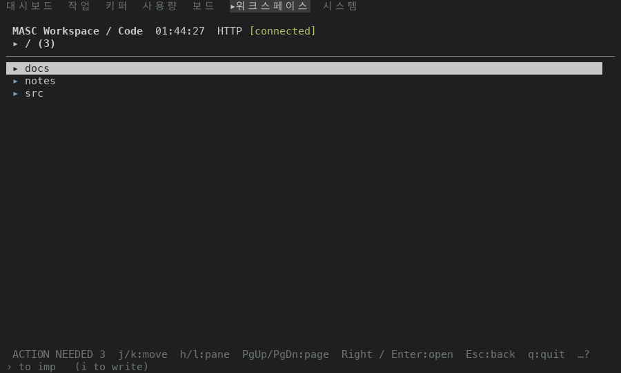

# The navigation trace compares frames without the header clock

PR #49445. `MASC_TUI_NAV_TRACE` (RFC-0485) writes a `key_unchanged` line when the first frame drawn after a key is the same as the frame before it. The presenter calls a frame the same only when every byte of it is, and the header holds a clock (`HH:MM:SS`) that moves once a second. A key that did nothing but was pressed after the second turned drew a repaint of the header row and left no line. The trace exists so a footer that announces a key the screen does not act on shows up without a person pressing every key on every screen; with most presses unseen it did not.

`Masc_tui_nav_trace_log.note_screen` now hands the log the rows and the cursor of the frame about to be noted. `note_frame` compares them with the frame before once every `HH:MM:SS` shape is set to zero, and a differential repaint of rows that match counts as unchanged. A repaint of no rows (only the cursor moved) and a whole-screen repaint keep their result.

Before is the proof build of `6415b78c514`, the base of this PR (run 42229365992, masc-tui sha256 `bda390a9…a039`). After is the proof build of the PR head `e9468d1f78d` (run 42252633913, masc-tui sha256 `5ff4094a…44a3`). Between the two source trees the files under `bin/`, `lib/`, `test/` and `docs/rfc/` that differ are `bin/masc_tui.ml`, `bin/masc_tui_nav_trace.ml`, `bin/masc_tui_nav_trace.mli`, `bin/masc_tui_nav_trace_log.ml`, `bin/masc_tui_nav_trace_log.mli`, `docs/rfc/RFC-0485-tui-writes-screens-opened-and-keys-that-changed-nothing-when-asked.md`, `test/test_tui_nav_trace.ml`, `test/test_tui_nav_trace_log.ml`. The evidence commit that carries this README comes after the head and changes only files under `docs/evidence/`.

## The runs

The Code screen of a throwaway workspace with no file open, the trace file on, one key pressed ten times with two seconds between presses. In the `dead-l` and `dead-h` runs the key does nothing: the screen after each of the 10 presses is the screen before any key (text and colours), clock set aside, in the before runs and in the after runs. In the `moving` run `j` and `k` move the selection bar of the file list between `docs` and `notes`, and the screen after each press differs from the one before it, in both builds.

| flow | presses | size | lines before | lines after |
|---|---|---|---|---|
| dead-l | `l` ten times | 100x30 | 4 of 10 | 10 of 10 |
| dead-h | `h` ten times | 160x30 | 3 of 10 | 10 of 10 |
| moving | `j` and `k` five times each, alternating | 100x30 | 0 of 10 | 0 of 10 |

The two runs of keys that do nothing: 7 of 20 presses left a line before, 20 of 20 after. The run of keys that move the cursor left no line in either build, so the change does not report a key that drew something.

Lines the after build wrote for `l`, the first three (the clock of the line is left out):

```
{"t":…,"kind":"key_unchanged","surface":"code","key":"l","advertised":true}
{"t":…,"kind":"key_unchanged","surface":"code","key":"l","advertised":true}
{"t":…,"kind":"key_unchanged","surface":"code","key":"l","advertised":true}
```

## The screens under test

The screen is the same before and after; only the trace differs.

| flow | the screen after the last press |
|---|---|
| dead-l (100x30) |  |
| moving (100x30) |  |

## Not shown

- A frame that changes every few hundred milliseconds for another reason (a spinner, an age counted in seconds) is still a new frame. Only text shaped like `HH:MM:SS` is set aside.
- That holds for any text of that shape, not only the header clock. A key whose only effect is to change another `HH:MM:SS` text (an elapsed-time counter, for one) leaves no line.
- A whole-screen repaint keeps its `Presented` result and leaves no line. The presenter draws the whole screen for the first frame, after a resize, after `invalidate`, and when `force_present` is set because input authority changed while the rows stayed the same (`Masc_tui_frame_presenter.present`).
- Cursor handling is covered by `test_tui_nav_trace_log`: a repaint that moved only the cursor, and one that moved the cursor and the clock together, leave no line. Run 42252635747 of `test.yml` on the PR head ran test_tui_nav_trace, test_tui_nav_trace_log: success.
