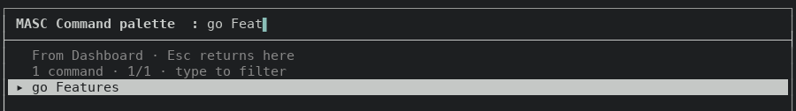
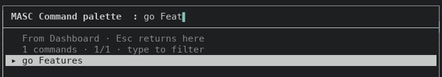
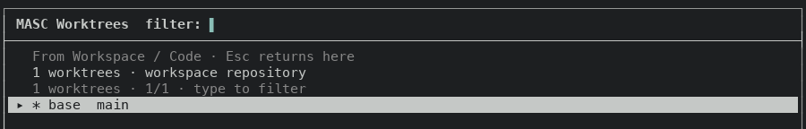
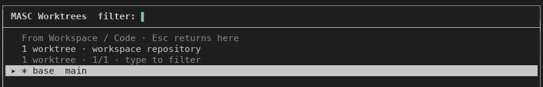
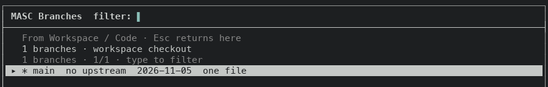
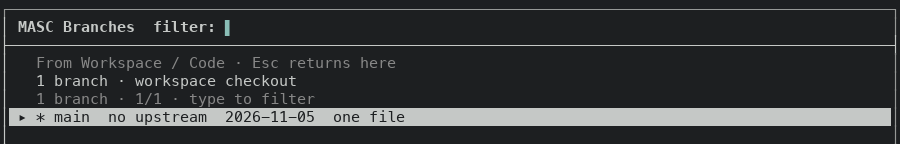
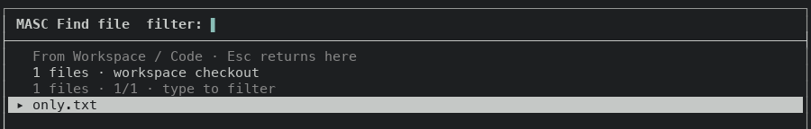
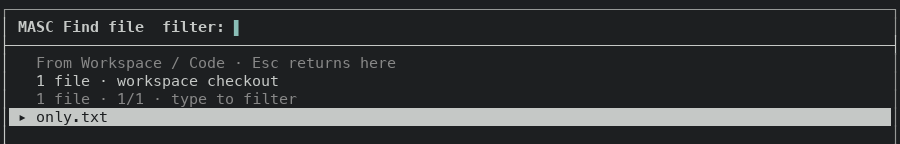

# The palette counts what it lists in the right number

PR #49000, layer 11 of stack #48922. The count line of the command palette and the Code finders wrote the noun as a plural at every count, so one match read `1 commands`.

Before is the proof build of layer 10 (`305643fcc9b`, run 42112833703). After is the proof build of this layer's code commit (`81c8b0509dc`, run 42124472214). Both ran against a fixture server. The finders need a checkout to list, so for those captures the fixture base path was a Git repository with one commit holding one file (`only.txt`).

## Command palette, 100x30

| Typed | Before | After |
| --- | --- | --- |
| (nothing typed) | `60 commands · 1/60 · type to filter` | `60 commands · 1/60 · type to filter` |
| `go Feat` | `1 commands · 1/1 · type to filter` | `1 command · 1/1 · type to filter` |
| `go Task` | `2 commands · 1/2 · type to filter` | `2 commands · 1/2 · type to filter` |
| `zzzz` | `0 commands · 0/0 · type to filter` + `No matching commands · Ctrl-U clears the filter` | `0 commands · 0/0 · type to filter` + `No matching commands · Ctrl-U clears the filter` |

A count of zero or two or more already read right; only one match changes.

## Code finders, 100x30, one entry each

Each finder draws the catalog note and then the count line, and both named the noun as a plural.

| Finder | Before | After |
| --- | --- | --- |
| Worktrees finder (`W` on Code) | `1 worktrees · workspace repository` and `1 worktrees · 1/1 · type to filter` | `1 worktree · workspace repository` and `1 worktree · 1/1 · type to filter` |
| Branches finder (`Ctrl-R` on Code) | `1 branches · workspace checkout` and `1 branches · 1/1 · type to filter` | `1 branch · workspace checkout` and `1 branch · 1/1 · type to filter` |
| File finder (`Ctrl-P` on Code) | `1 files · workspace checkout` and `1 files · 1/1 · type to filter` | `1 file · workspace checkout` and `1 file · 1/1 · type to filter` |

## Screens

Rows 1 to 7 of the palette with one match (`go Feat`) at both sizes, and rows 1 to 8 of each finder at 100x30.

## What the change is

`palette_noun` in `bin/masc_tui_render_overlays.ml` gives the singular and plural noun once for each of the six palette modes, in a match with no wildcard arm. `palette_count` writes the count through `Message_layout.count_noun`. The count line, the three catalog notes and the `names on line` title use it, and the empty-list line uses the plural.

The symbol chooser (`Palette_choice`) listed the names on the cursor's line but its count line said `commands`. Its row now says `name` or `names`. That screen needs a language server answer for a line with names, so it was not captured here.

## Not changed

- About 160 other format strings across `bin/` write `%d` and a plural noun. They were counted from the source, not measured at a count of one. Tracked in #49001.

- With an empty filter the finder's catalog note and its count line state the same count twice. They differ only once a filter narrows the list.

- The palette wording has no test, since the constitution keeps screen wording out of the tests. `count_noun`, which the wording now goes through, had no test in the tree, so `test/test_tui_message_layout.ml` gains one: for every count from 0 to 120 the noun is singular only at 1, with the default plural and with a given plural.

