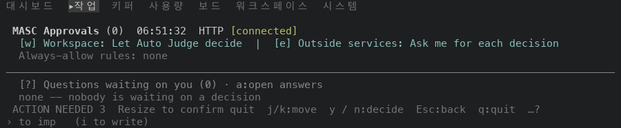
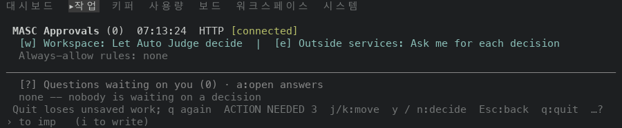
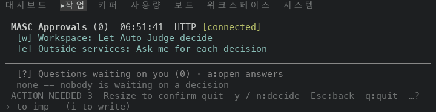
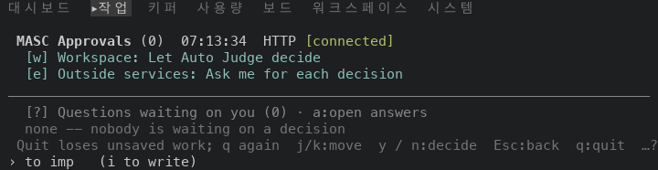
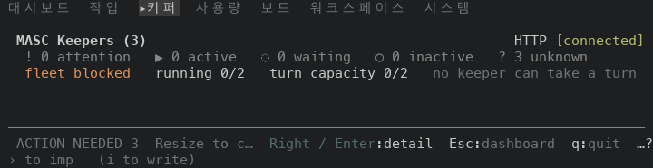
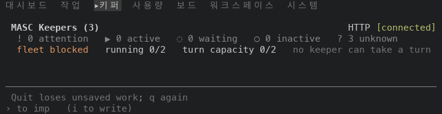

# TUI quit confirmation leads the footer row (#48970)

Scope: layer 10 of stack #48922, which closes #48966. `Masc_tui_footer.line` in
`bin/masc_tui_footer.ml` takes its `preferred_action` as a sum of two kinds, and
`footer_line` in `bin/masc_tui_render_prim.ml` passes the quit confirmation as the new kind.

The quit confirmation (`Quit loses unsaved work; q again`) went to the footer fitter as a
preferred action. The fitter drew it only where it fit whole beside the notice and the keys
that cannot be dropped, and otherwise drew the fallback `Resize to confirm quit`, cut to the
cells that were left. The second `q` confirms only when the whole prompt was drawn
(`last_visible_quit` in `bin/masc_tui.ml`), so on those destinations `q q` did not
quit.

An `Outcome` keeps that rule. A `Pending_question` is the one item on the row that the next
key can lose, so the fitter places it as `Leads_the_row` (the rank that a pending Keeper
action has, first in `conflict_order`), `Alone` on the row when it fits beside nothing, or
`Not_drawn`, where the fallback text stands. The press mark is applied only to a prompt that
is drawn.

## Source

Both sides are the `masc-tui` and `masc` binaries that the native TUI proof workflow built
on a macOS arm64 runner. Each artifact carries a `receipt.json` whose `sha256` and
`server_sha256` match the files that were run, and `masc-tui --build-commit` prints the source
commit below.

| Side | Source commit | Proof run | `masc-tui` sha256 | `masc` sha256 |
| --- | --- | --- | --- | --- |
| Before (layer 9, first commit) | `66d989fbbaac19b2e0401796f9d62f1d5bf012e7` | 42108015985 | `77af31fcd73a389ca52cbd2fe6994a016c2e464f474c968d0c472232d133d38a` | `ad61f45f6651e6789476a7a8e2d550a0bb98abedaeddf5f38235d05d6733102e` |
| After (layer 10, first commit) | `305643fcc9b3ce35ec81ec016ca97c3ac72a49da` | 42112833703 | `b1a6ac43de50f9433063d86cf95210732120d099515f000ef577313e4edef115` | `b8c3b7e0e69ffab55034249726c93b75afc7cd19189509d7761f6e4429966e26` |

The first commit of layer 10 is the code change and the test, and the second commit adds this
document, the images and a changelog fragment. Files under `bin/` and `lib/` that differ
between the two source commits (`git diff --name-only`): `bin/masc_tui_footer.ml`, `bin/masc_tui_render_prim.ml`.

The proof runs of layers 8, 9 and 10 (42102091255, 42108015985, 42112833703) end `failure`,
`failure` and `cancelled`. In all three the job `native-tui / macos-tui` fails in the step
`Verify candidate and ownership behavior` (#48260, a `/var` against `/private/var` path
test), and the next two steps still package and upload the artifact. In the run of this layer
the job `Source and config syntax` also ended `cancelled`. The receipt checks above are the
evidence that the two binaries are the ones the artifact holds.

## Environment

The same as in `../2026-11-06-tui-ux-stack-48922/README.md`: one isolated workspace per
capture, every process under `env -i`, the fixture server started from the same artifact as
the TUI, tmux at a fixed size. The fixture has three pending operator actions, which is the
`ACTION NEEDED 3` at the left of every footer.

The sweep opens each of 42 destinations through the command palette (`:`, `go <name>`, Enter)
in one TUI process, presses `q` once, waits until the screen stops changing (at most two
seconds) and keeps the last four rows. A row counts as a Resize notice when one of its items
is a prefix of `Resize to confirm quit`, with or without the cut mark.

## Observed results

### 1. The first q at five sizes

| Size | Build | Confirmation shown | Resize notice | Neither | Destinations |
| --- | --- | --- | --- | --- | --- |
| 60x24 | before | 17 | 16 | 9 | 42 |
| 60x24 | after | 37 | 0 | 5 | 42 |
| 80x24 | before | 18 | 19 | 5 | 42 |
| 80x24 | after | 37 | 0 | 5 | 42 |
| 100x30 | before | 24 | 13 | 5 | 42 |
| 100x30 | after | 37 | 0 | 5 | 42 |
| 120x35 | before | 19 | 11 | 12 | 42 |
| 120x35 | after | 37 | 0 | 5 | 42 |
| 200x40 | before | 25 | 12 | 5 | 42 |
| 200x40 | after | 37 | 0 | 5 | 42 |

- Destinations that show the confirmation after the change and did not before: 20 at 60x24, 19 at 80x24, 13 at 100x30, 18 at 120x35, 12 at 200x40. At 100x30 they are Task Review, Task Verdicts, Librarian history, HITL Auto Judge history, Board Attention history, Workspace Curator history, Verifier history, Candle Appraiser history, Artifacts / Resources, Tools, Changes, Approvals, Fusion.
- Destinations that showed it before and do not after: 60x24: none; 80x24: none; 100x30: none; 120x35: none; 200x40: none.
- Destinations that still do not show it after the change: 60x24: Collab, Play links, MSX, DOS, Plugins; 80x24: Collab, Play links, MSX, DOS, Plugins; 100x30: Collab, Play links, MSX, DOS, Plugins; 120x35: Collab, Play links, MSX, DOS, Plugins; 200x40: Collab, Play links, MSX, DOS, Plugins.

### 2. Where the confirmation is drawn after the change

| Size | Beside the other items | Alone in the footer row | In the slot above the footer |
| --- | --- | --- | --- |
| 60x24 | 1 | 19 | 17 |
| 80x24 | 9 | 11 | 17 |
| 100x30 | 18 | 2 | 17 |
| 120x35 | 20 | 0 | 17 |
| 200x40 | 20 | 0 | 17 |

The 17 destinations in the last column are the same at every size, before and after the
change. They draw the confirmation in a row above the footer, which this layer does not touch.

### 3. Does the second q exit

Each row is a new TUI process that opens the destination at 100x30, presses `q`, then `q`
again, and checks whether the tmux session has ended.

| Destination | Before: prompt shown | Before: second q exits | After: prompt shown | After: second q exits |
| --- | --- | --- | --- | --- |
| Work | yes | yes | yes | yes |
| Task Review | no | no | yes | yes |
| Task Verdicts | no | no | yes | yes |
| Librarian history | no | no | yes | yes |
| Artifacts / Resources | no | no | yes | yes |
| Tools | no | no | yes | yes |
| Changes | no | no | yes | yes |
| Approvals | no | no | yes | yes |
| Fusion | no | no | yes | yes |
| Keepers | yes | yes | yes | yes |
| Features | yes | yes | yes | yes |
| Clients | yes | yes | yes | yes |
| Schedules | yes | yes | yes | yes |
| Code | yes | yes | yes | yes |

The second `q` exits on 6 of 14 destinations before the change and on 14 of 14 after it.

### 4. Two destinations after the first q

| Destination | Size | Build | Footer row after the first q |
| --- | --- | --- | --- |
| Approvals | 100x30 | before | `ACTION NEEDED 3  Resize to confirm quit  j/k:move  y / n:decide  Esc:back  q:quit  …?` |
| Approvals | 100x30 | after | `Quit loses unsaved work; q again  ACTION NEEDED 3  j/k:move  y / n:decide  Esc:back  q:quit  …?` |
| Approvals | 80x24 | before | `ACTION NEEDED 3  Resize to confirm quit  y / n:decide  Esc:back  q:quit  …?` |
| Approvals | 80x24 | after | `Quit loses unsaved work; q again  j/k:move  y / n:decide  Esc:back  q:quit  …?` |
| Keepers | 80x24 | before | `ACTION NEEDED 3  Resize to c…  Right / Enter:detail  Esc:dashboard  q:quit  …?` |
| Keepers | 80x24 | after | `Quit loses unsaved work; q again` |

Approvals at 100x30 before:

Approvals at 100x30 after:

Approvals at 80x24 before:

Approvals at 80x24 after:

The Keepers list at 80x24 is a destination where the confirmation stands alone in the row.
Before:

After:

### 5. The destinations that never show the confirmation

Five of the 42 destinations show neither text in any sweep: Collab, Play links, Plugins, MSX
and DOS. `go Play links` opens the same panel as `go Collab`. Each row below is a new TUI
process at 100x30 that opens the destination, presses `q`, then `q` again.

| Destination | Build | Footer row when opened | After the first q | After the second q |
| --- | --- | --- | --- | --- |
| Collab, Play links | before | `ACTION NEEDED 3 · keeper_fleet_safety:no_executable_keeper_fibers  m:MSX  Enter:link  Esc:back  …?` | back on the Dashboard | the confirmation, in the slot above the footer |
| Collab, Play links | after | `ACTION NEEDED 3 · keeper_fleet_safety:no_executable_keeper_fibers  m:MSX  Enter:link  Esc:back  …?` | back on the Dashboard | the confirmation, in the slot above the footer |
| Plugins | before | `ACTION NEEDED 3 · keeper_fleet_safety:no_executable_keeper_fibers  Esc:back  Enter:open  …?` | back on the Dashboard | the confirmation, in the slot above the footer |
| Plugins | after | `ACTION NEEDED 3 · keeper_fleet_safety:no_executable_keeper_fibers  Esc:back  Enter:open  …?` | back on the Dashboard | the confirmation, in the slot above the footer |
| MSX | before | `Esc:back` | screen unchanged | screen unchanged |
| MSX | after | `Esc:back` | screen unchanged | screen unchanged |
| DOS | before | `Esc: back  +/-: 100%` | screen unchanged | screen unchanged |
| DOS | after | `Esc: back  +/-: 100%` | screen unchanged | screen unchanged |

On the panels `q` closes the panel like Esc does, and the Dashboard under it takes the second
`q`. On MSX and DOS the screen does not change after either `q`. None of the four footers
names `q:quit`.

### 6. With an unsent chat draft

Each row is a new TUI process that opens the Keepers list, opens `imp`, focuses the composer
with `i`, types `draft`, leaves the composer with Esc, then presses `q` and `q` again. The
composer keeps the text, so the confirmation names the draft (`chat/other drafts`, 37 cells).

| Size | Build | Composer row before the first q | Footer row after the first q | Second q exits |
| --- | --- | --- | --- | --- |
| 100x30 | before | `› to imp draft` | `ACTION NEEDED 3  Resize to confirm quit  v:view  Right / Enter:detail  Esc:dashboard  q:quit  …?` | no |
| 100x30 | after | `› to imp draft` | `Quit loses chat/other drafts; q again  v:view  Right / Enter:detail  Esc:dashboard  q:quit  …?` | yes |
| 80x24 | before | `› to imp draft` | `ACTION NEEDED 3  Resize to c…  Right / Enter:detail  Esc:dashboard  q:quit  …?` | no |
| 80x24 | after | `› to imp draft` | `Quit loses chat/other drafts; q again` | yes |

### 7. The next key takes the confirmation back

One TUI process at 100x30 on the layer-10 build: the Approvals queue, `q`, `j`, `q`.

| Step | Footer row |
| --- | --- |
| Approvals opened | `ACTION NEEDED 3  j/k:move  y / n:decide  w:Workspace mode  e:Outside mode  Esc:back  q:quit  …?` |
| first q | `Quit loses unsaved work; q again  ACTION NEEDED 3  j/k:move  y / n:decide  Esc:back  q:quit  …?` |
| j | `ACTION NEEDED 3  j/k:move  y / n:decide  w:Workspace mode  e:Outside mode  Esc:back  q:quit  …?` |
| q again | `Quit loses unsaved work; q again  ACTION NEEDED 3  j/k:move  y / n:decide  Esc:back  q:quit  …?` |

## Checks

- `ocamlfind ocamlc -stop-after typing` on `bin/masc_tui_footer.ml`,
  `bin/masc_tui_render_prim.mli` and `.ml` against the compiled interfaces in the build
  directory of the `main` checkout, with the new footer interface first: exit code 0. A copy of
  `render_prim` with a misspelled constructor fails with `Unbound constructor`.
- `test/test_tui_footer_notice_forms.ml` gains two cases. They read the row that `Masc_tui_footer.line`
  returns at every width from 0 to 200 and check what must hold at each width: a pending
  question is drawn whole and marked or not at all, leads the row, and never stands beside its
  fallback; an outcome replaces the fallback only where it fits whole. The cases do not name a
  width or a row.
- A scratch build of that test file with the new footer, linked against the libraries of the
  `main` checkout without dune, passes 4 of 4. Eight mutants of the footer (the question never
  leads, is never drawn alone, ignores the cut marker, is allowed one cell too many, loses its
  mark, loses its rank, an outcome treated as a question, an outcome never offered) are each
  failed by the committed test.

## Not shown

- The longer forms of the prompt (`Quit loses chat/Code/other drafts +N unsent; send/save may run; q again`,
  up to 72 cells): only the chat draft form (37 cells) is measured.
- Terminals narrower than 60 columns. The footer test covers every width from 0 to 200; the sweeps do not.
- Widths other than the five listed, and mouse input.
