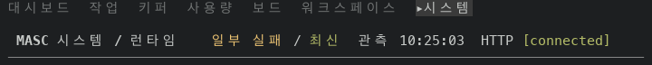
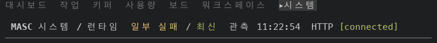
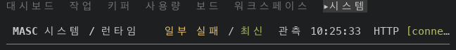
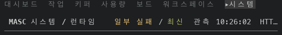
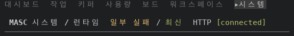
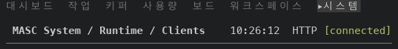
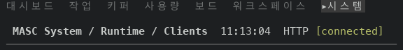
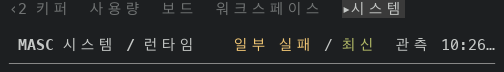
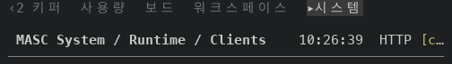
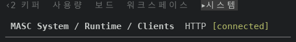

# The Runtime, Features and Clients headings keep the connection badge whole

PR #49045, layer 15 of stack #48922. The title row of three System screens joined its parts by hand (title, tab strip, reading time, connection badge). When the parts after the tab strip were wider than the row, the tab strip got no cells and the frame cut the row at its end, and the end of the row is the connection badge.

Before is the proof build of layer 14 (code commit `d1569dc589c`, run 42138077129). After is the proof build of this layer's code up to its last code commit (`ce423e3db49`, run 42147433996); the evidence commit that carries this README comes after it and changes no code. The branch was rebased onto a newer `main` after that build; the same last code commit is `fcc8a25662f` on the branch now, with the same changed lines. Both ran against a fixture server. Each screen was read at six terminal sizes, a few seconds after the screen opened. The Runtime probe state on screen in those reads was `일부 실패 / 최신`.

## The title rows on the screen

The row that holds `MASC` and the screen name, as the capture drew it. Width is in terminal cells.

### Runtime, 80x24

Before (75 cells)

```text
MASC 시스템 / 런타임    일부 실패 / 최신  관측 10:25:03  HTTP [connected]
```

After (73 cells)

```text
MASC 시스템 / 런타임  일부 실패 / 최신  관측 11:22:54  HTTP [connected]
```

### Clients, 80x24

Before (63 cells)

```text
MASC System / Runtime / Clients    10:25:13  HTTP [connected]
```

After (61 cells)

```text
MASC System / Runtime / Clients  11:23:02  HTTP [connected]
```

### Runtime, 72x30

Before (71 cells)

```text
MASC 시스템 / 런타임    일부 실패 / 최신  관측 10:25:33  HTTP [conne…
```

After (58 cells)

```text
MASC 시스템 / 런타임  일부 실패 / 최신  HTTP [connected]
```

### Clients, 72x30

Before (63 cells)

```text
MASC System / Runtime / Clients    10:25:43  HTTP [connected]
```

After (61 cells)

```text
MASC System / Runtime / Clients  11:12:45  HTTP [connected]
```

### Runtime, 64x30

Before (63 cells)

```text
MASC 시스템 / 런타임    일부 실패 / 최신  관측 10:26:02  HTT…
```

After (58 cells)

```text
MASC 시스템 / 런타임  일부 실패 / 최신  HTTP [connected]
```

### Features, 64x30

Before (45 cells)

```text
MASC Features    10:26:08  HTTP [connected]
```

After (43 cells)

```text
MASC Features  11:13:00  HTTP [connected]
```

### Clients, 64x30

Before (63 cells)

```text
MASC System / Runtime / Clients    10:26:12  HTTP [connected]
```

After (61 cells)

```text
MASC System / Runtime / Clients  11:13:04  HTTP [connected]
```

### Runtime, 56x30

Before (55 cells)

```text
MASC 시스템 / 런타임    일부 실패 / 최신  관측 10:26…
```

After (40 cells)

```text
MASC 시스템 / 런타임  HTTP [connected]
```

### Features, 56x30

Before (45 cells)

```text
MASC Features    10:26:35  HTTP [connected]
```

After (43 cells)

```text
MASC Features  11:13:23  HTTP [connected]
```

### Clients, 56x30

Before (55 cells)

```text
MASC System / Runtime / Clients    10:26:39  HTTP [c…
```

After (51 cells)

```text
MASC System / Runtime / Clients  HTTP [connected]
```

### Runtime, 100x30

Before (75 cells)

```text
MASC 시스템 / 런타임    일부 실패 / 최신  관측 10:26:54  HTTP [connected]
```

After (73 cells)

```text
MASC 시스템 / 런타임  일부 실패 / 최신  관측 11:13:39  HTTP [connected]
```

The title row has the same text before and after (clock masked) for: Runtime 200x50; Features 80x24, 72x30, 100x30, 200x50; Clients 100x30, 200x50.

The badge `HTTP [connected]` is whole on every after row of the three screens at the six sizes (18 rows). Before it was cut or missing on 4 of 18: rt1 72x30, rt1 64x30, rt1 56x30, clients 56x30.

## The stale Runtime state at 80 columns

The 14-screen tour of the layer 14 proof build (80x24) showed the Runtime probe as `일부 실패 / 이전 관측`. The row was cut inside the badge:

```text
MASC 시스템 / 런타임    일부 실패 / 이전 관측  관측 10:20:38  HTTP [connecte…
```

The parts of that row are 21 cells of title, 23 of status, 15 of reading time and 18 of badge with its gap, 77 in all. The row holds 78 (80 columns less the frame's margin). The old row also kept a 2 cell separator after the title for a tab strip that drew nothing, so it was 79 cells wide and lost 1. The new row has no separator when the strip draws nothing, so it needs 77 cells and fits. This is arithmetic on the widths of the captured parts, not a capture of the new build in that state.

## Wide screen

At 200x50 the whole capture of the three screens, with the clock replaced, has this many rows that differ between the two builds: runtime 0 of 51, features 0 of 51, clients 0 of 51.

## Screens

From the top row of the screen to the rule under the title row, before then after.


























## What the change is

`runtime_substrate_tab_strip` in `bin/masc_tui_render_prim.ml` took the text before and after the strip and gave the strip the cells that were left, and each screen joined the title, the strip and `after` with `Printf.sprintf` and drew the row with `box_line`. It is now two functions: `runtime_substrate_tabs` is the list of tabs and `runtime_substrate_heading` lays the row out with `detail_heading`, the function the Activity heading uses. The badge is the `tail` and is never cut. The pieces of `after` (the probe status, the reading time) are left out whole from the end when they do not fit, so the reading time goes first. The strip draws in what is left, whole or not at all, and a strip that draws nothing takes its separator with it.

`detail_heading` keeps the first piece of `after` and cuts it at its end when it does not fit. On Clients at 56 columns that left the reading time as `1…` beside the whole badge, and a cut number reads as a count. `runtime_substrate_heading` therefore puts an empty piece first, and every real piece is whole or left out.

When the strip draws, the row is the same text as before. When the strip draws nothing, the row loses the 2 cell separator that used to stand where the strip would have been, so the gap after the title goes from 4 spaces to 2. The `None` branches of the three screens (the reading is not loaded yet) are unchanged.

## Test

This layer adds no test. `docs/constitution.xml` rules out tests of TUI layout and row order, so the rows are shown by the captures above. The type of `runtime_substrate_heading` pins the call: `after` is a `string list`, and an implementation that passes `List.hd after` to `detail_heading` fails against the `.mli`. The new functions and the three call sites were type checked without dune (`ocamlfind`, exit code 0).

## Not changed

- Other rows that join `connection_badge state` by hand: `rg -c 'connection_badge state' bin/*.ml` counts 55 lines in 14 files on this layer's head. Some of them go through `detail_heading` already. This README does not claim any of the others is cut.

- The `None` branches of the three headings use `title_missing_reading`, a short fixed text.

- The probe state shown on Runtime depends on the age of the probe. The six size captures read it a few seconds after the server started, when it is fresh; the stale state is read separately, as described above.
