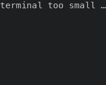
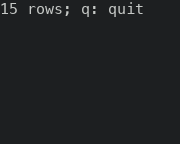
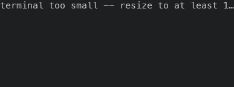
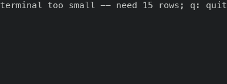
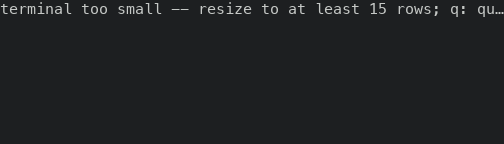
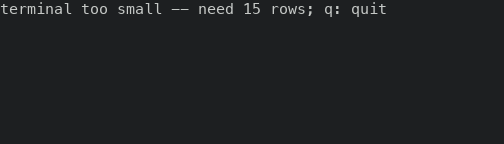

# The terminal-too-small hint keeps the row count and `q: quit` at narrow widths

PR #49459. A terminal with fewer rows than any surface needs draws one line, `terminal too small -- resize to at least 15 rows; q: quit`. The sentence is 57 columns wide, and `fit_width` cut it at the terminal width, so a narrower terminal read a cut count or no count and lost the end of `q: quit`. `terminal_too_small_hint` now picks the first of six sentences that fits the width, from the full one down to `q: quit`.

Before is the proof build of `6415b78c514`, the base of this PR (run 42229365992, masc-tui sha256 `bda390a9…a039`). After is the proof build of the PR code head `be115b29297` (run 42259897080, masc-tui sha256 `e886e26d…4c72`). Between the two source trees the only file under `bin/`, `lib/` and `test/` that differs is `bin/masc_tui_render_overlays.ml`. The commits that carry the changelog fragment and this evidence come after that head and change only `changelog.d/` and `docs/evidence/`.

## The frames

A throwaway workspace, the TUI started in a terminal of the width in the first column and 8 rows (12 rows for the `40x12` line), which is under the 15 rows the hint asks for. The first frame after start. Each frame holds one row of text; the table prints it.

| terminal | before | after | count before → after | `q: quit` before → after |
|---|---|---|---|---|
| 16x8 | `terminal too sm…` | `15 rows; q: quit` | no → yes | no → yes |
| 20x8 | `terminal too small …` | `15 rows; q: quit` | no → yes | no → yes |
| 30x8 | `terminal too small -- resize …` | `need 15 rows; q: quit` | no → yes | no → yes |
| 40x8 | `terminal too small -- resize to at leas…` | `too small -- need 15 rows; q: quit` | no → yes | no → yes |
| 40x12 | `terminal too small -- resize to at leas…` | `too small -- need 15 rows; q: quit` | no → yes | no → yes |
| 43x8 | `terminal too small -- resize to at least 1…` | `terminal too small -- need 15 rows; q: quit` | cut → yes | no → yes |
| 44x8 | `terminal too small -- resize to at least 15…` | `terminal too small -- need 15 rows; q: quit` | yes → yes | no → yes |
| 50x8 | `terminal too small -- resize to at least 15 rows;…` | `terminal too small -- need 15 rows; q: quit` | yes → yes | no → yes |
| 56x8 | `terminal too small -- resize to at least 15 rows; q: qu…` | `terminal too small -- need 15 rows; q: quit` | yes → yes | cut → yes |
| 57x8 | `terminal too small -- resize to at least 15 rows; q: quit` | `terminal too small -- resize to at least 15 rows; q: quit` | yes → yes | yes → yes |
| 80x8 | `terminal too small -- resize to at least 15 rows; q: quit` | `terminal too small -- resize to at least 15 rows; q: quit` | yes → yes | yes → yes |

- Before, the whole row count was readable at 5 of 11 sizes (44, 50, 56, 57, 80 columns) and `q: quit` at 2 (57, 80 columns). After, both are readable at all 11 sizes, 16 columns up.
- At 43 columns the before row ends `at least 1…`, the count cut to its first digit, so it reads as one row.
- At 57 and 80 columns the sentence fits and the frame is the same before and after (text and colours).
- The row count is 15 in every after frame, the same `minimum_terminal_rows` as before.

## The frames as images

| terminal | before | after |
|---|---|---|
| 20x8 |  |  |
| 43x8 |  |  |
| 56x8 |  |  |

## Not shown

- Under 16 columns only `q: quit` fits (down to 7 columns) and under 7 columns the full sentence is cut as before. The captures stop at 16 columns.
- The guard looks at rows only. A terminal with enough rows and few columns (16 to 30 columns, 30 rows, main build) kept the tab strip, the title, the table and the footer's `?`; those frames are not part of this evidence and this PR does not change them. The issue #47316 asks for a documented minimum width; that is not done here.
- The notices under the hint (recovery, rejection, quit confirmation) are not touched.
- No test is added. The hint is text on the screen, which `docs/constitution.xml` 354-355 does not let a test check.
