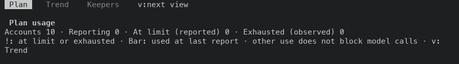
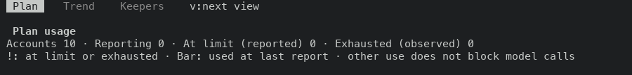
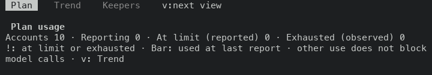
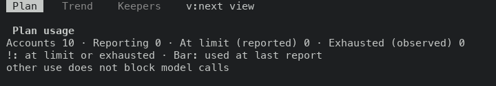
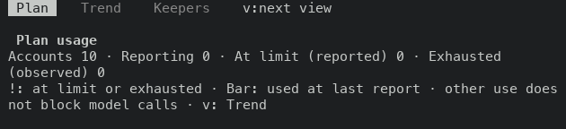
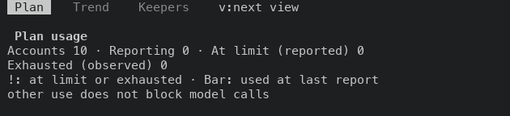
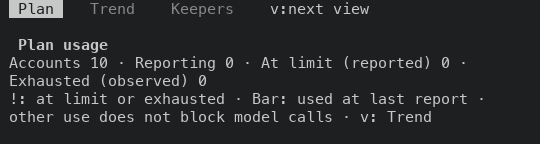
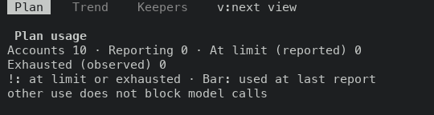

# The Usage Plan summary breaks between clauses

PR #49020, layer 12 of stack #48922. The two summary rows above the Plan on the Usage screen are lists of clauses joined by a middle dot. They were wrapped at any space, so a narrow terminal split a clause over two rows.

Before is the proof build of layer 11 (`81c8b0509dc`, run 42124472214). After is the proof build of this layer's code commit (`9befc8c2cc9`, run 42129588554). Both ran against a fixture server with ten accounts that have not reported.

## The summary rows on the screen

The rows between `Plan usage` and the blank row, as the capture drew them.

### 100x30

Before

```text
Accounts 10 · Reporting 0 · At limit (reported) 0 · Exhausted (observed) 0
!: at limit or exhausted · Bar: used at last report · other use does not block model calls · v:
Trend
```

After

```text
Accounts 10 · Reporting 0 · At limit (reported) 0 · Exhausted (observed) 0
!: at limit or exhausted · Bar: used at last report · other use does not block model calls
```

### 80x24

Before

```text
Accounts 10 · Reporting 0 · At limit (reported) 0 · Exhausted (observed) 0
!: at limit or exhausted · Bar: used at last report · other use does not block
model calls · v: Trend
```

After

```text
Accounts 10 · Reporting 0 · At limit (reported) 0 · Exhausted (observed) 0
!: at limit or exhausted · Bar: used at last report
other use does not block model calls
```

### 70x24

Before

```text
Accounts 10 · Reporting 0 · At limit (reported) 0 · Exhausted
(observed) 0
!: at limit or exhausted · Bar: used at last report · other use does
not block model calls · v: Trend
```

After

```text
Accounts 10 · Reporting 0 · At limit (reported) 0
Exhausted (observed) 0
!: at limit or exhausted · Bar: used at last report
other use does not block model calls
```

### 60x24

Before

```text
Accounts 10 · Reporting 0 · At limit (reported) 0 ·
Exhausted (observed) 0
!: at limit or exhausted · Bar: used at last report ·
other use does not block model calls · v: Trend
```

After

```text
Accounts 10 · Reporting 0 · At limit (reported) 0
Exhausted (observed) 0
!: at limit or exhausted · Bar: used at last report
other use does not block model calls
```

## Where a row broke inside a clause

The two functions were run on the same clauses, from 30 to 140 terminal columns (the section is laid out in columns minus two). A row counts as broken when it ends inside a clause or on the middle dot. This is a computed table, not a capture.

| Row | Before (`wrap_words`) | After (`pack_clauses`) |
| --- | --- | --- |
| counts row | 30-50, 53-75 columns | none |
| legend row | 30-52, 55-91, 94-102 columns | 30-37 columns |

The 30 to 37 columns that still break are narrower than the widest clause (`other use does not block model calls`, 36 cells), which a row cannot hold whole.

## Screens

From the tab row to the blank row below the summary, before then after, at each size.

















## What the change is

`section_with` in `bin/masc_tui_overview_providers.ml` now hands the two rows to `Message_layout.pack_clauses` as lists of clauses. That helper already lays out the Memory and Fusion header rows: it fills a row with whole clauses, joins them with the middle dot and starts the next row at a clause.

The legend lost its last clause, `v: Trend`. The tab row above the summary (`Plan  Trend  Keepers  v:next view`) names the Trend reading and the key that reaches it, and the screen draws that row whenever the body has three rows or more.

## Test

This layer adds no test. `docs/constitution.xml` rules out tests of TUI layout and row order, so the breaks between clauses are shown by the captures and the computed table above.

## Not changed

- A source search for rows that join literal clauses with the middle dot and pass the result to a wrap function found this one. The two other hits near a wrap call wrap chat text (`masc_tui_play_room.ml`) and a failure detail behind `D:full` (`masc_tui_lane_addons.ml`), which are not clause lists. The search looked only near wrap calls, so it missed the key hint row at the bottom of the Features summary, which is a constant string passed as an argument. Layer 14 (#49027) fixes that row.

- The footer of this screen reads `Esc:Dashboard`. The key table labels Esc as `Dashboard`, `dashboard` and `back` on different screens. This layer does not touch the label.

