# TUI UX stack #48856: before and after screens

Scope: layers 1 to 4 of the stack. #48854 makes a failed request show the
server's own sentence when the server answers with the tool error envelope as the
whole body. #48855 declares the description and the type of the three
`keeper_build_cleanup_*` runtime params. #48874 reads a tool error envelope that
sits inside another error envelope the same way in every body shape. #48896 keeps
the frame of the System ▸ Params detail when a description takes more than one
row. Layer 5 adds this document, its images and the changelog fragments of the
four layers.

Two screens change on the capture machine: System ▸ Voice (layers 1 and 3 touch
its error line; only layer 1 changes what the fixture shows) and System ▸ Params
(layers 2 and 4). Layer 3 has no screen of its own: no route of the fixture
answers a nested envelope, so its before and after are the output of the old and
the new `json_error_sentence` on the same bodies, listed at the end.

## Source

All sides are the `masc-tui` and `masc` binaries that the native TUI proof
workflow built on a macOS arm64 runner. Each artifact carries a `receipt.json`
whose `sha256` and `server_sha256` match the files that were run, and
`masc-tui --build-commit` prints the source commit below.

| Side | Source commit | Proof run | `masc-tui` sha256 | `masc` sha256 |
| --- | --- | --- | --- | --- |
| Before (`main`) | `2cb0767846e2937e6aab735a244978ffb3af1869` | 42059202792 | `0666c5b539ea8c188b396375d4196f305ca47b475fe15010701eff628537e97d` | `5f9e2e4cae1eecec132ecce99475f6e14611c04f4a00bc8232eece81fa0e1f51` |
| After, layers 1 to 3 (layer 3 head) | `7d58731c6bd64041ba9e1ee85896438a820baed0` | 42063175019 | `38e66853c78c0a914d26a0e19a5255bea185cad21509c0afa5ec40224765bf96` | `1ba3f356c5c9d2f12be29e1415ef141f9010865e6d249bc65e644abf302a59f3` |
| After, layers 1 to 4 (layer 4 head) | `032cdfd0feb6f234a7c260bb45fcb9702799d890` | 42069806921 | `f48e47a2233058057414ade1edc6a752ed4ea503242e1573ff9a18f18b5e39a4` | `1da1ec4af9649f7f793c376ec8d508f512ed0c2bce054b55c896b844586d7d63` |

Layers 1 to 3 are compared on the layer 3 build against `main`. Layer 4 is compared
on the layer 4 build against the layer 3 build. The source commit of a side is the
last commit that changes source; the commit that adds this document (layer 5)
changes none.

## Environment

- macOS arm64 machine, one terminal per capture, driven through tmux at a fixed
  size: 80x24 and 100x30 unless a section says otherwise.
- Every process ran under `env -i` with `PATH`, `HOME` (an empty directory),
  `TERM=xterm-256color` and `LANG=en_US.UTF-8`. No credential, Keeper or
  workspace of the operator was read.
- A fresh workspace per capture run: `masc init`, `masc start --port <port>` from
  the same artifact as the TUI, an expiring bearer from `masc mcp-config --expiring`.
  The `runtime.toml` that `masc init` writes has no `[voice]` section, and the
  Voice screen reads that as a missing voice config.
- Each capture starts a new TUI process, waits for `HTTP [connected]`, settles for
  a few seconds, opens the command palette with `:`, types `go System / params`
  or `go System / voice`, presses Enter and captures four seconds later. Where a
  section says "selected with N presses of `j`", it presses `j` N times after
  that.
- The server quotes the workspace path in the Voice sentence. The location of the
  capture directory is written over with `x`, one `x` per letter or digit, so the
  text and the images show the wrap points the TUI chose and no local path.
- The PNGs are drawn from `tmux capture-pane -e -p` captures (9x18 px per cell)
  and cropped to the rows that change. The text beside each pair is the text of
  the same rows, except on the Voice screen, where the image also shows the two
  rows above the error line. The capture driver is not part of the repository.

## Observed results

### System ▸ Voice: the error line is the server's sentence, whole (#48854)

Before is `main`. After is the layer 3 build; layer 3 changes only how a nested
envelope is read, and the answer of the fixture is not nested, so layers 1 and 3
read it alike. System ▸ Voice, 80x24 and 100x30.

The Voice route answers `HTTP 500` with the tool error envelope,
`{"status":"error","message":"..."}`, as the whole body when the workspace has no
voice configuration. The pane read that shape only inside an `{"ok":false,...}`
wrapper, so it showed the first 240 bytes of the body: the JSON, cut inside the
sentence, followed by `...` and the size of the body.

80x24 text, rows of the error line (5 rows before, 6 after):

```
before
 voice config: HTTP 500: {"status":"error","message":"voice config missing: no
 [voice] section in
 /xxxxxxx/xxx/xxxxxx-xxx/-xxxxx-xxxxxx-xx-xxxxxxxxx-xxxxxxxxxxxx-xxxx/xxxxxxxx-
 xxxx-xxxx-xxxx-xxxxxxxxxxxx/xxxxxxxxxx/ev-u4base/base/.masc/config/runtime.
 toml, and no /... (568 bytes, response body)

after
 voice config: HTTP 500: voice config missing: no [voice] section in
 /xxxxxxx/xxx/xxxxxx-xxx/-xxxxx-xxxxxx-xx-xxxxxxxxx-xxxxxxxxxxxx-xxxx/xxxxxxxx-
 xxxx-xxxx-xxxx-xxxxxxxxxxxx/xxxxxxxxxx/ev-u4after/base/.masc/config/runtime.
 toml, and no
 /xxxxxxx/xxx/xxxxxx-xxx/-xxxxx-xxxxxx-xx-xxxxxxxxx-xxxxxxxxxxxx-xxxx/xxxxxxxx-
 xxxx-xxxx-xxxx-xxxxxxxxxxxx/xxxxxxxxxx/ev-u4after/base/.masc/voice_config.json
```

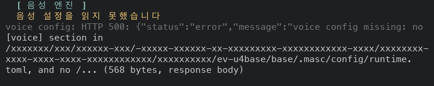
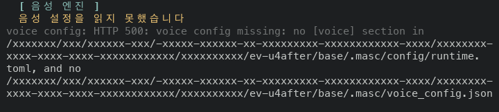

100x30 text (4 rows before, 5 after):

```
before
 voice config: HTTP 500: {"status":"error","message":"voice config missing: no [voice] section in
 /xxxxxxx/xxx/xxxxxx-xxx/-xxxxx-xxxxxx-xx-xxxxxxxxx-xxxxxxxxxxxx-xxxx/xxxxxxxx-xxxx-xxxx-xxxx-
 xxxxxxxxxxxx/xxxxxxxxxx/ev-u4base/base/.masc/config/runtime.toml, and no /... (568 bytes, response
 body)

after
 voice config: HTTP 500: voice config missing: no [voice] section in
 /xxxxxxx/xxx/xxxxxx-xxx/-xxxxx-xxxxxx-xx-xxxxxxxxx-xxxxxxxxxxxx-xxxx/xxxxxxxx-xxxx-xxxx-xxxx-
 xxxxxxxxxxxx/xxxxxxxxxx/ev-u4after/base/.masc/config/runtime.toml, and no
 /xxxxxxx/xxx/xxxxxx-xxx/-xxxxx-xxxxxx-xx-xxxxxxxxx-xxxxxxxxxxxx-xxxx/xxxxxxxx-xxxx-xxxx-xxxx-
 xxxxxxxxxxxx/xxxxxxxxxx/ev-u4after/base/.masc/voice_config.json
```

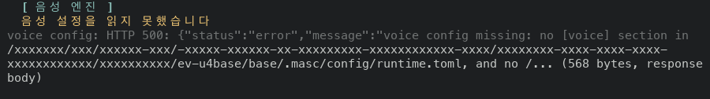
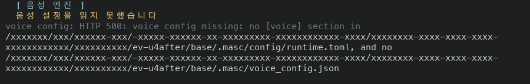

The error line takes one row more at both sizes and ends with the file name
`voice_config.json` instead of `no /... (568 bytes, response body)`. Every other
row of the screen has the same text on both sides; the rows below the error line
move down by one, and the last one (`선언: runtime.toml [voice] ...`) stays on
screen: row 19 to 20 at 80x24, row 18 to 19 at 100x30.

### System ▸ Params: the first three settings declare their contract (#48855)

Before is `main`. After is the layer 3 build; layer 3 does not touch this
screen. System ▸ Params, first screen, 80x24 and 100x30.

The three `keeper_build_cleanup_*` settings are the first rows of the screen and
the selected row when it opens. They were registered without a description and a
value type, so the detail showed `설명 ·` with nothing after it and the type
`typed value`, and the list showed the boolean as `true` where the other
boolean settings show `on` or `off`.

80x24 text, from the group row to the end of the detail:

```
before
   keeper_build_cleanup Idle guest build artifact cleanup
     ○ keeper_build_cleanup_enabled                            true
     ○ keeper_build_cleanup_interval_sec                       3600.0
     ○ keeper_build_cleanup_retention_sec                      86400.0
 ┌ 선택한 설정 · keeper_build_cleanup_enabled · 상세 1-9/12 ──────────────────┐
 │   [ 현재 값 ]                                                              │
 │   키 · keeper_build_cleanup_enabled                                        │
 │   설명 ·                                                                   │
 │   현재 값 · true                                                           │
 │   기본값 · true                                                            │
 │                                                                            │
 │   [ 타입과 허용 범위 ]                                                     │
 │   타입 · typed value                                                       │
 │                                                                            │
 └────────────────────────────────────────────────────────────────────────────┘

after
   keeper_build_cleanup Idle guest build artifact cleanup
     ○ keeper_build_cleanup_enabled                            on
     ○ keeper_build_cleanup_interval_sec                       3600.0
     ○ keeper_build_cleanup_retention_sec                      86400.0
 ──────────────────────────────────────────────────────────────────────────────
   [ 현재 값 ]
   키 · keeper_build_cleanup_enabled
   설명 · 쉬고 있는 키퍼의 Apple 마이크로VM 게스트(실행 중인 것만) 안에서 오래
   안 쓴 Dune 빌드 디렉터리(_build)를 주기적으로 지울지. 끄면 주기가 되어도
   키퍼를 훑지 않고 아무것도 지우지 않는다. _build 옆에 .masc-keep-build 파일을
   두면 켜 둬도 그 빌드는 남는다
   현재 값 · true
   기본값 · true

   상세 1-9/15
```

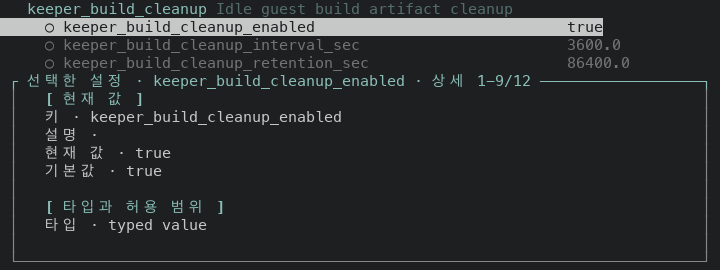
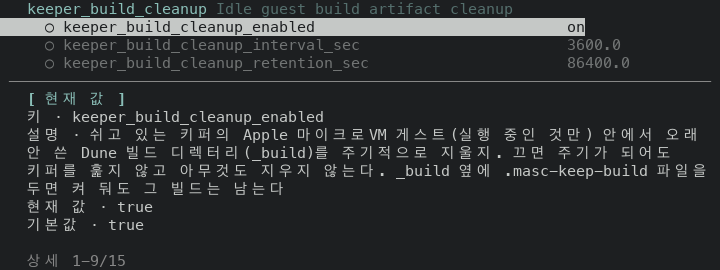

100x30 text, from the group row to the end of the detail:

```
before
   keeper_build_cleanup Idle guest build artifact cleanup
     ○ keeper_build_cleanup_enabled                                                true
     ○ keeper_build_cleanup_interval_sec                                           3600.0
     ○ keeper_build_cleanup_retention_sec                                          86400.0
   keeper_lifecycle Keeper heartbeat and supervisor timing
     ○ keeper.keepalive_interval_sec                                               300
 ┌ 선택한 설정 · keeper_build_cleanup_enabled · 상세 1-12/12 ─────────────────────────────────────┐
 │   [ 현재 값 ]                                                                                  │
 │   키 · keeper_build_cleanup_enabled                                                            │
 │   설명 ·                                                                                       │
 │   현재 값 · true                                                                               │
 │   기본값 · true                                                                                │
 │                                                                                                │
 │   [ 타입과 허용 범위 ]                                                                         │
 │   타입 · typed value                                                                           │
 │                                                                                                │
 │   [ 적용 상태 ]                                                                                │
 │   적용 상태 · 기본값                                                                           │
 │   소속 그룹 · keeper_build_cleanup · Idle guest build artifact cleanup                         │
 │                                                                                                │
 └────────────────────────────────────────────────────────────────────────────────────────────────┘

after
   keeper_build_cleanup Idle guest build artifact cleanup
     ○ keeper_build_cleanup_enabled                                                on
     ○ keeper_build_cleanup_interval_sec                                           3600.0
     ○ keeper_build_cleanup_retention_sec                                          86400.0
   keeper_lifecycle Keeper heartbeat and supervisor timing
     ○ keeper.keepalive_interval_sec                                               300
 ┌ 선택한 설정 · keeper_build_cleanup_enabled · 상세 1-13/14 ─────────────────────────────────────┐
 │   [ 현재 값 ]                                                                                  │
 │   키 · keeper_build_cleanup_enabled                                                            │
 │   설명 · 쉬고 있는 키퍼의 Apple 마이크로VM 게스트(실행 중인 것만) 안에서 오래 안 쓴 Dune 빌드  │
 │   디렉터리(_build)를 주기적으로 지울지. 끄면 주기가 되어도 키퍼를 훑지 않고 아무것도 지우지    │
 │   않는다. _build 옆에 .masc-keep-build 파일을 두면 켜 둬도 그 빌드는 남는다                    │
 │   현재 값 · true                                                                               │
 │   기본값 · true                                                                                │
 │                                                                                                │
 │   [ 타입과 허용 범위 ]                                                                         │
 │   타입 · bool                                                                                  │
 │                                                                                                │
 │   [ 적용 상태 ]                                                                                │
 │   적용 상태 · 기본값                                                                           │
 └────────────────────────────────────────────────────────────────────────────────────────────────┘
```

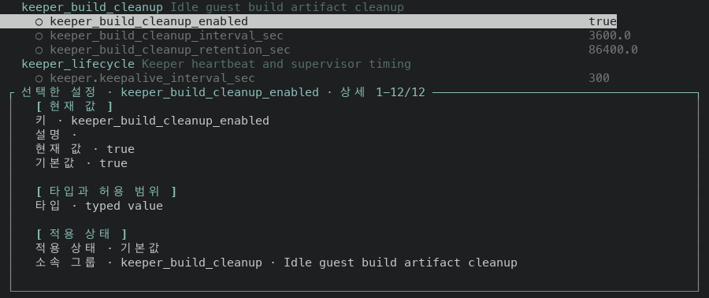
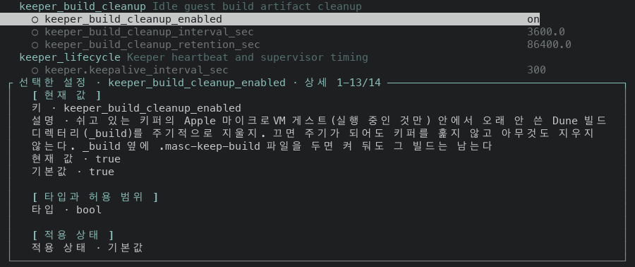

What changed on screen:

| | before | after |
| --- | --- | --- |
| `설명 ·` | empty | the description: 4 rows at 80x24, 3 rows at 100x30 |
| list row value | `true` | `on` |
| `타입 ·` | `typed value` | `bool` (not among the 9 rows shown at 80x24) |
| detail length | 12 rows | 15 rows at 80x24, 14 rows at 100x30 |

The exact value in the detail still reads `true`: that line shows the JSON of
the setting, not its label. At 80x24 the detail is drawn without its frame after
the change; layer 4 explains why and fixes it.

The other two settings of layer 2 declare their type the same way. Selected with one
and two presses of `j` on the layer 4 build, 100x30, from the frame title to the
`타입` row:

```
 ┌ 선택한 설정 · keeper_build_cleanup_interval_sec · 상세 1-13/13 ────────────────────────────────┐
 │   [ 현재 값 ]                                                                                  │
 │   키 · keeper_build_cleanup_interval_sec                                                       │
 │   설명 · 빌드 디렉터리 정리 점검 주기(초). 켜져 있으면 한 번 돌 때 모든 키퍼를 훑고, 쉬고 있는 │
 │   키퍼만 정리한다. 바꾼 값은 지금 기다리는 중인 주기가 끝난 뒤부터 적용된다. 0 보다 커야 한다  │
 │   현재 값 · 3600.0                                                                             │
 │   기본값 · 3600.0                                                                              │
 │                                                                                                │
 │   [ 타입과 허용 범위 ]                                                                         │
 │   타입 · float                                                                                 │
```

```
 ┌ 선택한 설정 · keeper_build_cleanup_retention_sec · 상세 1-13/13 ───────────────────────────────┐
 │   [ 현재 값 ]                                                                                  │
 │   키 · keeper_build_cleanup_retention_sec                                                      │
 │   설명 · 빌드 디렉터리 안에서 가장 최근에 바뀐 항목이 이 시간(초)보다 오래됐을 때만 지운다. 0  │
 │   보다 커야 한다                                                                               │
 │   현재 값 · 86400.0                                                                            │
 │   기본값 · 86400.0                                                                             │
 │                                                                                                │
 │   [ 타입과 허용 범위 ]                                                                         │
 │   타입 · float                                                                                 │
```

### Nested envelope: no screen, the same inputs through the old and the new reader (#48874)

No route of the fixture answers a tool error envelope inside another envelope,
so layer 3 has no capture. `json_error_sentence` was cut out of
`lib/tui_decode.ml` at the layer 2 head (`ec285df50c2`) and at the layer 3 head
(`7d58731c6bd`), linked against Yojson only, and run on the same fourteen bodies.
Twelve give the same answer on both sides. The two that differ are the nested
envelope as the whole body and the nested envelope beside `ok:false`:

| body | layer 2 head | layer 3 head |
| --- | --- | --- |
| `{"status":"error","message":"{\"status\":\"error\",\"error_code\":\"validation_error\",\"message\":\"bad\"}"}` | `{"status":"error","error_code":"validation_error","message":"bad"}` | `bad` |
| `{"ok":false,"status":"error","message":"{\"status\":\"error\",\"message\":\"bad\"}"}` | `{"status":"error","message":"bad"}` | `bad` |

The other twelve include the nested envelope under `ok:false` (`nested sentence`
on both sides), a plain message in an envelope (`disk full`), an `error` string
beside an envelope (`first`), and the bodies that stay raw: another `status`, a
blank or missing `message`, a bare `message`, text that is not JSON.

### System ▸ Params: the detail keeps its frame when a description wraps (#48896)

Before is the layer 3 build, which contains layer 2. After is the layer 4 build.
The Params detail is drawn in a frame, `┌ 선택한 설정 · <key> · 상세 a-b/n ┐`, and
falls back to plain rows when a line of the detail is wider than the frame can
draw. The frame draws `framed_inner_width - 4` cells a line, which is 74 at 80
columns. A field was wrapped at `framed_inner_width - 2` cells and then indented
two, so a row could be 75 to 78 cells wide, and the check gave the whole frame up
for one such row. Fields now wrap at what the frame draws, and the check reads the
same number.

Layer 2 gave the first three settings a description. On `main` they had an empty
one and kept the frame; with the description they lost it, and they are the first
screen of System ▸ Params. It is not specific to them: 17 other settings were
drawn without the frame on `main` already.

The first screen of System ▸ Params at twelve widths, height 24. A frame is
"yes" when the detail starts with `┌ 선택한 설정`:

| columns | frame before | frame after | description rows after |
| --- | --- | --- | --- |
| 64 | no | yes | 5 |
| 70 | no | yes | 5 |
| 72 | no | yes | 5 |
| 76 | no | yes | 4 |
| 80 | no | yes | 4 |
| 84 | no | yes | 4 |
| 88 | no | yes | 4 |
| 92 | no | yes | 4 |
| 96 | no | yes | 3 |
| 100 | yes | yes | 3 |
| 110 | no | yes | 3 |
| 120 | no | yes | 3 |

The frame is kept at 1 of 12 widths before and at 12 of 12 after. At 100
columns the description rows were 93, 91, 75 cells wide inside a frame that draws 94,
so the frame survived before the change by the width of its rows.

All 35 settings at 80x24, selected one after the other with `j` from the first
row. The frame is kept for 18 of 35 on `main`, 15 of 35 on the layer 3 build and
35 of 35 on the layer 4 build.

First screen, 80x24, from the first list row to the end of the detail:

```
before
   keeper_build_cleanup Idle guest build artifact cleanup
     ○ keeper_build_cleanup_enabled                            on
     ○ keeper_build_cleanup_interval_sec                       3600.0
     ○ keeper_build_cleanup_retention_sec                      86400.0
 ──────────────────────────────────────────────────────────────────────────────
   [ 현재 값 ]
   키 · keeper_build_cleanup_enabled
   설명 · 쉬고 있는 키퍼의 Apple 마이크로VM 게스트(실행 중인 것만) 안에서 오래
   안 쓴 Dune 빌드 디렉터리(_build)를 주기적으로 지울지. 끄면 주기가 되어도
   키퍼를 훑지 않고 아무것도 지우지 않는다. _build 옆에 .masc-keep-build 파일을
   두면 켜 둬도 그 빌드는 남는다
   현재 값 · true
   기본값 · true

   상세 1-9/15

after
   keeper_build_cleanup Idle guest build artifact cleanup
     ○ keeper_build_cleanup_enabled                            on
     ○ keeper_build_cleanup_interval_sec                       3600.0
     ○ keeper_build_cleanup_retention_sec                      86400.0
 ┌ 선택한 설정 · keeper_build_cleanup_enabled · 상세 1-9/15 ──────────────────┐
 │   [ 현재 값 ]                                                              │
 │   키 · keeper_build_cleanup_enabled                                        │
 │   설명 · 쉬고 있는 키퍼의 Apple 마이크로VM 게스트(실행 중인 것만) 안에서   │
 │   오래 안 쓴 Dune 빌드 디렉터리(_build)를 주기적으로 지울지. 끄면 주기가   │
 │   되어도 키퍼를 훑지 않고 아무것도 지우지 않는다. _build 옆에              │
 │   .masc-keep-build 파일을 두면 켜 둬도 그 빌드는 남는다                    │
 │   현재 값 · true                                                           │
 │   기본값 · true                                                            │
 │                                                                            │
 └────────────────────────────────────────────────────────────────────────────┘
```


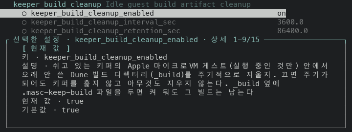

A setting layer 2 did not touch, `keeper.checkpoint_history_retained` (216 cells of description), selected with five presses of `j`, 80x24, from the first list row to the end of the detail:

```
before
     ○ keeper.keepalive_interval_sec                           300
     ○ keeper.supervisor_sweep_sec                             30.0
   keeper_retention How much of a keeper's past each store keeps
     ○ keeper.checkpoint_history_retained                      3
 ──────────────────────────────────────────────────────────────────────────────
   [ 현재 값 ]
   키 · keeper.checkpoint_history_retained
   설명 · 정본 옆에 남기는 지난 체크포인트 수. 하나가 통째로 한 벌이라 라이브
   키퍼에서는 111MB 이고, 대시보드 목록은 가장 최근 것을 빼고 남은 것을 전부
   디코드한다. 그래서 1 이면 목록은 늘 비어 보이고, 0 이면 아예 남기지 않는다
   현재 값 · 3
   기본값 · 3

   [ 타입과 허용 범위 ]
   상세 1-9/16

after
     ○ keeper.keepalive_interval_sec                           300
     ○ keeper.supervisor_sweep_sec                             30.0
   keeper_retention How much of a keeper's past each store keeps
     ○ keeper.checkpoint_history_retained                      3
 ┌ 선택한 설정 · keeper.checkpoint_history_retained · 상세 1-9/18 ────────────┐
 │   [ 현재 값 ]                                                              │
 │   키 · keeper.checkpoint_history_retained                                  │
 │   설명 · 정본 옆에 남기는 지난 체크포인트 수. 하나가 통째로 한 벌이라      │
 │   라이브 키퍼에서는 111MB 이고, 대시보드 목록은 가장 최근 것을 빼고 남은   │
 │   것을 전부 디코드한다. 그래서 1 이면 목록은 늘 비어 보이고, 0 이면 아예   │
 │   남기지 않는다                                                            │
 │   현재 값 · 3                                                              │
 │   기본값 · 3                                                               │
 │                                                                            │
 └────────────────────────────────────────────────────────────────────────────┘
```

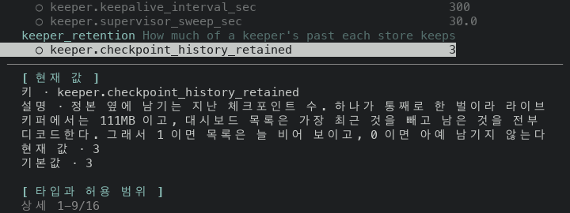
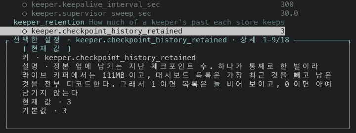

Layer 4 does not change the window. At 80x24 the detail shows 9 rows of 13 to 18
(`상세 1-9/n`). The `타입` row is inside it for 27 of the 35 settings (29 on `main`) and the
`적용 상태` row for 0. For 4 of the 35 the window ends on the heading
`[ 타입과 허용 범위 ]` with its rows below (issue #48905).

## Not verified

- No route of the fixture answers a tool error envelope inside another envelope,
  so layer 3 has no screen. Its before and after are the output of
  `json_error_sentence` on the same bodies, not of the TUI.
- The Board reaction and operator action routes answer the same envelope as the
  Voice route. The server side was read in the code; neither screen was captured.
- A 401 or 403 answer in the envelope shape was not captured. Those answers go to
  `Masc_tui_credential.server_reason_of_body` first and to the sentence only when
  it reads no reason.
- The width sweep of layer 4 is at height 24 and at twelve widths from 64 to 120
  columns. Wider terminals and other heights were not swept.
- No setting of the fixture has a JSON value wider than the detail panel, so the
  plain rows that the check still falls back to for such a value are in no capture.
