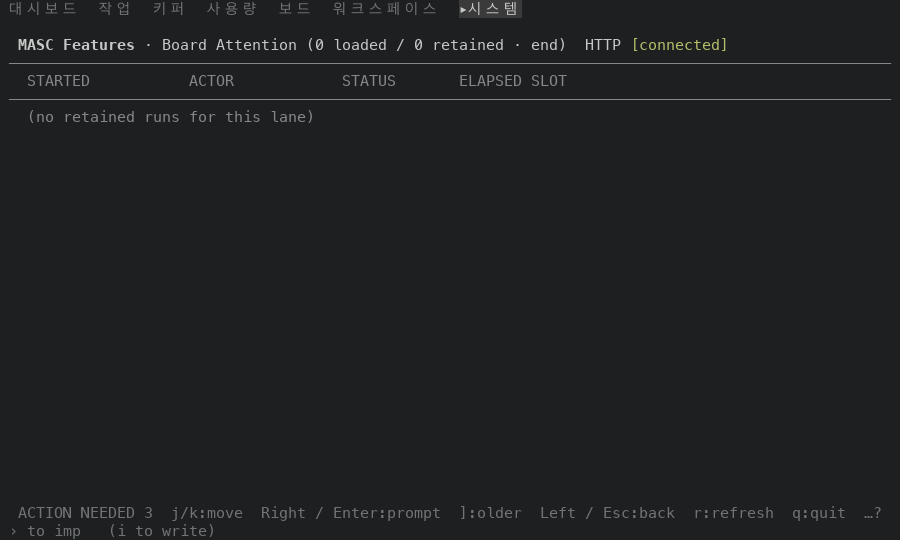
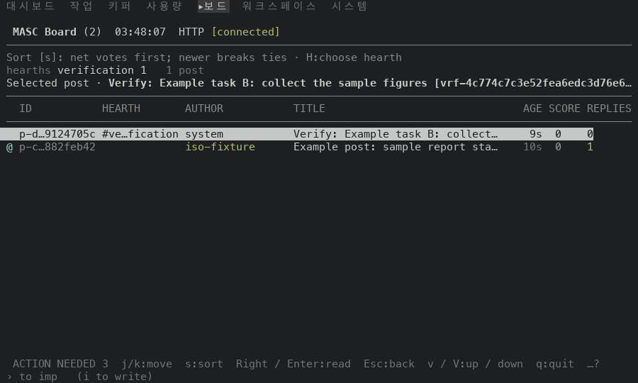
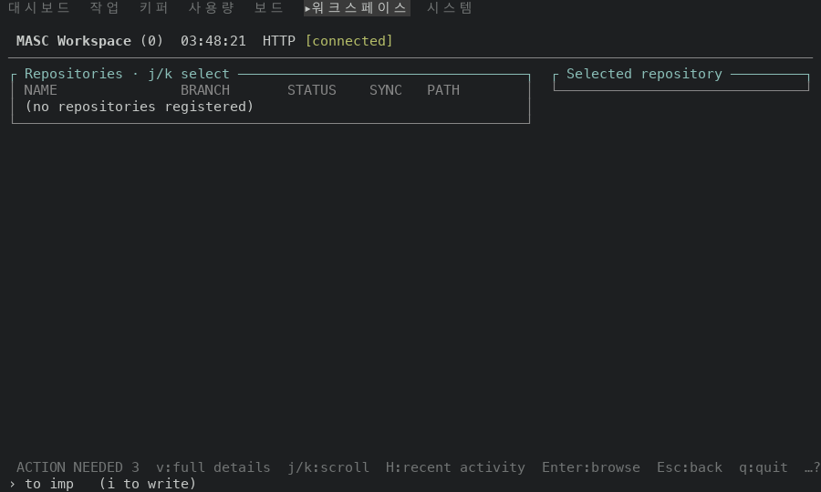
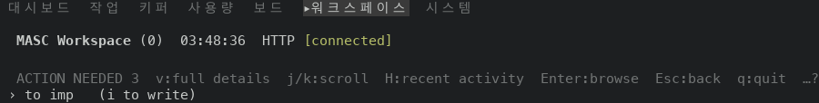
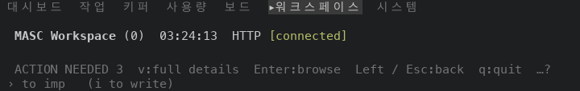
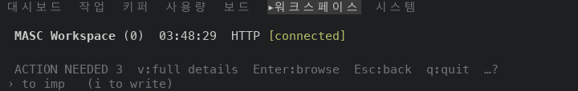
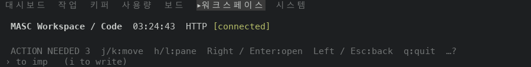
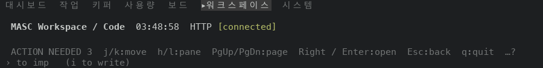
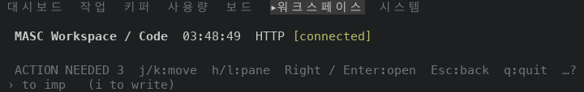

# TUI UX stack #48922: before and after screens

Scope: layers 1 to 4 of the stack. #48920 makes the command palette put a row
that is typed whole before the rows that start with it. #48921 makes the footer
name Left only where Left has a step to take. #48930 makes `test_tui_keys_doc`
print the lines that differ. #48932 adds the one row that the committed key guide
lacked. Layer 5 adds this document, its images and the changelog fragments of the
four layers.

Two behaviours change on the capture machine. The palette lands on a different
screen for `go Board` and `go Workspace` (layer 1). The footer of the Repositories
list and of the Code tree at the project root stops naming `Left / Esc` and names
`Esc` (layer 2). Layers 3 and 4 change a test and a document and have no screen.

## Source

Both sides are the `masc-tui` and `masc` binaries that the native TUI proof
workflow built on a macOS arm64 runner. Each artifact carries a `receipt.json`
whose `sha256` and `server_sha256` match the files that were run, and
`masc-tui --build-commit` prints the source commit below.

| Side | Source commit | Proof run | `masc-tui` sha256 | `masc` sha256 |
| --- | --- | --- | --- | --- |
| Before (`main`) | `2cb0767846e2937e6aab735a244978ffb3af1869` | 42059202792 | `0666c5b539ea8c188b396375d4196f305ca47b475fe15010701eff628537e97d` | `5f9e2e4cae1eecec132ecce99475f6e14611c04f4a00bc8232eece81fa0e1f51` |
| After (layer 2 head, on layer 1) | `6cf1d47ccb88fd42a095afb80f57fbaa9748b41f` | 42083117821 | `44436808ba91c6bdfaa9d8fa62dd2cb427ebbd7ac132b19aeccf3064050cb60d` | `c06893f8792dac07dddc20a9f95e1f57fba9c0206caa3dc27ffaf3cf1b36db83` |

The stack is based on `f2d98655513`, one commit after the before build. That
commit (#48634) changes `lib/dated_jsonl`, `lib/keeper/keeper_autonomous_turn_source.ml`
and one test, and no TUI source. Layers 3 and 4 change a test and a document, so
the layer 2 build is the build of layers 1 to 4.

## Environment

- macOS arm64 machine, one terminal per capture, driven through tmux at a fixed
  size: 80x24 and 100x30.
- Every process ran under `env -i` with `PATH`, `HOME` (an empty directory),
  `TERM=xterm-256color` and `LANG=en_US.UTF-8`. No credential, Keeper or
  workspace of the operator was read.
- A fresh workspace per capture run: `masc init`, `masc start --port <port>` from
  the same artifact as the TUI, an expiring bearer from `masc mcp-config
  --expiring`. The base path stayed relative (`base`), so no capture carries the
  location of the capture directory.
- The workspace holds the fixture's three pending operator actions (the
  `ACTION NEEDED 3` at the left of every footer), two posts on the Board, no
  registered repository (`Workspace (0)`), and a project tree with two
  directories: `docs/guide.md` and `src/main.ml`.
- Each capture starts a new TUI process, waits for `HTTP [connected]`, settles for
  a few seconds, opens the command palette with `:`, types the query and presses
  Enter. Where a section lists keys, they are pressed one by one with a capture
  after each.
- The PNGs are drawn from `tmux capture-pane -e -p` captures (9x18 px per cell).
  The palette images are the whole 100x30 screen. The footer images keep the three
  top rows (ring, blank, title) and the three bottom rows (footer, input) of the
  screen and drop the rows between them. The capture driver is not part of the
  repository.
- The ring labels are drawn in Korean on this machine.

## Observed results

### 1. `go Board` and `go Workspace` (#48920)

Query typed, then Enter. The Features screen lists the retained runs of one
lane, and the palette has a history row for the Board Attention lane and one for
the Workspace Curator lane. Their labels start with the same text as the query.

| Query | Build | Screen title | Ring marker |
| --- | --- | --- | --- |
| `go Board` | before | `MASC Features · Board Attention (0 loaded / 0 retained · end)` | `▸시스템` |
| `go Board` | after | `MASC Board (2)` | `▸보드` |
| `go Workspace` | before | `MASC Features · Workspace Curator (0 loaded / 0 retained · end)` | `▸시스템` |
| `go Workspace` | after | `MASC Workspace (0)` | `▸워크스페이스` |

Both sizes land on the same screens (at 80x24 the before titles are cut with `…`).

Before, `go Board`:

After, `go Board`:

Before, `go Workspace`:

After, `go Workspace`:

The palette ranked a label that starts with the query ahead of one that only
contains it, and inside that rank kept the order of the entries. The lane history
rows come before the ring rows, so `go Board Attention history` won over `go Board`.
Layer 1 adds a rank above it: a label or alias that is the whole query, in any
case. A palette query that no row matches whole ranks as before.

### 2. The footer names Left only where Left has a step (#48921)

Left closes what the matching Right key opened and climbs one directory. At the
project root of Code and on the Repositories list there is nothing for it to
close or climb, and the key did nothing in both builds: pressing it left the
screen as it was except for the clock. Esc goes on from there, to Repositories
from Code and to the Dashboard from Repositories, in both builds.

Footer row (the `ACTION NEEDED 3` prefix and the trailing `…?` are the same in
every row):

| Screen | Size | Build | Hints |
| --- | --- | --- | --- |
| Repositories list | 100x30 | before | `v:full details  j/k:scroll  Enter:browse  Left / Esc:back  q:quit` |
| Repositories list | 100x30 | after | `v:full details  j/k:scroll  H:recent activity  Enter:browse  Esc:back  q:quit` |
| Repositories list | 80x24 | before | `v:full details  Enter:browse  Left / Esc:back  q:quit` |
| Repositories list | 80x24 | after | `v:full details  Enter:browse  Esc:back  q:quit` |
| Code, project root | 100x30 | before | `j/k:move  h/l:pane  Right / Enter:open  Left / Esc:back  q:quit` |
| Code, project root | 100x30 | after | `j/k:move  h/l:pane  PgUp/PgDn:page  Right / Enter:open  Esc:back  q:quit` |
| Code, project root | 80x24 | before | `j/k:move  Right / Enter:open  Left / Esc:back  q:quit` |
| Code, project root | 80x24 | after | `j/k:move  h/l:pane  Right / Enter:open  Esc:back  q:quit` |
| Code, in `src` | 100x30 | both | `j/k:move  h/l:pane  Right / Enter:open  Left / Esc:back  q:quit` |

`Left / ` is seven cells, so the row has room for one more hint where the fitter
had dropped one: `H:recent activity` on the Repositories list at 100x30,
`PgUp/PgDn:page` on the Code root at 100x30 and `h/l:pane` on the Code root at
80x24. The Repositories list at 80x24 keeps the same four hints. One directory
down, Left climbs and both builds name `Left / Esc` (last row).

The key sequence on the Code screen, the same in both builds: `go Code`, then
`Down` (the cursor moves to `src`; the title stays `/ (2)`, the root lists `docs`
and `src`), `Enter` (the screen shows `src (1)`), `Left` (back to `/ (2)`), `Left`
(unchanged), `Escape` (Repositories). On the Repositories list: `Left`
(unchanged), `Escape` (Dashboard). The two `Left` presses that change nothing
leave the text of the screen equal to the capture before them, apart from the
clock, at both sizes and in both builds. The Repositories list was opened by
typing its Korean alias `저장소` as the whole query, because `go Workspace` lands
on the Features screen in the before build.

Repositories list, 100x30, before and after:

Repositories list, 80x24, before and after:

Code at the project root after pressing `Left` there, 100x30, before and after:

Code at the project root after pressing `Left` there, 80x24, before and after:

Code in `src`, 100x30, before and after (the same):

How it is decided: `Masc_tui_keys.code_back_step` answers the next step of the
Code ladder (notes, diff, history, the open file, a directory, a keeper's or
repository's root, the project root) as a variant. The Esc arm, the Left arm and
the footer pane read it. Only Esc runs the last step, which leaves the surface. The
Repositories row of the key table is `Esc`, and the Git changes view keeps its own
footer, which names `Left / Esc`.

### 3. Checks

- `test_tui_palette_matching` (single-suite run on the stack): passes, including
  the new test that types every palette row as written and every ring name and
  expects that row first.
- `test_tui_footer_detail_state`: the new Repositories and Code rows and the
  table of Code states pass. The suite still fails on one older test,
  `every scoped surface is named here` (Approvals), which fails on `main` as well
  (#48931).
- `test_tui_keys_doc`: fails on `main` because the committed guide lacks one line,
  the Dashboard `g` row. The generator output that the proof artifact carries
  (`key-reference.md`, 930 lines) equals the guide of layer 4 line for line.

## Not shown

- Layers 3 and 4 have no screen.
- The Git changes view of Repositories needs a repository with changes, which the
  fixture does not have. Its footer is unchanged by the stack.
- Footer rows were captured at 80x24 and 100x30 only, with one fixture. Other
  widths and other states of the same screens were not captured.
- The capture covers the keys listed above. Mouse input and the other screens
  were not captured.
