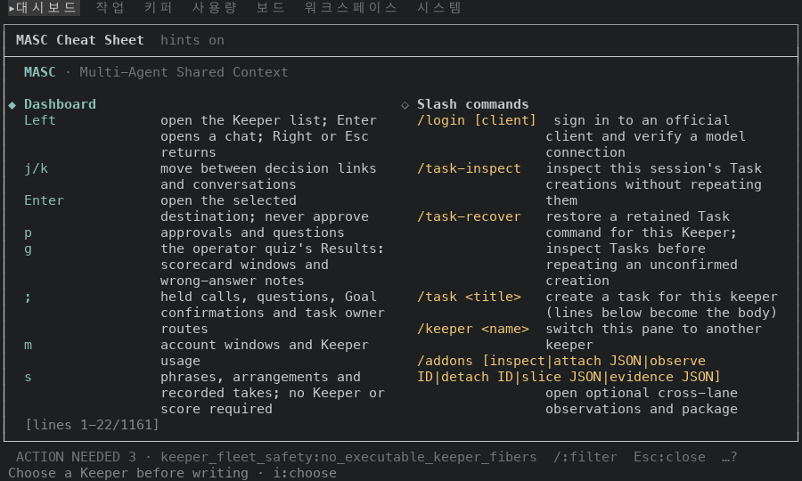
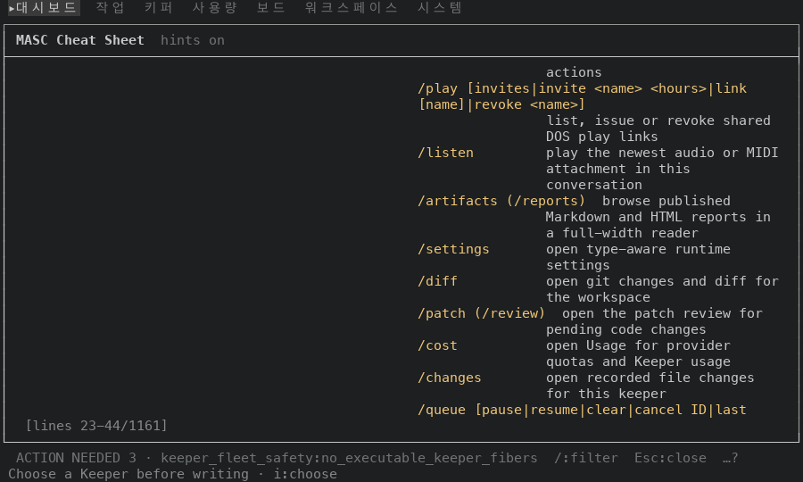
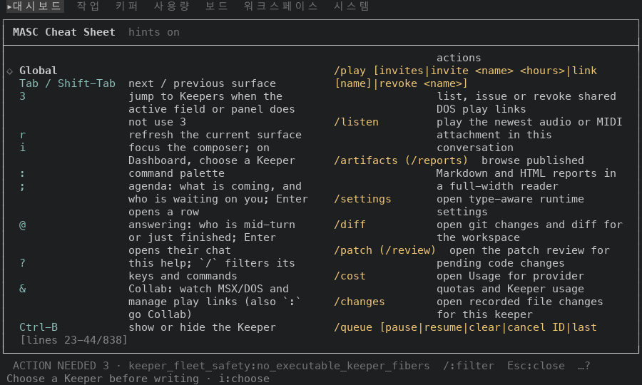
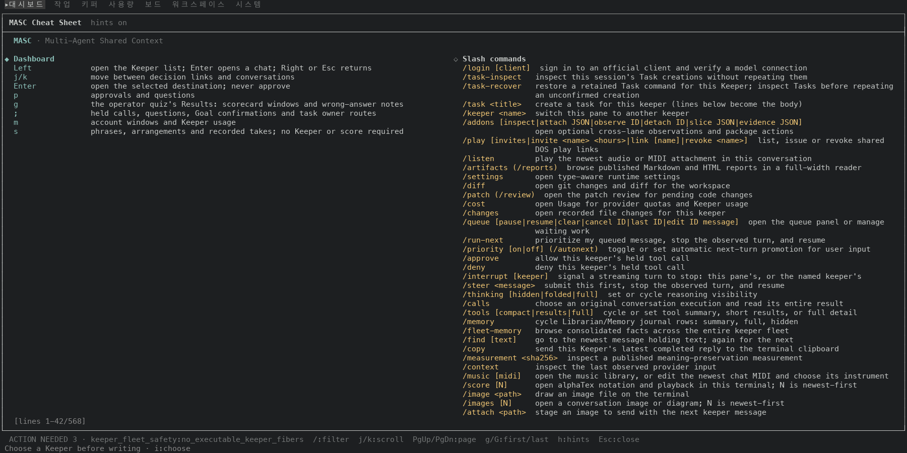
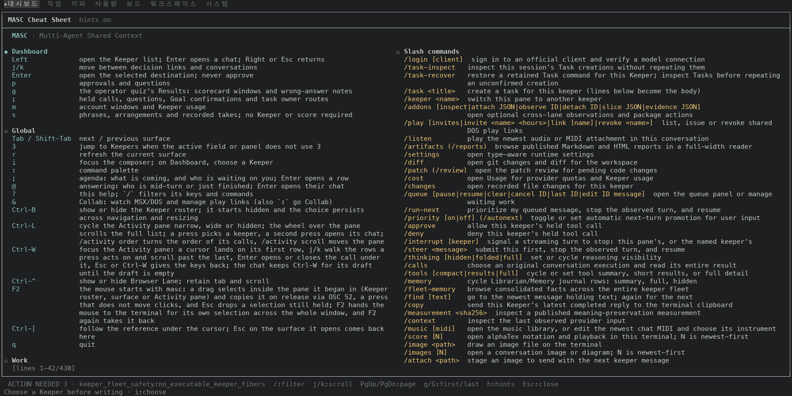

# 도움말 시트 두 단 접기: 고치기 전과 후 화면 (#49690)

#49690 은 도움말 시트(`?`)가 두 단으로 접힐 때, 섹션을 짝지어 놓는 대신 더 짧은 단 밑에 놓아요. 이 폴더는 그 PR 본문의 측정에 쓴 화면 캡처예요.

## 어떻게 찍었나

- 앞: 증명 빌드 run 42355827124. 코드 커밋은 `a0068b1ed8b`(이 PR 의 바탕, 시트 코드 그대로)예요. 산출물 `masc-tui` 의 sha256 은 `3c3ea2b7d1563a4ac41779ee22595d3ada611b9b9b7a8d1d939754fdfbf70894` 이고 `--build-commit` 은 `a0068b1ed8b804607cea8be418368af24ef78b4b` 예요.
- 뒤: 증명 빌드 run 42355733618. 코드 커밋은 `4ca438bf27e`(이 PR 의 코드)예요. 산출물 `masc-tui` 의 sha256 은 `8314a669b52f3d8b9b6650f9e0b7258f7f7d2a193cd6b69d868a1a7fed77a6e4` 이고 `--build-commit` 은 `4ca438bf27e49cb1b4651b6d92b15513cb1780b0` 예요. 이 PR 의 머리는 그 위에 변경 기록과 이 폴더를 더해요.
- 두 빌드 모두 run 이 성공했고 `--build-commit` 이 run 의 커밋과 같아요. 이미지에는 빌드 커밋이 안 찍혀요. 앞과 뒤는 위 산출물로 가려요.
- 일회용 워크스페이스에 작업·글·키퍼를 몇 개 심고 서버를 띄운 뒤, tmux 안에서 TUI 를 열었어요. 팔레트로 Dashboard 에 들어가 `?` 로 시트를 열었어요.
- 줄 수: 창 크기를 바꿔 가며(tmux `resize-window`) 시트가 알려 주는 전체 줄 수(`[lines a-b/N]` 의 N)를 읽었어요. 머리글 두 줄이 들어 있어요.
- 빈칸과 쪽 수: 100x30, 120x40, 200x50 에서 `g` 로 맨 위에 가서 PageDown 으로 끝까지 넘기며 쪽마다 화면을 읽고 줄 번호로 이어 붙였어요(빠진 줄 0). 한 줄의 왼쪽 반과 오른쪽 반을 칸이라 부르고, 글자가 없는 칸을 빈칸으로 셌어요. 섹션 사이 빈 줄도 빈칸이에요. 쪽 수는 맨 위부터 끝까지 읽는 데 든 화면 수예요.
- 이미지 속 글은 시트의 영어 문구와 키 이름뿐이고, 내 장비의 경로나 비밀 값은 없어요.

## 줄 수

시트가 알려 주는 전체 줄 수예요. 96열부터 두 단이에요.

| 창 | 단 | 앞 | 뒤 | 바뀐 줄 수 |
| --- | --- | --- | --- | --- |
| 60x30 | 1 | 1255 | 1255 | 0 |
| 80x30 | 1 | 987 | 987 | 0 |
| 95x30 | 1 | 855 | 855 | 0 |
| 96x30 | 2 | 1234 | 885 | -349 (-28.3%) |
| 100x30 | 2 | 1161 | 838 | -323 (-27.8%) |
| 120x40 | 2 | 900 | 660 | -240 (-26.7%) |
| 140x40 | 2 | 786 | 575 | -211 (-26.8%) |
| 160x45 | 2 | 695 | 516 | -179 (-25.8%) |
| 200x50 | 2 | 568 | 430 | -138 (-24.3%) |

95열에서 96열로 한 칸 넓혔을 때 줄 수가 앞은 855 에서 1234 로(+44.3%), 뒤는 855 에서 885 로(+3.5%) 늘어요.

## 빈칸

앞은 섹션 39개를 두 개씩 짝지어(20쌍) 놓았어요. 짝의 높이가 다르면 짧은 쪽 옆이 빈칸이에요. 첫 두 쌍의 높이(줄)와 빈칸이 두 단 칸에서 차지하는 몫이에요.

| 창 | 첫 쌍 (`Dashboard` · 슬래시 명령) | 둘째 쌍 | 빈칸 앞 → 뒤 | 몫 앞 → 뒤 | 쪽 수 앞 → 뒤 |
| --- | --- | --- | --- | --- | --- |
| 100x30 | 20 · 138 | 63 · 48 | 740 → 94 | 31.9% → 5.6% | 53 → 39 |
| 120x40 | 15 · 103 | 47 · 40 | 565 → 85 | 31.4% → 6.4% | 29 → 21 |
| 200x50 | 9 · 55 | 28 · 27 | 339 → 63 | 29.8% → 7.3% | 14 → 11 |

뒤의 빈칸은 대부분 섹션 사이 빈 줄이고, 나머지는 두 단 가운데 짧은 쪽 맨 아래에 남는 자리예요.

## 화면

100x30 의 첫 화면이에요. 왼쪽 `Dashboard` 20줄과 오른쪽 슬래시 명령이 그대로고, 전체 줄 수만 `1161` 에서 `838` 로 바뀌어요.

| 앞 | 뒤 |
| --- | --- |
|  |  |

100x30 에서 PageDown 한 번 뒤(`[lines 23-44/…]`)예요. 앞은 왼쪽 반이 통째로 비고, 뒤는 그 자리에 `Global` 섹션이 이어져요.

| 앞 | 뒤 |
| --- | --- |
|  |  |

200x50 의 첫 화면이에요. 앞은 `Dashboard` 9줄 밑으로 왼쪽이 비고, 뒤는 `Global` 섹션 전체와 `Work` 제목이 같은 화면에 들어와요.

| 앞 | 뒤 |
| --- | --- |
|  |  |

## 읽은 방법의 한계

- 한 가지 시드(Dashboard 에서 연 시트)에서만 쟀어요. 시트의 앞쪽 섹션은 열린 화면에 따라 달라서 줄 수도 달라져요.
- 사람이 읽기 좋은지는 줄 수로 가려지지 않아요. 96~110열에서는 단 하나의 설명 칸이 26~33칸이라 항목이 3~4줄로 감겨요(위 100x30 이미지).
