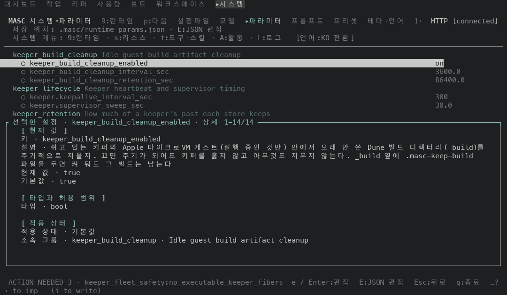
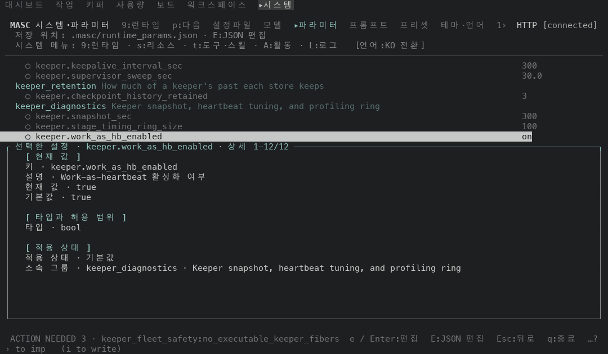
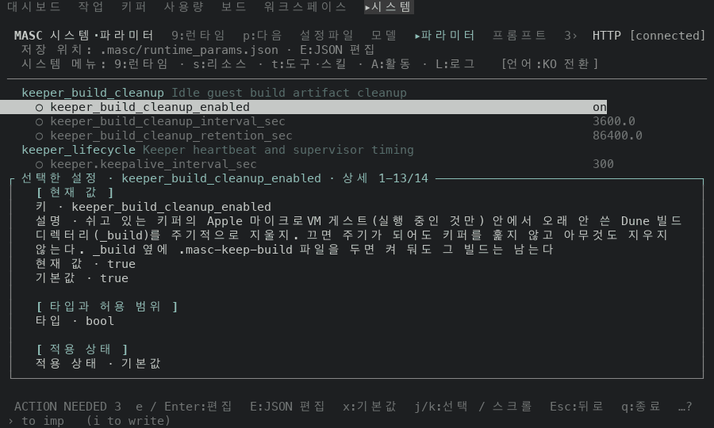
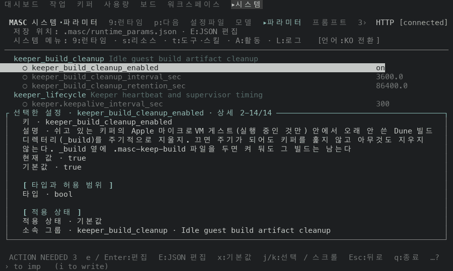
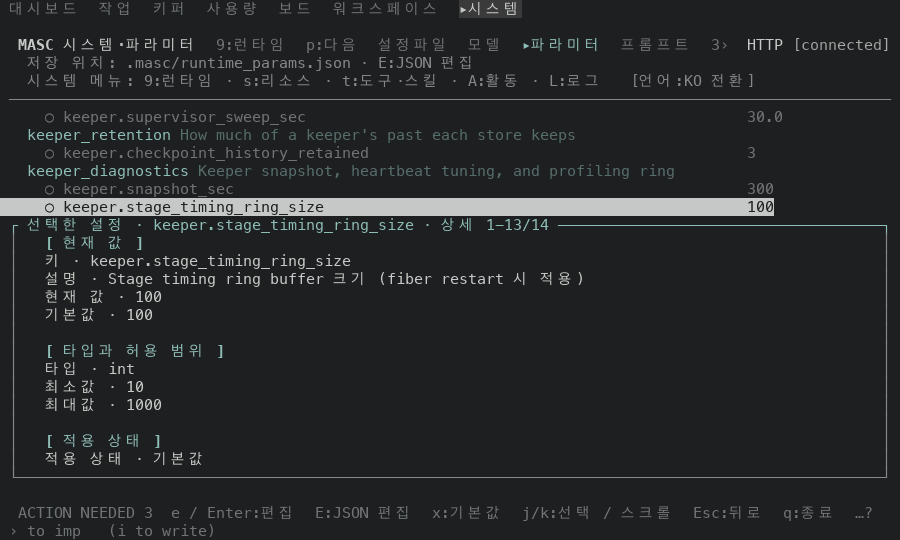

# System / params 휠: 고치기 전과 후 화면 (#49618)

#49618 은 System / params 에서 상세가 그 방향으로 움직일 수 없을 때 휠을 설정 목록으로 보내요. 이 폴더는 그 PR 본문의 측정에 쓴 화면 캡처예요.

## 어떻게 찍었나

- 앞: 증명 빌드 run 42336584982(머리 `31ae9232057`, #49618 앞의 코드).
- 뒤: 증명 빌드 run 42342482841(코드 커밋 `24690b15ce4`, #49618 의 변경). 두 잡 모두 성공했고 산출물의 `--build-commit` 이 커밋과 같아요.
- 일회용 워크스페이스에서 서버를 띄우고 tmux 안에서 TUI 를 열었어요. 팔레트로 System / params 에 들어간 첫 화면을 찍고, 휠 보고(SGR, `ESC[<65;col;rowM`, 창 한가운데 좌표) 8개를 tmux 쓰기 한 번으로 보낸 뒤 다시 찍었어요.
- 화면의 시계 숫자(머리 줄)는 찍은 시각이라 앞뒤가 달라요.

## 화면

120x35 에서는 상세가 한 화면에 다 들어가요(`상세 1-14/14`).

| 시작 | 휠 8개, 앞 | 휠 8개, 뒤 |
| --- | --- | --- |
|  |  |  |
| `keeper_build_cleanup_enabled` · 상세 1-14/14 | 같은 설정, 화면이 그대로예요 | `keeper.work_as_hb_enabled` · 상세 1-12/12 |

100x30 에서는 첫 설정의 상세가 한 줄 넘쳐요(`상세 1-13/14`).

| 시작 | 휠 8개, 앞 | 휠 8개, 뒤 |
| --- | --- | --- |
|  |  |  |
| `keeper_build_cleanup_enabled` · 상세 1-13/14 | 같은 설정, 상세만 한 줄 올라갔어요(2-14/14) | `keeper.stage_timing_ring_size` · 상세 1-13/14 |

100x30 의 뒤 화면은 한 번에 8개를 보낸 결과예요. 한 칸씩 보내면(0.12초 간격) 상세가 넘치는 설정에서 한 칸이 상세에 쓰여서 `keeper.checkpoint_history_retained` · 상세 2-14/16 에서 멈춰요.

## 칸마다 읽은 값

PR 본문의 표와 같은 측정이에요. 휠 보고를 한 번에 한 칸씩 보내고 칸마다 화면을 읽어 선택된 설정과 상세 상자 제목을 적었어요.

### 앞 (run 42336584982)

| 칸 | 100x30 | 120x35 |
| --- | --- | --- |
| 시작 | `keeper_build_cleanup_enabled` · 1-13/14 | `keeper_build_cleanup_enabled` · 1-14/14 |
| 휠↓ 1 | 같은 설정 · 2-14/14 | 아무것도 안 바뀌어요 |
| 휠↓ 2~6 | 아무것도 안 바뀌어요 | 아무것도 안 바뀌어요 |
| 휠↑ 1 | 같은 설정 · 1-13/14 | 아무것도 안 바뀌어요 |
| 휠↑ 2~6 | 아무것도 안 바뀌어요 | 아무것도 안 바뀌어요 |

### 뒤 (run 42342482841), 100x30

| 칸 | 선택된 설정 | 상세 |
| --- | --- | --- |
| 시작 | `keeper_build_cleanup_enabled` | 1-13/14 |
| 휠↓ 1 | `keeper_build_cleanup_enabled` | 2-14/14 |
| 휠↓ 2 | `keeper_build_cleanup_interval_sec` | 1-13/13 |
| 휠↓ 3 | `keeper_build_cleanup_retention_sec` | 1-13/13 |
| 휠↓ 4 | `keeper.keepalive_interval_sec` | 1-13/13 |
| 휠↓ 5 | `keeper.supervisor_sweep_sec` | 1-13/14 |
| 휠↓ 6 | `keeper.supervisor_sweep_sec` | 2-14/14 |
| 휠↑ 1 | `keeper.supervisor_sweep_sec` | 1-13/14 |
| 휠↑ 2 | `keeper.keepalive_interval_sec` | 1-13/13 |
| 휠↑ 3 | `keeper_build_cleanup_retention_sec` | 1-13/13 |
| 휠↑ 4 | `keeper_build_cleanup_interval_sec` | 1-13/13 |
| 휠↑ 5 | `keeper_build_cleanup_enabled` | 1-13/14 |
| 휠↑ 6 | `keeper_build_cleanup_enabled` | 1-13/14 |

### 뒤 (run 42342482841), 120x35

| 칸 | 선택된 설정 |
| --- | --- |
| 시작 | `keeper_build_cleanup_enabled` |
| 휠↓ 1 | `keeper_build_cleanup_interval_sec` |
| 휠↓ 2 | `keeper_build_cleanup_retention_sec` |
| 휠↓ 3 | `keeper.keepalive_interval_sec` |
| 휠↓ 4 | `keeper.supervisor_sweep_sec` |
| 휠↓ 5 | `keeper.checkpoint_history_retained` |
| 휠↓ 6 | `keeper.snapshot_sec` |
| 휠↑ 1~6 | 거꾸로 올라가 `keeper_build_cleanup_enabled` 로 돌아와요 |

## 못 한 것

- 실제 마우스와 트랙패드는 못 썼어요. tmux 로 보낸 SGR 휠 보고만 썼어요.
- Presets 화면은 고정 데이터에 프리셋이 없어서 못 찍었어요.
